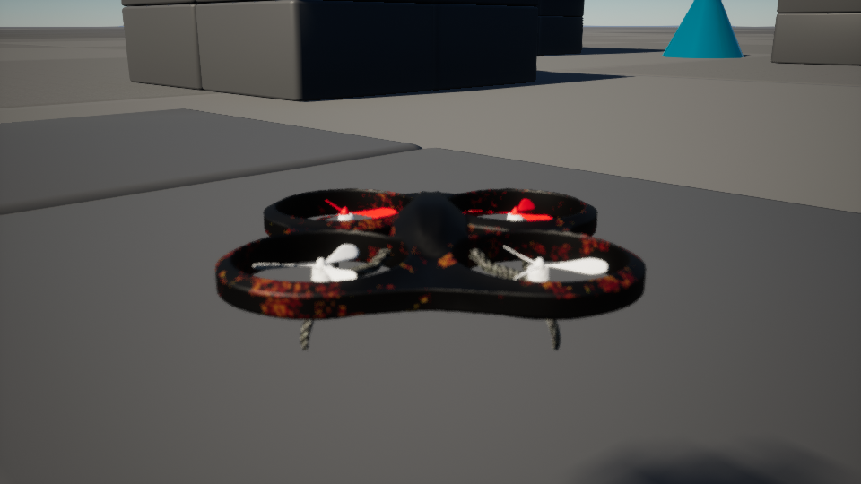
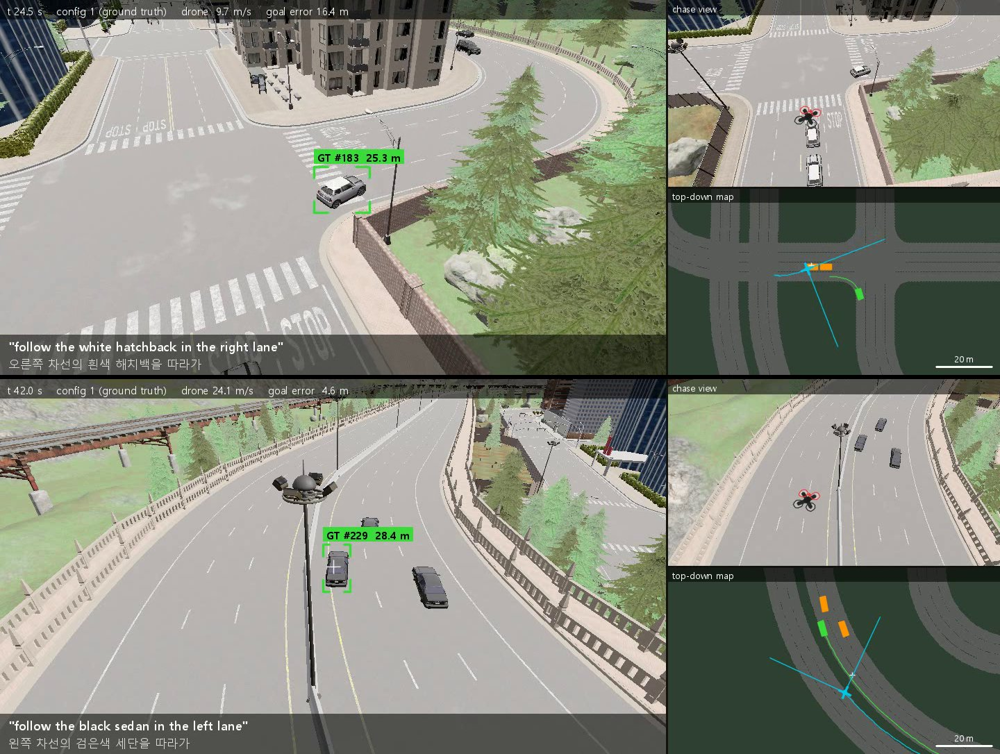

# UAV Vision-Language-Action Project

**문장으로 지시하는 드론을 Vision-Language-Action(VLA) 모델로 만들고, 실제 비행으로 평가하는 개인 프로젝트입니다.** Phase 1에서는 문장으로 지시한 물체를 찾아 착륙·접근하는 VLA를 학습하고 평가했고(종료), Phase 2에서는 자연어로 지정한 차량을 찾아 락온하고 일정 거리를 유지하며 따라가되, 닮은 차로 갈아타거나 놓치는 실패를 스스로 알아차리는 드론을 만듭니다(진행 중). 두 Phase는 저장소 안에서 서로 다른 폴더(`landing_vla/`, `car_follow/`)에 있습니다.



## 1. 프로젝트 개요

| Phase | 기간 | 주제 | 폴더 | 상태 |
|---|---|---|---|---|
| 1 | 2026-10-04 – 10-27 | 문장으로 지시한 물체를 찾아 착륙·접근하는 드론 VLA (Project AirSim) | [`landing_vla/`](landing_vla/) | 종료. [Phase 1 보고서](landing_vla/docs/phase1_vla_report.md) |
| 2 | 2026-11 – | 실패를 스스로 알아차리는 자연어 지시 드론 추적: 문장으로 지정한 차를 따라가는 드론 (CARLA) | [`car_follow/`](car_follow/) | 진행 중. [3절](#3-phase-2-진행) |

## 2. Phase 1 요약

Phase 1은 VLA를 직접 통합하고, 다시 학습하고, 엄격하게 평가해 본 시간이었습니다. 무엇을 했고 어떤 개념을 어떤 작업으로 배웠는지는 [Phase 1 보고서](landing_vla/docs/phase1_vla_report.md)에 논문 형식으로 정리되어 있습니다. 데모, 측정 결과, 시스템, 문서 목록, 한계는 [landing_vla/README.md](landing_vla/README.md)에 있습니다.

### 2.1 한 일과 결과

| 번호 | 작업 | 핵심 결과 | 보고서 |
|---|---|---|---|
| 1 | 공개 UAV VLA(AeroVLA)를 시뮬레이터 closed loop에 통합하고 진단 | 좌표에서 계산한 방향 문장에 의존. 빼면 13/13 첫 판단에서 착륙, 문장만으로는 0/6 | 4.1 |
| 2 | OpenVLA-OFT 방식(병렬 디코딩, 행동 chunk, L1 회귀)으로 다시 학습 (AeroVLA-OFT) | 12GB에서 학습(최대 9.8GiB), 판단 주기 6.3초 → 0.52초, 자기 구역 23/24 | 4.2 |
| 3 | data 범위를 넓혀 일반화 확인 (Gen-v1, Gen-v2) | 처음 보는 시작 4/32 → 27/32 → 32/32, 학습하지 않은 장면 18/20 | 4.3 |
| 4 | 비슷한 물체 사이에서 지시한 물체를 골라 착륙 (Gen-v3, Gen-v3c, FiLM) | 봉인 test 48개에서 47/48, `grounding_film`으로 동결. FiLM의 기여는 미입증 | 4.4 |
| 5 | Gaussian Blur 견고성 특성화 | 46 → 40 → 24 → 8 (48개 중). 실패는 공중 정지로 수렴 | 4.5 |
| 6 | 임의 시작 자세와 일반 착륙면(cube, cylinder, 판) 지원 | 판정기 scripted 검증 15/15. 정책은 새 착륙면에서 공중 정지 | 4.6 |
| 7 | cube·cylinder 착륙 학습 (Generic Landing 1–1d) | 네 단계 모두 기준 미달. teacher label 경계에서 정지로 평균화 | 4.7 |
| 8 | 사람 조종과 개입(takeover) 모드 | 사람이 고친 착륙 0.29–1.62m 대 모델 혼자 1.77–3.46m(가운데에서). 학습은 하지 않음 | 4.8 |

### 2.2 배운 개념

| 개념 | 배운 작업 |
|---|---|
| VLA 구조(시각 encoder, projector, 언어 모델, 행동 출력), 행동 토큰화와 디코딩 | 1 |
| 지름길 학습: 언어 대신 다른 단서를 따르는 모델 | 1 |
| 병렬 디코딩, 행동 chunk, 연속값 L1 회귀, receding horizon 실행 | 2 |
| 4비트 양자화(NF4), LoRA, adapter 적층으로 12GB에서 7B 모델 학습 | 2 |
| 특권 teacher 모방 학습, data 범위와 held-out 수준, 실패 분류가 이끄는 data 보강 | 2, 3 |
| 다중 모드 label의 평균화(회귀 정책이 "정지"로 무너지는 이유) | 3, 7 |
| 언어-시각 grounding, hard negative, FiLM, 대조 실험과 원인 귀속 | 4 |
| 정책·실행기·판정기의 책임 분리, 평가 설계(gate, 봉인 test, 동결 지문, 반복 변동) | 4, 6, 7 |
| 입력 손상과 견고성 측정 | 5 |
| 정지 대역과 label 여유, 교란 data와 회복 행동 | 7 |
| 공변량 이동, DAgger, 사람 개입(HG-DAgger), 연속 조작의 label화 | 8 |

수식과 참고문헌(OpenVLA, OpenVLA-OFT, AeroVLA, LoRA, QLoRA, FiLM, DAgger 등 24편)은 [보고서 2절과 참고문헌](landing_vla/docs/phase1_vla_report.md#2-배경-개념)에 있습니다.

## 3. Phase 2 진행

**주제.** 자연어로 지정한 차량("오른쪽 차선의 흰색 SUV를 따라가")을 찾아 락온하고, 차 뒤 20m·위 15m를 유지하며 따라가는 드론.

**핵심 질문.** 비슷한 차가 많고 가려짐이 있어도, 지정한 그 차를 끝까지 놓치지 않을 수 있는가.

**연구 주제.** 실패를 스스로 알아차리는 자연어 지시 드론 추적(Failure-Aware Language-Guided Aerial Target Following). 따라가던 드론이 닮은 차로 갈아타거나, 목표를 놓치거나, 명령이 모호할 때 이를 일찍 알아차리고 실패 종류에 맞게 대응합니다. 가설과 방법은 모듈형 시스템에서 입증하고, end-to-end VLA에서도 같은 실패 패턴이 나타나는지는 확장 실험으로 봅니다([연구 계획](car_follow/docs/research_plan.md)).

**구성.**

| 단계 | 하는 일 |
|---|---|
| 대상 지정 | 문장으로 화면 속 차량을 찾음 (VLM, open-vocabulary 탐지) |
| 추적 | 찾은 차량을 프레임마다 유지하고, 가려졌다 다시 나와도 같은 차로 이어 붙임 |
| 추종 | 자체 동역학 드론이 차 뒤 20m·위 15m를 지키고 카메라를 차에 맞춤 (구현 완료. end-to-end VLA 정책은 확장 실험) |
| 감시와 대응 | 닮은 차로 갈아탐, 소실, 명령 모호, 인지 저하를 알아차리고 종류별로 대응 (연구 주제, 첫 데모 뒤) |
| 화면 | 1인칭(락온 표시) + 3인칭(드론을 그려 넣은 시점) + 위에서 본 지도 (구현 완료) |

**시뮬레이터.** CARLA 0.9.16. 차량이 도로를 따라 스스로 달리고, 모든 차량의 정확한 위치를 알려 주므로 정답 data와 채점을 자동으로 만들 수 있습니다. 드론은 자체 동역학 모델(속도 명령을 0.5초 지연으로 따르는 점질량, 25m/s·6m/s²·60°/s 제한)로 동기 모드 tick마다 움직이고, 띄운 센서까지 같은 구성이면 같은 시험이 bit 단위로 재현됩니다. 비행 모델이 있는 CARLA-Air는 드론 물리가 tick을 따르지 않아 쓰지 않습니다.



*Phase 2 첫 데모 화면(정답 위치로 따라가는 구성 1). 왼쪽은 드론 카메라와 락온 상자, 오른쪽 위는 드론을 그려 넣은 3인칭, 오른쪽 아래는 위에서 본 지도(초록 목표, 주황 같은 차종·색의 차)입니다.*

**진행 순서.**

1. Phase 1 정리와 README 개편 (완료)
2. CARLA 설치 점검 (완료, [setup](car_follow/docs/setup.md)): uv Python 환경, CARLA 0.9.16. 차량 40대와 카메라 2–3대로 52–74 FPS. simulator는 Town03/05에서 약 2.6GB를 쓰고, Town10HD에서는 모델이 6GB를 잡아도 함께 돌아 인식 모델 예산은 약 6GB
3. 첫 데모 계획 (완료, [demo1_plan](car_follow/docs/demo1_plan.md)): Town05에서 문장으로 지정한 차를 따라가되, 같은 차종·색의 차 2–3대 사이에서 다른 차로 바뀌지 않는지 봅니다. 차량 탐지와 추적은 매 프레임, VLM은 처음 지정할 때만 씁니다. 땅 투영과 Kalman filter로 차 뒤 20m, 위 15m를 유지합니다. 합격선은 본평가 30회에서 처음 지정 90%, 바뀜 없는 시험 90%, 목표 유지 95%, 거리 오차 3m
4. 첫 데모 구현 1단계 장면과 시험 목록 (완료, [demo1](car_follow/docs/demo1.md) 1절). Town05에 시험 63개(dev 20, pilot 3, smoke 10, 봉인한 본평가 30)를 만들었고, 각 시험은 simulator에서 시작 화면을 확인한 뒤 남겼습니다. 2단계와 3단계는 7, 8번
5. 연구 계획 (완료, [research_plan](car_follow/docs/research_plan.md)): 주제, 가설 세 개, 방해 차 세 단계(다른 차, 닮은 차, 쌍둥이), 층으로 나눈 감시기, 실패 종류별 대응, 지표, 진행 순서
6. CARLA-Air 확인 (완료, [carla_air_check](car_follow/docs/carla_air_check.md)): CARLA 0.9.16에 AirSim 쿼드로터 비행 모델을 더한 simulator입니다. 드론 비행 물리가 동기 모드 tick을 따르지 않고 실제 시간으로 돌아, 시험을 재현할 수 없으므로 쓰지 않습니다. 지금의 CARLA 0.9.16을 유지하고 드론은 자체 동역학 모델로 움직입니다.
7. 첫 데모 구현 2단계 드론 이동과 추종 제어 (완료, [demo1](car_follow/docs/demo1.md) 2절): 속도 명령을 1차 지연으로 따르는 점질량 드론과, 차 뒤 20m·위 15m를 지키는 추종 제어기입니다. dev 시험 20개의 교통을 기록해 보니 같은 구성이면 bit 단위로 재현됐습니다. 차가 고가도로에서 최고 24.5m/s로 달려 계획 초기값(20m/s, 4m/s²)으로는 5개 시험이 거리 오차 3m를 넘고, 25m/s, 6m/s²로 올리면 모두 3m 이하(평균 1.22m)라 이 값(속도 지연 0.5초, 방향 거르기 1초)으로 정했습니다
8. 첫 데모 구현 3단계 화면 (완료, [demo1](car_follow/docs/demo1.md) 3절): 1인칭 락온 화면(상자, 트랙 번호와 거리, 영어·한국어 문장), 드론을 투영해 그린 3인칭 화면, OpenDRIVE 도로 위에 모든 차를 그린 지도를 한 화면에 합쳐 영상으로 남깁니다. 다음은 4단계 채점기

## 4. 저장소 구조

2026-11-13에 Phase별 폴더로 나눴습니다. 각 폴더는 그 안에서 실행하며, 폴더 안의 경로와 명령은 모두 그 폴더 기준입니다.

```text
README.md        이 문서 (전체 개요)
landing_vla/     Phase 1: 문장으로 지시한 물체에 착륙·접근하는 VLA (Project AirSim, 종료)
                 configs/ docs/ scripts/ src/ tests/ outputs/   안내: landing_vla/README.md
car_follow/      Phase 2: 실패를 알아차리는 자연어 지시 차량 추종 (CARLA, 진행 중)
                 pyproject.toml uv.lock configs/ docs/ scripts/ src/ tests/ outputs/   안내: car_follow/README.md
```

모델 weight, checkpoint, dataset, simulator, 실행 원자료는 Git에 넣지 않고 각 폴더의 `assets/`, `datasets/`, `outputs/` 아래 로컬에만 둡니다.
