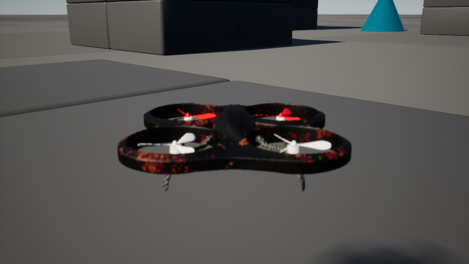
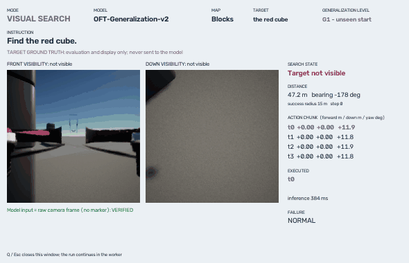
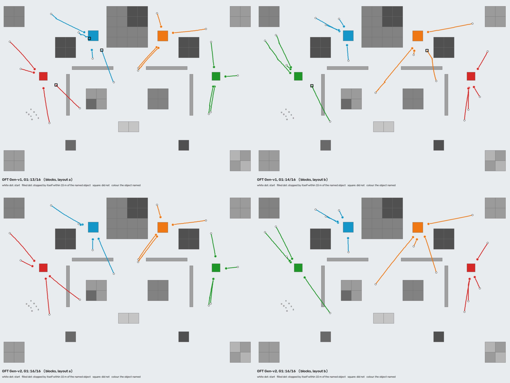
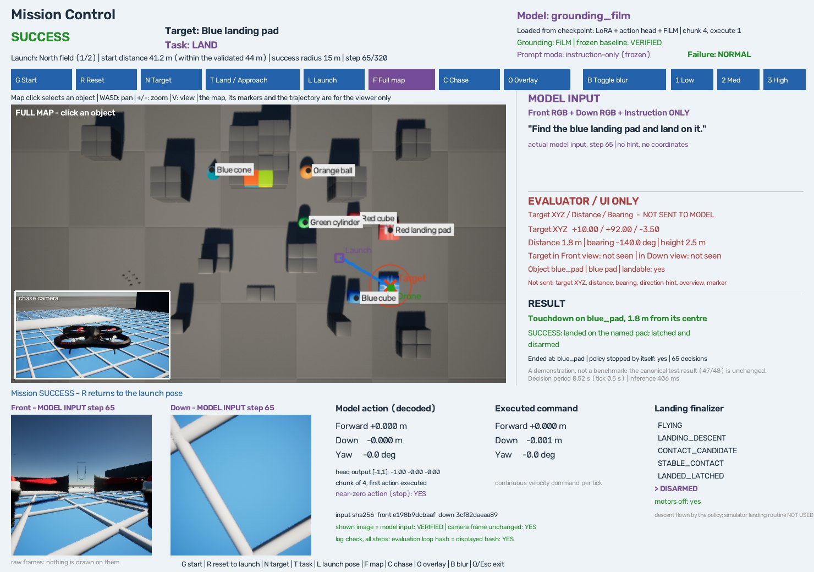
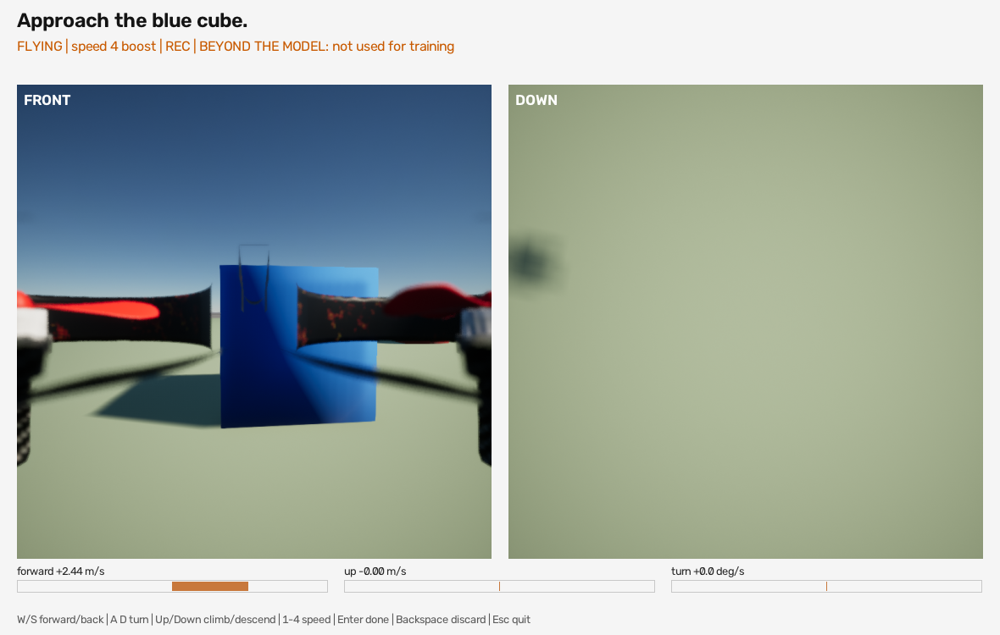
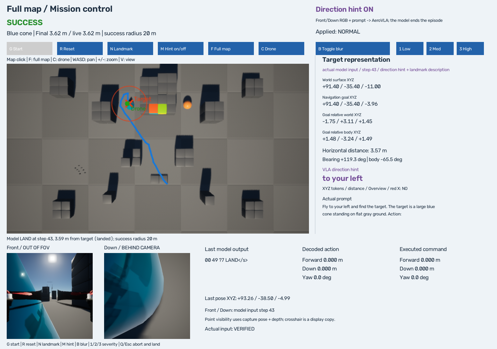
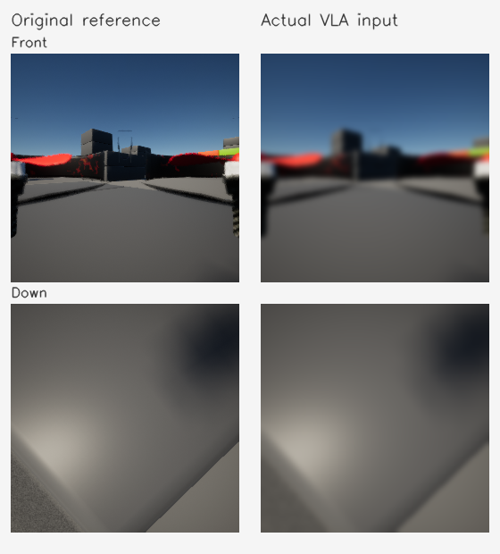
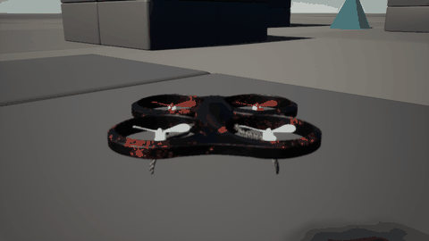
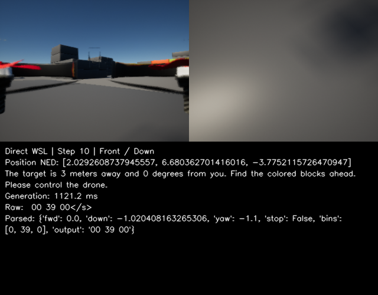
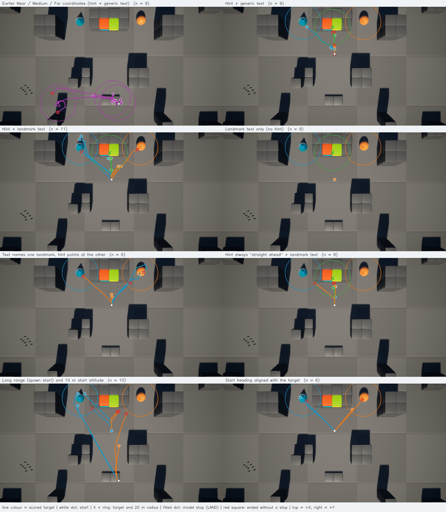

# UAV Vision-Language-Action Project

**문장으로 지시하는 드론을 Vision-Language-Action(VLA) 모델로 만들고, 실제 비행으로 평가하는 개인 프로젝트입니다.** Phase 1에서는 문장으로 지시한 물체를 찾아 착륙·접근하는 VLA를 학습하고 평가했고(종료), Phase 2에서는 자연어로 지정한 차량을 찾아 락온하고 일정 거리를 유지하며 따라가는 드론을 만듭니다(시작 전).



## 1. 프로젝트 개요

| Phase | 기간 | 주제 | 상태 |
|---|---|---|---|
| 1 | 2026-10-04 – 10-27 | 문장으로 지시한 물체를 찾아 착륙·접근하는 드론 VLA (Project AirSim) | 종료. [Phase 1 보고서](docs/phase1_vla_report.md) |
| 2 | 2026-11 – | 자연어로 지정한 차량을 찾아 락온하고 일정 거리를 유지하며 따라가는 드론 (CARLA) | 준비 중. [3절](#3-phase-2-계획) |

## 2. Phase 1 요약

Phase 1은 VLA를 직접 통합하고, 다시 학습하고, 엄격하게 평가해 본 시간이었습니다. 무엇을 했고 어떤 개념을 어떤 작업으로 배웠는지는 [Phase 1 보고서](docs/phase1_vla_report.md)에 논문 형식으로 정리되어 있습니다.

### 2.1 한 일과 결과

| 번호 | 작업 | 핵심 결과 | 보고서 |
|---|---|---|---|
| 1 | 공개 UAV VLA(AeroVLA)를 시뮬레이터 closed loop에 통합하고 진단 | 좌표에서 계산한 방향 문장에 의존. 빼면 13/13 첫 판단에서 착륙, 문장만으로는 0/6 | 4.1 |
| 2 | OpenVLA-OFT 방식(병렬 디코딩, 행동 chunk, L1 회귀)으로 다시 학습 (AeroVLA-OFT) | 12GB에서 학습(최대 9.8GiB), 판단 주기 6.3초 → 0.52초, 자기 구역 23/24 | 4.2 |
| 3 | data 범위를 넓혀 일반화 확인 (Gen-v1, Gen-v2) | 처음 보는 시작 4/32 → 27/32 → 32/32, 학습하지 않은 장면 18/20 | 4.3 |
| 4 | 비슷한 물체 사이에서 지시한 물체를 골라 착륙 (Gen-v3, Gen-v3c, FiLM) | 봉인 test 48개에서 47/48, `grounding_film`으로 동결. FiLM의 기여는 미입증 | 4.4 |
| 5 | Gaussian Blur 견고성 특성화 | 46 → 40 → 24 → 8 (48개 중). 실패는 공중 정지로 수렴 | 4.5 |
| 6 | 임의 시작 자세와 일반 착륙면(cube, cylinder, 판) 지원 | 판정기 scripted 검증 15/15. 정책은 새 착륙면에서 공중 정지 | 4.6 |
| 7 | cube·cylinder 착륙 학습 (Generic Landing 1–1d) | 네 단계 모두 기준 미달. teacher label 경계에서 정지로 평균화 | 4.7 |
| 8 | 사람 조종과 개입(takeover) 모드 | 사람이 고친 착륙 0.29–1.62m 대 모델 혼자 1.77–3.46m(가운데에서). 학습은 하지 않음 | 4.8 |

### 2.2 배운 개념

| 개념 | 배운 작업 |
|---|---|
| VLA 구조(시각 encoder, projector, 언어 모델, 행동 출력), 행동 토큰화와 디코딩 | 1 |
| 지름길 학습: 언어 대신 다른 단서를 따르는 모델 | 1 |
| 병렬 디코딩, 행동 chunk, 연속값 L1 회귀, receding horizon 실행 | 2 |
| 4비트 양자화(NF4), LoRA, adapter 적층으로 12GB에서 7B 모델 학습 | 2 |
| 특권 teacher 모방 학습, data 범위와 held-out 수준, 실패 분류가 이끄는 data 보강 | 2, 3 |
| 다중 모드 label의 평균화(회귀 정책이 "정지"로 무너지는 이유) | 3, 7 |
| 언어-시각 grounding, hard negative, FiLM, 대조 실험과 원인 귀속 | 4 |
| 정책·실행기·판정기의 책임 분리, 평가 설계(gate, 봉인 test, 동결 지문, 반복 변동) | 4, 6, 7 |
| 입력 손상과 견고성 측정 | 5 |
| 정지 대역과 label 여유, 교란 data와 회복 행동 | 7 |
| 공변량 이동, DAgger, 사람 개입(HG-DAgger), 연속 조작의 label화 | 8 |

수식과 참고문헌(OpenVLA, OpenVLA-OFT, AeroVLA, LoRA, QLoRA, FiLM, DAgger 등 24편)은 [보고서 2절과 참고문헌](docs/phase1_vla_report.md#2-배경-개념)에 있습니다.

## 3. Phase 2 계획

**주제.** 자연어로 지정한 차량("흰색 SUV 따라가", "빨간 트럭을 30m 뒤에서 따라가")을 찾아 락온하고, 일정 거리와 고도를 유지하며 따라가는 드론.

**핵심 질문.** 비슷한 차가 많고 가려짐이 있어도, 지정한 그 차를 끝까지 놓치지 않을 수 있는가.

**구성.**

| 단계 | 하는 일 |
|---|---|
| 대상 지정 | 문장으로 화면 속 차량을 찾음 (VLM, open-vocabulary 탐지) |
| 추적 | 찾은 차량을 프레임마다 유지하고, 가려졌다 다시 나와도 같은 차로 이어 붙임 |
| 추종 | 차량을 화면 가운데에, 일정 거리와 고도로 유지 (먼저 단순 제어, VLA 정책은 비교 후 결정) |
| 화면 | 1인칭(락온 표시) + 3인칭(드론과 차량이 함께 보이는 시점) |

**시뮬레이터.** CARLA. 차량이 도로를 따라 스스로 달리고, 모든 차량의 정확한 위치를 알려 주므로 정답 data와 채점을 자동으로 만들 수 있습니다. 드론은 비행 물리 대신 공중 카메라를 움직이는 방식입니다.

**진행 순서.**

1. Phase 1 정리와 README 개편 (완료)
2. CARLA 설치 점검 (완료, [phase2_setup](docs/phase2_setup.md)): uv Python 환경, CARLA 0.9.16. 차량 40대와 카메라 2–3대로 52–74 FPS. simulator는 Town03/05에서 약 2.6GB를 쓰고, Town10HD에서는 모델이 6GB를 잡아도 함께 돌아 인식 모델 예산은 약 6GB
3. 첫 데모 계획 (완료, [phase2_demo1_plan](docs/phase2_demo1_plan.md)): Town05에서 문장으로 지정한 차를 따라가되, 같은 차종·색의 차 2–3대 사이에서 다른 차로 바뀌지 않는지 봅니다. 차량 탐지와 추적은 매 프레임, VLM은 처음 지정할 때만 씁니다. 땅 투영과 Kalman filter로 차 뒤 20m, 위 15m를 유지합니다. 합격선은 본평가 30회에서 처음 지정 90%, 바뀜 없는 시험 90%, 목표 유지 95%, 거리 오차 3m
4. 첫 데모 구현 (다음 차례, 계획의 4절 순서대로)

## 4. Phase 1 데모

Phase 1의 모델과 도구는 그대로 실행할 수 있습니다. 모델과 simulator는 저장소에 없습니다. 준비 방법은 [setup](docs/setup.md)에 있습니다.

| 기능 | 상태 | 실행 |
|---|---|---|
| Front/Down 영상 → AeroVLA → 드론 이동 (closed loop) | 동작 | `.\scripts\run_blur_demo.ps1` |
| Gaussian Blur를 실제 모델 입력에 주입 | 동작 | 같은 창에서 B, 1/2/3 |
| 맵에서 목표를 골라 보내기 (방향 힌트 사용) | 동작. 20m 안 정지는 조건에 따라 0–60% | `.\scripts\run_mission_demo.ps1` |
| 문장만 주고 찾아가기 (방향 힌트 없음) | AeroVLA-OFT로 동작. 처음 보는 시작 32/32, 학습하지 않은 장면 18/20 | `.\scripts\run_visual_search_demo.ps1` |
| 맵에서 물체를 골라 문장으로 보내기 (착륙 또는 접근) | 동작. 동결한 baseline을 직접 조작해 보는 시연 | `.\scripts\run_grounding_film_mission_demo.ps1` |
| 사람이 카메라를 보고 조종하고 기록하기, 모델이 날다 막히면 넘겨받기 | 동작. 이 data로 학습하지는 않음 | `.\scripts\run_human_pilot.ps1` |

### 4.1 문장만 주고 찾아가기 — Visual Search



`Find the red cube.` 한 문장과 Front/Down 영상만 받은 **AeroVLA-OFT**의 실제 비행입니다. 목표는 벽 뒤에 있어 처음에는 보이지 않습니다. 앞이 막혀 있으면 올라가고, 오른쪽으로 돌며 찾고, 보이면 그쪽으로 접근해 10.5m 앞에서 스스로 멈춥니다. 목표 좌표와 방향 힌트는 모델에 들어가지 않습니다. 십자 표시는 화면용 복사본에만 있고, 모델 입력이 카메라 원본과 같은지 hash로 확인해 표시합니다. 이 시작 위치는 학습에 쓰지 않은 것입니다.

```powershell
.\scripts\run_visual_search_demo.ps1 -Model oft -Checkpoint outputs/aerovla_oft/checkpoints/generalization_v2 -Level G1 -Target red_cube
.\scripts\run_visual_search_demo.ps1 -Model oft -Checkpoint outputs/aerovla_oft/checkpoints/generalization_v2 -Level G3 -Target orange_ball   # 학습하지 않은 장면
.\scripts\run_visual_search_demo.ps1 -Model baseline   # 기존 AeroVLA
```

**AeroVLA-OFT**는 AeroVLA adapter를 고정한 채 OpenVLA-OFT 방식의 head를 얹은 것입니다. 한 번의 forward로 연속값 행동 4개를 내고 그중 1개를 실행합니다(판단 주기 0.5초, 기존 AeroVLA는 6.4초). teacher가 비행한 episode로 RTX 5070 12GB에서 LoRA만 학습했습니다. 세 번 학습했고, 매번 학습에 쓰지 않은 고정된 시작 상태에서 평가했습니다.

| 평가 (학습에 쓰지 않은 시작 상태) | 기존 AeroVLA | Pilot (72 episode) | Gen-v1 (292) | Gen-v2 (445) |
|---|---:|---:|---:|---:|
| G1. 본 맵·본 물체, 처음 보는 시작 | 1/16 | 4/32 | 27/32 | **32/32** |
| G3. 학습하지 않은 장면(Yard), 본 물체 | - | 6/10 | 19/20 | 18/20 |
| G2. 처음 보는 물체 (yellow pyramid) | - | 0/6 | 9/12 | 11/12 |
| G4. Yard + 처음 보는 물체 | - | - | 2/6 | 4/6 |
| 학습에 없던 문장 (`Locate`, `Search for`, …) | - | - | 21/24 | 24/24 |
| 충돌 | 1/16 | 3/32 | 0/130 | 0/130 |



G1의 실제 궤적입니다. 위는 Gen-v1, 아래는 Gen-v2이고, 채운 점은 15m 안에서 스스로 멈춘 곳, 네모는 실패입니다.

- **Pilot은 자기 구역 밖에서는 못 했습니다.** 자기 장면과 문장으로도 처음 보는 시작에서는 5/16입니다. 시작 위치·방향·거리·고도와 물체를 넓힌 데이터(Gen-v1)로 27/32가 됐습니다.
- **Gen-v1의 실패는 목표를 못 찾아서가 아니었습니다.** 처음에 안 보이던 목표 73개를 모두 찾았고, 실패는 높은 곳에서 일찍 멈추거나 목표 앞에서 계속 올라가서 생겼습니다. 그 부분의 데이터만 더한 Gen-v2에서 이 실패가 8회에서 0회가 됐습니다.
- **문장을 따릅니다.** 같은 자리에서 다른 물체를 지시하면 가까이 보이는 물체로 가지 않습니다(20회 중 2회만 그 물체에 멈춤).
- **읽을 때 주의할 점.** Yard는 같은 simulator 안에 만든 다른 장면이지 다른 환경이 아닙니다. Gen-v2는 같은 평가 set의 실패를 보고 고친 것이라 새 추정치가 아닙니다.
- **새 장거리 평가(40–90m, 새 seed 36회)에서 Gen-v2는 27/36입니다.** 학습한 장면에서는 70–90m도 6/6이지만 Yard의 56m 이상은 4/12입니다.

**문장에 따른 목표 선택과 착륙(Gen-v3 → canonical clean baseline).** 목표는 "Find the blue landing pad and land on it."처럼 색이나 형태가 같은 다른 물체가 있는 장면에서 지시한 물체를 고르고, 찾아가서, 위에서 맞추고, 내려앉는 것이었습니다. 범위는 44m 이하로 정하고, 착륙의 끝(안정 접촉 확인, latch, disarm)은 저수준 Landing Finalizer로 옮겼습니다.

| 단계 | 결과 | 판정 |
|---|---|---|
| Gen-v3 | 검증 시작 18회 중 지시한 pad에 touchdown 16회. approach를 시키면 내려앉지 않음(0/18) | held-out 미측정 |
| Canonical 첫 시도 | 검증 30/36, 다른 물체에서 끝난 비행 3회(기준 2회 이하) | 미통과 |
| Gen-v3c (hard negative 96 episode, evaluator v2) | pilot 11/12, 새 검증 33/36, 다른 물체 3회 | 미통과 |
| FiLM (`grounding_film`) | pilot 32/32, 검증 34/36, 봉인 test 48개에서 **47/48**(착륙 36/36, 다른 물체 1, 충돌 0) | 통과, 동결 |

- FiLM 없이 같은 일정을 돌린 대조 실험도 pilot 기준을 지켜(30/32), 이 개선이 FiLM 덕이라는 근거는 없습니다. 같은 data로 더 오래 학습한 것이 pilot의 실패를 고쳤습니다.
- Canonical test에서 색이나 형태가 같은 물체가 먼저 보이는 시작은 16/17이었습니다. 이것이 가장 약한 곳이라는 점은 그대로입니다.
- 44m를 넘는 시작에서 같은 색 물체 사이의 선택은 열린 한계로 남았습니다([문서](docs/long_range_same_color_grounding.md)).

같은 자세에서 문장만 바꾸면 끝이 달라집니다: [착륙](outputs/examples/gen_v3/land.gif) · [접근 후 공중 정지](outputs/examples/gen_v3/approach.gif) · [60m 밖에서 찾아 착륙](outputs/examples/gen_v3/mission_land.gif) · [실패: 먼 파란 목표 앞에서 망설임](outputs/examples/gen_v3/failure_far_blue.gif)

GIF: [탐색](outputs/examples/generalization/search_g1.gif) · [놓친 뒤 다시 찾기](outputs/examples/generalization/reacquire_g1.gif) · [Yard](outputs/examples/generalization/yard_g3.gif) · [Gen-v1의 실패](outputs/examples/generalization/failure_g1_v1.gif)와 [같은 시작에서의 Gen-v2](outputs/examples/generalization/fixed_g1_v2.gif) · [pilot 단계의 비행](outputs/examples/visual_search_oft.gif)

문서: [pilot — 구조와 학습 가능성](docs/aerovla_oft.md) · [Gen-v1 — 시작 위치·물체·장면 일반화](docs/aerovla_oft_generalization.md) · [Gen-v2 — 실패 분류와 전환 데이터 보강](docs/aerovla_oft_gen_v2.md) · [장거리 held-out 평가](docs/aerovla_oft_long_range.md) · [Gen-v3 — grounding과 착륙](docs/aerovla_oft_gen_v3.md) · [Canonical clean baseline — 44m 이하와 Landing Finalizer](docs/canonical_clean_baseline.md) · [Gen-v3c — hard-negative 보정과 evaluator v2](docs/gen_v3c_hard_negative_grounding.md) · [구조 실험과 canonical baseline 통과 — FiLM, 대조 실험, test 48](docs/language_vision_grounding_architecture.md)

### 4.2 맵에서 물체를 골라 문장으로 보내기 — Interactive grounding_film Mission Control



```powershell
.\scripts\run_grounding_film_mission_demo.ps1
```

기존 Mission Control 화면에서 동결한 baseline(`grounding_film`)에 미션을 줍니다. 물체를 고르고(지도 클릭 또는 **N**), **T**로 LAND / APPROACH를 정하고, **G**로 시작합니다.

- **지도와 목표의 실제 위치는 사람에게만 보이고 정책에는 전달되지 않습니다.** 모델은 Front RGB, Down RGB, 문장 하나만 받습니다.
- 비행은 canonical 평가의 loop 그대로입니다. 하강은 모델이 하고, 끝은 Landing Finalizer가 맡습니다.
- 같은 pad, 같은 자세에서 문장만 바꿔 볼 수 있습니다: G(착륙) → **R** → **T** → G([공중 정지](outputs/examples/grounding_film_mission/approach.jpg)).
- **시연이지 평가가 아닙니다.** 수동 확인 13회 중 10회 성공, 2회 실패, 1회는 중단입니다.
- **시작 자세와 착륙면:** **S**로 지도에서 시작 자세를 정할 수 있고, LAND는 pad뿐 아니라 cube와 cylinder 윗면에도 줄 수 있습니다. 이것은 simulator, 화면, 판정기의 기능입니다. 동결 baseline은 cube나 cylinder에 내리는 것을 배운 적이 없어 공중에서 멈춥니다.

[구조, 조작, 수동 확인 기록](docs/grounding_film_interactive_demo.md) · [시작 규칙, 착륙면, 판정, 확인 기록](docs/arbitrary_start_generalized_landing.md)

**Cube·cylinder 착륙 학습 (Generic Landing, 네 단계 모두 미통과).** 상세는 [보고서 4.7절](docs/phase1_vla_report.md#47-pad-외-표면-착륙-학습-generic-landing-11d-2026-10-11--10-13)과 각 단계 문서에 있습니다.

| 단계 | 바꾼 것 | 결과 | 문서 |
|---|---|---|---|
| 1 | cube·cylinder 착륙 233 episode, 2,500 update | cube 6/10(기준 8/10). 실패는 모두 공중 정지 | [Stage 1](docs/generic_landing_active_search_v2.md) |
| 1b | 착륙 전 모든 label을 정지 대역의 3배 이상으로 | 공중 정지 15 → 1 (40번 중), cube 7/10, regression 충돌 2 | [Stage 1b](docs/generic_landing_stage1b_stop_safe_teacher.md) |
| 1c | 잘못된 상태에서의 회복 착륙, 같은 색 물체 착륙 | 같은 색 8/8이지만 공중 정지가 돌아옴. pilot에서 멈춤 | [Stage 1c](docs/generic_landing_stage1c_recovery_grounding.md) |
| 1d | 하강/상승 경계를 옮기고 윗면 위 낮은 상태 착륙 | 가운데 쪽은 착륙, 가장자리에서 공중 정지 3 → 4–6 (12개 중) | [Stage 1d](docs/generic_landing_stage1d_final_descent.md) |

### 4.3 사람이 카메라만 보고 조종하기 — Human Pilot Mode



```powershell
.\scripts\run_human_pilot.ps1                # 조종 창만
.\scripts\run_human_pilot.ps1 -UnrealView    # Unreal 창도 띄워 보며 조종
.\scripts\run_human_pilot.ps1 -Takeover      # 모델이 먼저 날고, 막히면 사람이 넘겨받음
```

사람이 Front·Down 카메라와 문장을 보고 조종하고, 그 비행을 모델의 decision과 같은 형식(사진 두 장 + 0.5초 조작을 모델 행동으로 바꾼 label)으로 기록합니다.

- **조작:** W/S 전진·후진, A/D 회전, ↑/↓ 상승·하강, 1–4 속도, Enter 끝. 명령은 1초에 20번 갱신됩니다. Xbox식 pad도 됩니다.
- **목표와 시작:** 물체 8개 중에서 고르거나(N/P, T) 무작위로 정하고(R), 시작 거리는 near 12–44m, mid 44–100m, far 100–160m 중에서 고릅니다(D).
- **개입 모드(`-Takeover`):** 동결 baseline이 먼저 날고, 사람이 Space나 아무 비행 키로 넘겨받아 고친 뒤 Space로 돌려줍니다. 사람이 날린 decision만 label이 됩니다.
- **기록 기준:** 착륙은 윗면 가운데 1.75m 안(공 위 판은 1.3m)에 0.75 m/s 이하로 닿고 멈춰야 data로 남습니다.

이 data로는 학습하지 않았습니다. 학습 1회차 계획은 [초안](docs/human_takeover_r1.md)으로만 남아 있습니다. [화면, 조작, 개입 모드, label 계산, 기록 형식](docs/human_pilot_mode.md)

### 4.4 맵에서 목표를 골라 보내기 — Coordinate Goal Mode



```powershell
.\scripts\run_mission_demo.ps1
```

맵의 평평한 지점이나 landmark를 클릭하고 **G**로 시작합니다. 이 모드는 목표 좌표로 계산한 방향 문장(`Fly forward-left and find the target. …`)을 원본 AeroVLA에 줍니다. 모델이 LAND를 내면 착륙하고, 그 지점이 목표 20m 안이면 성공입니다.

| 키 | 기능 |
|---|---|
| 맵 클릭 / N | 목표 선택 / landmark 차례로 선택 |
| G / R | 시작 / 끝난 미션 초기화 |
| M | prompt 모드: 방향 힌트 + 설명 → 설명만 → 지시문만 |
| B, 1/2/3 | Gaussian Blur ON/OFF, 강도 |
| Q / Esc | 중단하고 착륙 |

- 기본은 멈추지 않고 이어서 나는 **연속 비행**입니다. `-Flight step`을 붙이면 판단마다 멈춥니다.
- 블록 위를 클릭하면 드론은 목표 45m 안에서 그 면보다 6m 위로 올라갑니다.

[조작과 화면 설명](docs/mission_demo.md)

### 4.5 장애 주입 — Gaussian Blur

> 동결한 baseline에 대한 정량 측정은 [Gaussian Blur Robustness Characterization](docs/failure_gaussian_blur.md)에 있습니다. 48개 시작에서 성공이 46(clean) → 40(low) → 24(medium) → 8(high)로 떨어지고, 실패는 공중 정지로 모입니다. 아래는 기존 AeroVLA closed loop의 blur 데모입니다.



```powershell
.\scripts\run_blur_demo.ps1
```

왼쪽은 원본, 오른쪽은 실제 모델 입력입니다. 관찰 창에서 **B**로 켜고 끄고 **1/2/3**으로 강도를 바꿉니다. [관찰 창](outputs/examples/gaussian_blur_observer.png)에는 prompt, 모델 출력, 실행 명령이 함께 나옵니다. [안내](docs/gaussian_blur_demo.md)

### 4.6 드론과 모델 입력

| | |
|---|---|
|  |  |
| 관찰 카메라로 본 드론. 화면을 보여주기 위한 scripted 비행입니다 | AeroVLA가 실제로 받은 Front/Down 영상과 그때의 출력 |

## 5. Phase 1 측정 결과

모두 Project AirSim Blocks 맵에서의 실제 비행입니다. 같은 조건도 실행마다 결과가 갈리므로 성공률이 아니라 관찰 기록으로 읽어야 합니다.



| 질문 | 결과 | 문서 |
|---|---|---|
| 방향 힌트가 있으면 목표로 가는가 | 35회 중 33회 접근, 12회는 20m 안에서 스스로 정지 | [Model Self-Evaluation](docs/model_evaluation.md) |
| 방향 힌트를 빼면 | 13회 모두 첫 step에 LAND | 같은 문서 |
| 설명과 힌트가 다른 물체를 가리키면 | 힌트 쪽으로 감 | 같은 문서 |
| 블록 위 목표 ([그림](outputs/examples/model_evaluation_roof.jpg)) | 42m 거리에서 위로 접근하면 6/6, 97m 출발점에서는 0/9 | [해당 절](docs/model_evaluation.md#2-블록-위-목표) |
| 말로만 시키면 (기존 AeroVLA) | 지시한 물체 20m 안 정지 0/6 | [해당 절](docs/model_evaluation.md#3-지시문만으로-찾아가기) |
| 미션이 `invalid_action`으로 끝나던 이유 | 숫자 토큰 하나가 원본 OpenVLA의 action 토큰으로 바뀜. 디코더를 고친 뒤 0회 | [해당 절](docs/model_evaluation.md#1-invalid-출력은-토큰-하나가-바뀐-이동-명령이었다) |
| 연속 비행의 효과 | 정지 시간 18–21% → 5–8%. 벽 충돌은 더 잦았음(10회 중 5회 대 8회 중 1회) | [연속 비행](docs/model_evaluation.md#연속-비행) |
| 힌트 없이 찾게 학습시킬 수 있는가 | 이 맵에서는 가능. pilot은 자기 구역에서 23/24 | [AeroVLA-OFT](docs/aerovla_oft.md) |
| 그 모델은 시작 위치를 외운 것인가 | pilot은 그렇다(처음 보는 시작 4/32). 데이터를 넓힌 Gen-v1은 27/32, 학습하지 않은 장면 19/20 | [일반화](docs/aerovla_oft_generalization.md) |
| 남은 실패는 못 찾아서인가, 찾은 뒤인가 | 찾은 뒤. 찾기는 73/73. 전환 데이터를 더한 Gen-v2는 32/32 | [Gen-v2](docs/aerovla_oft_gen_v2.md) |
| 문장으로 착륙까지 시킬 수 있는가 | 검증 시작에서는 지시한 pad에 16/18 touchdown, approach를 시키면 내려앉지 않음(0/18) | [Gen-v3](docs/aerovla_oft_gen_v3.md) |
| 범위를 44m 이하로 줄이고 착륙의 끝을 실행기로 옮기면 clean 기준이 서는가 | 첫 시도는 아니다. 검증 30/36으로 gate 미통과. 남은 것은 착륙이 아니라 목표 선택 | [Canonical clean baseline](docs/canonical_clean_baseline.md) |
| "먼저 보이는 비슷한 물체"를 데이터로 가르치면 목표 선택이 안정되는가 | 아니다. Hard-negative 96 episode 보정 뒤 pilot 11/12, 새 검증 33/36 | [Gen-v3c](docs/gen_v3c_hard_negative_grounding.md) |
| 그 실패는 문장이 시각 표현을 약하게 조건화해서인가 | 확인되지 않음. FiLM checkpoint는 canonical test 47/48로 통과했지만, FiLM 없는 대조도 pilot 기준을 지킴(30/32) | [구조 실험](docs/language_vision_grounding_architecture.md) |
| 탐색 방향을 섞어 가르치면 | 탐색이 사라짐(탐색 frame의 yaw 예측 +0.88 → +0.07). 영상 한 장만 보는 정책이라서 | [해당 절](docs/aerovla_oft_generalization.md#teacher) |
| Blur를 넣으면 | 46 → 40 → 24 → 8 (48개 중). 충돌·다른 물체 선택은 늘지 않고 공중 정지가 늘어남 | [Blur](docs/failure_gaussian_blur.md) |

## 6. Phase 1 시스템 구성과 환경

```text
                      ┌─ Coordinate Goal Mode ──────────────────────────────┐
Project AirSim        │ Front + Down RGB + "Fly {방향} and find the target" │
(Windows)             │        → AeroVLA NF4 → 숫자 3개 또는 LAND            │
   │  Front / Down    └─────────────────────────────────────────────────────┘
   ├────────────────►
   │                  ┌─ Visual Search Mode ────────────────────────────────┐
   │                  │ Front + Down RGB + "Find the blue cone."            │
   │                  │        → AeroVLA-OFT → 연속값 행동 4개, 1개 실행      │
   │                  └─────────────────────────────────────────────────────┘
   ◄──────────────── Action Adapter ← forward / down / yaw        (WSL2)
```

simulator는 Windows에서, 모델은 WSL2 Ubuntu에서 실행하고 직접 통신합니다.

- 환경: RTX 5070 12GB / Windows + WSL2 / Project AirSim Blocks / OpenVLA-7B + AeroVLA LoRA / NF4 + BF16 compute
- 기존 AeroVLA: 추론 약 1.0초, 판단 한 번 약 4.5–6.3초, GPU peak 9.76GiB ([baseline](docs/baseline.md))
- AeroVLA-OFT: 추론 약 0.4초(simulator와 함께), 학습 peak 9.8GiB, 학습 39분(pilot) – 140분(Gen-v2)

## 7. 저장소 구조

```text
pyproject.toml, uv.lock  Phase 2 Python 환경 (uv, CARLA client)
src/integration/     모델 loader, 카메라·행동 변환, 실행기
src/mission/         지도 좌표, landmark, 미션 상태와 판정
src/failures/        Gaussian Blur와 control protocol
src/visual_search/   Visual Search episode, 맵 정의와 기하, 시작 상태 계획, teacher 정책
src/aerovla_oft/     AeroVLA-OFT 모델과 행동·chunk 규칙
src/landing/         착륙면, 착륙면으로 읽는 판정, 작은 면에 내리는 teacher
src/human_pilot/     사람 조종과 개입 모드: 조작, 장치, 기록, 원격 정책
scripts/             launcher(.ps1), 계획·평가·학습·요약·동결 스크립트
configs/             비행·미션 한도, landmark, 평가 protocol, OFT 설정, 사람 조종 설정
configs/maps/        맵 파일(장애물, 물체, layout). 고정된 held-out 시작 상태는 configs/generalization_test_spawns.json
configs/mission/     Interactive Mission Control의 지도(물체 배치, launch 자세)
configs/landing/     착륙면 규칙(어떤 모양에 어떤 면이 있는가)
configs/experiments/ 시작 계획 파일과 scripted 확인 비행의 계획
configs/failures/    장애 실험의 고정 조건(Gaussian Blur 강도, 비행 순서, repeat subset)
configs/generic_landing*/  Generic Landing 각 단계의 녹화 계획과 pilot·gate·regression 시작
tests/               simulator 없이 도는 테스트 (Python 482개 + PowerShell 4개)
docs/                아래 문서
outputs/examples/    README에 쓰는 실제 화면과 GIF
outputs/generalization/  동결한 결과 표와 실패 분류 (원자료는 로컬에만)
outputs/failures/        장애 실험의 표, 실행 기록, 예시 그림 (비행 원자료는 로컬에만)
outputs/arbitrary_start/ 시작·착륙면 확인의 표와 예시 화면 (비행 원자료는 로컬에만)
outputs/generic_landing*/ Generic Landing 각 단계의 표와 그림 (비행, data, checkpoint는 로컬에만)
```

## 8. 문서

| 문서 | 내용 |
|---|---|
| [phase1_vla_report](docs/phase1_vla_report.md) | **Phase 1 보고서.** 목표와 연구 질문, 배경 개념(수식), 실험 환경과 평가 원칙, 여덟 작업의 목적·방법·결과·배운 것, 개념과 작업의 대응표, 논의, 한계, 참고문헌 24편 |
| [phase2_demo1_plan](docs/phase2_demo1_plan.md) | **Phase 2 첫 데모 계획.** 범위, 구성(처음 지정, 추적, 추종 제어, 화면), 채점 지표와 합격선, 구현 순서, 이후 단계 |
| [phase2_setup](docs/phase2_setup.md) | **Phase 2 환경.** uv Python 환경, CARLA 버전 선택, 설치 확인(속도, GPU 메모리, 자동 정답, 다른 GPU 작업과 함께) |
| [setup](docs/setup.md) | Phase 1 환경 준비와 실행 순서 |
| [baseline](docs/baseline.md) | 초기 closed loop 측정 |
| [model_evaluation](docs/model_evaluation.md) | 하네스 수정, 69회 평가, 연속 비행, 디코더, 블록 위 목표, 지시문 |
| [mission_demo](docs/mission_demo.md) · [full_map_grounding](docs/full_map_grounding.md) | 미션 데모 조작, 지도와 Inspector |
| [aerovla_oft](docs/aerovla_oft.md) | Visual Search Mode와 AeroVLA-OFT pilot |
| [aerovla_oft_generalization](docs/aerovla_oft_generalization.md) | 맵 정의, held-out 시작 상태, teacher, Gen-v1의 G0–G4 결과와 대조 시험 |
| [aerovla_oft_gen_v2](docs/aerovla_oft_gen_v2.md) | Gen-v1 결과 동결, 실패 분류, 전환 데이터 보강, Gen-v1 대 Gen-v2 |
| [aerovla_oft_long_range](docs/aerovla_oft_long_range.md) | 새 장거리 held-out set, 단계별 결과, 장면·물체별 분리 |
| [aerovla_oft_gen_v3](docs/aerovla_oft_gen_v3.md) | distractor가 있는 장면, 착륙 teacher와 착륙 규칙, 평가 gate, 두 차례 학습, 검증·회귀 결과 |
| [canonical_clean_baseline](docs/canonical_clean_baseline.md) | 44m 이하 canonical mission, Landing Finalizer, VLA·실행기·평가의 책임 구분, gate 결과와 실패 분류 |
| [gen_v3c_hard_negative_grounding](docs/gen_v3c_hard_negative_grounding.md) | Evaluator v2, hard-negative data, 보정 학습, pilot, 새 검증 set의 gate 결과, 목표 선택 진단 |
| [language_vision_grounding_architecture](docs/language_vision_grounding_architecture.md) | 시각 경로 audit, FiLM과 cross-attention 모듈, 대조 실험, 새 검증 gate, 동결, canonical test 48 |
| [long_range_same_color_grounding](docs/long_range_same_color_grounding.md) | 44m를 넘는 시작에서 같은 색 물체를 고르는 문제 |
| [grounding_film_interactive_demo](docs/grounding_film_interactive_demo.md) | 동결한 baseline으로 나는 Interactive Mission Control |
| [failure_gaussian_blur](docs/failure_gaussian_blur.md) | Gaussian Blur 특성화: 조건, 주입 위치, 강도별·단계별 결과, 실패 분류, paired 비교와 repeat |
| [gaussian_blur_demo](docs/gaussian_blur_demo.md) | Blur 주입 데모 |
| [arbitrary_start_generalized_landing](docs/arbitrary_start_generalized_landing.md) | 임의의 시작 자세와 일반 착륙면, 판정기 확인 |
| [generic_landing_active_search_v2](docs/generic_landing_active_search_v2.md) | Generic Landing Stage 1 |
| [generic_landing_stage1b_stop_safe_teacher](docs/generic_landing_stage1b_stop_safe_teacher.md) | Stage 1b: 정지 대역과 label 여유 |
| [generic_landing_stage1c_recovery_grounding](docs/generic_landing_stage1c_recovery_grounding.md) | Stage 1c: 회복 착륙과 같은 색 물체 구분 |
| [generic_landing_stage1d_final_descent](docs/generic_landing_stage1d_final_descent.md) | Stage 1d: 윗면 위 마지막 하강 |
| [human_pilot_mode](docs/human_pilot_mode.md) | 사람 조종과 개입 모드: 화면, 조작, label 계산, 기록 형식, 확인 비행 |
| [human_takeover_r1](docs/human_takeover_r1.md) | 개입 data 학습 1회차 계획 (초안, 실행하지 않음) |
| [experiments](docs/experiments.md) | 날짜별 실험 요약 |
| [failure_plan](docs/failure_plan.md) | 이후 넣을 장애 후보 (Phase 1 기준) |

## 9. Phase 1의 한계

- **simulator 하나에서 본 결과입니다.** Blocks 맵과 그 안에 만든 장면들, 물체 다섯에서 여덟 개, 조건당 수 회에서 수십 회입니다.
- **Coordinate Goal Mode의 방향 힌트는 목표 좌표에서 나옵니다.** 카메라만으로 얻는 정보가 아닙니다.
- **AeroVLA-OFT는 teacher를 흉내 낸 것입니다.** 탐색은 기억 없는 한 방향 회전이고, 처음 보는 물체와 먼 거리 시작에서 약합니다. Gen-v2의 숫자는 같은 평가 set을 보고 고친 뒤의 것입니다.
- **학습 분포 밖에서는 공중 정지로 무너집니다.** 새 착륙면, 입력 손상, 먼 거리에서 공통으로 나타났습니다.
- **장애물 회피가 없습니다.** 충돌하면 simulator가 기체를 고정해 그 비행은 끝납니다.
- **모델 전체 fine-tuning, TravelUAV benchmark 평가는 하지 않았습니다.** 학습은 LoRA와 head, FiLM뿐입니다.
- 모델 weight, checkpoint, dataset, simulator, raw 로그는 Git에 넣지 않습니다.
