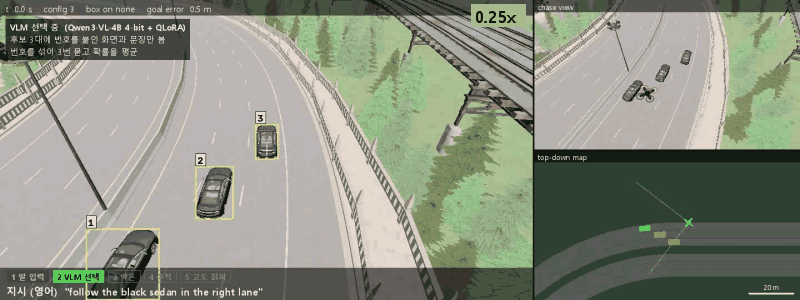
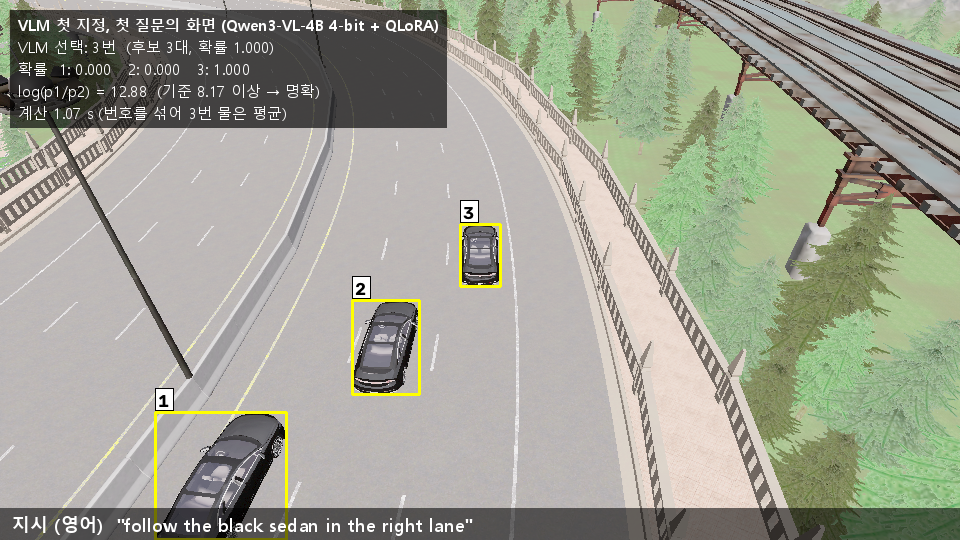
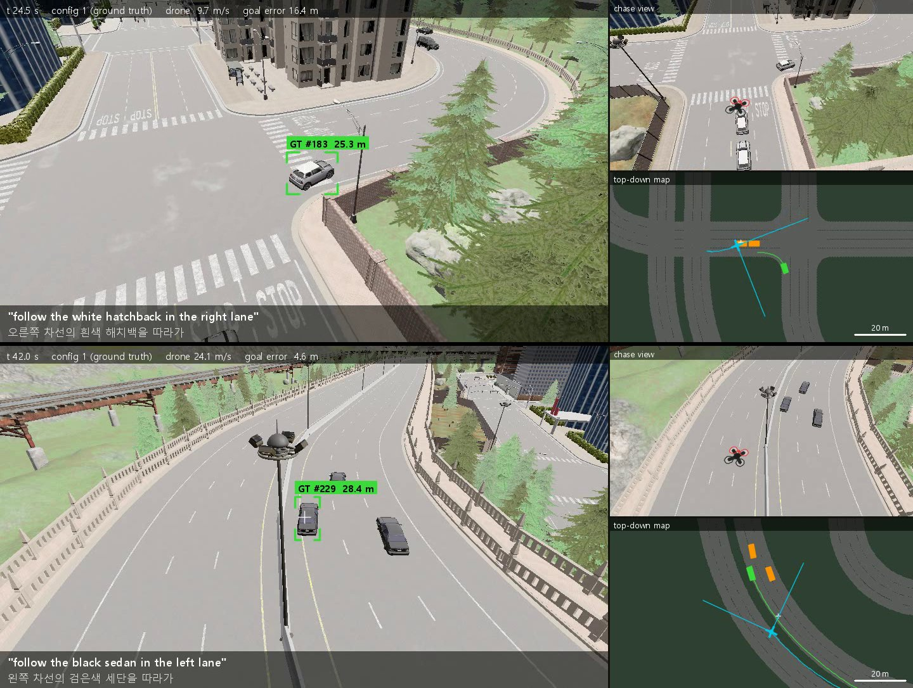
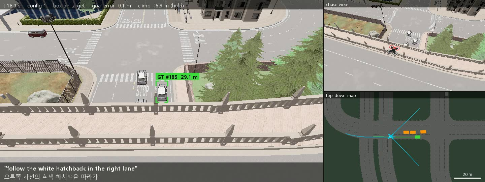

# Phase 2: 자연어로 지정한 차량을 따라가는 드론 (진행 중)

CARLA에서 자연어로 지정한 차량("오른쪽 차선의 흰색 SUV를 따라가")을 찾아 락온하고, 일정 거리와 고도를 유지하며 따라가는 드론을 만듭니다. 핵심 질문은 "비슷한 차가 많고 가려짐이 있어도 지정한 그 차를 놓치지 않는가"입니다. 연구 주제는 **실패를 스스로 알아차리는 자연어 지시 드론 추적**입니다. 닮은 차로 갈아타거나, 목표를 놓치거나, 명령이 모호할 때 드론이 이를 알아차리고 대응하게 합니다([연구 계획](docs/research_plan.md)). 저장소 전체 개요는 [상위 README](../README.md)에 있습니다.

**이 폴더에서 실행합니다.** 아래와 각 문서의 경로와 명령은 모두 `car_follow/` 기준이고, Python 환경은 이 폴더의 uv 프로젝트입니다.

## 1. 진행

| 단계 | 상태 | 문서 |
|---|---|---|
| 환경과 CARLA 0.9.16 설치 점검 | 완료 | [setup](docs/setup.md) |
| 첫 데모 계획: 같은 차종·색의 차 2–3대 사이에서 지정한 차 따라가기 (Town05) | 완료 | [demo1_plan](docs/demo1_plan.md) |
| 첫 데모 구현 1: 장면과 시험 목록 (시험 63개, 본평가 30개 봉인) | 완료 | [demo1](docs/demo1.md) 1절 |
| 연구 계획: 주제, 가설, 실패 시험 설계, 진행 순서 | 완료 | [research_plan](docs/research_plan.md) |
| CARLA-Air 확인 (CARLA 0.9.16 + 쿼드로터 비행 모델) | 완료. 쓰지 않음(드론 물리가 동기 모드 tick을 따르지 않음). CARLA 0.9.16 + 자체 동역학으로 감 | [carla_air_check](docs/carla_air_check.md) |
| 첫 데모 구현 2: 드론 이동과 추종 제어 (자체 동역학, 정답 위치로 추종, dev 20개) | 완료. 25m/s, 6m/s², 지연 0.5초, 방향 거르기 1초로 dev 20개 모두 거리 오차 3m 이하(평균 1.22m) | [demo1](docs/demo1.md) 2절 |
| 첫 데모 구현 3: 화면 (1인칭 락온, 3인칭 드론 그리기, 위에서 본 지도) | 완료 | [demo1](docs/demo1.md) 3절 |
| 첫 데모 구현 4: 채점기 (기록한 교통을 재생해 모든 구성이 같은 교통을 봄) | 완료. 구성 1(정답 상자)로 dev 20개 바뀜 없음 100%, 목표 유지 100%, 거리 오차 1.22m. dev 5개에서 목표가 고가도로에 5–22초 가려짐 | [demo1](docs/demo1.md) 4절 |
| 첫 데모 구현 4 보완: 2초 넘는 가림 전·후 따로 채점, 깊이 카메라로 고도 높이기 | 완료. 구성 1 그대로 합격. 가려진 시간 59.8초 → 37.0초, 앞의 깊이 점이 3m 안에 들어온 적 없음, 속도 63–72 tick/s, GPU 변화 없음 | [demo1](docs/demo1.md) 4.5–4.7절 |
| 첫 데모 구현 5: 탐지기와 추적기 (구성 2) | 완료. 위치 추정: 땅 평면 투영은 고가도로 위에서 중앙값 11.3m 틀려 깊이 맵(0.12m)을 씀. 세계 좌표 ByteTrack 방식 추적기를 완벽한 탐지로 재 보니 본 구간 바뀜 없음 20/20, 목표 유지 99.97%, 거리 오차 1.49m. 실제 탐지기는 RF-DETR-Small(Apache-2.0)로 정해 설치함: 8ms/영상, 0.5GB. 목표 탐지율 95%(점수 0.3)지만 50m 넘는 작은 차와 위에서 본 일부 차(회색 승합차, 주황 Mini)를 놓침. RF-DETR + 추적기(구성 2)는 dev 20개 본 구간에서 바뀜 없음 20/20, 목표 유지 98.7%, 거리 오차 1.52m로 합격선을 넘음. 회색 승합차는 탐지 공백이 1.4초까지 길어져 트랙 지움(1.5초) 직전 | [demo1](docs/demo1.md) 5절 |
| 첫 데모 구현 6: VLM 처음 지정 (구성 3) | 완료. Apache-2.0 VLM 3종 zero-shot: Qwen3-VL-4B(4-bit)가 가장 나아 VLM dev 100장 영어 79%·한국어 80%, dev 20장 영어 90%·한국어 70%로 90% 미달(차선·앞뒤 표현에서 비슷한 차를 고름). 2B bf16을 시뮬레이터·RF-DETR와 함께 올려도 GPU 10.1GB. 4B 4-bit QLoRA 뒤 VLM dev 99%, dev 20장 100%(저장 화면 기준). 답할 수 없는 지시는 log(p1/p2) 임계값으로 거름 | [demo1](docs/demo1.md) 6–7절 |
| 첫 데모 구현 7: 구성 3 평가 | 완료. dev 20, pilot 3(2회), smoke 10 통과 뒤 봉인한 본평가 30개를 열어 영어·한국어 모두 합격: 처음 지정 30/30, 바뀜 없음 영어 30/30·한국어 29/30, 목표 유지 97.4%, 거리 오차 1.8m. 바뀜 1회는 회색 승합차의 위치 추정이 앞의 비슷한 차 쪽으로 끌려가 트랙이 넘어간 경우. 첫 데모 baseline | [demo1](docs/demo1.md) 8–9절 |
| 연구 3단계 계획: 실패 시험 목록, 실패 시점 자동 라벨, 보정 묶음 | 계획 결정 (2026-11-26). main-024의 탐지 미연결, 추정 점프, 깊이 시야 경계를 감시 신호 후보에 넣음 | [failure_plan](docs/failure_plan.md) |
| 연구 3단계 구현 1: 실패 라벨, 지표, 보정 코드 | 완료. 바뀜(상자, 추정), 이탈, 소실, 위기, 교차·대기열·깊이 시야 노출을 기록에서 자동으로 붙임. 첫 데모 공개 72회 비행에서 바뀜·이탈·위기 0, 소실 11(긴 가림 10, 탐지 누락으로 트랙 지움 1). main-024는 한국어 "이탈 47.3초 → 바뀜(추정) 50.15초 → 바뀜(상자) 51.3초", 영어는 위기만 | [failure](docs/failure.md) |
| 연구 3단계 구현 2: 비행 기록 늘리기와 비회귀 확인 | 완료. 모든 차의 pixel, 모든 탐지·트랙, 목표 트랙의 연결(예측, 문턱, 혁신)을 기록. 시뮬레이터가 bit 단위로 반복되지 않아(깊이 값이 첫 tick부터 mm–cm 다름) bit 비교 대신, 기록된 탐지로 추적기를 다시 돌려 26개 비행 모두 bit 단위로 같음을 확인하고, 구성 2 dev 20이 반복 잡음 범위 안, 구성 3 dev 3개 × 2언어 통과 | [failure](docs/failure.md) 4절 |
| 연구 3단계 구현 3: 사건 대본과 생성기 예행 | 완료. 교통을 기록하며 사건을 넣음: A1 끼어들기(옆 차선에서 호위하던 방해 차가 앞질러 목표 차선으로), A2 대기열(신호를 빨강으로 잡아 두 차를 한 차선에 세움), A3 가림(고가 아래를 지나는 시작). 조정에 쓰지 않은 seed에서 사건 비율 A1 8/10, A2 9/10, A3 8/10(기준 70%) | [failure](docs/failure.md) 5절 |
| 연구 3단계 추가: 목표 차선 변경 조건(A4) | 완료. 목표의 단일 변경, 좌우 반복 변경, 닮은 차와 동시에 서로 차선 맞바꾸기를 교통 기록에 넣고, 기록의 지도 차선으로 변경을 확인(새 seed에서 A4a 9/10, A4b 7/10, A4c 8/10). 기준 구성 3 그대로 dev 24개 × 2언어 48회 비행: 처음 지정한 차 48/48 유지, 바뀜·이탈·소실·위기 0. 변경 중 추정 오차 p95가 0.3–0.5m에서 1.0–1.1m로, 거리 오차 옆 성분이 1.5–2.0m(곧은 길의 변경 후 0.5–0.8m)로 커짐. 실패 유발 조건이 아니라 정상 주행의 어려운 음성으로 보고, 묶음 A 본 목록은 키우지 않고 오경보 점검용 보조 묶음으로 둠 | [failure](docs/failure.md) 6절 |
| 연구 3단계 구현 4: 라벨 확인 비행 | 완료. 새 seed 생성기 시험 5개(A1·A2의 쌍둥이와 닮은 차, A3)를 구성 3으로 영어·한국어 10회 비행하고 다시 그려 확인: 라벨 10/10이 장면과 맞음. A1·A2는 실패 없음(끼어든 차는 9.6–11.2m 앞, 영상에서 상자가 겹치지 않음), A3는 두 언어 모두 고가 아래 소실(32.7초). 바뀜·이탈이 드물어 본평가 크기를 정하기 전에 실패 비율 측정이나 사건 강화를 정해야 함 | [failure](docs/failure.md) 7절 |
| 연구 3단계: 실패 비율과 사건 조정안 | 지금 대본의 25개 시험 50회 비행에서 사건이 일으킨 바뀜·이탈 0회(A1·A2 34회), A3 소실 16/16. 영상에서 상자가 겹치려면 같은 차선 중심 간격 6–7m 이하가 필요. 좁힌 대기열(앞차 거리 1m)은 14회 중 5회 바뀜·이탈(방해 차가 앞에 선 경우), 뒤로 끼어들기는 0회. 조정안: A2를 좁힌 대기열로, A1은 유지하고 비중 축소, 새 seed로 다시 잰 뒤 크기 결정 | [failure](docs/failure.md) 8절 |
| 연구 3단계: A2 확정과 목록 크기안 | A2를 좁힌 대기열(앞차 거리 1m, 방해 차 약 7/9이 목표 앞, 신호 100–250m)로 확정. 새 seed 사건 비율 23/25, 구성 3 40회 비행에서 대기열이 일으킨 바뀜·이탈 4회(10%, 방해 차가 앞일 때만). 본평가 바뀜·이탈 30건에는 A2 시험 약 150개가 필요해, 모든 실패 종류로 30건 이상을 잡는 크기안(본평가 100, 보정 60, dev 68)을 제안 | [failure](docs/failure.md) 8.7–8.8절 |
| 연구 3단계 구현 5: 목록 생성과 봉인 | 공개 dev 68(구성 3 136회 비행: 조용한 바뀜·이탈 7, 가림 소실 32, 처음 지정 틀림 4)과 보조 A4b 10을 만들고, 보정 51, pilot 3, smoke 10, 본평가 85를 봉인(sha256). A3는 시작 후보가 dev 칸 4곳뿐이라 dev에만 둠. 실패 종류별 지표를 따로 보고하는 규칙을 계획과 지표 코드에 넣음. 감시기 개발용으로 dev 칸에서 A2 60개 보강 중 | [failure](docs/failure.md) 9절 |



*구성 3 비행(smoke-001, 영어 지시 "follow the black sedan in the right lane"). 아래 띠가 단계(말 입력, VLM 선택, 락온, 추적, 고도 회피)를 표시합니다. 처음 1.3초는 0.25배, 락온 구간은 0.5배로 느리게 재생하고 그 뒤 약 11초는 실제 속도입니다. VLM은 지정을 1.07초 동안 계산하고, 드론은 고정 예산 1.25초 동안 잠금 없이 기다린 뒤 고른 차를 따라갑니다([demo1](docs/demo1.md) 8.1, 8.7절).*



*VLM이 첫 질문에서 실제로 본 화면입니다. RF-DETR 후보 상자에 번호를 붙여 문장과 함께 보여 주고, 번호를 섞어 3번 물은 확률을 평균합니다. 3번을 확률 1.000으로 골랐고, log(p1/p2) 12.88로 기준 8.17을 넘어 "명확"입니다.*



*첫 데모 화면. 왼쪽은 드론 카메라(락온 상자와 문장), 오른쪽 위는 드론이 그려진 3인칭, 오른쪽 아래는 위에서 본 지도(초록 목표, 주황 비슷한 차)입니다. 이 그림은 정답 위치로 따라가는 구성 1입니다.*



*깊이 카메라 고도 회피. 고가도로 난간이 시선을 가리자 드론이 6.9m 올라가, 난간 너머 신호에 멈춘 목표가 다시 보입니다([demo1](docs/demo1.md) 4.6–4.7절).*

## 2. 실행

```powershell
uv sync                                               # Python 3.12 환경(.venv)을 만든다
uv run python scripts/carla_check.py --quality Low   # simulator를 켜서 속도와 GPU 메모리를 잰다
uv run python scripts/make_demo1_trials.py           # 첫 데모 시험 목록을 만든다 (이미 만들어 둠)
uv run python -m unittest discover -s tests          # simulator 없이 도는 테스트
```

- `uv sync`는 PyTorch(CUDA 12.8 빌드), RF-DETR, bitsandbytes까지 설치합니다(`.venv` 약 4.7GB). RF-DETR 가중치(368MB)는 처음 쓸 때 패키지가 `assets/models/rfdetr/`로 받습니다.
- VLM 가중치(Qwen3-VL-2B/4B, InternVL3.5-2B-HF, 약 16.6GiB)는 `assets/models/hf/`에 Hugging Face cache 형식으로 두고, 실행 중에는 내려받지 않습니다.
- CARLA 0.9.16 Windows 패키지는 `assets/carla-0.9.16/`에 풀어 둡니다. Git에는 없고, 받는 곳은 [setup](docs/setup.md) 3절에 있습니다.
- Claude 데스크톱 앱 안에서 환경을 새로 만들 때의 주의점은 [setup](docs/setup.md) 2.3절에 있습니다.

## 3. 폴더 구조

```text
pyproject.toml, uv.lock, .python-version   Python 환경 (uv)
src/car_follow/    simulator 시작·연결과 카메라(sim.py), 첫 데모의 시험·문장·봉인(trials.py),
                   드론 모델(drone.py), 추종 제어(follow.py), 추종 품질 지표(metrics.py), 화면(screen.py),
                   교통 재생(replay.py), 채점(scorer.py), 깊이 카메라 고도 회피(clearance.py),
                   상자에서 목표 위치와 Kalman filter(estimate.py), 다중 객체 추적기(tracker.py),
                   탐지기 인터페이스와 RF-DETR adapter(detector.py), VLM 처음 지정(vlm.py),
                   구성 3의 첫 지정(first_pick.py)과 그 영상 표시(pick_view.py), GPU 로드 순서(gpu_order.py), VLM 학습 데이터와 신뢰도 지표(vlm_data.py, vlm_metrics.py)
                   연구 3단계의 실패 라벨(labels.py), 경보 지표(failure_metrics.py), 시험 단위 보정(calibrate.py),
                   비행 기록 늘리기(flight_log.py), 실패 시험의 조건과 사건 대본(failure_trials.py),
                   목표 차선 변경 전·중·후 비교(lane_phases.py)
scripts/           설치 확인(carla_check.py), 시험 목록 생성(make_demo1_trials.py),
                   교통 기록·추종 비행(demo1_follow.py), 재생 확인(demo1_replay_check.py),
                   재생 위 채점(demo1_eval.py), 채점된 비행 다시 그리기(demo1_scene.py), 위치 추정 오차(demo1_estimate.py), 탐지율(demo1_detector_check.py),
                   VLM 시작 화면·지정 평가·GPU 공존(demo1_vlm_scenes.py, demo1_vlm_eval.py, demo1_vlm_memory_check.py),
                   VLM 학습과 신뢰도 시험(demo1_vlm_train_scenes.py, demo1_vlm_train.py, demo1_vlm_report.py,
                   demo1_vlm_stress.py),
                   실패 라벨 붙이기(failure_labels.py), 기록 확인과 비교(check_flight_record.py, compare_runs.py,
                   compare_noise.py), 실패 시험 생성(make_failure_trials.py), 차선 변경 비교(lane_change_report.py),
                   CARLA-Air 확인(carla_air/)
configs/           차종 이름표, 첫 데모 시험 목록 (본평가는 봉인)
tests/             simulator 없이 도는 테스트
docs/              아래 문서
outputs/examples/  문서에 쓰는 그림 (나머지 실행 결과는 로컬에만)
assets/            (로컬에만) CARLA 0.9.16, 탐지기와 VLM 가중치(models/)
```

저장소 맨 위의 `.claude/skills/phase2-analysis/`는 시험 목록과 결과의 분포 표와 논문 스타일 그림을 만드는 Claude Code skill입니다. 봉인 목록(`main`, `calibration`)은 사용자의 명시적 허락 없이 열거나 그리지 않습니다.

## 4. 문서

| 문서 | 내용 |
|---|---|
| [research_plan](docs/research_plan.md) | 연구 계획: 주제와 차별점, 가설, 실패 종류와 방해 차 단계, 감시기와 대응, 지표, 진행 순서, CARLA-Air 확인 항목 |
| [failure_plan](docs/failure_plan.md) | 연구 3단계 계획: main-024에서 본 신호, 결과·노출·조건 라벨, 사건을 넣은 실패 시험 목록과 나누기, 감시 신호 후보와 늘릴 기록, 시험 단위 보정 |
| [failure](docs/failure.md) | 연구 3단계 구현 기록: 라벨, 지표, 보정 코드, 기록 늘리기, 사건 대본과 생성기 예행, 목표 차선 변경 조건(A4)의 확인 비행 |
| [carla_air_check](docs/carla_air_check.md) | CARLA-Air 확인 기록: client 연결, 동기 모드, 드론에 붙인 카메라, 속도 응답, 지도와 자원, 판정 |
| [setup](docs/setup.md) | uv Python 환경, CARLA 버전 선택, 설치 확인(속도, GPU 메모리, 자동 정답, 다른 GPU 작업과 함께) |
| [demo1_plan](docs/demo1_plan.md) | 첫 데모 계획: 범위, 구성(처음 지정, 추적, 추종 제어, 화면), 채점 지표와 합격선, 구현 순서 |
| [demo1](docs/demo1.md) | 첫 데모 구현 기록: 장면과 시험 목록(1절), 드론 모델과 추종 제어(2절), 화면(3절), 교통 재생·채점·가림 구간·깊이 카메라 고도 회피(4절), 탐지기와 추적기(5절, 진행 중) |
