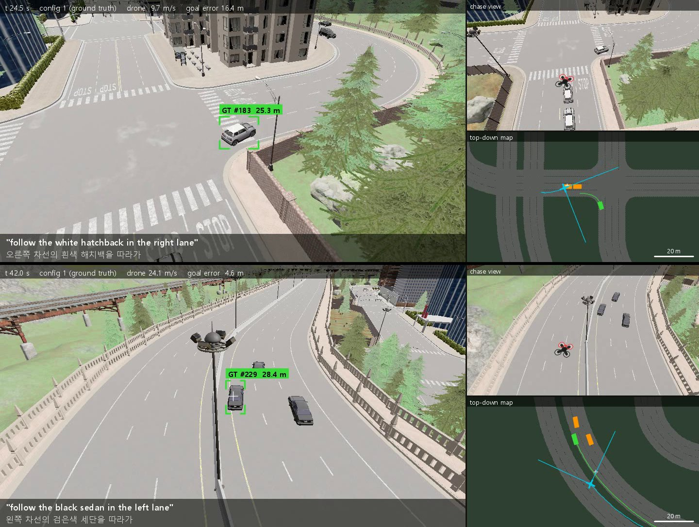
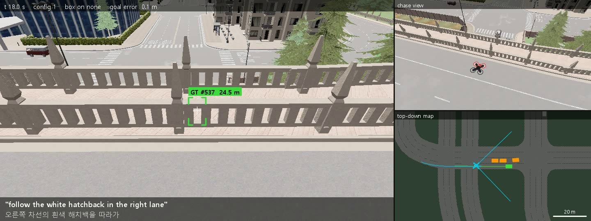
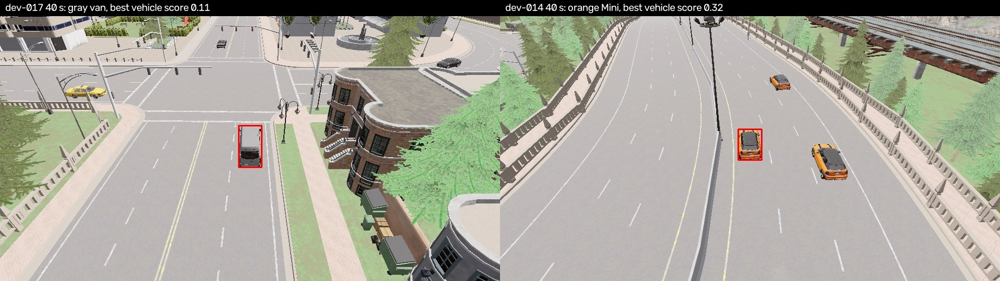

# Phase 2 첫 데모 구현 기록

이 문서는 [첫 데모 계획](demo1_plan.md) 4절의 구현 순서를 따라, 단계마다 한 일과 결과를 적는다. 경로와 명령은 `car_follow/` 폴더 기준이다.

| 단계 | 내용 | 상태 |
|---|---|---|
| 1 | 장면과 시험 목록 | 완료 (2026-11-13, 1절) |
| 2 | 드론 이동과 추종 제어 (구성 1) | 완료 (2026-11-23, 2절) |
| 3 | 화면 | 완료 (2026-11-23, 3절) |
| 4 | 채점기 (교통 재생, 가림 구간 나누기, 깊이 카메라 고도 회피 포함) | 완료 (2026-11-23, 4절) |
| 5 | 탐지기와 추적기 (구성 2) | 완료 (2026-11-23, 5절). RF-DETR-Small로 dev 합격선 통과. 탐지기 미세조정은 관문에서 필요할 때 |
| 6 | VLM 처음 지정 (구성 3) | 진행 중 (6절). zero-shot 최고 약 80%로 90% 미달, QLoRA 검토 |
| 7 | 평가 | 남음 |

## 1. 장면과 시험 목록

**요약.** Town05에서 시험 63개를 만들었다.

- **공개:** dev 20, pilot 3, smoke 10
- **봉인:** 본평가 30

각 시험은 simulator에 실제로 띄우고 드론 시작 위치에서 본 뒤, 조건을 모두 만족할 때만 남겼다(1.5절).

| 파일 | 내용 |
|---|---|
| `configs/vehicle_types.json` | 차종 이름표 (1.1절) |
| `configs/demo1_trials.json` | dev, pilot, smoke 시험과 본평가의 봉인 기록 |
| `configs/demo1_trials_main.json` | 본평가 30회 (봉인, 1.6절) |
| `src/car_follow/sim.py` | simulator 시작·종료·연결, 동기 모드, 카메라, 화면 투영 |
| `src/car_follow/trials.py` | 색 이름, 문장, 시험 만들기, 봉인 |
| `scripts/make_demo1_trials.py` | 시험 목록 생성. `--catalog`는 색 확인 그림(그림 1)만 그림 |
| `tests/test_demo1_trials.py` | simulator 없이 도는 테스트 10개 |

```powershell
uv run python scripts/make_demo1_trials.py             # simulator를 켜고 네 목록을 만든 뒤 끈다
uv run python -m unittest discover -s tests
```

### 1.1 차종 이름표

CARLA 0.9.16의 바퀴 4개 이상 blueprint 34개에 영어와 한국어 차종 이름을 붙였다. 예: SUV, sedan(세단), hatchback(해치백), coupe(쿠페), minivan(미니밴), sports car(스포츠카), van(승합차). 한국어 이름에는 목적격 조사를 붙인 꼴("SUV를", "세단을")도 함께 적었다.

목표가 될 수 있는 차는 21개다. 다음은 목표에서 뺐고, 다른 차량으로만 나온다.

- **일반 승용차가 아닌 차:** 경찰차, 택시, 구급차, 소방차, 트럭, 버스, 초소형차
- **위에서 몸체 색이 보이지 않는 차:**
  - Volkswagen T2 두 종: 색 속성이 차체 아래쪽만 칠한다(위는 흰색).
  - Jeep Wrangler: 위에서 보면 검은 소프트탑이 차를 덮는다.
  - 이 두 경우는 1.2절의 확인 그림과 시험 생성 예행에서 찾았다.

### 1.2 색 이름

CARLA 차의 색은 RGB 값(예: `217,217,217`)이다. 이 값을 HSV(색상 h°, 채도 s, 명도 v)로 바꿔 색 이름을 정한다.

**표 1. 색 이름 규칙**

| 이름 | 규칙 |
|---|---|
| black | v < 0.2, 또는 s < 0.2이고 v < 0.25 |
| white | s < 0.2이고 v ≥ 0.78 |
| gray | s < 0.2이고 0.25 ≤ v < 0.78 |
| red, orange, yellow, green, blue, purple | s ≥ 0.2일 때 색상으로: red 340–15°, orange 15–40°, yellow 40–70°, green 70–170°, blue 170–260°, purple 260–340° |

목표 차에는 **이름이 분명한 색**만 쓴다. 이름이 애매한 색으로 칠한 차를 문장으로 부르면, 모델이 틀려도 그것이 모델 탓인지 정답 탓인지 알 수 없기 때문이다.

- **black:** v ≤ 0.15이고, 채도가 낮다(s ≤ 0.3, 또는 v ≤ 0.08).
- **white:** v ≥ 0.83이고 s ≤ 0.12.
- **gray:** 0.38 ≤ v ≤ 0.5이고 s ≤ 0.12.
- **유채색:**
  - s ≥ 0.5이고 v ≥ 0.35. orange와 yellow는 v ≥ 0.6이어야 한다(그보다 어두우면 갈색이나 올리브색으로 보임).
  - 색상 경계에서 5° 이상 떨어져 있어야 한다.

이 규칙은 그림만 보고 정하지 않았다. 목표가 될 수 있는 모든 차를 모든 분명한 색으로 드론 시작 위치에서 실제로 그려 보고(그림 1, 60대), 눈으로 본 결과에 맞춰 다음을 고쳤다.

1. **T2 승합차 제외.** 색이 차체 일부에만 칠해진다(1.1절).
2. **Wrangler 제외.** 위에서 보면 소프트탑이 색을 가린다(1.1절).
3. **밝은 회색.** `160,160,160`, `167,166,175`, `187,187,187`은 거의 흰색으로 보인다. 그래서 회색 상한을 0.5로 낮췄다.
4. **어두운 회색.** `83,83,86`, `68,68,77`은 드론에서 보면 거의 검은색이다. 그래서 회색 하한을 0.38로 올렸다.
5. **어두운 초록.** 거의 검은 초록 `0,33,5`가 black으로 분류됐다. 그래서 black에 채도 조건을 더했다.

남은 애매한 점도 있다. Mini와 Audi A2는 지붕이 흰색이라 위에서 보면 흰 부분이 크다. 사람은 이런 차를 차체 색으로 부르므로("빨간 Mini") 그대로 두었다. 옛 Nissan Patrol의 검은색은 지붕 위 은색 짐받이 때문에 짙은 회색으로도 보인다.


*그림 1. 목표가 될 수 있는 차 60대(차종 × 분명한 색)를 드론 시작 위치에서 본 모습.*

- 위쪽 글자: 문장이 쓰는 이름
- 아래쪽 글자: blueprint와 RGB 값

### 1.3 시험 하나의 구성

1. **시작 후보.** 8m 간격의 도로 지점(waypoint) 중 다음을 모두 만족하는 1,141곳이다.
   - 교차로가 아니다.
   - 같은 방향 차선이 2개 이상이다.
   - 앞 35m와 뒤 30m에 교차로가 없다.
2. **목표.** 목표가 될 수 있는 차종 하나를 고르고, 그 차종의 분명한 색 중 하나를 고른다.
3. **비슷한 차.** 목표와 같은 blueprint, 같은 색의 차를 2대 또는 3대 둔다. 자리는 다음 후보 중에서 고른다.
   - 같은 차선: 앞뒤 12, 18, 25m
   - 옆 차선: −20, −12, −6, 0, 6, 12, 20, 25m
   - 같은 차선에서는 서로 8m 이상 떨어뜨린다.
   - 실제로는 1.4절의 문장 종류가 성립하는 자리만 쓴다.
4. **다른 차.** 지도의 spawn point 중 목표와 비슷한 차에서 30m 이상 떨어진 곳에 40대를 둔다.
   - 목표와 같은 차종에 같은 색 이름인 차는 다른 차로 두지 않는다.
   - 그래서 문장의 단어("흰색 SUV")에 맞는 차는 목표와 비슷한 차뿐이다.
5. **드론 시작.** 목표 차선 방향으로 20m 뒤, 15m 위에서 목표를 바라본다. 카메라는 960×540, FOV 90°다.
6. **길이.** 60초(20Hz로 1,200 tick)다.

### 1.4 문장

먼저 "드론 시작 시점에 보이는 일치 차"를 정한다. 비슷한 차 중 instance segmentation에서 30 pixel 이상 보이는 차다. 문장은 목표와 이 차들 중에서 목표 한 대만 가리켜야 한다. 쓰는 표현은 세 가지다.

| 표현 | 성립 조건 | 영어 | 한국어 |
|---|---|---|---|
| lane | 보이는 비슷한 차가 모두 같은 도로·방향·차선 수에 있고, 목표와 같은 차선에는 없음 | follow the white SUV in the right lane | 오른쪽 차선의 흰색 SUV를 따라가 |
| front | 목표가 보이는 비슷한 차 모두보다 차선 방향으로 6m 이상 앞 | follow the black hatchback furthest ahead | 가장 앞에 있는 검은색 해치백을 따라가 |
| back | 목표가 보이는 비슷한 차 모두보다 6m 이상 뒤 | follow the red minivan furthest back | 가장 뒤에 있는 빨간색 미니밴을 따라가 |

- **차선 이름.**
  - 같은 방향 2차선: 왼쪽, 오른쪽
  - 3차선: 왼쪽, 가운데, 오른쪽
  - 4차선 이상: 맨 왼쪽, 왼쪽에서 두 번째 등
- **표현 배분.** 시험은 미리 정한 표현 하나를 목표로 만든다.
  - 순서는 lane, lane, front, back을 반복한다.
  - 그래서 목록마다 표현의 비율이 고정된다: dev 10/5/5, pilot 2/1/0, smoke 6/2/2, 본평가 16/7/7.
  - 처음에는 표현을 무작위로 골랐다. 그러자 pilot과 smoke에 front가 하나도 없었고, 그래서 이 방식으로 바꿨다.
- **자리 제한.** 비슷한 차는 그 표현이 성립하는 자리에만 둔다. lane이면 다른 차선, front면 6m 이상 뒤, back이면 6m 이상 앞이다.
- **문장이 가리키는 시점.** 문장은 시작 시점의 배치를 말한다. 시험 중에 차들이 차선을 바꾸는 것은 상관없다. 처음 지정은 시작 시점에 한 번만 하기 때문이다.

### 1.5 확인과 버림

뽑은 시험은 simulator에 띄우고 드론 시작 위치에서 5 tick 뒤에 본다. 다음 조건을 모두 만족할 때만 남긴다.

1. 목표와 모든 비슷한 차가 spawn됐다.
2. 목표가 300 pixel 이상 보인다.
3. 비슷한 차가 하나 이상 보인다.
4. 미리 정한 표현이 성립한다.
5. 다른 시험과 시작 위치가 겹치지 않는다(네 목록 전체에서).

다른 차 중 spawn되지 않은 차는 시험에서 지운다. 이번에는 모든 시험에서 40대가 다 spawn됐다.

**표 2. 목록별 시도와 버린 이유**

| 목록 | 남김 | 시도 | 버린 이유 |
|---|---|---|---|
| 본평가 | 30 | 47 | 시작 겹침 7, front 불성립 4, lane 불성립 3, back 불성립 3 |
| pilot | 3 | 4 | 보이는 비슷한 차 없음 1 |
| smoke | 10 | 18 | lane 불성립 2, front 불성립 2, 보이는 비슷한 차 없음 2, 목표가 가려짐 1, back 불성립 1 |
| dev | 20 | 26 | front 불성립 5, 보이는 비슷한 차 없음 1 |

### 1.6 나누기와 봉인

**목록.** 목록은 네 개다. dev는 계획에 없던 목록으로, 이번에 더했다.

- **dev:** 개발과 조정에 쓴다. 그래야 pilot과 smoke를 조정에 쓰지 않고 관문으로만 쓸 수 있다.
- **pilot, smoke:** 관문이다.
- **본평가:** 봉인한다.

**지도 칸으로 나누기.** 시작 위치는 지도를 60m 칸으로 나눈 뒤 칸 단위로 목록에 배정한다.

- 각 칸의 좌표를 sha256으로 바꿔, 칸의 1/4은 본평가, 1/4은 관문(pilot, smoke), 1/2은 dev에 준다.
- 시험을 뽑을 때는 칸을 먼저 고르고 그 칸 안의 지점을 고른다. 그래서 시작 위치가 지도 전체로 퍼진다.
- 처음에는 도로 단위로 나눴다. 그런데 시작 후보가 있는 도로가 십여 개뿐이라 관문에 도로가 2개만 남았고, 그래서 칸 단위로 바꿨다.

| 목록 | 시작 후보 | 칸 | 도로 |
|---|---|---|---|
| 본평가 | 192 | 7 | 7 |
| 관문 (pilot, smoke) | 372 | 10 | 7 |
| dev | 577 | 24 | 10 |

**seed.** 목록마다 seed 시작값이 다르다: dev 100000, pilot 200000, smoke 300000, 본평가 900000. 여기에 시도 번호를 더한다.

**봉인.** 본평가 30회는 별도 파일에 있고, 그 sha256(`282edf8e…f38f`)을 `demo1_trials.json`에 적었다.

- `trials.load_trials("main")`은 `open_sealed=True` 없이는 열리지 않는다.
- 열 때는 파일이 기록된 sha256과 같은지 확인한다.
- 생성할 때 본평가 시험의 그림은 만들지 않았고, 시도 수와 버린 이유만 출력했다.
- 본평가 목록은 최종본 전에 두 번 만들어졌다가 버려졌다(어두운 회색 기준, 표현 배분 조정). 어느 때도 내용은 열어 보지 않았다.

### 1.7 결과

**표 3. 공개 목록의 구성**

| 항목 | pilot (3) | smoke (10) | dev (20) |
|---|---|---|---|
| 표현 lane / front / back | 2 / 1 / 0 | 6 / 2 / 2 | 10 / 5 / 5 |
| 목표 차종 | 쿠페 1, SUV 1, 해치백 1 | 세단 3, SUV 3, 해치백 3, 쿠페 1 | 해치백 9, 세단 3, SUV 3, 스포츠카 3, 쿠페 1, 승합차 1 |
| 비슷한 차 2대 / 3대 | 3 / 0 | 3 / 7 | 9 / 11 |
| 시작 때 보이는 비슷한 차 1 / 2 / 3대 | 0 / 3 / 0 | 0 / 8 / 2 | 2 / 13 / 5 |
| 같은 방향 2차선 / 3차선 | 0 / 3 | 0 / 10 | 6 / 14 |
| 목표의 보이는 pixel | 1,760–3,011 | 1,555–3,011 | 1,522–3,166 |

본평가 30회의 구성은 봉인되어 있어 표현 배분(16/7/7)과 개수 외에는 모른다.


*그림 2. dev 시험의 시작 화면. 위부터 lane, front, back 표현 두 개씩이다. 초록 상자가 목표, 주황 상자가 비슷한 차이며, 위 띠의 문장이 목표 한 대만 가리킨다.*

**관찰.**

- pilot과 smoke는 모두 같은 방향 3차선 도로에서 시작한다. 관문 칸의 도로가 그렇기 때문이다. 2차선 도로의 시작은 dev에만 있다.
- 시작할 때 비슷한 차가 드론 바로 아래(화면 아래 끝)에 걸쳐 보이는 시험이 있다.
- 이번 확인은 차가 멈춘 상태에서 했다. 자동 주행에서도 같은 시험이 똑같이 재현되는지는 계획대로 pilot에서 두 번 실행해 확인한다(계획 3.3절).

### 1.8 그 밖에 고친 것

- **공통 함수 정리.** simulator 시작·종료·연결과 카메라 함수를 `src/car_follow/sim.py`로 모았다. `scripts/carla_check.py`도 이 함수를 쓰도록 바꿨고, Town05 Low에서 다시 실행해 정상 동작을 확인했다.
- **simulator 시작 보호.**
  - simulator가 시작 요청에 응답하지 않은 일이 약 20번의 시작 중 세 번 있었다. 설치 확인 때 한 번, 이번 시험 생성 때 한 번, 폴더 정리 뒤 확인 실행 때 한 번이다.
  - 세 번째 때 살펴보니, simulator는 포트 2000–2002를 열고 화면도 그리고 있었지만 어떤 client에도 답하지 않았다. 새로 띄운 client도 마찬가지였다. 그래서 client 쪽 문제가 아니라 simulator가 시작 중에 멈춘 것으로 본다.
  - 다시 시작하면 매번 몇 초 만에 응답했다. 원인은 찾지 못했다.
  - 그래서 `sim.session`과 `carla_check.py`에 두 가지를 넣었다. 포트 2000을 이미 무언가가 쓰고 있으면 시작하지 않는다. 120초 안에 응답이 없으면 simulator를 끄고 한 번 더 시작한다.
- **테스트 위치.** Phase 2 테스트는 `car_follow/tests/`에 있고 uv 환경에서 돈다. carla가 없는 WSL의 Phase 1 테스트(`landing_vla/tests/`)와는 폴더가 달라 섞이지 않는다.

**다음 단계.** 2단계는 드론 이동과 추종 제어다(구성 1). 2절에 적었다.

## 2. 드론 이동과 추종 제어 (구성 1)

**요약.** 드론 모델과 추종 제어기를 만들고, dev 시험 20개에서 simulator 정답 위치로 따라가게 했다.

- **드론 모델.** 속도 명령을 1차 지연으로 따르는 점질량 모델이다. 제한은 속도, 가속도, 방향 회전에 둔다.
- **추종 제어기.** 목표 지점의 움직임을 앞질러 반영하고, 오차는 가속도 한도 안에서 줄인다. 차의 진행 방향은 걸러서 쓴다.
- **재현성.** 같은 시험을 세 번 따로 기록했더니 모든 차의 궤적이 bit 단위로 같았다.
- **결과.** 계획의 초기 한계(20m/s, 4m/s²)로는 20개 중 5개가 거리 오차 3m를 넘는다. 고가 순환도로 구간에서 차가 24.5m/s로 달리기 때문이다.
  - 25m/s, 6m/s²로 올리면 20개 모두 3m 이하이고 평균은 1.22m다.
  - 사용자가 25m/s, 6m/s², 지연 0.5초, 방향 거르기 1초로 정했다(2.7절).

| 파일 | 내용 |
|---|---|
| `src/car_follow/drone.py` | 드론 모델: 점질량, 속도 1차 지연, 제한, gimbal (2.1절) |
| `src/car_follow/follow.py` | 추종 제어기와 offline 비행 (2.2절) |
| `src/car_follow/metrics.py` | 추종 품질 지표 (2.5절) |
| `scripts/demo1_follow.py` | `record`(교통 기록), `offline`(기록 위 비행과 채점), `live`(simulator 안 비행과 확인 영상) |
| `tests/test_drone_follow.py` | simulator 없이 도는 테스트 8개 (제한, 지연, 회전, 직선·회전 추종, 카메라 각도) |

```powershell
uv run python scripts/demo1_follow.py record --split dev --run rec1
uv run python scripts/demo1_follow.py offline --run rec1 --speed 20 25 --accel 4 6 --lag 0.5 1 --heading 1 2
uv run python scripts/demo1_follow.py live --split dev --ids dev-001 --speed 25 --accel 6 --lag 0.5 --heading 1 --compare rec1 --video
```

### 2.1 드론 모델

- **비행 물리를 쓰지 않는 이유.** CARLA에는 동기 모드 tick에 맞춰 도는 비행 모델이 없다([CARLA-Air 확인](carla_air_check.md)). 그래서 드론을 tick마다 직접 적분한다. 이렇게 하면 재현된다.
- **속도.** 명령 속도는 먼저 최고 속도로 자른다.
  - 그 뒤 1차 지연으로 따라간다: 한 tick 동안의 변화는 `(명령 − 현재) × (1 − e^(−dt/τ))`.
  - 이렇게 나온 가속도를 수평(벡터 크기)과 수직으로 나눠 한도로 자른다.
  - 위치는 사다리꼴 적분이다.
- **카메라.** gimbal에 달려 있다.
  - 좌우 방향은 몸체 방향과 같고, 몸체가 회전 한도 안에서 돌린다.
  - 위아래 각도는 gimbal이 따로 돌린다. 범위는 수평부터 수직 아래까지다.

**표 4. 드론 모델 값**

| 항목 | 값 | 근거 |
|---|---|---|
| 수평 최고 속도 | 25m/s | 계획 2.3절 초기값 20m/s에서 바꿈(2.5절, 2.7절) |
| 수평 가속도 | 6m/s² | 계획 2.3절 초기값 4m/s²에서 바꿈(2.5절, 2.7절) |
| 수직 속도, 가속도 | 4m/s, 2m/s² | 가정. 이번 시험에서는 높이 오차가 최대 0.6m로 작았음 |
| 방향 회전 | 60°/s | 계획 2.3절. 이번 시험에서는 최대 42°/s로 한도에 닿지 않음 |
| gimbal 위아래 회전 | 90°/s | 가정 |
| 속도 지연 τ | 0.5s | 가정(2.7절에서 확정). AirSim SimpleFlight 기본값(약 4초)은 실제 쿼드로터를 대표하지 않는다([CARLA-Air 확인](carla_air_check.md) 2.4절). 1.0s는 견고성 비교용 |

### 2.2 추종 제어기

- **목표 지점.** 차 뒤 20m, 위 15m다(계획 2.3절).
- **속도 명령.** 실제 드론의 offboard 속도 명령과 같은 형태다. 세 항을 더한다.
  1. **목표 지점의 속도.** 목표 지점 위치의 차분을 0.25초 시간 상수로 거른 값이다.
  2. **지연 보상.** τ × 목표 지점의 가속도다.
  3. **오차 보정.** 목표 지점까지의 오차를 줄이는 속도다. sqrt 제어기(ArduPilot 위치 제어기와 같은 방식)를 쓴다.
     - 가까우면 오차에 비례한다. 비례 계수는 τ에 맞춰 임계 감쇠가 되게 `1/(4τ)`로 두고, 0.25–1.0/s 범위로 자른다.
     - 멀면 2m/s²로 멈출 수 있는 속도까지만 낸다.
- **진행 방향 거르기.** 목표 지점을 정하는 차의 진행 방향을 시간 상수(기본 1초)로 거른다. PX4 Follow Me의 responsiveness 필터와 같은 생각이다.
- **카메라.** 차의 상자 중심을 바라본다.

**두 장치가 필요한 이유.**

- **sqrt 제어기.** 합성한 90° 회전(반지름 15m, 8m/s)에서, 처음 쓴 단순 비례 보정은 드론이 목표 지점을 30m 지나쳤다. 목표 지점이 옆으로 빠르게 휘는 동안 쌓인 속도를 가속도 한도 안에서 멈추지 못했기 때문이다.
- **진행 방향 거르기.** sqrt 제어기를 넣어도 진행 방향을 거르지 않으면 같은 회전에서 차와의 거리 오차가 최대 23m였다. 2초로 거르면 약 1m였다(지연 0.5초).
  - 실제 교통에서는 다른 이유로도 필요하다. CARLA가 주는 차의 방향에 작은 흔들림이 있고, 20m 팔이 이를 키운다.
  - dev-001에서 거르지 않으면 저크 RMS가 11m/s³(지연 0.5초)였고, 1초로 거르면 2.1m/s³였다.
  - 대가가 있다. 차가 꺾을 때 드론이 차 주위를 늦게 돌아 들어간다(방위가 늦음, 2.5절).

### 2.3 교통 기록과 offline 비행

**offline 비행이 성립하는 이유.** 구성 1에서 드론은 차의 정답 위치를 쓰고, 세계에 아무 영향도 주지 않는다. 그래서 각 시험의 교통을 한 번 기록해 두면, 추종 비행은 기록 위에서 몇 번이든 offline으로 할 수 있다. offline과 live는 같은 함수(`Follower.command`, `drone.step`)를 같은 순서로 부른다.

**시험 시작.** 모든 시험은 같은 상태에서 시작한다.

1. 차와 센서를 모두 지우고 tick 한 번.
2. 신호등을 모두 처음 상태로 되돌린다(`reset_all_traffic_lights`).
3. Traffic Manager seed를 시험의 seed로 둔다.
4. 차를 정해진 순서(목표, 비슷한 차, 다른 차)로 띄우고 autopilot을 켠다.

**기록.**

- 1,200 tick 동안 매 tick 모든 차의 위치, 자세, 속도를 남긴다.
- 상자 크기도 남기고, 목표는 상자 중심 위치도 남긴다.
- 파일은 `outputs/demo1_follow/traffic/`(로컬)에 저장된다.

**속도.**

- 카메라 없이 기록하면 시험 하나(1,200 tick)에 8–10초 걸린다(약 140 tick/s).
- 960×540 RGB 카메라 하나를 켜고 live로 날면 53–67 tick/s다.
- 이때 GPU 전체 사용량은 4.8–5.2GB였다. 그중 약 2GB는 다른 프로그램이 쓰는 몫이다.

### 2.4 재현성

**표 5. 같은 시험을 다시 돌린 결과**

| 비교 | 대상 | 결과 |
|---|---|---|
| 기록 rec1 대 rec2 (각각 새 simulator 세션) | dev 20개, 모든 차 | bit 단위로 같음 |
| 기록 test1(dev-001만 단독) 대 rec1 | dev-001, 모든 차 | 같음 |
| live(카메라 있음) 대 rec1 | dev-001, dev-010, dev-013 | 목표는 세 시험 모두 같음. 다른 차는 dev-001과 dev-010에서 같음. dev-013에서는 10대가 42.9초부터 조금씩 갈라져 최대 92.6m 차이. 갈라지기 시작할 때 이 차들은 목표에서 100m 이상 떨어져 있었음 |
| live 두 번째 대 live 첫 번째 | 같은 세 시험 | 모든 차가 같음 |
| live 드론 경로 대 같은 교통의 offline 드론 경로 | 같은 세 시험 | 같음 (차이 0.0m) |

- **해석.** 구성(띄운 센서까지)이 같으면 시험은 bit 단위로 재현된다.
  - 카메라를 더하면 목표에서 먼 차들이 조금 다르게 움직일 수 있다.
  - actor ID가 밀린 것은 원인이 아니었다. dev-010도 ID가 346 밀렸지만 모든 차가 같았다. 원인은 찾지 못했다.
- **뜻.** 계획 3.3절의 재현성 확인은 같은 구성끼리 비교해야 한다.
  - 구성 1–3을 정확히 같은 교통에서 견주려면 방법이 두 가지다.
    - 모든 구성에서 센서를 똑같이 띄운다.
    - 기록한 교통을 그대로 다시 재생한다(차를 매 tick 기록된 자리에 둔다).
  - 채점기(4단계)와 탐지기(5단계) 전에 정한다.

### 2.5 dev 결과 (offline, 시험 20개)

**목표 차의 속도.**

- 시험별 평균 속도는 2.4–15.6m/s였다.
- 20개 중 9개에서 목표가 20m/s를 넘었다. 최고 24.5m/s(88km/h)로, 고가 순환도로 구간이다.
- dev-011, dev-013, dev-020은 60초 중 18–25초를 20m/s 넘게 달린다.

**표 6. 설정별 결과** (지표는 시작 후 5초를 뺀 값. 평균은 시험 20개의 평균, 최악 p95는 시험별 p95 중 가장 큰 값)

| 최고 속도 | 가속도 | 지연 τ | 방향 거르기 | 거리 오차 평균 | 거리 오차 최악 p95 | 3m 넘는 시험 | 차와의 거리 오차 평균 | 방위 오차 평균 | 저크 RMS 평균 |
|---|---|---|---|---|---|---|---|---|---|
| 20m/s | 4m/s² | 0.5s | 1s | 4.58m | 78.8m | 5 | 3.81m | 3.6° | 3.1m/s³ |
| 20m/s | 4m/s² | 0.5s | 2s | 4.39m | 69.8m | 5 | 3.13m | 4.9° | 3.0m/s³ |
| 25m/s | 6m/s² | 0.5s | 1s | **1.22m** | 10.9m | **0** | 0.66m | 2.1° | 3.7m/s³ |
| 25m/s | 6m/s² | 0.5s | 2s | 1.68m | 14.5m | 2 | 0.41m | 4.0° | 3.5m/s³ |
| 25m/s | 6m/s² | 1.0s | 1s | 1.62m | 11.8m | 4 | 1.10m | 2.2° | 3.2m/s³ |
| 30m/s | 8m/s² | 0.5s | 1s | 1.01m | 9.8m | 0 | 0.45m | 1.9° | 4.0m/s³ |

- **거리 오차**는 계획 3.2절의 정의다: 드론과 "실제 차 기준 정확히 뒤 20m, 위 15m" 지점 사이의 거리.
- **차와의 거리 오차**는 수평 거리와 20m의 차이다.
- **방위 오차**는 드론이 차의 정확히 뒤에서 벗어난 각도다.

**계획 초기값(20m/s, 4m/s²)에서 생기는 두 가지 실패.**

1. **목표가 드론보다 빠름.** 목표가 20m/s를 넘는 동안 드론이 계속 뒤처진다(최대 82m).
2. **고속 곡선.** 24m/s로 곡선을 돌려면 약 5.3m/s²의 구심 가속도가 필요하다. 4m/s²를 넘으므로, 최고 속도를 30m/s로 올려도 드론은 바깥으로 밀리며 뒤처진다.
   - dev-013에서 30m/s, 4m/s²일 때 차와의 수평 거리가 55m까지 벌어졌다.
   - 가속도를 6m/s²로 올리면 이 실패가 없어진다.

**제안값(25m/s, 6m/s², τ 0.5s, 방향 거르기 1s)에서 남는 오차.**

- 거리 오차 최대(16.9m)는 교차로에서 90° 꺾을 때 나온다.
  - dev-010, dev-018, dev-017, dev-015, dev-012가 그렇다.
  - 이때 차와의 거리는 20–22m로 유지되고, 방위만 늦는다(dev-010 방위 오차 p95 29°).
  - 계획 3.2절의 거리 오차는 이 의도된 늦음도 오차로 센다. 그래도 시험별 평균은 모두 3m 이하다(가장 큰 것: dev-013 2.9m, dev-010 2.8m, dev-018 2.8m).
- 카메라 조준 오차(정답 위치 기준)는 시험별 p95가 1.2° 이하다. 목표는 모든 tick에서 화면 안에 있었다.
- 높이 오차는 최대 0.6m다.
- 지연을 1.0초로 늘리면 3m를 넘는 시험이 4개 생긴다.

### 2.6 live 확인

제안값으로 dev-001, dev-010, dev-013을 simulator 안에서 날고 드론 카메라 영상을 남겼다.

- 드론 경로는 같은 교통 위의 offline 경로와 같았다(2.4절).
- 영상: `outputs/demo1_follow/video/`(로컬).


*그림 3. live 확인 영상의 세 장면.*

- 위: 보통 도로.
- 가운데: 교차로 회전. 목표 지점 오차는 16.4m지만 차와의 거리는 20.8m로, 드론이 차 주위를 돌아 들어가는 중이다.
- 아래: 24m/s 고속 곡선.
- 초록 상자는 정답 상자를 투영한 것이고, 위 띠는 그 tick의 오차와 속도다.

**관찰.** 드론 모델에는 충돌이 없다. dev-013에서는 15m 높이의 드론 바로 앞으로 가로등 꼭대기가 지나간다. 나무나 가로등이 카메라를 가리는 시간은 아직 재지 않았다. 채점기(4단계)에서 instance segmentation으로 잴 수 있다.

### 2.7 결정 (2026-11-23)

2.5절의 결과를 보고 사용자가 다음과 같이 정했다. 코드의 기본값도 이 값으로 바꿨다.

1. **드론 한계.** 25m/s, 6m/s²로 올린다.
   - 6m/s²는 쿼드로터가 약 31° 기울면 내는 수평 가속도다.
   - 25m/s는 Town05 고가도로의 차 속도(최고 24.5m/s)를 따라갈 수 있는 최소값이다.
2. **속도 지연.** 본 설정은 0.5초다. 1.0초는 견고성 비교로만 쓴다.
3. **방향 거르기.** 1초다.
4. **구성 사이에서 교통을 같게 맞추는 방법.** 2.4절의 두 방법 중 하나를 4단계(채점기) 전에 정한다.

**다음 단계.** 3단계(화면: 1인칭 표시, 3인칭 드론 그리기, 위에서 본 지도)로 간다. 3절에 적었다.

## 3. 화면

**요약.** 첫 데모 계획 2.4절의 화면을 만들었다.

- **세 화면.** 1인칭 락온 화면, 드론이 그려진 3인칭 화면, 위에서 본 지도다.
- **쓰는 법.** live 비행에 `--video`를 주면 매 tick 이 화면을 영상으로 남긴다.
- **속도.** dev 시험 세 개에서 초당 35–36 tick으로 돌았다. 실제 시간(초당 20 tick)보다 빠르다.

| 파일 | 내용 |
|---|---|
| `src/car_follow/screen.py` | 화면: 상자 꼭짓점과 카메라 투영, 1인칭 표시, 3인칭 드론 그리기, 지도, 합성 |
| `scripts/demo1_follow.py` | `live --video`가 이 화면을 영상으로 쓴다 |
| `tests/test_screen.py` | simulator 없이 도는 테스트 6개 (상자 꼭짓점과 투영이 CARLA 계산과 같은지, 3인칭 카메라 배치, 드론 그리기, 지도 창, 화면 배치) |
| `pyproject.toml` | Pillow 추가 (한국어 문장 표시) |

```powershell
uv run python scripts/demo1_follow.py live --split dev --ids dev-010 --video --run screen1
```

### 3.1 배치

전체 1440×540이다.

- 왼쪽: 1인칭, 960×540
- 오른쪽 위: 3인칭, 480×270
- 오른쪽 아래: 지도, 480×270



*그림 4. 화면의 두 장면.*

- 위: dev-010 교차로 회전. 드론이 차 주위를 돌아 들어가는 중이라 목표 지점 오차가 16.4m다.
- 아래: dev-013의 24m/s 고가도로 곡선. 1인칭에 비슷한 차(같은 검은 세단)가 둘 보이고, 지도에는 주황색으로 보인다.

### 3.2 1인칭

- **락온 상자.** 따라가는 차의 상자 둘레에 모서리 꺾쇠를 그린다.
  - 구성 1에서는 정답 3D 상자를 드론 카메라에 투영한 것이다. 기록한 위치·자세·상자 크기로 계산하며, 테스트로 CARLA의 계산과 같음을 확인했다.
  - 구성 2–3에서는 추적기의 상자로 바뀐다.
- **꼬리표.** 트랙 번호와 거리다.
  - 구성 1의 번호는 `GT #actor ID`다. 이후 구성에서는 추적기의 트랙 번호가 된다.
  - 거리는 드론에서 상자 중심까지의 3D 거리다.
- **위 띠.** 시간, 구성, 드론 속도, 목표 지점 오차다.
- **아래 띠.** 시험 문장이다. 영어와 한국어 두 줄로 쓴다.
  - OpenCV 글꼴에는 한국어가 없다. 그래서 Pillow와 맑은 고딕으로 그린다.

### 3.3 3인칭

- **카메라 위치.** 드론 진행 방향으로 4m 뒤, 7m 위, 오른쪽 2.5m에 둔다.
  - 드론과 차를 각도로 반씩 나눈 방향을 바라본다.
  - 처음에는 7m 뒤, 4m 위에 두었다. 그러자 드론이 카메라와 차를 잇는 선 위에 놓여, 화면에서 차와 18 pixel 거리로 겹쳤다. 그래서 카메라를 더 높였다.
  - 이제 드론은 화면 아래쪽에, 차는 그 앞쪽 위에 보인다.
- **드론 그리기.** CARLA에는 드론 모델이 없으므로 3인칭 영상 위에 드론을 투영해 그린다.
  - 모양: X자 배치의 회전날개 4개(중심에서 0.45m, 반지름 0.22m)와 몸체.
  - 앞쪽 두 날개는 빨간 테두리로 그려 방향을 보인다.
  - 기본 배치에서 약 37 pixel 크기다.
  - 이 그리기는 `draw_drone` 함수 하나에 모았다. 나중에 실제 3D 모델을 넣을 때 이 함수만 바꾼다(계획 5절).
- **한계.** 드론은 항상 영상 맨 위에 그려진다. 건물이나 나무 뒤에 있어도 가려지지 않는다.

### 3.4 위에서 본 지도

- **도로.** `Town05_Opt.xodr`(OpenDRIVE)에서 그린다.
  - simulator 없이 `carla.Map`으로 읽고, 1m 간격 waypoint마다 차선 폭의 원을 그린다.
  - 해상도는 0.25m/pixel, 크기는 2109×1828 pixel(527×457m)이다.
  - 만드는 데 0.2초 걸렸고, `outputs/demo1_follow/map/`(로컬)에 저장해 다시 쓴다.
- **창.** 드론과 목표의 가운데를 중심으로 120×67.5m를 보인다. 북쪽이 위다(CARLA x가 오른쪽, y가 아래).
- **표시.**
  - 차: 정답 위치·자세·상자 크기로 그린 사각형. 목표는 초록, 비슷한 차는 주황, 다른 차는 회색이다.
  - 드론: 하늘색 X와 카메라 시야(좌우 45°, 30m) 선.
  - 목표 지점: 흰 십자.
  - 지난 10초의 자취: 목표는 초록, 드론은 하늘색.
  - 20m 축척 막대.
- **한계.** 고가도로와 그 아래 도로를 같은 색으로 그린다. 그래서 dev-001처럼 고가도로를 달리는 시험에서는 아래 도로와 교차로처럼 겹쳐 보인다.

### 3.5 확인

dev-001, dev-010, dev-013을 화면과 함께 날았다.

- **속도와 메모리.** 초당 35–36 tick, GPU 전체 사용량 4.7GB였다.
- **영상.** 60초 시험 하나에 105–120MB다(`outputs/demo1_follow/video/`, 로컬).
- **재현.** 세 시험 모두 목표의 궤적이 기록(rec1)과 같았고, 드론 경로도 offline 비행과 같았다.
  - dev-013에서는 목표에서 먼 다른 차들이 기록과 달랐다(좌표 차이 최대 81.3m).
  - 카메라 한 대로 돌린 2절의 live 실행과 같은 최대값이다. 2.4절의 결과(카메라가 있으면 먼 차가 달라질 수 있음)와 맞는다.

**다음 단계.** 4단계 채점기다. 계획 3.2절의 지표를 정답으로 계산한다. 그 전에 2.7절 4번(구성 사이에서 교통을 같게 맞추는 방법)을 정한다. 4절에 적었다.

## 4. 채점기

**요약.**

- **교통 재생.** 2.7절 4번은 사용자가 "기록한 교통을 재생"으로 정했다(2026-11-23). 시험 하나(dev-013)로 먼저 확인했다.
  - 물리를 끈 차를 매 tick 기록 위치로 옮기는 재생에서 RGB, instance segmentation의 actor ID, 3D 상자가 모두 정상으로 나왔다.
  - 위치를 옮기는 batch는 simulator의 응답을 기다려야 정확하다.
  - 속도는 Traffic Manager로 달리게 할 때와 같거나 빨랐다.
- **채점기.** 계획 3.2절의 지표를 계산하는 채점기를 만들었다.
- **구성 1 결과.** dev 20개를 재생한 교통 위에서 채점했다.
  - 바뀜 없는 시험 100%, 목표 유지 100%, 거리 오차 평균 1.22m로 합격선을 넘었다.
  - 거리 오차는 2.5절의 offline 값과 같다.
- **발견.** dev 20개 중 5개에서 목표가 고가도로 구조물에 5–22초 동안 완전히 가려졌다(4.4절).
- **결정과 보완.** 사용자가 두 가지를 정했다(4.5절).
  - 2초 넘는 가림이 시작되면 그 앞만 합격선에 쓰고, 뒤는 따로 보고한다.
  - 드론에 저해상도 깊이 카메라를 달아, 경로의 장애물이나 시선 가림이 보이면 고도를 높인다(4.6절).
  - 다시 채점하면 구성 1은 그대로 합격이다. 가려진 시간은 59.8초에서 37.0초로 줄었고, 앞의 깊이 점이 3m 안에 들어온 적이 없다. 속도와 GPU 메모리에도 무리가 없다(4.7절).

| 파일 | 내용 |
|---|---|
| `src/car_follow/replay.py` | 교통 재생: 기록된 차를 물리를 끄고 띄우고, 매 tick 기록 위치로 옮긴다 |
| `src/car_follow/scorer.py` | 채점: 추적 상자가 가리키는 차, 바뀜, 목표 유지, 요약과 합격선, 가린 물체의 종류 |
| `scripts/demo1_replay_check.py` | 재생 확인 (4.1절) |
| `scripts/demo1_eval.py` | 재생한 교통 위에서 구성을 날고 tick마다 근거를 남긴 뒤 채점 (구성 1, 2–3은 5–6단계) |
| `tests/test_scorer.py` | simulator 없이 도는 테스트 10개 (상자 주인, 바뀜 정의, 시험 채점과 요약, 가림 구간 나누기, 회피 기록) |
| `scripts/demo1_follow.py` | 이제 기록에 각 차의 blueprint와 색도 남긴다 |
| `src/car_follow/clearance.py` | 고도 회피: 깊이 맵을 받아 목표 지점에 더할 높이 오프셋을 낸다 (4.6절) |
| `src/car_follow/follow.py` | 추종 제어기가 이 오프셋만큼 목표 지점을 높인다 |
| `src/car_follow/sim.py` | 깊이 카메라 영상을 m 단위로 바꾸는 함수 |
| `tests/test_clearance.py` | simulator 없이 도는 테스트 12개 (단순한 장면을 ray cast한 깊이 맵으로 통로, 시선 가림, 고가도로 아래, 올라가기·기다리기·돌아오기) |

```powershell
uv run python scripts/demo1_replay_check.py --trial dev-013 --run rec1
uv run python scripts/demo1_eval.py --config 1 --split dev --run rec1 --guard on
uv run python scripts/demo1_eval.py --config 1 --split dev --run rec1 --guard observe
```

### 4.1 교통 재생 방식과 확인

**방식.**

- 기록된 차를 기록과 같은 blueprint와 색으로 한 번의 batch로 띄운다(기록 위치보다 0.5m 위).
- 띄우는 즉시 물리를 끈다(`SetSimulatePhysics(False)`).
- 매 tick 전에 모든 차를 그 tick의 기록 위치·자세로 옮기는 명령(`ApplyTransform`)을 한 batch로 보낸다.
- blueprint를 남기지 않은 예전 기록은 시험의 띄우는 순서(목표, 비슷한 차, 다른 차)로 blueprint를 정한다. 띄운 차의 상자 크기가 기록과 같은지로 순서가 맞는지 확인한다.

**확인.** 시험 하나(dev-013, 차 44대, 고가도로, 비슷한 차 3대)를 rec1 기록으로 재생했다.

**표 7. 재생 확인 결과**

| 항목 | 결과 |
|---|---|
| A. 속도, 카메라 없음 | 응답을 기다리는 batch 135.5 tick/s, 기다리지 않는 batch 134.0 tick/s. Traffic Manager로 기록할 때(약 140 tick/s)와 비슷 |
| B. 위치 정확도 (매 tick 모든 차, 기록과 비교) | **응답을 기다리면 최대 0.00003m, 0.0001°.** 기록이 float32라 생기는 반올림 수준. **기다리지 않으면 최대 1.22m, 3.8°.** batch가 tick 뒤에 적용될 때가 있음 |
| C. 데모 카메라와 함께 (1인칭 RGB와 instance segmentation, 3인칭 RGB, 화면 합성) | 31.3 tick/s. tick당 batch 1.4ms, tick 8.4ms, 영상 받기 3.8ms, 처리 18.3ms. GPU 전체 4.5GB |
| C. 3D 상자 | 기록으로 계산한 상자와 CARLA가 계산한 상자의 차이가 최대 0.001 pixel |
| C. instance segmentation | 목표가 1,200 tick 모두 보임(중앙값 2,175 pixel). 목표의 모든 pixel이 투영한 3D 상자 안에 있음. 그 pixel들을 감싸는 상자와 3D 상자의 IoU 중앙값 0.68(3D 상자를 투영하면 차 윤곽보다 큼) |
| C. 비슷한 차 3대가 보인 tick | 1,199, 703, 1,200 |
| D. 비교: 같은 시험을 Traffic Manager로 live 주행, 같은 카메라 | 29.2 tick/s. 목표 중앙값 2,172 pixel, 비슷한 차가 보인 tick 1,196, 700, 1,200 |

- **RGB.** 재생과 live의 화면을 눈으로 비교했고 차의 모습과 자리가 같았다. 바퀴 회전처럼 물리에서 나오는 겉모습은 따로 확인하지 않았다.
- **actor ID.** 재생한 차도 instance segmentation에 자기 actor ID로 나온다.
  - 도로와 건물 같은 정적 물체도 ID를 가진다. 그래서 채점기는 기록된 차의 ID만 센다.
- **기다리는 batch를 쓴다.** `apply_batch_sync`다. 기다리는 비용은 tick당 1.4ms다.
- **속도 정보.** 재생에서 차의 속도는 기록에서 읽는다.

### 4.2 채점 정의

계획 3.2절의 정의를 그대로 코드로 옮기고, 정해지지 않았던 부분을 정했다.

- **추적 상자가 가리키는 차.** 상자 안 instance pixel 중 가장 많은 차다. 기록된 차의 pixel만 센다.
  - 상자가 없거나 상자 안에 차 pixel이 없으면 "없음"이다.
- **바뀜.** 상자가 목표가 아닌 한 차를 5 tick(0.25초) 이상 연달아 가리키는 경우다.
  - 상자가 목표를 처음 가리킨 뒤부터 센다. 처음부터 다른 차를 고른 것은 "처음 지정" 지표가 센다.
  - 목표를 놓쳤다가 다른 차에 다시 붙는 것도 바뀜이다.
- **목표 유지 시간.** 목표가 화면에 보이는 tick 중 상자가 목표를 가리킨 tick의 비율이다. 전체 시험을 합산한다.
  - "보인다"는 instance pixel이 30개 이상인 경우다(시험 확인과 같은 기준).
- **처음 지정.** 구성 3에서만 센다.
- **거리 오차.** 2.5절과 같은 정의다(시작 후 5초 제외).
- **함께 기록하는 값.**
  - 목표가 비슷한 차와 10m 안에 있었던 시간
  - 바뀜 상대의 종류(비슷한 차, 다른 차)
  - tick 속도, GPU 메모리
  - 목표가 가려졌을 때 그 자리를 가린 물체의 종류(instance segmentation 빨강 채널의 semantic tag)
- **구성 1의 추적 상자.** 목표의 보이는 instance pixel을 감싸는 2D 상자다.
  - 탐지기 상자와 가장 비슷한 정답 상자이기 때문이다.
  - 투영한 3D 상자는 차 윤곽보다 커서(4.1절, IoU 0.68) 옆 차를 더 많이 품는다.
- **근거 파일.** tick마다 상자, 상자의 주인, 목표 pixel, 가린 물체, 드론 기록을 `outputs/demo1_eval/`(로컬)에 남긴다.

### 4.3 구성 1 결과 (dev 20개, 재생한 교통)

**표 8. 구성 1 채점**

| 지표 | 결과 | 합격선 |
|---|---|---|
| 처음 지정 정확 | 해당 없음 (정답으로 지정) | 90% 이상 |
| 바뀜 없는 시험 | 20/20 (100%) | 90% 이상 |
| 목표 유지 시간 | 100% (목표가 보인 22,778 tick 모두) | 95% 이상 |
| 거리 오차 | 평균 1.22m (시험별 0.34–2.90m) | 3m 이하 |

- **함께 기록한 값.**
  - 목표가 비슷한 차와 10m 안에 있었던 시간은 20개 시험 합 577초로, 전체의 48%다.
  - 바뀜은 없었다.
  - 속도는 instance 카메라 하나로 72–85 tick/s, 화면 영상까지 쓰면 31 tick/s였다.
- **해석.** 구성 1은 추적이 완벽한 상한이다.
  - 비슷한 차가 10m 안에 있던 시간이 절반에 가까운데도 채점기는 가짜 바뀜을 하나도 세지 않았다. 상자 주인 정의가 이 데이터에서는 흔들리지 않는다는 뜻이다.
  - 거리 오차가 offline 값(2.5절)과 같으므로, 재생한 교통과 기록이 맞는다.

### 4.4 발견: 고가도로에 가려지는 목표

dev 20개 중 5개에서 목표가 5–22초 동안 완전히 가려졌다(pixel 0).

**표 9. 목표가 가려진 시험**

| 시험 | 가려진 시간 | 그때 목표 | 가린 물체(tick 수) |
|---|---|---|---|
| dev-003 | 30.1–35.2초 | 7.7m/s로 고가도로 아래를 지남 | 도로 72, 보도 15, 울타리 12, 가드레일 5 |
| dev-010 | 7.5–13.0초, 13.8–23.0초 | 고가도로 아래를 지난 뒤 신호에 멈춤(0.3m/s) | 울타리 154, 도로 73, 보도 64, 가드레일 5 |
| dev-012 | 5.1–27.6초 | 고가도로 근처에서 느리게 움직임(1.8m/s) | 보도 197, 도로 176, 울타리 71, 가드레일 5 |
| dev-015 | 6.0–11.1초 | 8.0m/s로 고가도로 아래를 지남 | 도로 72, 보도 16, 울타리 11, 가드레일 5 |
| dev-018 | 7.7–13.1초, 53.0–60.0초 | 고가도로 아래를 지남, 끝에는 느리게(3.2m/s) | 도로 193, 울타리 23, 보도 22, 가드레일 13 |

- **원인.** 가린 물체는 모두 고가도로의 상판(도로), 보도, 난간(울타리), 가드레일이다.
  - 짧은 구간(약 5초)은 목표가 고가도로 아래를 지날 때다.
  - 긴 구간은 목표가 고가도로 너머에 멈추거나 느리게 움직일 때다. 이때 드론은 고가도로 이쪽에 있고, 상판과 난간이 시선을 막는다.
- **드론 높이.** 차 위 15m는 고가도로 상판과 난간 높이와 겹친다(그림 5). 드론 모델에는 충돌이 없어서 드론이 구조물 바로 옆이나 속을 지난다. 실제라면 부딪히거나 지나치게 가까운 위치다.
- **처음 2 tick.** 다른 시험에서 보인 2 tick의 "가려짐"은 새로 띄운 카메라의 처음 두 영상에 차가 없는 것이다. 시작 후 5초 제외 구간 안이라 지표에는 영향이 없다.



*그림 5. dev-010의 18초.*

- 목표는 고가도로 너머 신호에서 멈춰 있고, 드론 카메라는 고가도로 난간 바로 뒤에 있다.
- 락온 꺾쇠(정답 위치를 투영한 것) 안에는 난간만 보인다.
- 3인칭에서는 드론이 고가도로 상판 바로 위에 있다.

**뜻.** 구성 1은 정답으로 따라가므로 가려져도 지표가 깎이지 않는다. 하지만 구성 2–3의 추적기는 이 구간에서 목표를 놓친다.

- 계획 1절은 "가려졌다 다시 나온 목표를 다시 잡기"를 첫 데모 범위 밖에 두었다.
- 그런데 dev에서는 4개 중 1개 꼴로 이런 가림이 생긴다. 봉인한 본평가 30개에도 비슷한 비율로 있을 것이다.
- 그러면 다시 잡지 못하는 추적기는 그 시험에서 바뀜이나 목표 유지 지표를 잃을 수 있다.
- 드론 높이 문제도 같은 장면에서 생긴다.

### 4.5 결정 (2026-11-23)

사용자가 4.4절의 두 가지를 다음과 같이 정했다.

1. **고가도로 가림은 (나).** 가려진 뒤 다시 잡기는 계획 1절대로 첫 데모 범위 밖에 둔다.
   - 2초 이하의 가림은 정상 추적으로 본다. 추적기의 기본 track buffer가 이어 붙이는 길이다.
   - 시험마다 2초를 넘는 첫 가림이 시작되는 tick에서 나눈다.
     - 그 앞을 "본 구간"이라 하고, 합격선은 여기에 적용한다. 그런 가림이 없으면 시험 전체가 본 구간이다.
     - 그 tick부터 끝까지를 "가림 이후 구간"이라 하고, 따로 보고한다(다시 잡았는지, 목표 유지, 바뀜, 거리 오차).
   - 구간 길이가 시험마다 달라지므로, 거리 오차는 시험 평균의 평균이 아니라 tick 평균으로 바꿨다. 구간을 나누지 않으면 둘은 같다.
2. **드론과 구조물은 (나)를 시각 기반으로.** simulator ray cast 대신 드론에 단 저해상도 깊이 카메라로 판단한다(4.6절).
   - 진행 경로의 드론 높이 근처에 장애물이 있거나 시선이 가려지면 고도를 높인다.
   - 지나간 뒤 1.5초 기다렸다가 부드럽게 원래 높이(15m)로 돌아온다.
   - 깊이 맵을 받아 고도 오프셋을 내는 부분은 모듈 하나(`src/car_follow/clearance.py`)로 분리했다. 나중에 단안 RGB 깊이 모델로 바꿀 수 있다.
   - 회피 상승으로 생기는 높이 변화는 수평 오차, 회피 시간과 함께 채점기에 따로 기록한다.

### 4.6 깊이 카메라로 고도 높이기

**센서.** 드론 몸체에 앞을 보는 깊이 카메라를 하나 단다. 실제 드론의 스테레오 카메라나 RealSense 자리다.

- 160×120, 수평 화각 90°(수직 73.7°)다.
- 몸체에 고정되어 방향(yaw)은 드론을 따라 돌고, 아래로 20° 기울어져 있다. 그래서 앞쪽 수평에서 아래 57°까지 보며, 뒤 20m·위 15m에서 보이는 목표(아래 약 37°)도 이 카메라에 들어온다.
- CARLA `sensor.camera.depth`의 값은 광축 방향 거리(평면 깊이)다. 목표 상자 중심 pixel의 깊이가 목표 중심까지의 평면 깊이보다 중앙값 1.15m 짧게 나왔다. 차 지붕이 중심보다 앞에 있기 때문이며, 광선 거리였다면 차이가 거의 0이었을 것이다.

**판단.** 매 tick 깊이 맵만 보고 "원래 높이(목표 위 15m)보다 얼마나 더 올라갈지"를 낸다. 지도나 simulator ray cast는 쓰지 않는다.

- **진행 경로.** 드론이 움직이는 방향으로 띠 모양의 통로를 잡는다. 앞으로 max(12m, 속도×3초), 좌우 각 3m다.
  - 그 안의 깊이 점 중 원래 높이보다 3m 아래까지 올라온 점이 있으면, 가장 높은 점보다 3m 위로 올라간다.
  - 거의 서 있으면 드론이 향한 방향을 쓴다.
- **시선 가림.** 목표가 있어야 할 pixel 주변 5×5 중 절반 이상이 목표보다 3m 넘게 가까우면 가려진 것이다.
  - 가린 점마다, 드론-목표 선이 그 점보다 1m 위로 지나가는 높이를 계산해 가장 높은 값으로 올라간다.
  - 다음 두 경우는 올라가도 소용없다고 보고("닿을 수 없음") 올라가지 않는다.
    - 목표 바로 위(수평 3m 안, 목표보다 4m 이상 위)에 깊이 점이 있다. 목표가 고가도로 상판 아래에 있다는 뜻이다.
    - 필요한 높이가 10m를 넘는다.
  - 목표 위치는 구성 1에서 정답이고, 구성 2–3에서는 추정값이 들어간다.
- **움직임.**
  - 필요가 생기면 바로 올라간다(최대 3m/s, 2m/s²).
  - 필요가 사라지면 1.5초 그대로 있는다.
  - 그 뒤 최대 1m/s, 0.5m/s²로 부드럽게 원래 높이로 돌아온다.
  - 이 오프셋을 추종 제어기의 목표 지점 높이에 더한다. 오프셋이 부드럽게 바뀌므로 목표 지점의 움직임에서 얻는 앞먹임도 그대로 쓴다.
- **바꾸기 쉽게.** 입력은 깊이 맵, 카메라 자세, 드론 속도, 목표 추정 위치뿐이다. 단안 RGB 깊이 모델이 같은 깊이 맵을 내면 그대로 바꿔 끼울 수 있다.

**표 10. 고도 회피 값** (모두 가정. dev에서 조정하지 않았다)

| 항목 | 값 |
|---|---|
| 통로 길이, 폭 | max(12m, 속도×3초), 좌우 3m |
| 장애물 위 여유 | 3m |
| 시선 가림 판정 | 5×5 pixel 중 절반 이상이 목표보다 3m 넘게 가까움 |
| 시선 위 여유 | 1m |
| 최대 오프셋 | 10m |
| 올라가기 | 3m/s, 2m/s² |
| 기다리기, 돌아오기 | 1.5초, 1m/s, 0.5m/s² |

**채점기에 따로 남기는 값.**

- 회피 시간과 횟수: 오프셋이 0.1m를 넘은 시간과 그런 구간의 수
- 오프셋과 실제 상승: 원래 목표 지점보다 높았던 정도의 최대와 회피 중 평균
- 원인별 시간: 진행 경로, 시선 가림, 닿을 수 없는 가림
- 가장 가까운 깊이 점까지의 거리: 최소값, 3m 안에 있었던 시간
- 수평 오차: 원래 목표 지점과의 수평 거리
- 거리 오차(합격선)는 드론이 지키라고 받은 목표 지점, 즉 정답 목표 지점에 오프셋을 더한 점까지 잰다. 회피로 높아진 만큼을 추종 오차로 세지 않기 위해서다. 높이 변화는 위 값으로 따로 본다.

### 4.7 구성 1 다시 채점 (dev 20개, 고도 회피 켬과 기록만)

같은 교통(rec1)에서 두 번 돌렸다.

- **기록만.** 깊이 카메라와 판단은 돌리되 드론은 따르지 않는다. 4.3절과 같은 비행이다.
- **켬.** 판단대로 높이를 바꾼다.

**표 11. 고도 회피를 켜기 전후** (본 구간과 가림 이후 구간은 4.5절. 거리 오차는 tick 평균)

| 항목 | 기록만 | 켬 |
|---|---|---|
| 바뀜 없는 시험, 목표 유지 (본 구간) | 20/20, 100% | 20/20, 100% |
| 거리 오차 (본 구간) | 1.02m | 1.02m |
| 수평 오차 (본 구간) | 1.01m | 1.01m |
| 2초 넘게 가려진 시험 | 5 | 5 |
| 목표가 가려진 시간 합 | 59.8초 | **37.0초** |
| 가림 이후 구간: 다시 보인 뒤 상자가 목표, 목표 유지, 거리 오차 | 5/5, 100%, 1.93m | 5/5, 100%, 1.98m |
| 가장 가까운 깊이 점 (최소) | 2.60m | **3.58m** |
| 깊이 점이 3m 안에 있었던 시간 | 1.8초 (시험 4개) | **0초** |
| 높이를 올린 시험, 횟수, 시간 | (판단만) 13개, 24회, 229초 | 13개, 25회, 232초 |
| 최대 오프셋, 원래 목표 지점보다 높았던 최대 | (판단만) 3.5m, 0.85m | 9.0m, 10.1m |
| 원인별 시간: 진행 경로, 시선 가림, 닿을 수 없는 가림 | 114초, 42초, 28초 | 110초, 15초, 30초 |
| 진행 경로가 10m 넘게 요구한 시간 | | 0.55초 (dev-012 0.5초, dev-015 1 tick) |
| 속도 (영상 없이) | 59–73 tick/s | 63–72 tick/s |
| 판단 계산 | 1.0ms/tick | 1.05ms/tick |
| GPU 전체 | 최대 4.6GB | 최대 4.6GB |

- **가림.** 줄어든 시간은 모두 목표가 고가도로 너머에 멈춘 장면이다.
  - dev-010은 14.7초에서 5.3초로, dev-012는 22.5초에서 9.5초로 줄었다.
  - 목표가 고가도로 바로 아래를 지나는 약 5초의 가림(dev-003, 010, 015, 018)은 그대로다. 이때 판단은 "닿을 수 없음"으로 올라가지 않았다(전체 30초).
  - dev-018 끝(53–60초)의 가림도 "닿을 수 없음"이었다. 그래서 가림 이후 구간 보고는 계속 필요하다.
- **구조물과의 거리.** 켜면 앞의 깊이 점이 3.58m 안으로 들어온 적이 없다. 장애물 위 여유 3m를 지켰다.
  - 이 값은 앞을 보는 카메라가 본 거리다. 바로 아래나 옆, 뒤는 재지 않는다.
- **원인.** 고가도로가 아닌 곳에서도 올라갔다.
  - dev-008, 009, 014, 016은 순환 고가도로 위 가로등이 드론 높이 근처에 있어 약 1.6m 올라갔다(그림 6 아래 설명).
  - 진행 경로가 10m 넘게 요구한 것은 dev-012의 0.5초뿐이다. 목표가 교차로에서 꺾을 때 건물 모서리가 통로에 들어왔다. 오프셋은 10m에서 멈춘다. 돌아가기는 하지 않는다.
- **추종.** 본 구간의 거리·수평 오차는 그대로다. 높이를 바꾼 만큼은 위 표의 오프셋과 상승으로 따로 남았다.
- **속도와 메모리.** 깊이 카메라 160×120을 더해도 GPU 메모리는 늘지 않았다(측정 오차 안). 속도는 instance 카메라만 쓸 때(72–85 tick/s)보다 10–15% 느리지만, 20Hz 실시간의 3배 이상이다. 화면 영상까지 쓰면 31 tick/s로 4.1절과 같다.


*그림 6. 그림 5와 같은 시험, 같은 시각(dev-010, 18초), 고도 회피를 켬.*

- 시선 가림으로 6.9m 올라가 있고, 가림이 풀린 뒤 1.5초 기다리는 중이다("hold").
- 난간 너머 신호에 멈춘 목표가 보인다. 그림 5에서는 같은 자리에서 난간만 보였다.
- dev-008의 54초에는 고가도로 위 가로등 때문에 0.8m 올라가 있었다(영상 `outputs/demo1_eval/guard_on_videos/`, 로컬).

**다음 단계.** 5단계 탐지기와 추적기(구성 2)다.

## 5. 탐지기와 추적기 (구성 2)

**요약.**

- **위치 추정을 먼저 쟀다.** 탐지기를 붙이기 전에, 상자에서 목표 위치를 얻는 부분을 정답 상자로 먼저 쟀다.
  - 계획 2.3절의 땅 평면 투영은 땅 위에서는 잘 맞지만, 목표가 순환 고가도로 위에 있을 때 중앙값 11m 틀린다. 그런 tick이 dev 전체의 35%다.
  - 고도 회피용 깊이 카메라(4.6절)로 상자 중심까지의 거리를 읽으면 땅과 고가 모두 중앙값 약 0.1m다. 이 방법을 쓴다.
- **추적기를 완벽한 탐지로 먼저 쟀다.** 세계 좌표에서 잇는 ByteTrack 방식 추적기를 만들고, 보이는 모든 차의 정답 상자를 탐지로 넣어 구성 2를 돌렸다(5.4절).
  - 본 구간에서 바뀜 없는 시험 20/20, 목표 유지 99.97%, 거리 오차 1.49m다.
  - 긴 가림 뒤에는 다시 잡지 않는다(범위 밖, 0/5).
- **탐지기는 아직이다.** 이 환경에는 PyTorch가 없다. 설치(내려받기)와 탐지기 라이선스를 사용자가 정한 뒤 붙인다(5.3절).

| 파일 | 내용 |
|---|---|
| `src/car_follow/estimate.py` | 상자에서 목표 위치 재기(땅 평면, 깊이 맵), 등속 모델 Kalman filter |
| `scripts/demo1_eval.py` | `--measure`: 구성 1로 날면서 정답 상자의 위치 측정값을 tick마다 남긴다 |
| `scripts/demo1_estimate.py` | 그 측정값으로 보정값을 맞추고 오차를 잰다 (5.2절) |
| `tests/test_estimate.py` | simulator 없이 도는 테스트 5개 (광선, 땅 평면과 깊이의 일치, 밀기, Kalman filter의 추정과 예측) |
| `src/car_follow/tracker.py` | 다중 객체 추적기: 세계 좌표에서 ByteTrack 방식으로 잇기 (5.4절) |
| `scripts/demo1_eval.py` | `--config 2 --detector gt`: 보이는 모든 차의 정답 상자를 탐지로 넣고 추적기로 따라간다. 시험 전 카메라 준비 2 tick |
| `src/car_follow/screen.py` | 1인칭 락온 상자를 추적기 상자로 바꿔 그릴 수 있게 함 |
| `tests/test_tracker.py` | simulator 없이 도는 테스트 6개 (나란히 달리는 차, 추월, 짧은·긴 가림, 낮은 점수, 문턱, 깊이 없는 탐지) |
| `src/car_follow/detector.py` | 탐지기 공통 인터페이스와 모델별 adapter (정답, RF-DETR) (5.5절) |
| `scripts/demo1_detector_check.py` | 구성 1로 날며 탐지기의 차량 탐지율, 속도, 메모리를 잰다 (5.5절) |
| `tests/test_detector.py` | simulator와 GPU 없이 도는 테스트 5개 (IoU, 겹친 상자 정리, 1:1 맞추기, 정답 탐지기) |
| `pyproject.toml` | PyTorch(CUDA 12.8 index)와 rfdetr 추가 |

```powershell
uv run python scripts/demo1_eval.py --config 1 --split dev --run rec1 --guard on --measure
uv run python scripts/demo1_estimate.py --name config1_dev_rec1_guard-on_measure
uv run python scripts/demo1_eval.py --config 2 --detector gt --split dev --run rec1 --guard on
```

### 5.1 구성 2의 흐름

```text
매 tick
  RGB → 탐지기(지금은 정답 상자) → 상자마다 깊이 맵으로 세계 위치 → 추적기(세계 좌표에서 Kalman 예측으로 잇기) → 목표 트랙
      → 목표 트랙의 Kalman 추정(위치, 속도, 진행 방향) → 추종 제어기와 고도 회피에 넘김
```

- 상자가 없는 tick(가려짐, 탐지 누락)에는 Kalman 예측만 넘긴다.
- 추종 제어기와 고도 회피는 구성 1과 같은 코드다. 구성 1에서 정답이 들어가던 자리에 추정값이 들어간다.

### 5.2 상자에서 목표 위치 (정답 상자로 잼)

**방법.** 드론은 자기 위치와 자세를 안다(실제 드론의 GPS, IMU).

- **땅 평면 (계획 2.3절).** 상자 아래 가운데를 지나는 광선이 높이 0의 땅과 만나는 점이다.
- **깊이 맵.** 상자 중심을 지나는 광선을 깊이 카메라 영상에서 찾아, 그 pixel의 깊이로 광선 위의 거리를 얻는다.
  - 두 카메라는 같은 자리에 있으므로 광선 하나가 깊이 영상의 pixel 하나로 간다.
  - 땅이 평평하다는 가정이 없다.
- **보정.** 두 방법 모두 차 중심이 아닌 드론 쪽 겉면에 떨어진다. 그래서 광선 방향(수평)으로 일정 거리를 더 밀고, 높이를 일정량 고친다.
  - 이 두 값은 dev 20개에서 정답 위치와의 차이의 중앙값으로 맞췄다.
  - 땅 평면은 1.49m 밀기, 높이 +0.05m다. 깊이 맵은 1.30m 밀기, 높이 −1.38m다.
- **잰 자료.** 구성 1(정답으로 비행, 고도 회피 켬)로 dev 20개를 날며 tick마다 정답 상자(보이는 pixel을 감싼 상자)로 두 방법을 쟀다.
  - 상자가 있던 tick은 23,242개(전체의 96.8%)다. 그중 목표가 높이 3m 넘는 고가도로 위에 있던 tick이 8,145개다.

**표 12. 목표 위치 오차** (정답 차 위치와의 수평 거리. 보정 뒤)

| 방법 | 땅 위: 중앙값, p95, 2m 넘는 비율 | 고가도로 위: 중앙값, p95, 2m 넘는 비율 | 높이 오차 p95 |
|---|---|---|---|
| 땅 평면 | 0.20m, 1.06m, 2.2% | **11.3m, 13.2m, 100%** | 9.95m |
| 깊이 맵 | 0.13m, 1.39m, 0.5% | **0.12m, 0.49m, 0.2%** | 1.06m |

**Kalman filter.** 등속 모델이고, 가속도 잡음 3m/s², 측정 잡음 0.7m다(가정). 깊이 맵 측정값 위에 비행과 분리해(open loop) 돌렸다.

- 상자가 없는 tick에는 예측만 했다. 시작 후 5초는 뺐다.
- 수평 위치 오차는 중앙값 0.28m, p95 1.56m였다. 2m를 넘은 tick은 3.7%로, 주로 가림 중 예측과 회전 구간이다.
- 속도 오차는 중앙값 0.11m/s, p95 2.45m/s였다.
- 진행 방향 오차는 3m/s 넘게 움직일 때 중앙값 0.2°, p95 12.9°였다. 추종 제어기는 여기에 1초 방향 거르기를 더 건다.

**결정.** 구성 2–3의 목표 위치는 깊이 맵으로 잰다. 땅 평면 가정은 계획 6절의 위험표가 예상한 대로 고가 구간에서 쓸 수 없다.

- 탐지기 상자는 정답 상자와 모양이 조금 다르다. 그래서 보정값은 탐지기를 붙인 뒤 다시 확인한다.
- 실제 드론에서는 같은 깊이 맵을 스테레오 카메라나 단안 깊이 모델이 낸다(4.6절).

### 5.3 정할 것: 설치와 탐지기 (2026-11-23 결정, 5.5절)

**설치.** 현재 `car_follow` 환경(uv, Python 3.12)에는 PyTorch가 없다.

- GPU가 RTX 5070이라 CUDA 12.8 이상 빌드가 필요하다.
- download.pytorch.org에서 약 3GB를 내려받는다.

**탐지기 후보.**

- **(가) Ultralytics YOLO11.** 계획 2.2절의 "YOLO 계열"이다.
  - 이 PC의 다른 폴더에 `yolo11n.pt`(5.6MB)와 `yolo11l.pt`(51MB)가 이미 있어, 이 두 크기는 가중치를 내려받지 않아도 된다. 공식 배포본과 같은 파일인지는 쓰기 전에 확인한다. s와 m 크기는 내려받아야 한다(약 19MB, 39MB).
  - 라이선스가 AGPL-3.0이다. 이 저장소는 공개 저장소이고 아직 라이선스 파일이 없다.
- **(나) torchvision의 COCO 탐지기.** BSD-3 라이선스다.
  - 패키지를 더하지 않아도 되지만 가중치(70–170MB)는 내려받아야 한다.
  - 높은 곳에서 본 작은 차에서는 YOLO11보다 느리거나 덜 정확할 가능성이 높다.

**추적기.** 계획 2.2절은 드론 자기 움직임 보정과 Kalman 예측을 추적기에 넘기도록 했다. 보통의 ByteTrack, BoT-SORT 구현은 알려진 카메라 움직임을 받지 않는다. 그래서 ByteTrack 방식(점수가 높은 상자와 낮은 상자를 두 번에 나눠 잇기)을 numpy로 직접 쓰고, 예측 위치는 5.2절의 Kalman filter와 드론 자세로 화면에 투영해 얻는다. (가)를 고르면 Ultralytics에 들어 있는 ByteTrack과 BoT-SORT도 비교 후보로 함께 잰다.

### 5.4 추적기와 구성 2 (완벽한 탐지로 먼저 잼)

**추적기.** ByteTrack 방식을 화면이 아니라 세계 좌표에서 한다(`src/car_follow/tracker.py`).

- 탐지 상자마다 5.2절의 깊이 맵 방법으로 세계 위치를 먼저 얻는다. 트랙은 그 위치에 대한 등속 Kalman filter다.
- 드론 자세를 알므로 카메라 움직임이 위치에서 저절로 빠진다. 계획 2.2절의 "드론 자기 움직임 보정"과 "Kalman 예측을 추적기에 넘김"을 이렇게 했다.
- 매 tick 다음 순서로 잇는다.
  1. 모든 트랙을 예측한다.
  2. 점수 0.5 이상 탐지를 가까운 쌍부터 트랙에 잇는다. 문턱은 예측 위치에서 수평 3m이고, 탐지 없이 지난 1초마다 4m씩 넓어진다.
  3. 남은 트랙을 점수 0.1–0.5 탐지에 잇는다. 일부가 가려진 차가 낮은 점수를 받는 경우다.
  4. 남은 0.6 이상 탐지로 새 트랙을 만든다.
  5. 1.5초 동안 탐지가 없는 트랙은 지운다. 4.5절에서 정한 대로 2초 이하 가림을 잇는 길이다.
- 잇기는 가까운 쌍부터 고르는 greedy 방식이다. 화면에 차가 몇 대뿐이라 최적 배정과 거의 다르지 않고, scipy가 필요 없다.

**구성 2의 목표 트랙.**

- 처음 지정은 구성 2 정의대로 정답이다. 목표가 처음 탐지된 tick에 그 탐지가 붙은 트랙을 따라간다.
- 그 트랙의 Kalman 추정(위치, 진행 방향)이 추종 제어기와 고도 회피에 들어간다. 카메라는 추정 위치보다 0.75m 위를 본다.
- 목표 트랙이 지워지면 마지막 추정을 고정하고 드론은 그 뒤에 멈춘다. 다시 잡기는 범위 밖이다(4.5절).

**완벽한 탐지.** 탐지기 대신 30 pixel 이상 보이는 모든 차의 정답 상자를 점수 1로 넣었다(`--detector gt`). 탐지기 오차 없이 추적기와 위치 추정에서 생기는 실패만 본다.

**고친 것.** 새로 띄운 카메라의 처음 2 영상이 이상하다(목표 pixel이 평소의 약 1/3, 깊이로 잰 위치가 2.7m 차이).

- 첫 실행에서 dev-012와 dev-017은 이 때문에 잘못된 위치에서 트랙이 시작됐다. 그다음 탐지가 문턱 밖이라 새 트랙이 생겼고, 목표 트랙은 1.5초 뒤 지워졌다.
- 그래서 시험마다 교통을 첫 위치에 둔 채 2 tick을 먼저 돌린다. 교통은 재생이므로 다른 것은 바뀌지 않는다.
- 구성 1도 이 방식으로 다시 돌렸다. 결과는 표 11과 소수점 셋째 자리까지 같았다.

**표 13. 구성 1과 구성 2(완벽한 탐지)** (dev 20개, 고도 회피 켬, 재생 교통 rec1)

| 항목 | 구성 1 (정답 상자, 정답 위치) | 구성 2 (완벽한 탐지, 추적기, 깊이 위치) | 합격선 |
|---|---|---|---|
| 바뀜 없는 시험 (본 구간) | 20/20 | 20/20 | 90% |
| 목표 유지 (본 구간) | 100% | 99.97% (1 tick 빠짐 6번) | 95% |
| 거리 오차 (본 구간) | 1.02m | 1.49m | 3m |
| 수평 오차 (본 구간) | 1.01m | 1.39m | |
| 목표 위치 추정 오차 (본 구간, 시작 후 5초 뺌) | 0 | 중앙값 0.24m, p95 1.43m, 2m 넘음 0.04% | |
| 가림 이후 구간: 다시 잡음 | 5/5 (정답 상자) | **0/5** (드론은 마지막 추정 뒤에 멈춤) | 범위 밖 |
| 가장 가까운 깊이 점 | 3.58m | 2.58m (목표를 잃은 뒤에만, 아래 설명) | |
| 속도 (영상 없이) | 65–78 tick/s | 52–71 tick/s | |

- **본 구간은 합격선 안이다.** 탐지가 완벽하면 추적기와 깊이 위치 추정만으로 비슷한 차 사이에서 한 번도 바뀌지 않았다.
  - 비슷한 차가 10m 안에 있던 시간은 구성 1과 같이 577초다.
  - 1 tick 빠짐은 그 tick에 목표 탐지가 목표 트랙에 이어지지 않은 경우다. 깊이로 잰 위치가 문턱 밖으로 튀어 새 트랙이 생기거나(dev-002), 거의 가려진 목표(44 pixel)의 상자 중심이 가린 물체에 닿았다(dev-012). 다음 tick에는 다시 이어졌다.
- **거리 오차.** 구성 1보다 0.47m 크다. 추정 위치와 진행 방향의 오차가 그대로 더해진 값이다.
  - 가장 큰 시험은 dev-017(2.81m)이다. 목표가 승합차(Mercedes Sprinter, 길이 5.9m)라 보통 차로 맞춘 보정값(5.2절)이 덜 맞는다(추정 오차 평균 1.34m).
  - 차 크기에 맞춘 보정은 탐지기 결과를 본 뒤 정한다.
- **긴 가림 뒤.** 5개 시험 모두 고가도로 아래를 지나는 첫 긴 가림(약 5초)에서 목표 트랙이 지워졌고, 다시 잡지 않았다. 4.5절의 결정대로이며, 이 구간은 합격선에 들어가지 않는다.
- **알려진 한계.** 구성 2에서 깊이 점이 3m 안에 들어온 1.6초(dev-015, dev-018)는 모두 목표를 잃은 뒤다.
  - 드론이 마지막 추정 뒤의 정지 지점으로 뒷걸음질하며 구조물 곁을 지났다.
  - 앞을 보는 깊이 카메라 하나로는 뒤로 움직이는 방향을 보지 못한다. 본 구간에서는 생기지 않았다.

**다음.** 실제 탐지기를 붙인다(5.3절의 설치와 탐지기 선택이 필요하다). 그다음 탐지 누락, 상자 흔들림, 비슷한 차의 겹침에서 생기는 바뀜을 이 결과와 비교한다.

### 5.5 탐지기: RF-DETR-Small

**결정 (2026-11-23).** 사용자가 5.3절의 두 가지를 정했다.

- PyTorch는 CUDA 12.8 빌드로 설치한다.
- 탐지기는 RF-DETR-Small(Roboflow, Apache-2.0)로 시작한다. 나중에 실제 드론에 올릴 것을 생각해 AGPL인 YOLO11 대신 골랐다.
- YOLO26s, D-FINE-S 같은 다른 모델로 쉽게 바꿀 수 있게 탐지기 인터페이스를 공통으로 분리한다.

**설치.** 문제없이 붙었다.

| 항목 | 값 |
|---|---|
| 패키지 | torch 2.11.0+cu128, torchvision 0.26.0+cu128 (download.pytorch.org의 cu128 index), rfdetr 1.12.1 (transformers 5.24, supervision 0.32 등) |
| GPU | RTX 5070(sm_120)을 이 빌드가 지원함 |
| 가중치 | `rf-detr-small.pth` 368MB. 패키지가 repo.roboflow.com에서 받아 MD5를 확인했다. `assets/models/rfdetr/`(로컬, Git 밖)에 둔다 |
| 환경 크기 | `.venv` 4.7GB |
| 실행 방식 | 고정 입력(512×512)으로 compile한 CUDA graph predictor. 960×540 영상은 512×512로 줄여 들어간다 |

**인터페이스** (`src/car_follow/detector.py`).

- 모든 탐지기는 같은 `Frame`(드론 RGB 영상)을 받아 같은 `Box`(pixel 좌표, 점수, 이름) 목록을 낸다.
- 차량 이름(COCO의 car, truck, bus)만 남긴다. 이 교통에는 바퀴 4개 차량만 있다.
- 점수는 0.1까지 낸다. 추적기의 두 번째 잇기 단계가 0.1–0.5를 쓰기 때문이다.
- 같은 차를 이름만 달리해 두 번 내는 경우("car" 0.84와 "truck" 0.19)는 IoU 0.7 넘게 겹치면 점수 높은 쪽만 남긴다. DETR 계열에는 NMS가 없어서 생긴다.
- 모델을 더하려면 `name`, `detect(frame)`, `info()`를 가진 class 하나를 쓰고 `MODELS`에 이름을 넣는다. 모델 패키지는 그 탐지기를 만들 때만 import한다.
- 정답 탐지기(`gt`)도 같은 인터페이스다.

**잰 방법** (`scripts/demo1_detector_check.py`).

- dev 20개를 구성 1(정답 위치로 비행, 고도 회피 켬)로 날며 10 tick마다 드론 RGB 영상에 탐지기를 돌렸다. 영상 2,400장이다.
- 30 pixel 이상 보이는 기록된 차 9,102대가 정답이다. 정답 상자는 보이는 pixel을 감싼 상자다.
- 탐지 상자와 IoU 0.5 이상이고 점수가 기준 이상이면 찾은 것이다.

**표 14. RF-DETR-Small의 차량 탐지율** (dev 20개, 15m 위 20m 뒤 시점)

| 점수 기준 | 전체 | 목표 | 비슷한 차 | 다른 차 | 300 pixel 미만 | 1,000 pixel 이상 | 잘못 찾은 상자/영상 |
|---|---|---|---|---|---|---|---|
| 0.1 | 93.0% | 99.6% | 98.6% | | 61.7% | 99.4% | |
| 0.3 | 87.3% | 95.4% | 95.6% | 69.6% | 45.8% | 96.1% | 0.37 |
| 0.5 | 78.4% | 86.1% | 87.9% | 59.4% | 35.7% | 87.4% | 0.07 |

- **크기별 (점수 0.3).** 30–100 pixel 6.5%, 100–300 pixel 61.6%, 300–1,000 pixel 89.4%, 1,000–3,000 pixel 97.5%, 3,000 pixel 이상 90.9%다.
- **거리별 (점수 0.3).** 30m 안 96.2%, 30–50m 91.8%, 50–80m 77.0%, 80m 넘게 36.0%다.
- **속도.** 영상 한 장에 평균 8.1ms, p95 8.7ms다. 첫 호출은 0.4초, 불러오기와 compile은 25초다.
- **메모리.** 탐지기는 최대 0.53GB다. simulator와 함께 GPU 전체는 5.1GB다.

**발견 1: 먼 작은 차를 많이 놓친다.** 300 pixel 미만(대략 50m보다 먼 차)은 점수 0.3에서 46%만 찾는다.

- 960×540 영상을 512×512로 줄이며 가로가 0.53배가 되는 것도 한 원인이다.
- 따라가는 목표와 그 옆의 비슷한 차는 대부분 20–30m 거리라 크다(목표 중앙값 약 2,000 pixel).
- 이 누락은 처음 지정할 때 목표가 멀거나, 먼 곳을 살필 때 문제가 된다.

**발견 2: 위에서 본 일부 차는 점수가 낮거나 다른 이름이 된다.** 크기 문제가 아니다(그림 7).

- dev-017의 회색 승합차(Mercedes Sprinter)는 회색 도로 위에서 28초부터 점수가 0.1–0.25로 떨어졌다. 목표 탐지율(점수 0.5)은 39%다.
- dev-014의 주황색 Mini는 위에서 보면 차량 점수가 0.3–0.4에 머무는 영상이 많다. 6–16초의 영상 4장에서는 "traffic light"(0.45–0.52)가 가장 높은 이름이었다. 목표 탐지율(점수 0.5)은 38%다.
- COCO 학습 영상은 대부분 땅에서 찍은 사진이라, 15m 위에서 내려다보는 시점과 차이가 있다.

**발견 3: 점수 0.1까지 보면 가까운 차는 거의 다 있다.** 목표 99.6%, 비슷한 차 98.6%, 1,000 pixel 이상 99.4%다.

- ByteTrack의 두 번째 잇기 단계(0.1–0.5)는 이런 낮은 점수 상자로 기존 트랙을 잇게 만든 것이다.
- 다만 새 트랙은 0.6 이상에서만 만든다. 그래서 목표 트랙을 처음 만들 때는 높은 점수가 필요하다.



*그림 7. RF-DETR-Small(COCO 학습)이 놓치거나 다르게 부른 목표(빨간 상자).*

- 왼쪽: dev-017의 40초. 회색 도로 위의 회색 승합차에서 가장 높은 차량 점수가 0.11이다.
- 오른쪽: dev-014의 40초. 주황색 Mini에서 가장 높은 차량 점수가 0.32다.

**다음 (사용자가 정함).** 구성 2를 RF-DETR로 돌리기 전에 멈추고 보고했다. 사용자가 작은 차 누락이 심하면 바로 알려 달라고 했기 때문이다. 사용자는 미세조정 전에 구성 2를 그대로 돌려 실제 실패가 나는지부터 보기로 했다(5.6절).

### 5.6 구성 2: RF-DETR-Small과 추적기 (dev 20개)

5.4절의 추적기에 정답 탐지 대신 RF-DETR-Small을 넣었다. 다른 것(깊이 위치, 고도 회피, 재생 교통, 카메라 준비 2 tick)은 같다.

**표 15. 구성 2의 탐지기별 결과** (본 구간)

| 항목 | 완벽한 탐지 (5.4절) | RF-DETR-Small | 합격선 |
|---|---|---|---|
| 바뀜 없는 시험 | 20/20 | **20/20** | 90% |
| 목표 유지 | 99.97% | **98.68%** | 95% |
| 거리 오차 | 1.49m | **1.52m** | 3m |
| 수평 오차 | 1.39m | 1.43m | |
| 본 구간에서 목표 트랙을 잃은 시험 | 0 | 0 | |
| 가림 이후 구간: 다시 잡음 | 0/5 | 0/5 | 범위 밖 |
| 속도 (영상 없이) | 52–71 tick/s | 30–36 tick/s (탐지 평균 8.4ms) | |
| GPU 전체 | 4.6GB | 5.1GB | |

**처음 트랙 만들기 (새 트랙은 점수 0.6 이상).** 실패는 없었다.

- 20개 시험 모두 목표가 첫 tick에 탐지됐다.
- 점수 0.6을 넘어 목표 트랙이 생긴 때는 17개 시험에서 0초, dev-004와 dev-012에서 0.1초, dev-007에서 0.4초였다.

**위에서 본 시점이 나쁜 시험.**

- **dev-014 (주황색 Mini).** 목표 트랙이 이어진 tick의 59%가 점수 0.5 미만, 21%가 0.3 미만이었다.
  - 그래도 바뀜이 없고 목표 유지는 99.6%다.
  - 탐지가 끊긴 가장 긴 구간은 0.1초다. ByteTrack의 두 번째 잇기 단계(0.1–0.5)가 낮은 점수 상자로 트랙을 이었다.
- **dev-017 (회색 승합차).** 목표 유지가 81.3%로 가장 낮다.
  - 목표가 보이는 tick의 35%에서 IoU 0.5 이상인 상자가 아예 없었고, 18%는 점수 0.3 미만이었다.
  - 바뀜은 없고, 거리 오차(2.78m)도 완벽한 탐지(2.81m)와 같다. 상자가 없는 동안 Kalman 예측으로 따라갔기 때문이다.
  - 다만 끊긴 구간이 64번 있었고, 가장 긴 구간이 53.2초의 1.4초였다. 트랙을 지우는 1.5초에 0.1초 모자랐다. 조금만 길었으면 목표를 잃고 다시 잡지 못했을 것이다(실패 직전).
- **다른 시험.** 점수 0.5 미만 비율이 15–20%인 시험(dev-005, 007, 008, 016)도 목표 유지는 99.3% 이상이었다.

**뜻.**

- dev에서는 RF-DETR-Small 그대로도 구성 2의 합격선을 넘는다.
- 시점 저하는 바뀜이 아니라 탐지 공백으로 나타난다. 지금은 추적기의 1.5초 buffer와 Kalman 예측이 공백을 메운다.
- 회색 승합차처럼 공백이 길어지는 차는 buffer 직전까지 갔다. 봉인한 본평가(30개)에 이런 차가 목표로 나오면 목표를 잃을 수 있다.
- 이런 탐지 공백과 낮은 점수 구간은 연구 계획의 실패 감시(자기 확신 신호)가 볼 대상이기도 하다.


## 6. VLM 처음 지정 (구성 3, 진행 중)

**요약.**

- **사용자 결정 (2026-11-23).**
  - 5단계는 RF-DETR-Small 그대로 두고 6단계로 넘어간다. pilot이나 smoke 관문에서 탐지 누락으로 실패하면 그때 미세조정을 검토한다.
  - 6단계는 Apache-2.0 VLM을 zero-shot으로 먼저 잰다. 90% 이상이면 구성 3으로 가고, 아니면 QLoRA 미세조정을 검토한다.
- **결과.** zero-shot은 90%에 못 미쳤다.
  - 가장 나은 Qwen3-VL-4B(4-bit)가 VLM dev 100장에서 영어 79%, 한국어 80%다. dev 20장에서는 영어 90%, 한국어 70%다.
  - 틀린 답은 모두 비슷한 차(같은 차종·색)를 고른 것이다. 차종과 색은 맞히고 위치 표현(차선, 앞뒤)에서 틀린다.
- **GPU.** Qwen3-VL-2B(bf16)를 시뮬레이터, RF-DETR와 함께 올려도 GPU 전체는 최대 10.1GB다. 12.2GB 안이다.

| 파일 | 내용 |
|---|---|
| `src/car_follow/vlm.py` | VLM 공통 인터페이스: Set-of-Mark 번호 그리기, 번호를 세 번 섞어 묻고 상자별 확률을 평균, 마진과 일관성. 모델 adapter (Qwen3-VL-2B, Qwen3-VL-4B 4-bit·8-bit, InternVL3.5-2B) |
| `scripts/demo1_vlm_scenes.py` | 시작 화면 만들기: VLM dev 장면 100개(새 seed), dev 20개 시험의 시작 화면 |
| `configs/demo1_vlm_dev.json` | VLM dev 장면 100개의 정의 (seed, 차, 문장) |
| `scripts/demo1_vlm_eval.py` | 저장한 시작 화면에서 VLM별 지정 정확도, 마진, 지연, 메모리 (simulator 없이) |
| `scripts/demo1_vlm_memory_check.py` | 시뮬레이터, RF-DETR, VLM을 함께 돌리며 GPU 전체 메모리를 50ms마다 잼 |
| `tests/test_vlm.py` | GPU 없이 도는 테스트 4개 (번호 섞기와 평균, 번호 편향, 한계, 그리기) |
| `pyproject.toml` | bitsandbytes 0.50.2, accelerate 추가 |

```powershell
uv run python scripts/demo1_vlm_scenes.py --new 100 --dev
uv run python scripts/demo1_vlm_eval.py --set vlm_dev --prompt v2 --models qwen3-vl-2b internvl3.5-2b qwen3-vl-4b-4bit
uv run python scripts/demo1_vlm_eval.py --set dev --prompt v2 --models qwen3-vl-2b internvl3.5-2b qwen3-vl-4b-4bit
uv run python scripts/demo1_vlm_memory_check.py --vlm qwen3-vl-2b --trial dev-013
```

### 6.1 후보와 설정 (사용자와 정함)

**후보.** 세 모델 모두 Apache-2.0이고, 설치한 transformers에 코드가 들어 있다(내려받은 코드를 실행하지 않는다).

| 모델 | 정밀도 | 가중치 |
|---|---|---|
| Qwen3-VL-2B-Instruct | bf16 | 3.96GiB |
| InternVL3.5-2B (`-HF` 판) | bf16 | 4.37GiB |
| Qwen3-VL-4B-Instruct | 4-bit (NF4, bitsandbytes) | 8.27GiB (bf16 기준, 올리면 약 3GB) |

- 처음 계획의 Qwen2.5-VL-3B는 공식 모델 카드의 라이선스가 Qwen Research License(연구용)라 빼고, 같은 계열의 Qwen3-VL-2B로 바꿨다.
- 2B 모델은 양자화하지 않는다. 4-bit는 확률 값을 바꾸는데, 그 확률을 모호성 감시기에 쓰기 때문이다. 4B만 bf16이 메모리에 들어가지 않아 4-bit로 쓴다.
- bitsandbytes 4-bit와 8-bit가 Windows와 RTX 5070에서 도는지 먼저 확인한 뒤 4B를 내려받았다.
- 모델 파일은 `assets/models/hf/`(로컬)에 두고, 실행 중에는 인터넷에 접속하지 않는다.

**묻는 방법 (Set-of-Mark).**

- 시작 화면에서 RF-DETR-Small의 차량 상자(점수 0.3 이상, 점수 순으로 최대 9개)가 후보다.
- 상자마다 노란 테두리와 흰 바탕의 번호를 그린 영상과 문장을 VLM에 넣는다.
- 답을 생성하게 하지 않는다. 한 번의 forward pass에서 답의 첫 자리에 올 번호 token(1–9, 각각 token 하나)의 logit만 읽어 후보 번호에 대한 softmax 확률을 얻는다.
- **번호 섞기.** 번호를 상자에 세 번 다르게 붙여 묻고 확률을 상자별로 평균한다. 첫 번째는 원래 순서다.
  - 모델이 특정 번호("1")를 선호하는 편향을 지운다.
  - 세 번의 1등 상자가 같은지(일관성)는 그 자체로 모호성 신호다.
- **돌려주는 값.** 상자별 확률, 1등 상자, 마진(1등과 2등 확률의 차), log(1등/2등), 세 번 중 1등이 같았던 비율, 각 섞기의 번호와 확률이다. 모두 1층 모호성 감시기(연구 계획)가 바로 쓴다.
- **맞음.** 고른 상자가 목표의 보이는 pixel 상자와 IoU 0.5 이상이면 맞은 것이다.

### 6.2 시작 화면

- **VLM dev 100장.** dev 구역에서 새 seed(500000번대)로 시험 목록과 같은 생성기와 확인을 거쳐 만들었다.
  - 공개 시험(dev, pilot, smoke)의 시작 위치는 쓰지 않았다.
  - 표현은 lane 50, front 25, back 25다.
  - 모델 고르기와 프롬프트 조정에만 쓴다.
- **dev 20장.** dev 시험의 시작 화면이다. 재생 교통의 tick 0을 카메라 준비 뒤에 찍었다. 구성 3이 실제로 보게 될 화면이다. 90% 확인에만 쓴다.
- **후보에 목표가 있음.** RF-DETR 후보에 목표가 빠진 장면은 VLM dev에서 1장, dev에서 0장이었다.
- **봉인 유지.** pilot, smoke, 본평가는 쓰지 않았다.

### 6.3 프롬프트

- **v1.** 드론 카메라 영상이라는 설명, 문장, "번호만 답하라"로 이루어진다.
- **v1에서 본 실수.** Qwen3-VL-2B는 "furthest back"을 25개 중 1개만 맞혔다.
  - 고른 차를 보면 "furthest back"에서 20/25, "furthest ahead"에서 17/25가 화면 맨 위(드론에서 가장 먼) 차였다.
  - 즉 "furthest"를 "카메라에서 가장 먼"으로 읽었다.
  - 드론은 차들 뒤에서 앞을 보므로, "가장 뒤"는 드론에 가장 가까운(화면 아래쪽) 차다.
- **v2.** v1에 드론이 아는 카메라 배치를 더했다.
  - 드론은 교통 뒤에서 도로를 따라 앞을 본다. 차들은 화면 위쪽으로 멀어진다.
  - "앞"은 화면 위·드론에서 멀리, "뒤"는 화면 아래·드론 가까이다.
  - 왼쪽·오른쪽은 화면 그대로이며 운전자의 왼쪽·오른쪽과 같다.
- 지시문은 영어이고, 문장은 영어나 한국어 그대로 넣는다.

**표 16. VLM dev 100장의 지정 정확도** (zero-shot)

| 모델 | 프롬프트 | 영어 | 한국어 | 영어 표현별 (lane / front / back) | 1회 지정 시간 (3번 묻기) | 지정 중 GPU 최대 (VLM만) |
|---|---|---|---|---|---|---|
| Qwen3-VL-2B (bf16) | v1 | 61% | 49% | 80% / 80% / 4% | 0.34초 | 4.4GB |
| InternVL3.5-2B (bf16) | v1 | 42% | 50% | 46% / 44% / 32% | 0.44초 | 4.9GB |
| Qwen3-VL-2B (bf16) | v2 | 67% | 50% | 78% / 92% / 20% | 0.38초 | 4.3GB |
| InternVL3.5-2B (bf16) | v2 | 47% | 46% | 46% / 40% / 56% | 0.50초 | 4.8GB |
| **Qwen3-VL-4B (4-bit)** | v2 | **79%** | **80%** | 84% / 88% / 60% | 0.72초 | **3.3GB** |

- 틀린 답 거의 전부가 비슷한 차다. 다른 차종이나 색을 고른 것은 200번 중 0–2번이다.
- InternVL3.5-2B는 번호 대신 문장으로 답을 시작하려 해서("The command …") 번호 token 확률이 덜 뚜렷하다(마진 중앙값 0.3 안팎).

### 6.4 dev 20장 (90% 확인)

**표 17. dev 20장의 지정 정확도** (zero-shot, 프롬프트 v2)

| 모델 | 영어 | 한국어 | 영어 표현별 (lane / front / back) | 한국어 표현별 (lane / front / back) |
|---|---|---|---|---|
| Qwen3-VL-2B (bf16) | 70% | 65% | 90% / 100% / 0% | 70% / 100% / 20% |
| InternVL3.5-2B (bf16) | 60% | 55% | 60% / 80% / 40% | 70% / 40% / 40% |
| Qwen3-VL-4B (4-bit) | **90%** | 70% | 80% / 100% / 100% | 50% / 100% / 80% |

- 90%를 넘은 것은 Qwen3-VL-4B의 영어 하나다. 20장에서는 한 장이 5%라, VLM dev 100장의 79%가 더 믿을 만한 값이다.
- 따라서 zero-shot은 90% 기준을 넘지 못했다고 본다.

### 6.5 GPU 공존

시뮬레이터가 dev-013(차 44대)을 재생하고, RF-DETR-Small이 매 tick 돌고, VLM이 tick 0에 처음 지정을 하는 구성 3과 같은 흐름에서 GPU 전체 사용량을 nvidia-smi로 50ms마다 쟀다.

- Windows의 WDDM 드라이버에서는 `cudaMemGetInfo`가 GPU 전체 값을 주지 않아 쓰지 않았다.
- 이 PC의 다른 프로그램이 시뮬레이터 전에 2.0GB를 쓰고 있었다. 아래 값에 들어 있다.

**표 18. GPU 전체 사용량** (12.2GB 중)

| 단계 | Qwen3-VL-2B bf16 (계속 올려 둠) | Qwen3-VL-2B bf16 (지정 뒤 내림) | Qwen3-VL-4B 4-bit (계속 올려 둠) |
|---|---|---|---|
| 시뮬레이터만 | 5.4GB | 5.4GB | |
| RF-DETR와 VLM을 올린 뒤 | 9.9GB | 9.9GB | 8.8GB |
| 처음 지정 중 최대 | **10.1GB** | 10.1GB | 9.1GB |
| 따라가는 동안 | 10.1GB | **5.9GB** | 9.1GB |
| 지정 시간 (시뮬레이터와 함께) | 0.63–0.68초 | 0.63초 | 0.94초 |
| 따라가는 속도 | 33 tick/s | 34 tick/s | 33 tick/s |

- **주의.** 시뮬레이터가 맵을 불러오는 몇 초 동안 혼자 10.9GB까지 올라간다. VLM은 반드시 시뮬레이터가 뜬 뒤에 올린다.
- 이 순서를 지키면 2B bf16을 계속 올려 둬도 2.1GB가 남는다.
- 지정 뒤 내리는 옵션(`unload`)을 쓰면 따라가는 동안 5.9GB로 돌아간다.

### 6.6 모호성 신호 (Qwen3-VL-4B, VLM dev 100장)

| 조건 | 영어: 남는 비율, 정확도 | 한국어: 남는 비율, 정확도 |
|---|---|---|
| 모두 | 100%, 79% | 100%, 80% |
| 세 번 섞어도 1등이 같음 | 69%, 84% | 73%, 86% |
| 마진 0.8 이상 | 58%, 91% | 60%, 87% |

- 마진으로 맞은 지정과 틀린 지정을 가르는 AUROC는 영어 0.77, 한국어 0.66이다(dev 20장에서는 0.86).
- 신호는 쓸 만하지만, 걸러 내는 것만으로는 zero-shot 지정을 안정적으로 90% 넘게 만들지 못한다.
- 영어와 한국어가 둘 다 틀린 장면은 10장뿐이다. 나머지 21장은 한 언어만 틀렸다.

**다음 (사용자가 정함).** zero-shot이 90%에 못 미쳤으므로 QLoRA 미세조정을 검토한다.
