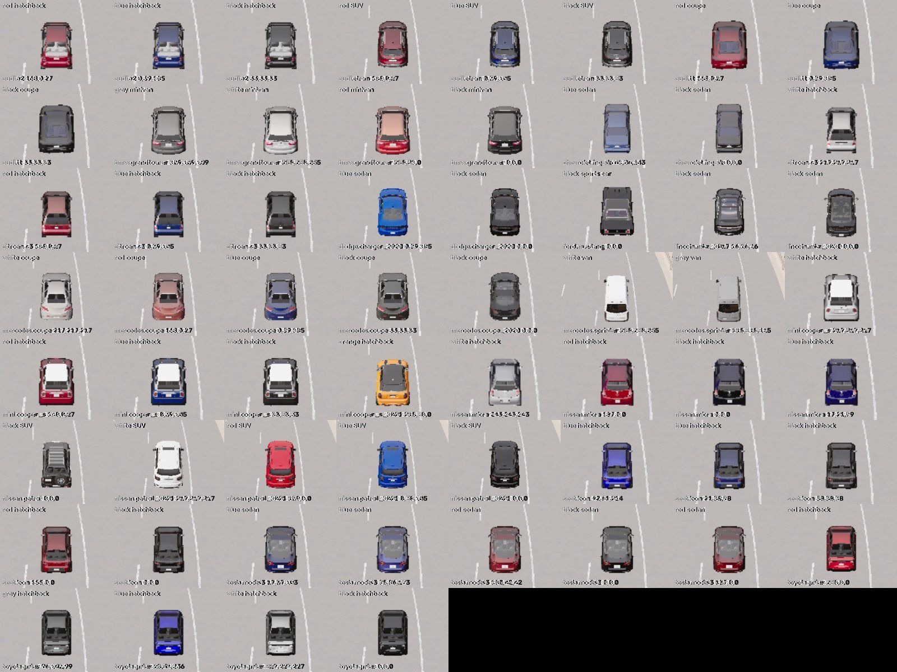
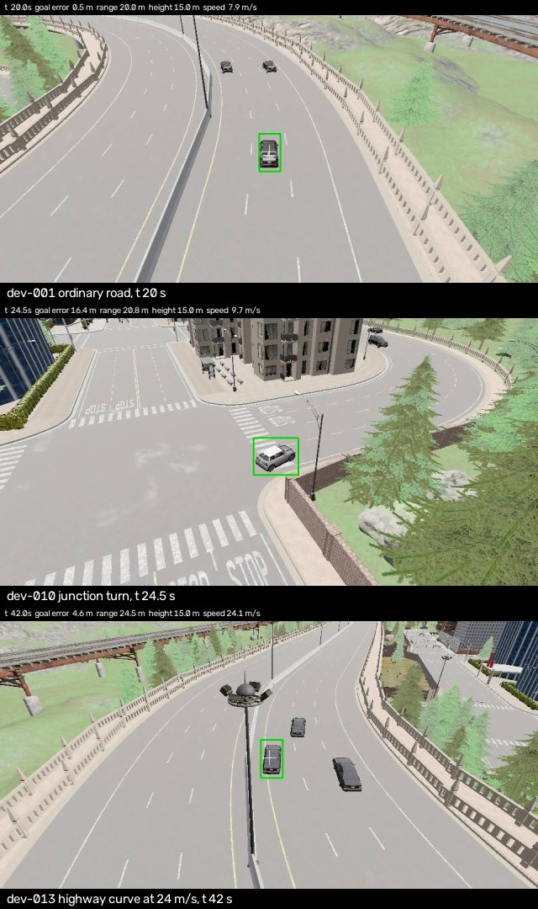

# Phase 2 첫 데모 구현 기록

이 문서는 [첫 데모 계획](demo1_plan.md) 4절의 구현 순서를 따라, 단계마다 한 일과 결과를 적는다. 경로와 명령은 `car_follow/` 폴더 기준이다.

| 단계 | 내용 | 상태 |
|---|---|---|
| 1 | 장면과 시험 목록 | 완료 (2026-11-13, 1절) |
| 2 | 드론 이동과 추종 제어 (구성 1) | 구현과 dev 확인 완료 (2026-11-23, 2절). 드론 한계 값은 사용자 결정 대기(2.7절) |
| 3–7 | 화면, 채점기, 탐지기와 추적기, VLM 지정, 평가 | 남음 |

## 1. 장면과 시험 목록

**요약.** Town05에서 시험 63개를 만들었다.

- **공개:** dev 20, pilot 3, smoke 10
- **봉인:** 본평가 30

각 시험은 simulator에 실제로 띄우고 드론 시작 위치에서 본 뒤, 조건을 모두 만족할 때만 남겼다(1.5절).

| 파일 | 내용 |
|---|---|
| `configs/vehicle_types.json` | 차종 이름표 (1.1절) |
| `configs/demo1_trials.json` | dev, pilot, smoke 시험과 본평가의 봉인 기록 |
| `configs/demo1_trials_main.json` | 본평가 30회 (봉인, 1.6절) |
| `src/car_follow/sim.py` | simulator 시작·종료·연결, 동기 모드, 카메라, 화면 투영 |
| `src/car_follow/trials.py` | 색 이름, 문장, 시험 만들기, 봉인 |
| `scripts/make_demo1_trials.py` | 시험 목록 생성. `--catalog`는 색 확인 그림(그림 1)만 그림 |
| `tests/test_demo1_trials.py` | simulator 없이 도는 테스트 10개 |

```powershell
uv run python scripts/make_demo1_trials.py             # simulator를 켜고 네 목록을 만든 뒤 끈다
uv run python -m unittest discover -s tests
```

### 1.1 차종 이름표

CARLA 0.9.16의 바퀴 4개 이상 blueprint 34개에 영어와 한국어 차종 이름을 붙였다. 예: SUV, sedan(세단), hatchback(해치백), coupe(쿠페), minivan(미니밴), sports car(스포츠카), van(승합차). 한국어 이름에는 목적격 조사를 붙인 꼴("SUV를", "세단을")도 함께 적었다.

목표가 될 수 있는 차는 21개다. 다음은 목표에서 뺐고, 다른 차량으로만 나온다.

- **일반 승용차가 아닌 차:** 경찰차, 택시, 구급차, 소방차, 트럭, 버스, 초소형차
- **위에서 몸체 색이 보이지 않는 차:**
  - Volkswagen T2 두 종: 색 속성이 차체 아래쪽만 칠한다(위는 흰색).
  - Jeep Wrangler: 위에서 보면 검은 소프트탑이 차를 덮는다.
  - 이 두 경우는 1.2절의 확인 그림과 시험 생성 예행에서 찾았다.

### 1.2 색 이름

CARLA 차의 색은 RGB 값(예: `217,217,217`)이다. 이 값을 HSV(색상 h°, 채도 s, 명도 v)로 바꿔 색 이름을 정한다.

**표 1. 색 이름 규칙**

| 이름 | 규칙 |
|---|---|
| black | v < 0.2, 또는 s < 0.2이고 v < 0.25 |
| white | s < 0.2이고 v ≥ 0.78 |
| gray | s < 0.2이고 0.25 ≤ v < 0.78 |
| red, orange, yellow, green, blue, purple | s ≥ 0.2일 때 색상으로: red 340–15°, orange 15–40°, yellow 40–70°, green 70–170°, blue 170–260°, purple 260–340° |

목표 차에는 **이름이 분명한 색**만 쓴다. 이름이 애매한 색으로 칠한 차를 문장으로 부르면, 모델이 틀려도 그것이 모델 탓인지 정답 탓인지 알 수 없기 때문이다.

- **black:** v ≤ 0.15이고, 채도가 낮다(s ≤ 0.3, 또는 v ≤ 0.08).
- **white:** v ≥ 0.83이고 s ≤ 0.12.
- **gray:** 0.38 ≤ v ≤ 0.5이고 s ≤ 0.12.
- **유채색:**
  - s ≥ 0.5이고 v ≥ 0.35. orange와 yellow는 v ≥ 0.6이어야 한다(그보다 어두우면 갈색이나 올리브색으로 보임).
  - 색상 경계에서 5° 이상 떨어져 있어야 한다.

이 규칙은 그림만 보고 정하지 않았다. 목표가 될 수 있는 모든 차를 모든 분명한 색으로 드론 시작 위치에서 실제로 그려 보고(그림 1, 60대), 눈으로 본 결과에 맞춰 다음을 고쳤다.

1. **T2 승합차 제외.** 색이 차체 일부에만 칠해진다(1.1절).
2. **Wrangler 제외.** 위에서 보면 소프트탑이 색을 가린다(1.1절).
3. **밝은 회색.** `160,160,160`, `167,166,175`, `187,187,187`은 거의 흰색으로 보인다. 그래서 회색 상한을 0.5로 낮췄다.
4. **어두운 회색.** `83,83,86`, `68,68,77`은 드론에서 보면 거의 검은색이다. 그래서 회색 하한을 0.38로 올렸다.
5. **어두운 초록.** 거의 검은 초록 `0,33,5`가 black으로 분류됐다. 그래서 black에 채도 조건을 더했다.

남은 애매한 점도 있다. Mini와 Audi A2는 지붕이 흰색이라 위에서 보면 흰 부분이 크다. 사람은 이런 차를 차체 색으로 부르므로("빨간 Mini") 그대로 두었다. 옛 Nissan Patrol의 검은색은 지붕 위 은색 짐받이 때문에 짙은 회색으로도 보인다.



*그림 1. 목표가 될 수 있는 차 60대(차종 × 분명한 색)를 드론 시작 위치에서 본 모습.*

- 위쪽 글자: 문장이 쓰는 이름
- 아래쪽 글자: blueprint와 RGB 값

### 1.3 시험 하나의 구성

1. **시작 후보.** 8m 간격의 도로 지점(waypoint) 중 다음을 모두 만족하는 1,141곳이다.
   - 교차로가 아니다.
   - 같은 방향 차선이 2개 이상이다.
   - 앞 35m와 뒤 30m에 교차로가 없다.
2. **목표.** 목표가 될 수 있는 차종 하나를 고르고, 그 차종의 분명한 색 중 하나를 고른다.
3. **비슷한 차.** 목표와 같은 blueprint, 같은 색의 차를 2대 또는 3대 둔다. 자리는 다음 후보 중에서 고른다.
   - 같은 차선: 앞뒤 12, 18, 25m
   - 옆 차선: −20, −12, −6, 0, 6, 12, 20, 25m
   - 같은 차선에서는 서로 8m 이상 떨어뜨린다.
   - 실제로는 1.4절의 문장 종류가 성립하는 자리만 쓴다.
4. **다른 차.** 지도의 spawn point 중 목표와 비슷한 차에서 30m 이상 떨어진 곳에 40대를 둔다.
   - 목표와 같은 차종에 같은 색 이름인 차는 다른 차로 두지 않는다.
   - 그래서 문장의 단어("흰색 SUV")에 맞는 차는 목표와 비슷한 차뿐이다.
5. **드론 시작.** 목표 차선 방향으로 20m 뒤, 15m 위에서 목표를 바라본다. 카메라는 960×540, FOV 90°다.
6. **길이.** 60초(20Hz로 1,200 tick)다.

### 1.4 문장

먼저 "드론 시작 시점에 보이는 일치 차"를 정한다. 비슷한 차 중 instance segmentation에서 30 pixel 이상 보이는 차다. 문장은 목표와 이 차들 중에서 목표 한 대만 가리켜야 한다. 쓰는 표현은 세 가지다.

| 표현 | 성립 조건 | 영어 | 한국어 |
|---|---|---|---|
| lane | 보이는 비슷한 차가 모두 같은 도로·방향·차선 수에 있고, 목표와 같은 차선에는 없음 | follow the white SUV in the right lane | 오른쪽 차선의 흰색 SUV를 따라가 |
| front | 목표가 보이는 비슷한 차 모두보다 차선 방향으로 6m 이상 앞 | follow the black hatchback furthest ahead | 가장 앞에 있는 검은색 해치백을 따라가 |
| back | 목표가 보이는 비슷한 차 모두보다 6m 이상 뒤 | follow the red minivan furthest back | 가장 뒤에 있는 빨간색 미니밴을 따라가 |

- **차선 이름.**
  - 같은 방향 2차선: 왼쪽, 오른쪽
  - 3차선: 왼쪽, 가운데, 오른쪽
  - 4차선 이상: 맨 왼쪽, 왼쪽에서 두 번째 등
- **표현 배분.** 시험은 미리 정한 표현 하나를 목표로 만든다.
  - 순서는 lane, lane, front, back을 반복한다.
  - 그래서 목록마다 표현의 비율이 고정된다: dev 10/5/5, pilot 2/1/0, smoke 6/2/2, 본평가 16/7/7.
  - 처음에는 표현을 무작위로 골랐다. 그러자 pilot과 smoke에 front가 하나도 없었고, 그래서 이 방식으로 바꿨다.
- **자리 제한.** 비슷한 차는 그 표현이 성립하는 자리에만 둔다. lane이면 다른 차선, front면 6m 이상 뒤, back이면 6m 이상 앞이다.
- **문장이 가리키는 시점.** 문장은 시작 시점의 배치를 말한다. 시험 중에 차들이 차선을 바꾸는 것은 상관없다. 처음 지정은 시작 시점에 한 번만 하기 때문이다.

### 1.5 확인과 버림

뽑은 시험은 simulator에 띄우고 드론 시작 위치에서 5 tick 뒤에 본다. 다음 조건을 모두 만족할 때만 남긴다.

1. 목표와 모든 비슷한 차가 spawn됐다.
2. 목표가 300 pixel 이상 보인다.
3. 비슷한 차가 하나 이상 보인다.
4. 미리 정한 표현이 성립한다.
5. 다른 시험과 시작 위치가 겹치지 않는다(네 목록 전체에서).

다른 차 중 spawn되지 않은 차는 시험에서 지운다. 이번에는 모든 시험에서 40대가 다 spawn됐다.

**표 2. 목록별 시도와 버린 이유**

| 목록 | 남김 | 시도 | 버린 이유 |
|---|---|---|---|
| 본평가 | 30 | 47 | 시작 겹침 7, front 불성립 4, lane 불성립 3, back 불성립 3 |
| pilot | 3 | 4 | 보이는 비슷한 차 없음 1 |
| smoke | 10 | 18 | lane 불성립 2, front 불성립 2, 보이는 비슷한 차 없음 2, 목표가 가려짐 1, back 불성립 1 |
| dev | 20 | 26 | front 불성립 5, 보이는 비슷한 차 없음 1 |

### 1.6 나누기와 봉인

**목록.** 목록은 네 개다. dev는 계획에 없던 목록으로, 이번에 더했다.

- **dev:** 개발과 조정에 쓴다. 그래야 pilot과 smoke를 조정에 쓰지 않고 관문으로만 쓸 수 있다.
- **pilot, smoke:** 관문이다.
- **본평가:** 봉인한다.

**지도 칸으로 나누기.** 시작 위치는 지도를 60m 칸으로 나눈 뒤 칸 단위로 목록에 배정한다.

- 각 칸의 좌표를 sha256으로 바꿔, 칸의 1/4은 본평가, 1/4은 관문(pilot, smoke), 1/2은 dev에 준다.
- 시험을 뽑을 때는 칸을 먼저 고르고 그 칸 안의 지점을 고른다. 그래서 시작 위치가 지도 전체로 퍼진다.
- 처음에는 도로 단위로 나눴다. 그런데 시작 후보가 있는 도로가 십여 개뿐이라 관문에 도로가 2개만 남았고, 그래서 칸 단위로 바꿨다.

| 목록 | 시작 후보 | 칸 | 도로 |
|---|---|---|---|
| 본평가 | 192 | 7 | 7 |
| 관문 (pilot, smoke) | 372 | 10 | 7 |
| dev | 577 | 24 | 10 |

**seed.** 목록마다 seed 시작값이 다르다: dev 100000, pilot 200000, smoke 300000, 본평가 900000. 여기에 시도 번호를 더한다.

**봉인.** 본평가 30회는 별도 파일에 있고, 그 sha256(`282edf8e…f38f`)을 `demo1_trials.json`에 적었다.

- `trials.load_trials("main")`은 `open_sealed=True` 없이는 열리지 않는다.
- 열 때는 파일이 기록된 sha256과 같은지 확인한다.
- 생성할 때 본평가 시험의 그림은 만들지 않았고, 시도 수와 버린 이유만 출력했다.
- 본평가 목록은 최종본 전에 두 번 만들어졌다가 버려졌다(어두운 회색 기준, 표현 배분 조정). 어느 때도 내용은 열어 보지 않았다.

### 1.7 결과

**표 3. 공개 목록의 구성**

| 항목 | pilot (3) | smoke (10) | dev (20) |
|---|---|---|---|
| 표현 lane / front / back | 2 / 1 / 0 | 6 / 2 / 2 | 10 / 5 / 5 |
| 목표 차종 | 쿠페 1, SUV 1, 해치백 1 | 세단 3, SUV 3, 해치백 3, 쿠페 1 | 해치백 9, 세단 3, SUV 3, 스포츠카 3, 쿠페 1, 승합차 1 |
| 비슷한 차 2대 / 3대 | 3 / 0 | 3 / 7 | 9 / 11 |
| 시작 때 보이는 비슷한 차 1 / 2 / 3대 | 0 / 3 / 0 | 0 / 8 / 2 | 2 / 13 / 5 |
| 같은 방향 2차선 / 3차선 | 0 / 3 | 0 / 10 | 6 / 14 |
| 목표의 보이는 pixel | 1,760–3,011 | 1,555–3,011 | 1,522–3,166 |

본평가 30회의 구성은 봉인되어 있어 표현 배분(16/7/7)과 개수 외에는 모른다.


*그림 2. dev 시험의 시작 화면. 위부터 lane, front, back 표현 두 개씩이다. 초록 상자가 목표, 주황 상자가 비슷한 차이며, 위 띠의 문장이 목표 한 대만 가리킨다.*

**관찰.**

- pilot과 smoke는 모두 같은 방향 3차선 도로에서 시작한다. 관문 칸의 도로가 그렇기 때문이다. 2차선 도로의 시작은 dev에만 있다.
- 시작할 때 비슷한 차가 드론 바로 아래(화면 아래 끝)에 걸쳐 보이는 시험이 있다.
- 이번 확인은 차가 멈춘 상태에서 했다. 자동 주행에서도 같은 시험이 똑같이 재현되는지는 계획대로 pilot에서 두 번 실행해 확인한다(계획 3.3절).

### 1.8 그 밖에 고친 것

- **공통 함수 정리.** simulator 시작·종료·연결과 카메라 함수를 `src/car_follow/sim.py`로 모았다. `scripts/carla_check.py`도 이 함수를 쓰도록 바꿨고, Town05 Low에서 다시 실행해 정상 동작을 확인했다.
- **simulator 시작 보호.**
  - simulator가 시작 요청에 응답하지 않은 일이 약 20번의 시작 중 세 번 있었다. 설치 확인 때 한 번, 이번 시험 생성 때 한 번, 폴더 정리 뒤 확인 실행 때 한 번이다.
  - 세 번째 때 살펴보니, simulator는 포트 2000–2002를 열고 화면도 그리고 있었지만 어떤 client에도 답하지 않았다. 새로 띄운 client도 마찬가지였다. 그래서 client 쪽 문제가 아니라 simulator가 시작 중에 멈춘 것으로 본다.
  - 다시 시작하면 매번 몇 초 만에 응답했다. 원인은 찾지 못했다.
  - 그래서 `sim.session`과 `carla_check.py`에 두 가지를 넣었다. 포트 2000을 이미 무언가가 쓰고 있으면 시작하지 않는다. 120초 안에 응답이 없으면 simulator를 끄고 한 번 더 시작한다.
- **테스트 위치.** Phase 2 테스트는 `car_follow/tests/`에 있고 uv 환경에서 돈다. carla가 없는 WSL의 Phase 1 테스트(`landing_vla/tests/`)와는 폴더가 달라 섞이지 않는다.

**다음 단계.** 2단계는 드론 이동과 추종 제어다(구성 1). 2절에 적었다.

## 2. 드론 이동과 추종 제어 (구성 1)

**요약.** 드론 모델과 추종 제어기를 만들고, dev 시험 20개에서 simulator 정답 위치로 따라가게 했다.

- **드론 모델.** 속도 명령을 1차 지연으로 따르는 점질량 모델이다. 제한은 속도, 가속도, 방향 회전에 둔다.
- **추종 제어기.** 목표 지점의 움직임을 앞질러 반영하고, 오차는 가속도 한도 안에서 줄인다. 차의 진행 방향은 걸러서 쓴다.
- **재현성.** 같은 시험을 세 번 따로 기록했더니 모든 차의 궤적이 bit 단위로 같았다.
- **결과.** 계획의 초기 한계(20m/s, 4m/s²)로는 20개 중 5개가 거리 오차 3m를 넘는다. 고가 순환도로 구간에서 차가 24.5m/s로 달리기 때문이다.
  - 25m/s, 6m/s²로 올리면 20개 모두 3m 이하이고 평균은 1.22m다.
  - 한계 값을 바꿀지는 사용자가 정한다(2.7절).

| 파일 | 내용 |
|---|---|
| `src/car_follow/drone.py` | 드론 모델: 점질량, 속도 1차 지연, 제한, gimbal (2.1절) |
| `src/car_follow/follow.py` | 추종 제어기와 offline 비행 (2.2절) |
| `src/car_follow/metrics.py` | 추종 품질 지표 (2.5절) |
| `scripts/demo1_follow.py` | `record`(교통 기록), `offline`(기록 위 비행과 채점), `live`(simulator 안 비행과 확인 영상) |
| `tests/test_drone_follow.py` | simulator 없이 도는 테스트 8개 (제한, 지연, 회전, 직선·회전 추종, 카메라 각도) |

```powershell
uv run python scripts/demo1_follow.py record --split dev --run rec1
uv run python scripts/demo1_follow.py offline --run rec1 --speed 20 25 --accel 4 6 --lag 0.5 1 --heading 1 2
uv run python scripts/demo1_follow.py live --split dev --ids dev-001 --speed 25 --accel 6 --lag 0.5 --heading 1 --compare rec1 --video
```

### 2.1 드론 모델

- **비행 물리를 쓰지 않는 이유.** CARLA에는 동기 모드 tick에 맞춰 도는 비행 모델이 없다([CARLA-Air 확인](carla_air_check.md)). 그래서 드론을 tick마다 직접 적분한다. 이렇게 하면 재현된다.
- **속도.** 명령 속도는 먼저 최고 속도로 자른다.
  - 그 뒤 1차 지연으로 따라간다: 한 tick 동안의 변화는 `(명령 − 현재) × (1 − e^(−dt/τ))`.
  - 이렇게 나온 가속도를 수평(벡터 크기)과 수직으로 나눠 한도로 자른다.
  - 위치는 사다리꼴 적분이다.
- **카메라.** gimbal에 달려 있다.
  - 좌우 방향은 몸체 방향과 같고, 몸체가 회전 한도 안에서 돌린다.
  - 위아래 각도는 gimbal이 따로 돌린다. 범위는 수평부터 수직 아래까지다.

**표 4. 드론 모델 값**

| 항목 | 값 | 근거 |
|---|---|---|
| 수평 최고 속도 | 20m/s | 계획 2.3절 초기값. 2.5절에서 25m/s를 제안 |
| 수평 가속도 | 4m/s² | 계획 2.3절 초기값. 2.5절에서 6m/s²를 제안 |
| 수직 속도, 가속도 | 4m/s, 2m/s² | 가정. 이번 시험에서는 높이 오차가 최대 0.6m로 작았음 |
| 방향 회전 | 60°/s | 계획 2.3절. 이번 시험에서는 최대 42°/s로 한도에 닿지 않음 |
| gimbal 위아래 회전 | 90°/s | 가정 |
| 속도 지연 τ | 0.5s | 가정. AirSim SimpleFlight 기본값(약 4초)은 실제 쿼드로터를 대표하지 않는다([CARLA-Air 확인](carla_air_check.md) 2.4절). 1.0s로도 비교 |

### 2.2 추종 제어기

- **목표 지점.** 차 뒤 20m, 위 15m다(계획 2.3절).
- **속도 명령.** 실제 드론의 offboard 속도 명령과 같은 형태다. 세 항을 더한다.
  1. **목표 지점의 속도.** 목표 지점 위치의 차분을 0.25초 시간 상수로 거른 값이다.
  2. **지연 보상.** τ × 목표 지점의 가속도다.
  3. **오차 보정.** 목표 지점까지의 오차를 줄이는 속도다. sqrt 제어기(ArduPilot 위치 제어기와 같은 방식)를 쓴다.
     - 가까우면 오차에 비례한다. 비례 계수는 τ에 맞춰 임계 감쇠가 되게 `1/(4τ)`로 두고, 0.25–1.0/s 범위로 자른다.
     - 멀면 2m/s²로 멈출 수 있는 속도까지만 낸다.
- **진행 방향 거르기.** 목표 지점을 정하는 차의 진행 방향을 시간 상수(기본 1초)로 거른다. PX4 Follow Me의 responsiveness 필터와 같은 생각이다.
- **카메라.** 차의 상자 중심을 바라본다.

**두 장치가 필요한 이유.**

- **sqrt 제어기.** 합성한 90° 회전(반지름 15m, 8m/s)에서, 처음 쓴 단순 비례 보정은 드론이 목표 지점을 30m 지나쳤다. 목표 지점이 옆으로 빠르게 휘는 동안 쌓인 속도를 가속도 한도 안에서 멈추지 못했기 때문이다.
- **진행 방향 거르기.** sqrt 제어기를 넣어도 진행 방향을 거르지 않으면 같은 회전에서 차와의 거리 오차가 최대 23m였다. 2초로 거르면 약 1m였다(지연 0.5초).
  - 실제 교통에서는 다른 이유로도 필요하다. CARLA가 주는 차의 방향에 작은 흔들림이 있고, 20m 팔이 이를 키운다.
  - dev-001에서 거르지 않으면 저크 RMS가 11m/s³(지연 0.5초)였고, 1초로 거르면 2.1m/s³였다.
  - 대가가 있다. 차가 꺾을 때 드론이 차 주위를 늦게 돌아 들어간다(방위가 늦음, 2.5절).

### 2.3 교통 기록과 offline 비행

**offline 비행이 성립하는 이유.** 구성 1에서 드론은 차의 정답 위치를 쓰고, 세계에 아무 영향도 주지 않는다. 그래서 각 시험의 교통을 한 번 기록해 두면, 추종 비행은 기록 위에서 몇 번이든 offline으로 할 수 있다. offline과 live는 같은 함수(`Follower.command`, `drone.step`)를 같은 순서로 부른다.

**시험 시작.** 모든 시험은 같은 상태에서 시작한다.

1. 차와 센서를 모두 지우고 tick 한 번.
2. 신호등을 모두 처음 상태로 되돌린다(`reset_all_traffic_lights`).
3. Traffic Manager seed를 시험의 seed로 둔다.
4. 차를 정해진 순서(목표, 비슷한 차, 다른 차)로 띄우고 autopilot을 켠다.

**기록.**

- 1,200 tick 동안 매 tick 모든 차의 위치, 자세, 속도를 남긴다.
- 상자 크기도 남기고, 목표는 상자 중심 위치도 남긴다.
- 파일은 `outputs/demo1_follow/traffic/`(로컬)에 저장된다.

**속도.**

- 카메라 없이 기록하면 시험 하나(1,200 tick)에 8–10초 걸린다(약 140 tick/s).
- 960×540 RGB 카메라 하나를 켜고 live로 날면 53–67 tick/s다.
- 이때 GPU 전체 사용량은 4.8–5.2GB였다. 그중 약 2GB는 다른 프로그램이 쓰는 몫이다.

### 2.4 재현성

**표 5. 같은 시험을 다시 돌린 결과**

| 비교 | 대상 | 결과 |
|---|---|---|
| 기록 rec1 대 rec2 (각각 새 simulator 세션) | dev 20개, 모든 차 | bit 단위로 같음 |
| 기록 test1(dev-001만 단독) 대 rec1 | dev-001, 모든 차 | 같음 |
| live(카메라 있음) 대 rec1 | dev-001, dev-010, dev-013 | 목표는 세 시험 모두 같음. 다른 차는 dev-001과 dev-010에서 같음. dev-013에서는 10대가 42.9초부터 조금씩 갈라져 최대 92.6m 차이. 갈라지기 시작할 때 이 차들은 목표에서 100m 이상 떨어져 있었음 |
| live 두 번째 대 live 첫 번째 | 같은 세 시험 | 모든 차가 같음 |
| live 드론 경로 대 같은 교통의 offline 드론 경로 | 같은 세 시험 | 같음 (차이 0.0m) |

- **해석.** 구성(띄운 센서까지)이 같으면 시험은 bit 단위로 재현된다.
  - 카메라를 더하면 목표에서 먼 차들이 조금 다르게 움직일 수 있다.
  - actor ID가 밀린 것은 원인이 아니었다. dev-010도 ID가 346 밀렸지만 모든 차가 같았다. 원인은 찾지 못했다.
- **뜻.** 계획 3.3절의 재현성 확인은 같은 구성끼리 비교해야 한다.
  - 구성 1–3을 정확히 같은 교통에서 견주려면 방법이 두 가지다.
    - 모든 구성에서 센서를 똑같이 띄운다.
    - 기록한 교통을 그대로 다시 재생한다(차를 매 tick 기록된 자리에 둔다).
  - 채점기(4단계)와 탐지기(5단계) 전에 정한다.

### 2.5 dev 결과 (offline, 시험 20개)

**목표 차의 속도.**

- 시험별 평균 속도는 2.4–15.6m/s였다.
- 20개 중 9개에서 목표가 20m/s를 넘었다. 최고 24.5m/s(88km/h)로, 고가 순환도로 구간이다.
- dev-011, dev-013, dev-020은 60초 중 18–25초를 20m/s 넘게 달린다.

**표 6. 설정별 결과** (지표는 시작 후 5초를 뺀 값. 평균은 시험 20개의 평균, 최악 p95는 시험별 p95 중 가장 큰 값)

| 최고 속도 | 가속도 | 지연 τ | 방향 거르기 | 거리 오차 평균 | 거리 오차 최악 p95 | 3m 넘는 시험 | 차와의 거리 오차 평균 | 방위 오차 평균 | 저크 RMS 평균 |
|---|---|---|---|---|---|---|---|---|---|
| 20m/s | 4m/s² | 0.5s | 1s | 4.58m | 78.8m | 5 | 3.81m | 3.6° | 3.1m/s³ |
| 20m/s | 4m/s² | 0.5s | 2s | 4.39m | 69.8m | 5 | 3.13m | 4.9° | 3.0m/s³ |
| 25m/s | 6m/s² | 0.5s | 1s | **1.22m** | 10.9m | **0** | 0.66m | 2.1° | 3.7m/s³ |
| 25m/s | 6m/s² | 0.5s | 2s | 1.68m | 14.5m | 2 | 0.41m | 4.0° | 3.5m/s³ |
| 25m/s | 6m/s² | 1.0s | 1s | 1.62m | 11.8m | 4 | 1.10m | 2.2° | 3.2m/s³ |
| 30m/s | 8m/s² | 0.5s | 1s | 1.01m | 9.8m | 0 | 0.45m | 1.9° | 4.0m/s³ |

- **거리 오차**는 계획 3.2절의 정의다: 드론과 "실제 차 기준 정확히 뒤 20m, 위 15m" 지점 사이의 거리.
- **차와의 거리 오차**는 수평 거리와 20m의 차이다.
- **방위 오차**는 드론이 차의 정확히 뒤에서 벗어난 각도다.

**계획 초기값(20m/s, 4m/s²)에서 생기는 두 가지 실패.**

1. **목표가 드론보다 빠름.** 목표가 20m/s를 넘는 동안 드론이 계속 뒤처진다(최대 82m).
2. **고속 곡선.** 24m/s로 곡선을 돌려면 약 5.3m/s²의 구심 가속도가 필요하다. 4m/s²를 넘으므로, 최고 속도를 30m/s로 올려도 드론은 바깥으로 밀리며 뒤처진다.
   - dev-013에서 30m/s, 4m/s²일 때 차와의 수평 거리가 55m까지 벌어졌다.
   - 가속도를 6m/s²로 올리면 이 실패가 없어진다.

**제안값(25m/s, 6m/s², τ 0.5s, 방향 거르기 1s)에서 남는 오차.**

- 거리 오차 최대(16.9m)는 교차로에서 90° 꺾을 때 나온다.
  - dev-010, dev-018, dev-017, dev-015, dev-012가 그렇다.
  - 이때 차와의 거리는 20–22m로 유지되고, 방위만 늦는다(dev-010 방위 오차 p95 29°).
  - 계획 3.2절의 거리 오차는 이 의도된 늦음도 오차로 센다. 그래도 시험별 평균은 모두 3m 이하다(가장 큰 것: dev-013 2.9m, dev-010 2.8m, dev-018 2.8m).
- 카메라 조준 오차(정답 위치 기준)는 시험별 p95가 1.2° 이하다. 목표는 모든 tick에서 화면 안에 있었다.
- 높이 오차는 최대 0.6m다.
- 지연을 1.0초로 늘리면 3m를 넘는 시험이 4개 생긴다.

### 2.6 live 확인

제안값으로 dev-001, dev-010, dev-013을 simulator 안에서 날고 드론 카메라 영상을 남겼다.

- 드론 경로는 같은 교통 위의 offline 경로와 같았다(2.4절).
- 영상: `outputs/demo1_follow/video/`(로컬).



*그림 3. live 확인 영상의 세 장면.*

- 위: 보통 도로.
- 가운데: 교차로 회전. 목표 지점 오차는 16.4m지만 차와의 거리는 20.8m로, 드론이 차 주위를 돌아 들어가는 중이다.
- 아래: 24m/s 고속 곡선.
- 초록 상자는 정답 상자를 투영한 것이고, 위 띠는 그 tick의 오차와 속도다.

**관찰.** 드론 모델에는 충돌이 없다. dev-013에서는 15m 높이의 드론 바로 앞으로 가로등 꼭대기가 지나간다. 나무나 가로등이 카메라를 가리는 시간은 아직 재지 않았다. 채점기(4단계)에서 instance segmentation으로 잴 수 있다.

### 2.7 정할 것

1. **드론 한계.**
   - 계획 초기값 20m/s, 4m/s²를 25m/s, 6m/s²로 올리는 것을 제안한다.
     - 6m/s²는 쿼드로터가 약 31° 기울면 내는 수평 가속도다.
     - 25m/s는 Town05 고가도로의 차 속도(최고 24.5m/s)를 따라갈 수 있는 최소값이다.
   - 다른 길도 있다. 초기값을 유지하고 고가도로 구간을 "목표가 너무 빠름" 실패로 다룰 수 있다(연구 계획 표 2의 소실). 그러면 첫 데모의 clean 합격선(거리 오차 3m)은 고속 시험에서 넘기 어렵다.
2. **속도 지연.** 본 설정은 0.5초로 두고, 1.0초는 견고성 비교로만 쓰는 것을 제안한다.
3. **방향 거르기.** 1초를 제안한다. 2초는 차와의 거리를 더 잘 지키지만 방위가 더 늦고, 3m를 넘는 시험이 2개 생긴다.
4. **구성 사이에서 교통을 같게 맞추는 방법.** 2.4절의 두 방법 중 하나를 채점기 전에 정한다.

**다음 단계.** 위 값이 정해지면 3단계(화면: 1인칭 표시, 3인칭 드론 그리기, 위에서 본 지도)로 간다.
