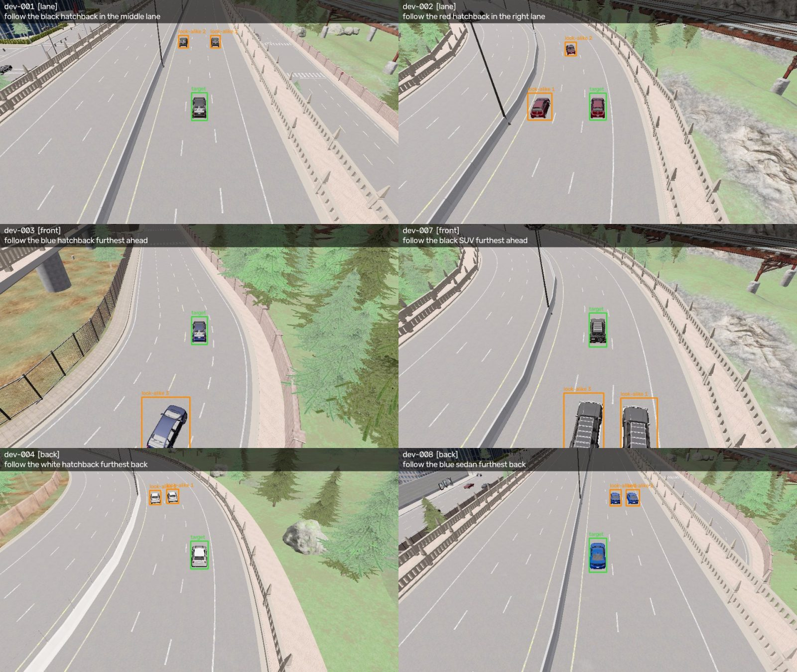

# Phase 2 첫 데모 구현 기록

이 문서는 [첫 데모 계획](demo1_plan.md) 4절의 구현 순서를 따라, 단계마다 한 일과 결과를 적는다. 경로와 명령은 `car_follow/` 폴더 기준이다.

| 단계 | 내용 | 상태 |
|---|---|---|
| 1 | 장면과 시험 목록 | 완료 (2026-11-13, 1절) |
| 2 | 드론 이동과 추종 제어 (구성 1) | 다음 |
| 3–7 | 화면, 채점기, 탐지기와 추적기, VLM 지정, 평가 | 남음 |

## 1. 장면과 시험 목록

**요약.** Town05에서 시험 63개를 만들었다.

- **공개:** dev 20, pilot 3, smoke 10
- **봉인:** 본평가 30

각 시험은 simulator에 실제로 띄우고 드론 시작 위치에서 본 뒤, 조건을 모두 만족할 때만 남겼다(1.5절).

| 파일 | 내용 |
|---|---|
| `configs/vehicle_types.json` | 차종 이름표 (1.1절) |
| `configs/demo1_trials.json` | dev, pilot, smoke 시험과 본평가의 봉인 기록 |
| `configs/demo1_trials_main.json` | 본평가 30회 (봉인, 1.6절) |
| `src/car_follow/sim.py` | simulator 시작·종료·연결, 동기 모드, 카메라, 화면 투영 |
| `src/car_follow/trials.py` | 색 이름, 문장, 시험 만들기, 봉인 |
| `scripts/make_demo1_trials.py` | 시험 목록 생성. `--catalog`는 색 확인 그림(그림 1)만 그림 |
| `tests/test_demo1_trials.py` | simulator 없이 도는 테스트 10개 |

```powershell
uv run python scripts/make_demo1_trials.py             # simulator를 켜고 네 목록을 만든 뒤 끈다
uv run python -m unittest discover -s tests
```

### 1.1 차종 이름표

CARLA 0.9.16의 바퀴 4개 이상 blueprint 34개에 영어와 한국어 차종 이름을 붙였다. 예: SUV, sedan(세단), hatchback(해치백), coupe(쿠페), minivan(미니밴), sports car(스포츠카), van(승합차). 한국어 이름에는 목적격 조사를 붙인 꼴("SUV를", "세단을")도 함께 적었다.

목표가 될 수 있는 차는 21개다. 다음은 목표에서 뺐고, 다른 차량으로만 나온다.

- **일반 승용차가 아닌 차:** 경찰차, 택시, 구급차, 소방차, 트럭, 버스, 초소형차
- **위에서 몸체 색이 보이지 않는 차:**
  - Volkswagen T2 두 종: 색 속성이 차체 아래쪽만 칠한다(위는 흰색).
  - Jeep Wrangler: 위에서 보면 검은 소프트탑이 차를 덮는다.
  - 이 두 경우는 1.2절의 확인 그림과 시험 생성 예행에서 찾았다.

### 1.2 색 이름

CARLA 차의 색은 RGB 값(예: `217,217,217`)이다. 이 값을 HSV(색상 h°, 채도 s, 명도 v)로 바꿔 색 이름을 정한다.

**표 1. 색 이름 규칙**

| 이름 | 규칙 |
|---|---|
| black | v < 0.2, 또는 s < 0.2이고 v < 0.25 |
| white | s < 0.2이고 v ≥ 0.78 |
| gray | s < 0.2이고 0.25 ≤ v < 0.78 |
| red, orange, yellow, green, blue, purple | s ≥ 0.2일 때 색상으로: red 340–15°, orange 15–40°, yellow 40–70°, green 70–170°, blue 170–260°, purple 260–340° |

목표 차에는 **이름이 분명한 색**만 쓴다. 이름이 애매한 색으로 칠한 차를 문장으로 부르면, 모델이 틀려도 그것이 모델 탓인지 정답 탓인지 알 수 없기 때문이다.

- **black:** v ≤ 0.15이고, 채도가 낮다(s ≤ 0.3, 또는 v ≤ 0.08).
- **white:** v ≥ 0.83이고 s ≤ 0.12.
- **gray:** 0.38 ≤ v ≤ 0.5이고 s ≤ 0.12.
- **유채색:**
  - s ≥ 0.5이고 v ≥ 0.35. orange와 yellow는 v ≥ 0.6이어야 한다(그보다 어두우면 갈색이나 올리브색으로 보임).
  - 색상 경계에서 5° 이상 떨어져 있어야 한다.

이 규칙은 그림만 보고 정하지 않았다. 목표가 될 수 있는 모든 차를 모든 분명한 색으로 드론 시작 위치에서 실제로 그려 보고(그림 1, 60대), 눈으로 본 결과에 맞춰 다음을 고쳤다.

1. **T2 승합차 제외.** 색이 차체 일부에만 칠해진다(1.1절).
2. **Wrangler 제외.** 위에서 보면 소프트탑이 색을 가린다(1.1절).
3. **밝은 회색.** `160,160,160`, `167,166,175`, `187,187,187`은 거의 흰색으로 보인다. 그래서 회색 상한을 0.5로 낮췄다.
4. **어두운 회색.** `83,83,86`, `68,68,77`은 드론에서 보면 거의 검은색이다. 그래서 회색 하한을 0.38로 올렸다.
5. **어두운 초록.** 거의 검은 초록 `0,33,5`가 black으로 분류됐다. 그래서 black에 채도 조건을 더했다.

남은 애매한 점도 있다. Mini와 Audi A2는 지붕이 흰색이라 위에서 보면 흰 부분이 크다. 사람은 이런 차를 차체 색으로 부르므로("빨간 Mini") 그대로 두었다. 옛 Nissan Patrol의 검은색은 지붕 위 은색 짐받이 때문에 짙은 회색으로도 보인다.


*그림 1. 목표가 될 수 있는 차 60대(차종 × 분명한 색)를 드론 시작 위치에서 본 모습.*

- 위쪽 글자: 문장이 쓰는 이름
- 아래쪽 글자: blueprint와 RGB 값

### 1.3 시험 하나의 구성

1. **시작 후보.** 8m 간격의 도로 지점(waypoint) 중 다음을 모두 만족하는 1,141곳이다.
   - 교차로가 아니다.
   - 같은 방향 차선이 2개 이상이다.
   - 앞 35m와 뒤 30m에 교차로가 없다.
2. **목표.** 목표가 될 수 있는 차종 하나를 고르고, 그 차종의 분명한 색 중 하나를 고른다.
3. **비슷한 차.** 목표와 같은 blueprint, 같은 색의 차를 2대 또는 3대 둔다. 자리는 다음 후보 중에서 고른다.
   - 같은 차선: 앞뒤 12, 18, 25m
   - 옆 차선: −20, −12, −6, 0, 6, 12, 20, 25m
   - 같은 차선에서는 서로 8m 이상 떨어뜨린다.
   - 실제로는 1.4절의 문장 종류가 성립하는 자리만 쓴다.
4. **다른 차.** 지도의 spawn point 중 목표와 비슷한 차에서 30m 이상 떨어진 곳에 40대를 둔다.
   - 목표와 같은 차종에 같은 색 이름인 차는 다른 차로 두지 않는다.
   - 그래서 문장의 단어("흰색 SUV")에 맞는 차는 목표와 비슷한 차뿐이다.
5. **드론 시작.** 목표 차선 방향으로 20m 뒤, 15m 위에서 목표를 바라본다. 카메라는 960×540, FOV 90°다.
6. **길이.** 60초(20Hz로 1,200 tick)다.

### 1.4 문장

먼저 "드론 시작 시점에 보이는 일치 차"를 정한다. 비슷한 차 중 instance segmentation에서 30 pixel 이상 보이는 차다. 문장은 목표와 이 차들 중에서 목표 한 대만 가리켜야 한다. 쓰는 표현은 세 가지다.

| 표현 | 성립 조건 | 영어 | 한국어 |
|---|---|---|---|
| lane | 보이는 비슷한 차가 모두 같은 도로·방향·차선 수에 있고, 목표와 같은 차선에는 없음 | follow the white SUV in the right lane | 오른쪽 차선의 흰색 SUV를 따라가 |
| front | 목표가 보이는 비슷한 차 모두보다 차선 방향으로 6m 이상 앞 | follow the black hatchback furthest ahead | 가장 앞에 있는 검은색 해치백을 따라가 |
| back | 목표가 보이는 비슷한 차 모두보다 6m 이상 뒤 | follow the red minivan furthest back | 가장 뒤에 있는 빨간색 미니밴을 따라가 |

- **차선 이름.**
  - 같은 방향 2차선: 왼쪽, 오른쪽
  - 3차선: 왼쪽, 가운데, 오른쪽
  - 4차선 이상: 맨 왼쪽, 왼쪽에서 두 번째 등
- **표현 배분.** 시험은 미리 정한 표현 하나를 목표로 만든다.
  - 순서는 lane, lane, front, back을 반복한다.
  - 그래서 목록마다 표현의 비율이 고정된다: dev 10/5/5, pilot 2/1/0, smoke 6/2/2, 본평가 16/7/7.
  - 처음에는 표현을 무작위로 골랐다. 그러자 pilot과 smoke에 front가 하나도 없었고, 그래서 이 방식으로 바꿨다.
- **자리 제한.** 비슷한 차는 그 표현이 성립하는 자리에만 둔다. lane이면 다른 차선, front면 6m 이상 뒤, back이면 6m 이상 앞이다.
- **문장이 가리키는 시점.** 문장은 시작 시점의 배치를 말한다. 시험 중에 차들이 차선을 바꾸는 것은 상관없다. 처음 지정은 시작 시점에 한 번만 하기 때문이다.

### 1.5 확인과 버림

뽑은 시험은 simulator에 띄우고 드론 시작 위치에서 5 tick 뒤에 본다. 다음 조건을 모두 만족할 때만 남긴다.

1. 목표와 모든 비슷한 차가 spawn됐다.
2. 목표가 300 pixel 이상 보인다.
3. 비슷한 차가 하나 이상 보인다.
4. 미리 정한 표현이 성립한다.
5. 다른 시험과 시작 위치가 겹치지 않는다(네 목록 전체에서).

다른 차 중 spawn되지 않은 차는 시험에서 지운다. 이번에는 모든 시험에서 40대가 다 spawn됐다.

**표 2. 목록별 시도와 버린 이유**

| 목록 | 남김 | 시도 | 버린 이유 |
|---|---|---|---|
| 본평가 | 30 | 47 | 시작 겹침 7, front 불성립 4, lane 불성립 3, back 불성립 3 |
| pilot | 3 | 4 | 보이는 비슷한 차 없음 1 |
| smoke | 10 | 18 | lane 불성립 2, front 불성립 2, 보이는 비슷한 차 없음 2, 목표가 가려짐 1, back 불성립 1 |
| dev | 20 | 26 | front 불성립 5, 보이는 비슷한 차 없음 1 |

### 1.6 나누기와 봉인

**목록.** 목록은 네 개다. dev는 계획에 없던 목록으로, 이번에 더했다.

- **dev:** 개발과 조정에 쓴다. 그래야 pilot과 smoke를 조정에 쓰지 않고 관문으로만 쓸 수 있다.
- **pilot, smoke:** 관문이다.
- **본평가:** 봉인한다.

**지도 칸으로 나누기.** 시작 위치는 지도를 60m 칸으로 나눈 뒤 칸 단위로 목록에 배정한다.

- 각 칸의 좌표를 sha256으로 바꿔, 칸의 1/4은 본평가, 1/4은 관문(pilot, smoke), 1/2은 dev에 준다.
- 시험을 뽑을 때는 칸을 먼저 고르고 그 칸 안의 지점을 고른다. 그래서 시작 위치가 지도 전체로 퍼진다.
- 처음에는 도로 단위로 나눴다. 그런데 시작 후보가 있는 도로가 십여 개뿐이라 관문에 도로가 2개만 남았고, 그래서 칸 단위로 바꿨다.

| 목록 | 시작 후보 | 칸 | 도로 |
|---|---|---|---|
| 본평가 | 192 | 7 | 7 |
| 관문 (pilot, smoke) | 372 | 10 | 7 |
| dev | 577 | 24 | 10 |

**seed.** 목록마다 seed 시작값이 다르다: dev 100000, pilot 200000, smoke 300000, 본평가 900000. 여기에 시도 번호를 더한다.

**봉인.** 본평가 30회는 별도 파일에 있고, 그 sha256(`282edf8e…f38f`)을 `demo1_trials.json`에 적었다.

- `trials.load_trials("main")`은 `open_sealed=True` 없이는 열리지 않는다.
- 열 때는 파일이 기록된 sha256과 같은지 확인한다.
- 생성할 때 본평가 시험의 그림은 만들지 않았고, 시도 수와 버린 이유만 출력했다.
- 본평가 목록은 최종본 전에 두 번 만들어졌다가 버려졌다(어두운 회색 기준, 표현 배분 조정). 어느 때도 내용은 열어 보지 않았다.

### 1.7 결과

**표 3. 공개 목록의 구성**

| 항목 | pilot (3) | smoke (10) | dev (20) |
|---|---|---|---|
| 표현 lane / front / back | 2 / 1 / 0 | 6 / 2 / 2 | 10 / 5 / 5 |
| 목표 차종 | 쿠페 1, SUV 1, 해치백 1 | 세단 3, SUV 3, 해치백 3, 쿠페 1 | 해치백 9, 세단 3, SUV 3, 스포츠카 3, 쿠페 1, 승합차 1 |
| 비슷한 차 2대 / 3대 | 3 / 0 | 3 / 7 | 9 / 11 |
| 시작 때 보이는 비슷한 차 1 / 2 / 3대 | 0 / 3 / 0 | 0 / 8 / 2 | 2 / 13 / 5 |
| 같은 방향 2차선 / 3차선 | 0 / 3 | 0 / 10 | 6 / 14 |
| 목표의 보이는 pixel | 1,760–3,011 | 1,555–3,011 | 1,522–3,166 |

본평가 30회의 구성은 봉인되어 있어 표현 배분(16/7/7)과 개수 외에는 모른다.



*그림 2. dev 시험의 시작 화면. 위부터 lane, front, back 표현 두 개씩이다. 초록 상자가 목표, 주황 상자가 비슷한 차이며, 위 띠의 문장이 목표 한 대만 가리킨다.*

**관찰.**

- pilot과 smoke는 모두 같은 방향 3차선 도로에서 시작한다. 관문 칸의 도로가 그렇기 때문이다. 2차선 도로의 시작은 dev에만 있다.
- 시작할 때 비슷한 차가 드론 바로 아래(화면 아래 끝)에 걸쳐 보이는 시험이 있다.
- 이번 확인은 차가 멈춘 상태에서 했다. 자동 주행에서도 같은 시험이 똑같이 재현되는지는 계획대로 pilot에서 두 번 실행해 확인한다(계획 3.3절).

### 1.8 그 밖에 고친 것

- **공통 함수 정리.** simulator 시작·종료·연결과 카메라 함수를 `src/car_follow/sim.py`로 모았다. `scripts/carla_check.py`도 이 함수를 쓰도록 바꿨고, Town05 Low에서 다시 실행해 정상 동작을 확인했다.
- **simulator 시작 보호.**
  - simulator가 시작 요청에 응답하지 않은 일이 약 20번의 시작 중 세 번 있었다. 설치 확인 때 한 번, 이번 시험 생성 때 한 번, 폴더 정리 뒤 확인 실행 때 한 번이다.
  - 세 번째 때 살펴보니, simulator는 포트 2000–2002를 열고 화면도 그리고 있었지만 어떤 client에도 답하지 않았다. 새로 띄운 client도 마찬가지였다. 그래서 client 쪽 문제가 아니라 simulator가 시작 중에 멈춘 것으로 본다.
  - 다시 시작하면 매번 몇 초 만에 응답했다. 원인은 찾지 못했다.
  - 그래서 `sim.session`과 `carla_check.py`에 두 가지를 넣었다. 포트 2000을 이미 무언가가 쓰고 있으면 시작하지 않는다. 120초 안에 응답이 없으면 simulator를 끄고 한 번 더 시작한다.
- **테스트 위치.** Phase 2 테스트는 `car_follow/tests/`에 있고 uv 환경에서 돈다. carla가 없는 WSL의 Phase 1 테스트(`landing_vla/tests/`)와는 폴더가 달라 섞이지 않는다.

**다음 단계.** 2단계는 드론 이동과 추종 제어다(구성 1). dev 시험에서 simulator의 정답 위치로 따라가며, 속도·가속도·회전 제한과 목표 지점, 카메라 조준을 맞춘다.
