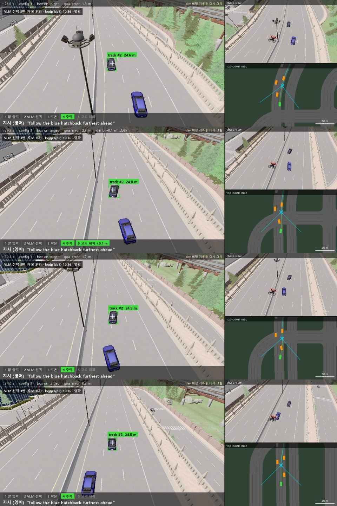
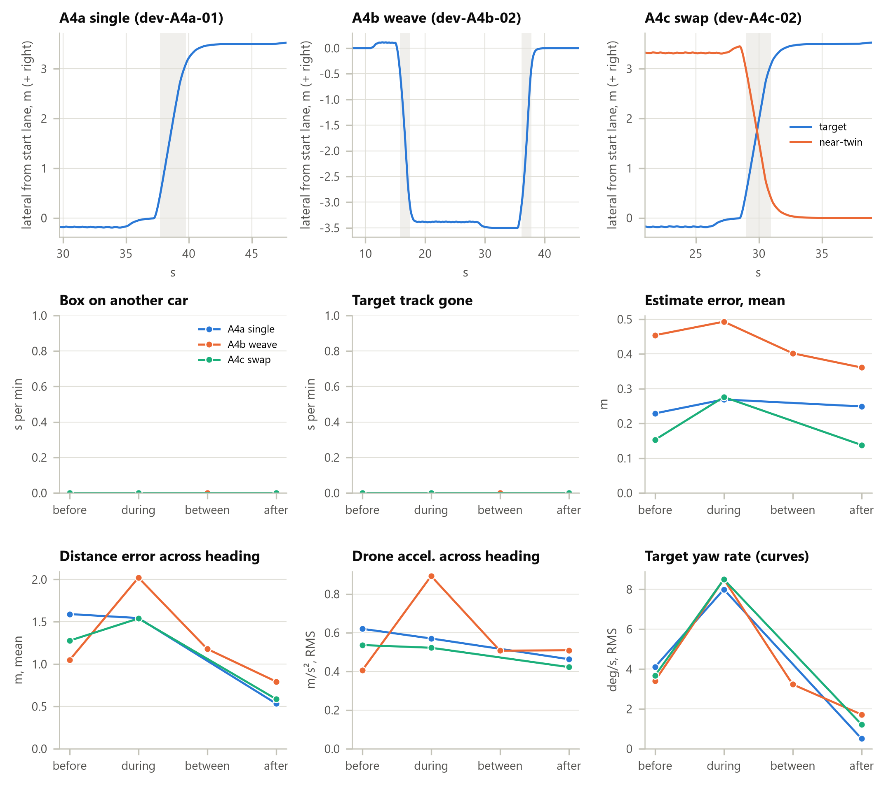

# Phase 2 3단계 구현 기록: 실패 라벨, 지표, 보정

이 문서는 [3단계 계획](failure_plan.md)을 구현한 기록이다. 계획 7절의 순서대로 단계마다 결과를 적는다. 경로는 `car_follow/` 기준이다.

## 1. 상태

**표 1. 진행**

| 단계 (계획 7절) | 상태 | 절 |
|---|---|---|
| 1. 라벨, 지표, 보정 코드와 테스트 | 끝 (2026-11-26) | 2, 3 |
| 2. 기록 늘리기와 비회귀 확인 | 끝 (2026-11-26) | 4 |
| 3. 사건 대본과 생성기 예행 | 끝 (2026-11-26) | 5 |
| 4. 라벨 확인 비행 | 끝 (2026-11-26) | 7 |
| 5. 목록 생성과 봉인 | 끝 (2026-11-27). 공개 dev 68과 보강 60 비행, 봉인 목록(A3 없음) | 9 |
| 추가: 목표 차선 변경 조건 A4 (사용자 요청, 묶음 A 밖) | 끝 (2026-11-26) | 6 |
| 4단계 뒤: 실패 비율과 사건 조정안 | A2 좁힌 대기열과 목록 크기 안 1 확정 (2026-11-26) | 8 |

## 2. 1단계: 라벨, 지표, 보정 코드

모두 순수 numpy다. simulator 없이 기존 비행 기록(npz)과 교통 기록 위에서 돈다.

**표 2. 파일**

| 파일 | 내용 |
|---|---|
| `src/car_follow/labels.py` | 결과 라벨과 사슬, 복구, 위기, 노출 라벨, 조건 라벨 |
| `src/car_follow/failure_metrics.py` | 정상 구간, 오경보(기본과 엄격), 감지와 지연, 잘못 따라간 시간, Clopper-Pearson 구간, 요약 |
| `src/car_follow/calibrate.py` | 경보 규칙, 비행 점수, 시험 단위 conformal risk control, 순위 공식, PAC 순위 |
| `scripts/failure_labels.py` | 평가 실행 하나의 모든 비행에 라벨을 붙여 `outputs/failure_labels/<실행>.json`에 씀 (봉인 목록은 `--open-sealed`가 있어야 함) |
| `tests/test_labels.py`, `test_failure_metrics.py`, `test_calibrate.py` | 합성 순서열 30개 |

### 2.1 라벨

계획 3절의 정의를 그대로 옮겼다. 구현하며 정한 세부는 다음과 같다.

- **단어 일치 차.** 차종 이름(`configs/vehicle_types.json`의 `type`)과 색 이름 묶음(`trials.color_family`)이 목표와 같은 차다. 색이 없는 blueprint는 넣지 않는다.
- **바뀜 (상자).** `scorer.switches`를 비행 전체에 쓴다. 첫 데모의 채점은 본 구간과 긴 가림 뒤 구간을 나눠 셌지만, 라벨은 둘을 나누지 않는다.
- **바뀜 (추정).** 트랙이 있는 동안, 추정 위치에서 수평으로 가장 가까운 차가 3m 안이면 그 차를 둔다. 같은 `scorer.switches` 규칙(목표를 한 번 가리킨 뒤, 다른 한 차로 5 tick 이상)을 쓴다.
- **소실.** 2초 넘는 가림과 트랙 지움 중 이른 것 하나만 둔다. 가림은 잠금 뒤까지 이어진 것만 센다. 가린 것은 기존 `hidden_by`의 최빈값이다.
- **복구.** `t_fail` 뒤 1초 창 전체에서 트랙이 있고, 추정이 목표 4m 안이고, 상자가 다른 차에 없어야 한다. 또 창의 절반 이상에서 상자가 목표에 있어야 한다.
  - 처음에는 마지막 조건 없이 썼다. 그러자 고가도로 아래에서 상자 없이 등속 예측으로 이어지는 트랙이 0.05초 만에 복구로 잡혔다. 그래서 이 조건을 더했다.
- **위기와 시작 구간.** 위기 구간이 `t_fail`까지 이어지면 실패가 커지는 과정으로 보고 `onset`으로 표시한다.
  - 정상 구간에서는 위기처럼 뺀다.
  - 위기 비행 수와 위기 시간에는 세지 않는다.
- **교차.** 단어 일치 차가 목표의 수평 5m 안에 있거나, 정해진 추종 자세(뒤 20m, 위 15m, 목표를 겨눔)에서 두 차의 투영 상자가 겹치는 tick이다.
  - 같은 차선에서는 앞차가 약 7m 안일 때 상자가 겹친다. 14m 앞이면 영상에서 목표 위로 떨어진다.
- **대기열.** 같은 차선을 교통 기록만으로 근사한다. 방향 차 20° 안, 목표 기준 옆 거리 1.75m 안, 앞뒤 10m 안이고, 두 차 모두 1m/s 아래다.
- **깊이 시야 밖.** 실제 목표가 드론 수평선 아래 56.87°보다 깊은 tick이다. 깊이 카메라의 설치 pitch(−20°)와 세로 시야의 절반(36.87°)을 더한 값이다.

### 2.2 지표와 보정

- **정상 구간.** 잠금부터 `t_fail − L`까지다. 위기 구간과 그 앞 `L`초는 뺀다. 엄격 정상 구간은 이를 빼지 않는다. `L`은 3초다.
- **감지.** `t_fail − L`부터 스스로 복구할 때(없으면 비행 끝)까지의 첫 경보다. 지연은 경보 tick에서 `t_fail`을 뺀 값이고, 음수면 앞선 경보다.
  - 처음 지정 실패는 잠금 전에 일어나므로, 감지 창의 시작을 잠금으로 자르지 않는다.
- **잘못 따라간 시간.** 감지했으면 `max(0, 경보 − t_fail)`이다. 못 했으면 복구까지, 그것도 없으면 비행 끝까지다.
- **비행 점수.** 경보 규칙이 "점수가 τ 이상인 tick이 k번 이어짐"일 때, 정상 구간 안에서 경보를 내는 가장 큰 τ다. 곧 k tick 이동 최솟값의 정상 구간 최댓값이다. 정상 구간에 경보가 나는지는 점수가 τ 이상인지로 바뀐다.
- **임계값.** 시험 손실 `ℓ_i(τ)`는 두 비행 중 비행 점수가 τ 이상인 비율이다. `τ̂`는 `(n·R̂(τ) + 1)/(n + 1) ≤ α`를 만족하는 가장 작은 τ다.
  - 후보는 비행 점수 바로 위의 값들이다.
  - n이 너무 작아 경보가 전혀 없어도 만족하지 못하면, 무한대와 함께 불가로 돌려준다.
- **엄격 기준.** `calibrate.calibrate`는 기본 임계값을 정하고, 그 임계값에서의 엄격 위험과, 엄격 기준으로 정했다면 나왔을 임계값을 함께 돌려준다.
- **구간.** 비율의 95% 구간은 양쪽 Clopper-Pearson이다. 계획의 수(90개 중 9개 → 상한 18.1%, 30개 중 30개 → 하한 88.4%)가 그대로 나온다.

## 3. 1단계 확인

### 3.1 단위 테스트

합성 비행으로 다음을 확인한다. 30개를 더해 전체 133개가 통과한다(`uv run python -m unittest discover -s tests`).

- 바뀜, 0.5초 경계의 이탈, 사슬(이탈 → 추정 바뀜 → 상자 바뀜), 복구, 시작 구간, 소실 한 번
- 2초 가림은 정상, 처음 지정 실패
- 교차(거리와 영상), 대기열, 깊이 시야 밖
- 정상 구간과 위기 창, 엄격 오경보, 감지 지연, 잘못 따라간 시간
- Clopper-Pearson 값, 계획 표 7의 순위(α 0.10과 0.05, PAC 순위 39, 58, 95)
- 시험당 비행 하나에서 conformal risk control과 순위 공식이 같음, 시험당 비행 둘인 손 계산

### 3.2 첫 데모 공개 목록 72회 비행

dev 20개, pilot 3개(두 번), smoke 10개를 영어와 한국어로 날린 구성 3 기록에 라벨을 붙였다. 다시 비행하지 않았다.

**표 3. 공개 목록의 라벨**

| 라벨 | 비행 | 내용 |
|---|---|---|
| 바뀜 (상자, 추정), 이탈, 처음 지정 실패 | 0 | |
| 소실 (가림) | 10 | dev-003, 010, 012, 015, 018의 두 언어. 첫 데모의 긴 가림과 같고, 가린 것은 고가도로 노면, 울타리, 가드레일이다. 다시 잡은 비행은 없다 |
| 소실 (트랙 지움) | 1 | dev-017 한국어, 50.45초 |
| 위기 | 0 | |

- **이탈 기준의 여유.** 실패가 없는 61회 비행에서 추정과 목표의 거리는 최대 2.22m였다. 계획 3.1절이 잰 값과 같다.
- **새로 보인 실패.** dev-017 한국어에서 목표는 멈춰 있었고 2,723 pixel로 잘 보였다. 그런데 49초 무렵부터 탐지기가 목표를 놓쳤고(IoU 0.5 이상인 탐지 없음), 트랙이 1.5초 버퍼를 넘겨 50.45초에 지워졌다.
  - 그 뒤 드론은 멈춘 추정 뒤에 머물렀고 상자는 비었다.
  - 첫 데모 채점은 이를 바뀜으로 세지 않았고, 목표 유지율에만 반영했다. 같은 교통의 영어 비행은 트랙을 지켰다.
  - 라벨은 이를 소실(트랙 지움)로 잡는다. 탐지 누락으로 인한 소실은 4단계 실패 지도의 한 종류가 된다.

### 3.3 main-024 (계획 3.4절의 확인)

첫 데모 본평가 기록 중 main-024 두 비행만 열었다(`--open-sealed --ids main-024`). 기준값을 맞추는 데는 쓰지 않았다.

**표 4. main-024의 라벨**

| 비행 | 사슬 | 위기 | 노출 |
|---|---|---|---|
| 한국어 | 이탈 47.30초 → 바뀜(추정) 50.15초 → 바뀜(상자) 51.30초 → 소실 52.20초 → 바뀜(상자) 52.40초 | 47.25초 1 tick (시작 구간) | 교차 27.5초, 대기열 25.15초, 깊이 시야 밖 4.6초, 가림 7.8초 |
| 영어 | 없음 | 48.50초 0.65초 외 3번, 모두 추정 3m 초과 | 교차 27.5초, 대기열 25.15초, 깊이 시야 밖 0초 |

- 계획대로 한국어는 이탈로 시작하는 사슬이, 영어는 위기만 나왔다.
- 계획 2절이 "약 47.5초"라고 적은 이탈 시작은 라벨 정의로 47.30초다. 계획의 해당 문장을 고쳤다.
- 같은 교통에서 대기열이 25초 이어졌다. 묶음 A의 A2(대기열) 조건이 노리는 상황이다.
- 영어 비행의 미연결 비율은 23.15초에 다른 장면의 최대값을 넘었다(계획 2절). 이 시각은 위기 구간과 그 앞 3초 밖이다. 그래서 그 신호로 경보를 냈다면 기본 기준과 엄격 기준 모두에서 오경보다.

### 3.4 남은 확인

- **눈 확인.** `scripts/demo1_scene.py`로 `t_fail` 앞뒤를 다시 그리려면 simulator가 필요하다. 4단계(라벨 확인 비행)에서 dev 비행과 함께 한다. 먼저 볼 것은 dev-017 한국어 50.45초다.
- **다음 단계.** 계획 7절 2단계, 기록 늘리기와 비회귀 확인이다(4절).

## 4. 2단계: 기록 늘리기와 비회귀 확인

### 4.1 늘린 기록

`src/car_follow/flight_log.py`가 인지 단계에서 이미 계산되는 값을 읽어 비행 기록(npz)에 더한다. 트래커, 필터, 탐지 상자를 바꾸지 않는다. `scripts/demo1_eval.py`에는 이를 부르는 줄 5개와 import만 더했다.

**표 5. 더한 기록**

| 묶음 | 필드 | 내용 |
|---|---|---|
| 정답 | `car_px` | 기록된 모든 차의 보이는 pixel 수 (tick × 차). 0열이 목표 |
| 목표 트랙의 연결 | `tgt_pred`, `tgt_gate` | 그 tick에 추적기가 쓰는 등속 예측 위치와 연결 문턱 |
| | `tgt_innov`, `tgt_round` | 이어진 탐지와 예측의 거리(혁신), 이어진 차례(높은 점수 1, 낮은 점수 2, 없음 0) |
| | `tgt_near1`, `tgt_near2`, `tgt_in_gate`, `tgt_tracks_in_gate` | 예측에서 가장 가까운 탐지와 두 번째 탐지까지의 거리, 문턱 안의 탐지 수, 문턱 안의 다른 트랙 수 |
| 모든 탐지 | `det_tick`, `det_box`, `det_score`, `det_pos` | 추적기 입력 순서대로. 위치와 점수는 float64로 둬 추적기를 똑같이 다시 돌릴 수 있게 함 |
| 모든 트랙 | `trk_tick`, `trk_id`, `trk_pos`, `trk_vel`, `trk_since`, `trk_matched`, `trk_box`, `trk_score`, `trk_hits` | 살아 있는 모든 트랙의 상태 |

- 계획 5.1절의 신호 중 깊이 시야 경계와 화면 가장자리는 따로 기록하지 않는다. 상자, 위치 없는 탐지, 드론 자세, 두 카메라의 설치값으로 비행 뒤에 계산할 수 있다.
- **크기와 속도.** 비행 하나의 기록이 약 2–2.4배(0.4–0.5MB)가 됐다. 속도는 구성 2(정답 탐지)가 59에서 48.5 tick/s로, 구성 3이 약 5% 느려졌다. 시뮬레이터는 고정된 tick으로 진행하므로 속도는 비행 결과에 영향이 없다.

### 4.2 결정성 확인: 결정적이지 않음

계획 5.3절 1항대로, 기록을 늘리기 전의 코드로 구성 2를 정답 탐지로 dev 20개에서 두 번 날렸다(`check2_gt_a1`, `check2_gt_a2`).

- **결과.** 20개 비행 모두 1–106 tick(중앙값 약 10) 사이에서 갈라졌다. 가장 먼저 다른 것은 목표 위치의 깊이 값이었고(0.7mm–19cm), 이어서 추정 위치가 달라졌다.
- **크기.** 추정은 최대 0.35m, 드론 위치는 최대 0.55m 달랐다. 거리 오차는 최대 0.029m, 목표 유지는 최대 0.0101 달랐다. 두 비행 모두 바뀜이 없었다.
- **뜻.** 같은 교통, 같은 코드여도 비행이 bit 단위로 반복되지 않는다. 그래서 계획 5.3절 1항의 bit 비교를 할 수 없다.
  - 첫 데모 main-024에서 같은 교통의 두 언어 비행이 다르게 끝난 것과 같은 성질이다.
  - 감시기의 개발과 보정은 저장된 기록 위에서 하므로 이 성질에 영향을 받지 않는다. 대응을 비교할 때(5단계)는 같은 교통에서 여러 번 짝지어 비행해야 한다(계획 표 9).

### 4.3 대체 확인과 결과

bit 비교 대신 아래 확인을 기록을 늘린 비행 전에 규칙 파일(`outputs/demo1_eval/stage3_logging_rule.json`, 로컬)에 고정했다. 기준은 계획 5.3절과 같다.

**표 6. 비회귀 확인**

| 확인 | 비행 | 기준 | 결과 |
|---|---|---|---|
| 정확한 재실행 (2a) | 구성 2 dev 20 (`check2_gt_b`), 구성 3 dev 3개 × 2언어 (`check3_log`) | 기록된 탐지로 추적기를 다시 돌리면 그 비행의 목표 트랙 번호와 추정 위치가 bit 단위로 같음 | 26/26 같음 |
| 잡음 범위 (2b) | `check2_gt_b`와 `a1`, `a2` | 바뀜 수 같음. 거리 오차, 수평 오차, 목표 유지의 차이가 `a1`–`a2` 최대 차이의 2배 안. 드론 위치 차이도 2배 안 | 통과. 거리 오차 최대 0.026m(한도 0.058), 목표 유지 0.0101(한도 0.0202), 드론 위치 0.37m(한도 1.1) |
| 구성 3 (3) | dev-010, 013, 017 × 2언어 | 처음 지정 맞음, 본 구간 바뀜 없음, 목표 유지가 앞선 같은 비행의 최저값 − 0.10 이상 | 6/6 통과 |
| 기록의 일치 (4) | 2a와 같음 | `car_px` 0열 = `target_px`, 혁신이 있는 tick = 목표가 이어진 tick, 목표 트랙 위치 = 추정 위치 | 26/26 일치 |
| 코드 해시 | | 첫 데모 본평가 규칙과 비교해 바뀐 파일이 `demo1_eval.py`(부르는 줄)와 새 `flight_log.py`뿐 | 맞음. 해시는 줄바꿈을 LF로 바꿔 잼 |

- **2a의 뜻.** 비행 중 추적기가 본 입력이 기록에 빠짐없이 남았다. 그래서 기록만으로 비행 중 추적기 상태를 다시 만들 수 있다. 그 위에서 5단계 감시기의 신호를 계산할 수 있다.
- **2b의 갈라지는 시점.** 기록을 늘린 비행이 `a1`과 갈라진 tick은 중앙값 약 30이었다. `a1`과 `a2`가 갈라진 시점(중앙값 약 10)보다 이르지 않았다. 기록이 비행을 처음부터 바꿨다면 모든 비행이 0–1 tick에서 갈라졌을 것이다.
- **줄바꿈.** 작업 사본의 파일들은 CRLF로 바뀌어 있었다. 그래서 본평가 규칙의 해시와 그대로는 달랐지만, LF로 바꾸면 같았다. 비행 코드의 내용은 바뀌지 않았다.

**표 7. 구성 3 확인 비행** (앞선 값은 `config3_dev_rec1_qlora1_v2`)

| 비행 | 처음 지정 | 바뀜 | 목표 유지 (앞선 값) | 라벨 |
|---|---|---|---|---|
| dev-010 영어 | 맞음, 명확 | 0 | 0.828 (0.828) | 소실 7.25초 (긴 가림, 앞과 같음) |
| dev-010 한국어 | 맞음, 명확 | 0 | 0.828 (0.828) | 소실 7.25초 (앞과 같음) |
| dev-013 영어 | 맞음, 모호 (log 비 6.97) | 0 | 0.979 (0.979) | 없음 |
| dev-013 한국어 | 맞음, 명확 | 0 | 0.979 (0.979) | 없음 |
| dev-017 영어 | 맞음, 명확 | 0 | 0.908 (0.863) | 없음 |
| dev-017 한국어 | 맞음, 명확 | 0 | 0.838 (0.690) | 없음. 앞선 비행의 트랙 지움(50.45초)은 이번에 일어나지 않음 |

- dev-013 영어는 앞선 비행에서도 모호(6.54)였다. 처음 지정이 맞았는데 모호로 표시된 경우다.
- dev-017 한국어의 트랙 지움(3.2절)은 반복 비행에서 다시 나오지 않았다. 4단계에서 dev를 두 번 비행해 시험별 실패 확률을 재는 이유다(계획 표 9).

### 4.4 다음

계획 7절 3단계, 사건 대본과 생성기 예행이다(5절).

## 5. 3단계: 사건 대본과 생성기 예행

### 5.1 구현

- **파일.** `src/car_follow/failure_trials.py`(조건, 방해 차, 사건 대본, 기록으로 하는 사건 확인), `scripts/make_failure_trials.py pilot`(생성기 예행), `tests/test_failure_trials.py`(6개, 전체 144개).
- **시험.** 첫 데모 시험에 조건, 방해 차 단계, 사건, 방해 차를 더한다. 교통 기록에서 방해 차는 닮은 차 바로 뒤에 `distractor`로 남는다.
- **방해 차 단계.** 모두 위에서 몸체 색이 보이는 blueprint(목표가 될 수 있는 차)에서 고른다.
  - 쌍둥이: 목표와 같은 blueprint, 같은 색
  - 닮은 차: 차종 이름과 색 이름 묶음이 같다. 다른 blueprint이거나, 같은 blueprint의 다른 RGB다(둘 중 무작위)
  - 다른 차: 차종 이름은 같고 색 이름 묶음이 다르다
- **시작 확인.** 첫 데모와 같다. 단어가 맞는 방해 차는 화면에 보이면 문장 확인에 넣는다.
- **기록.** 모든 차는 Traffic Manager 자동 주행이다. 사건 대본은 Traffic Manager와 신호만 움직인다. 60초를 기록한 뒤, 사건이 일어났는지는 기록만으로 정한다. 시험 하나의 기록은 약 8초 걸린다(카메라 없음).

**표 8. 사건 대본과 확인**

| 조건 | 기록 전에 거르는 시작 | 대본 | 기록으로 하는 확인 |
|---|---|---|---|
| A1 끼어들기 | 직진 경로 180m 안에 교차로 없음 | 방해 차는 옆 차선 6–20m 뒤에서 시작한다. 창 전까지 목표 속도에 보정을 더해 8m 뒤를 지킨다(호위). 창 안에서 둘 다 움직이고 앞 20m에 교차로가 없으면, 방해 차는 목표보다 6m/s 빠르게, 목표는 기본보다 느리게 간다. 8m 앞서면 지도에서 목표 차선 쪽을 구해 강제로 차선을 바꾼다. 바꾸는 동안만 다른 차를 무시한다 | 목표 차선 앞 25m 안에 1초 이상 있음. 들어오기 전 5초 안에 옆 차선에 있었음. 창 시작부터 창 끝 + 15초 사이에 들어옴 |
| A2 대기열 | 직진 경로 60–250m에 신호 교차로 | 방해 차는 같은 차선 12m 또는 18m 앞(문장 '뒤'일 때)이나 뒤('앞'일 때)에서 시작한다. 둘 다 같은 경로, 차선 바꾸기 없음, 앞차 거리 4m. 창 안에서 한 차선, 25m 안, 사이에 차 없음이고 앞선 차의 차선 앞 60m 안에 신호가 있으면, 그 신호를 빨강으로 바꾸고 모든 신호를 멈춘다. 둘이 6초 서 있으면 초록으로 바꾼다 | 같은 차선 10m 안, 사이에 차 없이 둘 다 1m/s 아래로 3초 이상(창 안에서 시작). 그 뒤 10초 안에 둘 다 2m/s 넘게 출발 |
| A3 가림 | 직진 경로 60–140m에 구조물 아래 구간 8m 이상(위로 쏜 ray) | 목표에 직진 경로만 준다 | 정해진 추종 자세(뒤 20m, 위 15m)에서 목표 중심으로 쏜 ray가 구조물에 2초 이상 막힘(창 안에서 시작). 0.25초마다 잰다 |

- 사건 창은 계획대로 15–45초다. 경로는 모두 'Straight'(갈림길에서 가장 덜 꺾는 쪽)다.
- 단어가 맞는 방해 차를 목표 뒤에 두면 '가장 뒤' 문장이 성립하지 않는다. 그래서 A1의 쌍둥이와 닮은 차는 '차선'이나 '가장 앞' 문장으로 만든다.

### 5.2 예행에서 고친 것

조정은 예행 seed(조건마다 1,050,000 + 10,000 × 조건 번호부터)에서 했다. 조건마다 10개를 기록하고, 대본이 막힌 이유를 tick마다 세어 고쳤다.

**표 9. 고친 것**

| 본 것 | 고친 것 |
|---|---|
| A1: Traffic Manager에 맡기면 창이 올 때 두 차가 옆에 있지 않았다(처음 0/10) | 방해 차가 목표 속도에 맞춰 8m 뒤를 지키게 함(호위) |
| A1: 경로 점(`set_path`)으로 차선을 바꾸게 하면 절반만 바뀌었다 | 지도에서 목표 차선이 방해 차 차선의 왼쪽인지 오른쪽인지 구해 `force_lane_change`를 매 tick 부름(True가 오른쪽, 문서대로). 9/10 |
| 옆 거리로 방향을 판단하다 잘못 읽음 | 굽은 길에서 멀리 앞선 차는 옆으로 벌어져 보인다. 그래서 차선 판단은 지도로 한다 |
| 같은 물리 차선인데 지도 번호가 다름(이어진 두 도로 구간) | A1의 옆 차선, A2의 한 차선을 옆 거리와 방향으로 판단 |
| `World.get_traffic_lights_from_waypoint`가 신호를 거의 찾지 못함 | 차선을 따라가 교차로 입구에서 신호의 정지 waypoint와 차선을 맞춤 |
| 신호 때문에 목표가 15초에 35–117m, 45초에 105–372m만 감 | A3의 구조물 거리를 60–140m로 좁힘 |
| A2에서 정지 간격이 5m(계획 6–10m) | 앞차 거리 4m. 확인 비행에서 6.8–8.6m |
| 도심에서 A1의 두 차가 신호마다 섬 | 시작 거르기(교차로 없이 180m) |

- **시도했다가 버린 것.** A1 방해 차를 멀리서 출발시켰다가 창에서 목표 뒤 옆 차선(드론 바로 아래, 화면 밖)으로 옮기는 방식이다. 옮길 자리를 닮은 차가 차지하거나 차선 바꾸기가 되지 않아 2/10이었다.

### 5.3 새 seed로 한 확인

조정에 쓰지 않은 seed로 확인했다. 최종 대본으로 조건마다 10개다.

**표 10. 사건이 일어난 비율** (기준 70%)

| 조건 | seed | 일어남 | 단계별 (다른 차 / 닮은 차 / 쌍둥이) | 사건 | 일어나지 않은 이유 |
|---|---|---|---|---|---|
| A1 끼어들기 | 1,067,000부터 | 8/10 | 4/4, 2/3, 2/3 | 19.8–33.3초에 목표 앞 9.6–19.7m로 들어옴 | 강제 차선 바꾸기가 되지 않음 2 |
| A2 대기열 | 1,079,000부터 | 9/10 | 4/4, 3/3, 2/3 | 17.9–29.5초에 6.8–8.6m 간격으로 6.5–7.5초 섬 | 둘이 한 차선에 오지 않음 1 |
| A3 가림 | 1,087,000부터 | 8/10 | 쌍둥이 8/10 | 25.8–43.0초에 9.3–14.3초 가림 | 창 안에 2초 넘는 가림 없음 2 |

- **A2의 이력.** 차선 판단을 기하로 바꾸기 전의 대본은 새 seed 두 묶음에서 8/10과 5/10이었다. 최종 대본은 새 seed 한 묶음(9/10)과 조정 seed(7/10)에서 확인했다.
- **A1의 이력.** 호위와 지도 기반 차선 바꾸기 전의 대본은 새 seed에서 4/10이었다.
- **A3의 비용.** 시작 거르기를 통과하는 뽑기가 약 200번에 1번이다. 거르기는 기록 없이 ray만 쏘므로 조건 하나 10개에 약 2분이다.
- **기록.** 표 10의 30개 시험은 `outputs/failure_trials/final_confirm/`(로컬)에 한데 모았다.
- **눈 확인.** 분석 skill의 `events --name final_confirm`으로 조건마다 예 하나의 시계열과 사건 시각 분포를 그렸다. 끼어든 차의 옆 거리가 3.5m에서 1m 아래로 바뀌고, 대기열의 두 차가 함께 서고, 가림 구간에서 목표가 지나간다. 드론 화면으로 보는 확인은 4단계 비행에서 한다.
- 생성기 예행의 시험은 `gen-` 이름과 `generator` 목록으로 둔다. 관문 목록 'pilot'과 다르다.

### 5.4 다음

계획 7절 4단계, 라벨 확인 비행이다. 실패 시험 dev 5개를 구성 3으로 비행하고, 다시 그려 `t_fail` 앞뒤를 눈으로 본다. 이를 위해 `demo1_eval.py`가 실패 시험 목록과 그 교통 기록을 읽게 해야 한다.

## 6. 목표 차선 변경 조건 (A4)

2026-11-26 사용자 요청으로 더한 조건이다. 묶음 A 밖에 둔다(계획 4.1절). 목표 자신이 차선을 바꿀 때 처음 지정한 차를 계속 따라가는지 본다. 기준 모델인 구성 3은 그대로 둔다(RF-DETR-Small, 추적기, Qwen3-VL-4B QLoRA `qlora1`, 프롬프트 v2, 고도 회피 켬). 순서는 사용자 요청대로다. 먼저 기록에서 실제 차선 변경이 일어났는지 확인하고, 일어난 시험만 비행한다.

### 6.1 구현

- **파일.**
  - `src/car_follow/failure_trials.py`: A4 계획, `LaneChange` 대본, `LaneProbe`(차선 기록), `lane_changes`와 `check_lane`(기록으로 하는 확인), `lateral_track`
  - `scripts/make_failure_trials.py`: A4 시작 거르기, 차선 기록 저장, `--list dev`(A4 전용 dev 시험)
  - `scripts/demo1_eval.py --failure-run`: 실패 시험 실행의 시험과 교통 기록으로 비행한다. 기본은 사건이 일어난 시험만이다. 봉인 시험은 `--open-sealed` 없이 거부한다. 비행 코드(`fly_trial`)는 그대로다
  - `scripts/failure_labels.py`: 실패 시험 실행을 비행한 결과도 읽는다
  - `src/car_follow/lane_phases.py`, `scripts/lane_change_report.py`: 변경 전·중·후 비교
  - 분석 skill: `events`가 A4 예를 그리고, `lanes`가 비교를 그린다
  - `scripts/demo1_scene.py`: 실패 시험 실행을 비행한 기록도 다시 그린다. `src/car_follow/screen.py`는 지도에 방해 차를 닮은 차처럼 그린다(표시만)
  - 테스트: `tests/test_failure_trials.py`(차선 변경 판정 2개 더함), `tests/test_lane_phases.py`(4개)
- **차선 기록.** 기록 중 매 tick, 목표, 닮은 차, 방해 차의 지도 차선(도로, 구간, 차선 번호), 좌우 같은 방향 이웃 차선, 차선 중앙에서의 옆 거리를 남긴다. 클라이언트의 지도 사본으로 계산하므로 교통에 영향이 없다.
- **차선 변경 판정 (기록만으로).**
  - 한 tick의 차선이 직전 tick 차선의 왼쪽이나 오른쪽 이웃이면 변경이다. 도로 구간이 바뀌는 것은 변경이 아니다.
  - 1초 안에 되돌아오면 선 위의 흔들림으로 보고 둘 다 버린다.
  - 변경 구간은 옛 차선 중앙에서 0.4m 넘게 벗어난 tick부터 새 차선 중앙 0.4m 안에 들기 전까지다(건넌 순간 앞뒤 4초 안에서 찾음). 직진 중 차선 중앙에서의 거리는 0.27m 이하였다.

**표 11. A4 대본과 확인**

| 조건 | 기록 전에 거르는 시작 | 대본 | 기록으로 하는 확인 |
|---|---|---|---|
| A4a 단일 | 직진 경로 180m 안에 교차로 없음 | 창(15–45초) 안에서 조건이 맞으면 목표의 차선을 강제로 바꾼다. 처음 정한 쪽이 막히면 반대쪽 | 변경이 정확히 1번, 창 안에서 건넘 |
| A4b 좌우 반복 | 직진 경로 300m 안에 교차로 없음 | 나갔다 돌아오고 다시 나감(최대 3번). 다음 변경은 Traffic Manager가 허락하는 거리(직전 변경 뒤 10 × 속도 + 15m)를 지난 뒤, 50초까지 | 변경이 2번 이상, 매번 방향이 바뀜, 첫 변경이 창 안 |
| A4c 닮은 차와 동시 | 직진 경로 180m 안에 교차로 없음. 닮은 차는 옆 차선 9m나 12m 앞이나 뒤 | 닮은 차가 목표 옆에서 정한 거리를 지킨다(호위). 창 안에서 같은 tick에 목표는 닮은 차 차선으로, 닮은 차는 목표 차선으로 강제 변경 | 목표와 닮은 차가 각각 정확히 1번, 서로 반대쪽으로, 2초 안에 건넘. 변경 앞뒤로 옆 위치가 뒤바뀜 |

- **변경을 시작하는 조건 (공통).**
  - 목표가 2m/s 넘게 움직이고, 지난 1초에 1m/s 넘게 감속하지 않고, 신호에 잡혀 있지 않다.
  - 앞 50m에 교차로가 없다.
  - 단일과 동시: 차선이 뒤 30m부터 앞 60m까지 거의 곧다(방향 차 10° 이하). 변경 전·중·후 구간이 곧은 길에 놓이게 하려는 것이다. 반복에는 두지 않는다(표 12).
  - 들어갈 차선의 뒤 6m부터 앞 10m, 자기 차선의 앞 15m에 다른 차가 없다(A4c의 닮은 차는 뺀다).
  - A4c는 닮은 차도 2m/s 넘게 움직이고, 감속하지 않고, 신호에 잡혀 있지 않아야 한다.
- **강제 변경.** A1과 같다. 자동 차선 바꾸기를 켜고 `force_lane_change`를 매 tick 부르며, 바꾸는 동안만 다른 차를 무시한다. 지도에서 이웃 차선에 들면 끝이다. 6초 안에 바뀌지 않으면 멈추고 4초 뒤 다시 한다.
- **옆 차가 막을 때.** 단일과 반복에서 들어갈 차선의 차가 3초 넘게 막으면 목표를 늦춰(제한 속도의 50%) 틈을 만든다. 변경을 시작하면 원래 속도로 돌린다.
- **A4c 호위.** 닮은 차가 정한 자리에서 3m 넘게 4초 이상 벗어나면(앞차에 막힘) 목표 반대쪽 9m를 지킨다. 변경 뒤에도 같은 거리를 지킨다.
- **seed.** 예행은 1,010,000(A4a), 1,020,000(A4b), 1,030,000(A4c)부터다. A4 dev 시험 묶음은 1,040,000, 1,043,000, 1,046,000부터다(6.3절). 묶음 A의 dev(1,100,000부터)와 겹치지 않는다.

### 6.2 예행에서 고친 것

조정은 예행 seed에서 했다. 대본이 막힌 이유를 tick마다 세고, 바꾸다 만 시도는 시작 시각과 직전 변경 뒤 경과 시간을 남겼다.

**표 12. 고친 것**

| 본 것 | 고친 것 | 결과 |
|---|---|---|
| Traffic Manager의 안전 판단을 켜 두면 들어갈 차선이 비어 있어도 6초 안에 바꾸지 않음 | 바꾸는 동안만 다른 차를 무시한다. 대신 빈 차선은 우리가 확인한다(6.1절) | A4a 디버그 3개 중 0 → 6개 중 4 |
| 들어갈 차선에 쌍둥이가 나란히 달려 창 내내 막힘 | 첫 변경은 반대쪽도 본다. 3초 넘게 막히면 목표를 늦춘다 | |
| 신호 앞에서 감속하던 목표가 강제 변경을 무시 | 신호에 잡혀 있거나 1초에 1m/s 넘게 감속하면 시작하지 않는다. 교차로 거리를 30m에서 50m로 늘린다 | |
| 반복: 첫 변경 4–5초 뒤의 되돌리기가 무시되고, 약 14초 뒤 재시도에서야 바뀜 | 직전 변경 지점에서 10 × 속도 + 여유만큼 간 뒤 시도한다. 우리가 기억하는 Traffic Manager 규칙이고, 코드로 확인하지는 않았다 | 여유 5m에서 A4b 6/10. 여유 15m에서도 2번은 약 12초 뒤 시도가 무시되고 다음 시도에서 바뀜 |
| 반복: 신호에 서서 두 번째 변경을 못 함 | 시작 거르기를 직진 300m로 늘린다 | A4b 9/10 |
| 동시: 닮은 차가 앞차에 막혀 목표 옆으로 처짐 | 5초 넘게 자리를 못 지키면 목표 반대쪽 9m를 지킨다 | A4c 7/10 → 8/10 |
| 새 seed 첫 확인(dev 묶음 처음 seed)에서 A4c 6/10: 닮은 차가 목표 3–5m 앞에 머물러 자리 바꾸기(허용 6m)가 걸리지 않음 2, 감속 중인 닮은 차가 강제 변경을 무시해 목표만 바뀜 1, 신호 1 | 허용을 3m, 4초로 줄인다. 닮은 차도 움직이고 감속하지 않을 때만 시작한다. 이 묶음은 조정에 썼으므로 dev에서 뺀다 | A4a 9/10, A4b 7/10이었던 같은 묶음도 함께 뺀다 |
| 시험 비행 1개(dev-A4a-01): 변경 직후 길이 굽어(목표 방향 10초에 65°) '후' 거리 오차 2.76m의 대부분이 굽은 길 때문 | 곧은 길에서만 변경을 시작한다. 구간마다 목표의 방향 변화율을 함께 보고한다 | 뒤 40m–앞 80m, 8°로는 A4b가 약 1/10(300m 직진 시작은 대부분 굽은 순환 고가도로), A4c 6/10 |
| 곧은 길 조건이 반복을 거의 막음 | 단일과 동시만 뒤 30m–앞 60m, 10°로 푼다. 반복은 조건 없이 두고 방향 변화율로 굽은 길이 섞인 정도를 보인다 | A4a 9/10, A4c 8/10 |

- **조정 이력.** 첫 대본(교차로 거리 30m, 반복은 4초 쉬고 다음 변경, 닮은 차 자리 바꿈 없음)은 A4a 9/10, A4b 5/10, A4c 7/10이었다. 고칠 때마다 고친 조건을 같은 조정 seed로 다시 기록했다(반복을 거르는 조건이 바뀌면 고른 시작도 바뀐다).
- **버린 기록.** 엄격한 곧은 길 조건으로 시작했다가 멈춘 dev 기록 2개(dev 묶음 + 1,000)는 지웠다. 최종 dev 묶음은 + 2,000부터다(6.3절).
- **남은 실패.** 창이 시작될 때 목표가 신호에 걸려 창 대부분을 서 있는 시험이다(조건마다 0–1개). 기록 확인으로 버린다.

### 6.3 새 seed로 한 확인과 A4 dev 목록

조정에 쓰지 않은 seed(dev 묶음 + 2,000)로 조건마다 10개를 기록했다. 이 기록이 사건 비율 확인이자 A4 dev 목록이다(`outputs/failure_trials/a4_dev2/`, 로컬). 비행은 기록에서 변경이 확인된 시험만 한다.

**표 13. 기록에서 차선 변경이 확인된 비율** (기준 70%)

| 조건 | seed | 확인됨 | 변경 | 일어나지 않은 이유 |
|---|---|---|---|---|
| A4a 단일 | 1,042,000부터 | 9/10 | 첫 변경 16.5–38.6초, 변경 구간 1.25–2.2초 | 변경 시작 못 함 1(강제 변경이 3번 무시됨) |
| A4b 좌우 반복 | 1,045,000부터 | 7/10 | 3번 4개, 2번 3개. 첫 변경 16.7–22.9초, 다음 변경은 약 14–15초 간격 | 두 번째 변경 못 함 3 |
| A4c 닮은 차와 동시 | 1,048,000부터 | 8/10 | 16.5–43.6초. 두 차가 건넌 시각 차 0–0.2초, 둘 사이 최소 거리 9.6–13.4m | 변경 시작 못 함 2 |

- **A4c의 닮은 차.** 8개 중 7개가 목표 뒤에서 앞으로 들어왔다(바꾸기 직전 목표 뒤 9.5–13.3m). 닮은 차는 다른 blueprint 6, 같은 blueprint의 다른 RGB 2다. 문장은 차선 7, 가장 앞 1이다.
- **A4b의 늦춤.** 10개 중 8개에서 되돌아갈 차선에 차가 3초 넘게 있어 목표를 늦췄다. 차선을 바꾸면 쌍둥이와 나란해지기 쉽다.
- **변경 구간.** 0.4m 기준으로 잰 구간이 1.2–3.1초다. 비교에서는 앞뒤로 1초씩 넓혀 차가 움직이기 시작하고 자리 잡는 부분까지 넣는다(6.4절).

### 6.4 구성 3 비행: 같은 차 유지와 변경 전·중·후

표 13에서 변경이 확인된 24개 시험을 구성 3으로 영어와 한국어 한 번씩 비행했다(48회, `config3_a4_dev2_guard-on_rfdetr-small_qlora1`, 34분). 어댑터 sha256은 본평가 때와 같다(`47c1e64f…`). 시험 비행 1개(dev-A4a-01, 처음 dev 묶음)로 경로를 먼저 확인했다.

**구간.** 목표의 차선 변경마다 0.4m 기준 구간을 앞뒤 1초씩 넓힌 것이 '중'이다. 첫 변경 앞 5초가 '전', 마지막 변경 뒤 5초가 '후', 반복의 변경 사이가 '사이'다. 지정(lock) 전과 처음 5초는 뺀다(`src/car_follow/lane_phases.py`).

**표 14. 같은 차 유지** (비행 = 시험 × 2언어)

| 조건 | 비행 | 처음 지정 맞음 | 같은 차 유지 | 목표의 차선 변경 (비행 합) | 바뀜 (상자 / 추정) | 이탈 | 소실 | 위기 비행 | 추정 오차 최대 |
|---|---|---|---|---|---|---|---|---|---|
| A4a 단일 | 18 | 18 | 18 | 18 | 0 / 0 | 0 | 0 | 0 | 1.65m |
| A4b 좌우 반복 | 14 | 14 | 14 | 36 | 0 / 0 | 0 | 0 | 0 | 2.31m |
| A4c 닮은 차와 동시 | 16 | 16 | 16 | 16 | 0 / 0 | 0 | 0 | 0 | 1.25m |

- '같은 차 유지'는 처음 지정이 맞고, 지정부터 '후' 구간 끝까지 바뀜(상자, 추정)과 소실이 없다는 뜻이다.
- 모든 구간에서 상자가 다른 차에 있던 시간은 0초, 목표 트랙이 없던 시간도 0초다. 화면에 보이는 목표에 상자가 없던 시간은 A4b에서만 비행 14회 합쳐 1.5초다.
- 유지율은 비행마다 96.4–97.9%다. 빠진 2.1%는 지정 대기 1.25초다(첫 데모 8.1절).

**표 15. 구간별 추적과 비행** (비행을 합침. 오차는 평균, 괄호는 비행별 95번째 백분위수의 최대)

| 조건 | 구간 | 추정 오차 m | 거리 오차 m | 옆 오차 m | 진행 오차 m | 드론 옆 가속 m/s² | 드론 진행 가속 m/s² | 드론 yaw °/s | 목표 yaw °/s | 목표 가속 m/s² |
|---|---|---|---|---|---|---|---|---|---|---|
| A4a | 전 | 0.23 (0.5) | 1.61 (2.3) | 1.59 | 0.14 | 0.62 | 0.25 | 4.4 | 4.1 | 0.79 |
| A4a | 중 | 0.27 (1.0) | 1.61 (3.2) | 1.54 | 0.24 | 0.57 | 1.03 | 3.0 | 8.0 | 1.38 |
| A4a | 후 | 0.25 (1.1) | 1.11 (2.8) | 0.53 | 0.54 | 0.46 | 1.92 | 2.3 | 0.5 | 1.84 |
| A4b | 전 | 0.45 (1.5) | 1.40 (3.1) | 1.05 | 0.56 | 0.41 | 1.75 | 3.0 | 3.4 | 3.86 |
| A4b | 중 | 0.49 (1.7) | 2.34 (5.0) | 2.02 | 0.62 | 0.89 | 1.73 | 4.3 | 8.5 | 2.03 |
| A4b | 사이 | 0.40 (2.1) | 1.51 (4.2) | 1.18 | 0.42 | 0.51 | 1.06 | 3.5 | 3.2 | 1.92 |
| A4b | 후 | 0.36 (1.4) | 1.34 (2.9) | 0.79 | 0.47 | 0.51 | 1.19 | 2.9 | 1.7 | 1.81 |
| A4c | 전 | 0.15 (0.3) | 1.29 (2.3) | 1.28 | 0.07 | 0.54 | 0.37 | 3.8 | 3.7 | 0.57 |
| A4c | 중 | 0.28 (1.1) | 1.70 (3.4) | 1.54 | 0.41 | 0.52 | 1.57 | 2.9 | 8.5 | 1.46 |
| A4c | 후 | 0.14 (0.4) | 0.85 (2.3) | 0.59 | 0.26 | 0.42 | 1.01 | 2.2 | 1.2 | 0.80 |

- 옆과 진행은 목표의 진행 방향 기준이다. 가속, yaw 속도, 목표 가속은 RMS다. 거리 오차는 고도 회피가 올린 목표점까지다(첫 데모 4.6절).
- 표와 그림은 분석 skill의 `lanes`로 만든다(`outputs/analysis/lanes_config3_a4_dev2_guard-on_rfdetr-small_qlora1/`, 로컬).

### 6.5 해석

1. **같은 차 유지.** 기준 모델은 목표가 차선을 바꿔도 처음 지정한 차를 놓치지 않았다. 시험 24개의 목표 차선 변경 35번을 두 언어로 각각 비행한 48회에 바뀜, 이탈, 소실, 위기가 없었다. 닮은 차와 맞바꾼 8개 시험에서도 같다. 이때 두 차는 진행 방향으로 9.6–13.4m 떨어져 있었고, 추적기는 깊이로 구한 세계 위치로 연결하므로 영상에서 엇갈려도 섞이지 않았다.
2. **변경의 비용은 오차에 나타난다.** 변경 중 추정 오차의 95번째 백분위수가 0.3–0.5m에서 1.0–1.1m로 커진다. 거리 오차의 옆 성분은 변경 중 1.5m(단일, 동시)와 2.0m(반복)이고, 곧은 길의 '후'에서는 0.5–0.8m다. 반복은 변경 중 거리 오차 95번째 백분위수가 5.0m로 가장 크다. 드론 모델의 속도 지연(0.5초)과 목표 방향 필터(1초) 때문에 옆 이동을 늦게 따라가는 것으로 보이지만, 따로 확인하지는 않았다.
3. **비행 흔들림은 단일과 동시에서 거의 늘지 않는다.** 드론의 옆 가속은 변경 중 0.52–0.57m/s²로, 앞뒤(0.42–0.62)와 비슷하다. 반복에서만 0.41에서 0.89로 늘어난다. 드론 yaw 속도는 목표 yaw(변경 중 8°/s)를 1초 방향 필터로 거르므로 늘지 않는다.
4. **진행 방향 가속이 커진 것은 목표의 가속 때문이다.** 변경 시작부터 끝난 뒤 6초 사이의 최고 속도가 변경 전 3초 평균보다 3m/s 넘게 높았던 경우가 A4a 9개 중 5개, A4b 변경 18번 중 5번, A4c 8개 중 3개다(최대 +6.6m/s). Traffic Manager의 동작이다. 목표 속도를 정확히 지정해 막아 보았으나(시험 6개) 튐이 남고 속도가 4–7m/s로 흔들려 되돌렸다. 그래서 드론 가속을 옆과 진행으로 나눠 본다. 진행 성분은 목표 가속과 함께 오르내린다.
5. **'전' 구간에는 굽은 길이 섞였다.** 단일과 동시는 곧은 길 조건(뒤 30m)이 풀리자마자 변경을 시작한 경우가 많다. 그래서 '전'의 목표 yaw가 3.7–4.1°/s이고, 옆 오차(1.3–1.6m)는 대부분 굽은 길의 방향 지연이다. '전'이 곧았던 시험(A4a 1개, A4c 2개)의 거리 오차는 0.05–0.13m였다. 변경의 영향은 '중'과 곧은 '후'의 비교가 더 깨끗하다. 확인 거리를 뒤 60m로 늘리면 '전'의 목표 yaw가 약 2°/s로 줄지만 사건 비율이 A4a 7/10, A4c 6/10으로 떨어져 채택하지 않았다.
6. **감시기에 주는 뜻.** 차선 변경은 실패 없이 추정 오차와 옆 오차를 키운다. 그래서 A4는 감시기의 오경보를 시험하는 정상 조건(어려운 음성)으로 쓸 수 있다.

### 6.6 한계와 다음

- **크기.** dev 24개 시험, seed 묶음 하나다. 한 번씩만 비행했다(같은 시작도 다시 비행하면 달라질 수 있다).
- **어려운 경우가 빠졌다.** 동시 변경의 닮은 차는 8개 중 7개가 목표 뒤에서 들어왔고, 진행 방향 간격은 9.6m 이상이었다. 쌍둥이와의 맞바꿈, 6m 안의 맞바꿈, 가림과 겹친 변경은 시험하지 않았다.
- **대본의 부산물.** 바꾸는 동안 다른 차를 무시한다. 변경 뒤 목표가 빨라지는 경우가 있다. 반복은 목표를 늦춰 틈을 만들고(10개 중 8개), 굽은 순환 고가도로에서 주로 일어난다.
- **목록에서의 자리 (2026-11-26 결정).** A4는 정상 주행의 어려운 음성이다. 묶음 A 본 목록(계획 표 5)의 크기는 키우지 않고, 오경보 점검용 보조 묶음으로 따로 둔다. 정상 조건 A0 안에 소량 넣을지는 4단계 결과를 보고 정한다(계획 4.1절).
- **눈 확인.** 조건마다 비행 하나를 비행 기록에서 다시 그려(`demo1_scene.py --result config3_a4_dev2_…`) 변경 전·중·후 장면을 보았다(6.7절).

### 6.7 눈 확인

조건마다 비행 하나를 비행 기록에서 다시 그렸다(영어, 변경 전·중·후 네 장면). 새 instance 영상으로 다시 잰 상자 주인이 세 비행 모두 채점 기록과 100% 같았다. 아래는 동시 변경(dev-A4c-02, "follow the blue hatchback furthest ahead")의 26, 29.3, 30.3, 34초다. 목표 뒤 옆 차선의 닮은 파란 해치백(다른 blueprint)이 목표와 엇갈려 반대편 차선으로 가고, 상자(track #2)는 처음 지정한 차에 남는다.

변경 전·중·후 비교 그림이다. 위 줄은 조건마다 시험 하나의 목표 횡위치다(시작 차선 기준, 오른쪽 +, 회색 띠는 변경 구간, A4c는 닮은 차도). 아래 두 줄은 구간별로 합친 값이다.

## 7. 4단계: 라벨 확인 비행

### 7.1 방법

- **고정한 규칙.** 비행 전에 로컬 규칙 파일(`outputs/failure_labels/step4_label_check_rule.json`)에 시험, 비행, 확인 방법, 통과 조건을 적었다.
- **시험.** 묶음 A의 dev 목록은 5단계에서 만든다. 그래서 조정에 쓰지 않은 새 seed의 생성기 기록(`outputs/failure_trials/final_confirm`, dev 칸)에서 골랐다. 문장의 단어가 맞는 방해 차 단계마다, 사건이 확인된 첫 시험을 id 순서로 골랐다. '다른 차' 단계는 뺐다.
  - A1 쌍둥이 gen-A1-06, A1 닮은 차 gen-A1-02, A2 쌍둥이 gen-A2-03, A2 닮은 차 gen-A2-02, A3 gen-A3-01
- **비행.** 구성 3 그대로, 영어와 한국어 한 번씩 10회다(`config3_step4_label_check`, 8분).
- **확인.**
  - `scripts/failure_labels.py`로 라벨을 붙였다.
  - `scripts/demo1_scene.py`로 비행 기록을 다시 그려, 사건, 실패, 노출 시각의 장면 4개씩을 보았다.
  - 교차 노출은 정한 추종 자세에서 계산한다. 그래서 기록된 실제 드론 자세로도 다시 계산해 비교했다.

### 7.2 결과

**표 16. 라벨과 다시 그린 장면** (라벨은 두 언어가 같았다. A3의 실패 시각만 영어 32.75초, 한국어 32.70초)

| 시험 | 조건 | 기록된 사건 | 라벨 | 장면 | 판정 |
|---|---|---|---|---|---|
| gen-A1-02 | A1 닮은 차 | 19.75초, 목표 앞 9.6m로 들어옴 | 실패 없음. 교차 노출 16.45초부터 1.35초 | 16.4–17.5초에 닮은 차가 옆을 지나 앞으로 감. 19.8초에 목표 차선 앞에 듦. 상자는 계속 목표에 | 맞음 |
| gen-A1-06 | A1 쌍둥이 | 20.45초, 11.2m 앞 | 실패 없음. 교차 16.4초(1.3초), 21.15초(2.75초) | 20.5초에 앞으로 듦. 21.6초에 다른 쌍둥이가 오른쪽 바로 옆(5m 안). 상자는 목표에 | 맞음 |
| gen-A2-02 | A2 닮은 차 | 27.9초부터 6.55초 섬, 간격 8.1m | 실패 없음. 대기열 27.9초(6.55초). 교차 26.15초(10.05초), 36.4초(2.2초) | 정지선 맨 앞에 목표, 같은 차선 뒤에 닮은 차, 옆 차선에 쌍둥이. 상자는 목표에 | 맞음 |
| gen-A2-03 | A2 쌍둥이 | 29.45초부터 6.8초 섬, 간격 6.8m | 실패 없음. 대기열 29.45초(6.8초). 교차 29.35초부터 끝까지 | 같은 모양. 38초에 출발. 상자는 목표에 | 맞음 |
| gen-A3-01 | A3 | 32.75초부터 가림 (정한 자세에서 9.75초) | 소실 32.75초, 가린 것 보도. 가림 노출 32.75초부터 끝까지(27.25초). 복구 없음 | 32.8초에 고가 난간과 상판이 가림. 34.2초에 트랙이 지워짐. 45초에 "마지막 추정 위치 뒤에서 대기", 목표는 54m 앞 | 맞음 |

- **상자 주인.** 다시 그린 영상에서 다시 잰 상자 주인이 10회 모두 채점 기록과 100% 같았다.
- **교차 노출.** 실제 드론 자세로 다시 계산한 값이 정한 자세의 라벨과 tick 단위로 100% 같았다(A1, A2 영어 비행 4개). 드론이 추종 자세 가까이 있었기 때문이다.
- **판정.** 10회 모두 맞다. 계획 7절의 완료 조건 2(라벨 단위 테스트, main-024, dev 확인 비행 5개)를 채웠다.

### 7.3 본 것

1. **A1과 A2는 이 비행들에서 실패를 일으키지 않았다(8회).**
   - 끼어든 차는 목표 앞 9.6–11.2m에 들어왔고, 실제 드론 영상에서 두 차의 상자가 겹친 적이 없다. 교차 노출은 추월하며 옆 5m 안을 지나는 약 1.3초에만 붙었다.
   - 대기열의 두 차는 같은 차선에서 6.8–8.1m 간격으로 섰다. 영상에서 겹치지 않았다. 교차 노출이 10–30초로 긴 것은 옆 차선에 선 쌍둥이 때문이다.
2. **A3는 두 언어 모두 소실이다.**
   - 트랙은 버퍼 1.5초 뒤(34.2초)에 지워졌다.
   - 드론은 마지막 추정 위치 뒤에 머물렀고, 고가 상판에 막혀 목표를 다시 보지 못했다. 다시 찾기는 첫 데모의 범위 밖이다.
   - 정한 자세에서 잰 가림은 9.75초지만, 실제 드론에서는 끝까지 27초 가려졌다.
3. **A3-01의 처음 지정은 맞았지만 모호하다고 표시됐다**(log(p1/p2) 영어 6.6, 한국어 7.8, 임계값 8.17).

### 7.4 다음에 정할 것

- **바뀜과 이탈이 드물 수 있다.**
  - 본평가 크기는 실패(바뀜이나 이탈) 30건 이상이 나오게 다시 정하기로 했다(계획 4.4절).
  - 이번 A1·A2 8회와 A4 48회에서 바뀜과 이탈은 0건이다. 시험 5개로 비율을 말할 수는 없다. 다만 지금 대본이면 본평가 90개에서 30건에 크게 못 미칠 수 있다.
  - 5단계(목록 생성과 봉인) 전에 두 가지 중 하나를 정해야 한다.
    - final_confirm에서 사건이 확인된 25개를 모두 비행해(약 35분) 조건별 실패 비율을 잰다.
    - 사건을 더 어렵게 만든다. 예를 들어 끼어들기를 더 가까이, 대기열 간격을 더 좁게 한다.
- **A4와 A0 (결정, 2026-11-26).** A0의 약 1/3을 A4a와 A4c로 채우고, A4b는 보조 묶음에만 둔다(계획 4.1절). 개수는 5단계에서 정한다.

## 8. 실패 비율과 사건 조정안

### 8.1 지금 대본의 실패 비율

`final_confirm`에서 사건이 확인된 25개 시험을 모두 구성 3으로 영어와 한국어 한 번씩 비행했다(50회, `config3_final_confirm_rates_nvidia`, 35분). 처음 비행은 시뮬레이터가 내장 GPU에서 돌아 NVIDIA에서 다시 비행했다(8.6절). 4단계의 5개도 다시 비행했고, 라벨은 4단계와 같았다.

**표 17. 조건별 결과** (비행 수. 바뀜과 이탈은 그 사건이 사슬에 있는 비행)

| 조건 | 단계 | 비행 | 바뀜 (상자 / 추정) | 이탈 | 소실 | 위기 비행 | 처음 지정 틀림 |
|---|---|---|---|---|---|---|---|
| A1 끼어들기 | 다른 차 / 닮은 차 / 쌍둥이 | 8 / 4 / 4 | 0 / 0 | 0 | 0 | 0 | 0 |
| A2 대기열 | 다른 차 | 8 | 0 / 0 | 2 | 0 | 0 | 2 |
| A2 대기열 | 닮은 차 / 쌍둥이 | 6 / 4 | 0 / 0 | 0 | 0 | 0 | 0 |
| A3 가림 | 쌍둥이 | 16 | 0 / 0 | 3 | 16 | 0 | 0 |

- **사건이 일으킨 바뀜과 이탈은 A1·A2 34회 중 0회다.** 실패 비율의 95% 상한은 약 8.4%다(0/34).
- **A2의 이탈 2회는 대기열과 상관없다.** gen-A2-07(두 언어)은 시작에서 탐지기가 목표를 후보로 잡지 못했다. 후보가 쌍둥이 1대뿐이어서 VLM이 그 차를 골랐다. 모호성 신호는 '확인 불가(후보 1대)'로 표시됐다.
- **A3는 16회 모두 소실이다.** 3회는 소실 뒤 멈춘 추정이 목표에서 멀어져 이탈이 이어졌다.
- **본평가에 대한 뜻.** 계획 표 5대로 본평가 90개(A1 30, A2 30)를 만들면, 사건이 일으킨 바뀜·이탈은 120회 비행에서 많아야 10회 안팎이다. 목표 30건에 못 미친다.

### 8.2 영상에서 상자가 겹치는 간격

정한 추종 자세(뒤 20m, 위 15m, 목표를 봄)에서 다른 차의 상자가 목표 상자를 얼마나 가리는지 계산했다(`labels.box_cover`, 실제 blueprint 크기).

**표 18. 같은 차선의 다른 차가 목표 상자를 가리는 비율** (중심 사이 거리. + 앞, − 뒤)

| 목표 | 길이 | −6m | −5m | −4.5m | +4.5m | +5m | +6m | +7m |
|---|---|---|---|---|---|---|---|---|
| Nissan Micra (해치백) | 3.6m | 0% | 10% | 20% | 19% | 13% | 1% | 0% |
| Lincoln MKZ 2017 (세단) | 4.9m | 12% | 30% | 38% | 29% | 23% | 13% | 4% |
| Nissan Patrol (SUV) | 4.6m | 14% | 31% | 39% | 31% | 25% | 15% | 6% |

- 같은 차선에서는 중심 사이 거리가 앞 6–7.5m, 뒤 5.5–6.5m 안이어야 겹친다. 범퍼 사이로 0–2m다.
- 옆 차선(3.5m 옆)의 차는 어느 거리에서도 겹치지 않는다.
- 지금 대본의 끼어들기(9.6–11.2m 앞)와 대기열(6.8–8.6m)은 겹치지 않는다. `final_confirm`의 A1·A2에서 방해 차가 목표 상자를 가린 비율은 모두 0이었다.

### 8.3 조정안 예행 (조정 seed, 기록만)

생성기에 `--tight`(A1 4.5m 앞 끼어들기와 목표의 앞차 거리 1.5m, A2 앞차 거리 1m)와 `--cut-behind`(A1이 목표 바로 뒤로 끼어듦)를 더했다. 기본 대본은 바꾸지 않았다.

**표 19. 조정안의 사건 비율과 가림**

| 안 | 사건 비율 | 들어선 거리 | 방해 차가 가린 비율 (최대) | 10% 넘게 가린 시간 |
|---|---|---|---|---|
| A2 좁힌 대기열 (앞차 거리 1m) | 7/10 | 중심 3.9–5.7m | 12–36% | 6.9–13.3초 |
| A1 좁힌 앞 끼어들기 (4.5m에서 바꿈) | 6/10 | 앞 6.1–7.6m | 0–12% | 0–1.1초 |
| A1 뒤로 끼어들기 (뒤 5m, 따라붙기 1m) | 7/10 | 뒤 5.4–6.1m | 0–17% | 0–17.7초 (2개만 10초 넘음) |

### 8.4 조정안 비행 (구성 3)

좁힌 대기열 7개와 뒤로 끼어들기 7개를 영어와 한국어로 비행했다(28회, `config3_tight_queue`, `config3_cut_behind`). 좁힌 앞 끼어들기는 가림이 작아 비행하지 않았다.

**표 20. 조정안 비행의 실패**

| 안 | 비행 | 사건 직후의 바뀜·이탈 | 그 밖의 실패 |
|---|---|---|---|
| A2 좁힌 대기열 | 14 | 5회 (gen-A2-01 두 언어, A2-03 영어, A2-10 두 언어). 대기열 시작 0.3–0.6초 뒤 추정 바뀜이 먼저 오고, 상자 바뀜, 이탈, 트랙 지움이 이어짐 | 시작 2–5초의 트랙 지움 1회, 울타리 가림 소실 2회 |
| A1 뒤로 끼어들기 | 14 | 0회 | 없음 |

- **실패한 대기열은 모두 방해 차가 목표 바로 앞에 선 경우다**('가장 뒤' 문장). 그런 4개 시험 중 3개, 비행 8회 중 5회가 실패했다. 방해 차가 뒤에 선 3개는 실패하지 않았다. 추정이 앞차 쪽으로 끌려간 main-024와 같은 모양이다.
- **눈 확인.** gen-A2-10 영어를 다시 그렸다. 19.5초에 목표가 앞차 뒤 약 4m에 서 있고, 20.5초에 상자가 앞차로 넘어가고, 21.4초에 상자가 사라지고, 23.4초에 "마지막 추정 위치 뒤에서 대기"가 된다. 다시 잰 상자 주인은 채점 기록과 100% 같았다.
- **뒤로 끼어들기는 실패를 만들지 않았다.** 추적기는 깊이로 구한 세계 위치로 연결하므로, 5–6m 뒤의 차는 섞이지 않았다.

### 8.5 조정안

1. **A2를 좁힌 대기열로 바꾼다**(앞차 거리 1m). 방해 차를 목표 앞에 두는 쪽('가장 뒤' 문장)을 늘리거나 그쪽만 쓰는 것도 고려한다.
2. **A1은 지금 대본을 둔다.** 좁혀도 영상에서 거의 겹치지 않고, 뒤로 끼어들기는 실패를 만들지 않았다. A1은 교차 노출이 있는 정상 구간(오경보 점검)으로 쓰고, 본평가에서 비중을 줄인다.
3. **새 seed로 다시 확인한 뒤 목록 크기를 정한다.** 위 수치는 조정 seed의 7개 시험이라 신뢰구간이 넓다(5/14 = 36%, 95% 구간 약 13–65%). 좁힌 A2를 새 seed 20개 정도로 비행해 비율을 다시 재고, 바뀜·이탈 30건이 나오도록 A2 수를 정한다. 예를 들어 비행당 36%면 A2 시험 42개(84회 비행)가 필요하다.

### 8.6 시뮬레이터가 내장 GPU에서 돈 일

- **무엇이 있었나.** 이 PC에는 RTX 5070 옆에 AMD 내장 GPU가 있다. 8.1절의 처음 비행(`config3_final_confirm_rates`, 50회) 동안 시뮬레이터가 내장 GPU에서 렌더링했다(사용자가 발견).
  - 그때 데스크톱 세션은 연결이 끊긴 상태였다.
  - NVIDIA 카드에는 모델만 있었다(4.8–5.1GB, 보통 7.5GB 안팎).
  - 비행은 초당 6–17 tick이었다(보통 약 30).
- **다른 실행은 영향이 없었다.** 비행마다 남긴 NVIDIA 메모리로 확인했다. 첫 데모 본평가, A4, 4단계, 조정안 비행은 모두 7.2–8.0GB, 초당 약 30 tick이었다.
- **결과가 달랐나.** 두 GPU에서 비행한 같은 5개 시험(10회)을 tick 단위로 비교했다.
  - 상자 주인은 99.8% 이상 같고, 라벨은 모두 같았다.
  - 탐지 개수가 같은 tick은 48–80%, 드론 위치 차이는 최대 0.07–0.84m였다.
  - NVIDIA끼리 다시 비행한 2단계 기록(dev-010, 013, 017)은 탐지 개수가 같은 tick이 24–97%, 드론 위치 차이가 최대 0.09–0.81m였다. 내장 GPU의 차이는 이 반복 잡음 안이다.
- **고친 것.**
  - `sim.server_args`에 `-preferNvidia`를 넣었다. 시험에서 `-preferAMD`는 시뮬레이터를 내장 GPU로 옮겼고(NVIDIA +25MB), `-preferNvidia`는 NVIDIA에 두었다(+3,282MB).
  - `sim.session`은 시뮬레이터를 띄운 뒤 NVIDIA 메모리가 1.5GB 넘게 늘지 않으면 `WrongGPU`로 멈춘다. 일부러 `-preferAMD`를 덧붙여 멈추는 것을 확인했다.
- **다시 비행.** NVIDIA에서 다시 비행한 50회(7.5–7.8GB, 초당 29–30 tick)의 라벨은 처음 비행과 49회가 같았다. 다른 하나(gen-A3-09 영어)는 소실 뒤의 이탈이 없어졌을 뿐, 첫 실패는 같다. 표 17은 다시 비행한 값이다.

### 8.7 A2 확정과 새 seed 실패율

**결정 (2026-11-26).**
- A2는 좁힌 대기열(앞차 거리 1m)을 기본으로 한다.
- 방해 차를 목표 앞에 두는 배치를 늘린다.
  - 다른 차 단계: 항상 앞. 단어가 맞지 않으므로 문장은 첫 데모 비율로 고른다(차선 1/2, 가장 앞 1/4, 가장 뒤 1/4).
  - 닮은 차와 쌍둥이 단계: 2/3는 앞('가장 뒤' 문장), 1/3은 뒤('가장 앞').
  - 전체로 약 7/9가 앞이다.
- A1은 지금 대본 그대로 교차 노출 오경보 점검용으로 두고, 본평가 비중을 줄인다.

**시작 거르기 수정.** 새 seed 첫 묶음(A2 생성기 + 3,000, 25개)에서 사건이 13/25만 확인됐다.
- 첫 신호가 62–82m 앞이던 8개는 두 차가 창(15초) 전에 첫 신호에서 서 버렸다.
- 그래서 신호 거리를 60–250m에서 100–250m로 바꾸었다. 이 묶음은 조정에 썼으므로 측정에서 뺐다.

**측정.** 새 seed(+ 4,000) 25개를 기록하고, 사건이 확인된 시험 중 처음 20개를 구성 3으로 영어와 한국어 비행했다(40회, `config3_a2_tight_rate`, NVIDIA).

**표 21. 새 seed의 좁힌 대기열**

| 항목 | 값 |
|---|---|
| 사건 비율 | 23/25 (닮은 차 8/8, 다른 차 8/9, 쌍둥이 7/8) |
| 방해 차 배치 | 앞 18, 뒤 5. 문장 가장 뒤 14, 가장 앞 6, 차선 3 |
| 선 간격 / 목표 상자를 가린 비율 | 3.6–5.8m / 최대 15–36% |
| 대기열이 일으킨 바뀜·이탈 | 40회 중 4회, 10% (95% 구간 2.8–23.7%). 시험 20개 중 3개 |
| 그중 방해 차가 앞일 때 | 32회 중 4회, 12.5% (3.5–29.0%). 뒤일 때 8회 중 0회 |
| 그 밖의 실패 | 처음 지정 틀림 2회(gen-A2-16 두 언어. 시작에서 목표가 후보에 없음) |

- 대기열이 일으킨 실패는 대기열 시작 0.2–0.7초 뒤의 추정 바뀜이 3회이고, 출발 2.3초 뒤의 이탈이 1회다. 단계별로는 닮은 차 3회, 다른 차 1회, 쌍둥이 0회다.
- 조정 seed에서 본 5/14(36%)는 작은 표본의 높은 값이었다. 두 묶음을 합치면 9/54(16.7%)지만, 조정 seed는 앞 배치를 고르는 데 쓴 것이라 새 seed의 10%를 기준으로 한다.
- 처음 지정 틀림은 두 측정에서 합쳐 90회 중 4회(4.4%)다. 모두 시작 화면에서 탐지기가 목표를 후보로 잡지 못한 경우이고, 모호성 신호는 '확인 불가'였다.

### 8.8 5단계 목록 크기 (2026-11-26 안 1로 확정)

**전제.**
- 보정 목록과 본평가는 같은 분포에서 나와야 보정의 보장이 선다(교환 가능). 그래서 두 목록의 조건 비율을 같게 한다. dev, pilot, smoke도 같은 비율에 가깝게 둔다.
- A0의 약 1/3은 A4a와 A4c다.
- 바뀜·이탈은 A2 비행당 약 10%, 소실은 A3 비행당 거의 100%, 처음 지정 틀림은 비행당 약 4%로 본다.

**한계.** 바뀜·이탈 30건을 본평가에서 얻으려면 A2 비행이 약 300회(시험 150개) 필요하다.

**표 22. 크기안** (시험 수. 비행은 두 배. 시간은 시험당 약 1.5분)

| 안 | 목록 | 시험 (A0 [정상 + A4a·A4c] / A1 / A2 / A3) | 본평가 기대 실패 | 전체 시간 |
|---|---|---|---|---|
| 1 (추천) | 본평가 100 | 15 [10+5] / 10 / 60 / 15 | 바뀜·이탈 약 12(4–28), 소실 약 30, 처음 지정 틀림 약 9. 모두 약 50 | 약 6.4시간 (254개) |
| | 보정 60 | 9 [6+3] / 6 / 36 / 9 | | |
| | dev 68 | 10 [7+3] / 7 / 41 / 10 | | |
| | pilot 4 / smoke 12 | 1/1/1/1 / 2/1/7/2 | | |
| | 보조 (공개) | A4b 10 | | |
| 2 | 본평가 190 | 15 / 10 / 150 / 15 | 바뀜·이탈 약 30 | 약 8.6시간 (344개) |
| | 보정 60, dev 68 | 본평가와 같은 비율 (A2가 약 79%) | | |

- **안 1의 뜻.** A2가 본평가와 보정의 60%다. 본평가의 주 지표(감지율)는 모든 실패 종류(바뀜, 이탈, 소실, 처음 지정 틀림)를 합쳐 30건 이상으로 잡는다. 바뀜·이탈만의 감지율은 보조 지표로 신뢰구간과 함께 보고한다. 12건이 모두 잡혀도 95% 하한은 73.5%다. 계획 4.4절의 '바뀜·이탈 30건'을 바꾸는 것이다.
- **안 2의 뜻.** 계획의 목표를 지키지만, 본평가와 보정의 79%가 대기열이 된다. 오경보율이 대기열 장면에 치우친다.
- **다른 길.** 바뀜을 더 자주 일으키는 사건을 먼저 찾는다(예: 큰 차의 대기열, 깊이 시야 경계와 겹친 대기열). 결과가 불확실하고 한 번 더 예행이 필요하다.

## 9. 5단계: 목록 생성과 봉인

### 9.1 생성 규칙

- **명령.** `scripts/make_failure_trials.py lists`다. 크기는 `failure_trials.LISTS`(계획 표 5, 안 1)다.
- **나누기 (계획 4.3절).**
  - dev와 보조: dev 칸, seed 1,100,000부터
  - 보정, pilot, smoke, 본평가: 관문 칸과 본평가 칸을 합친 곳, seed 1,900,000부터. 시험을 뽑기 전에 seed의 sha256과 조건별 목록 비율로 목록을 정한다. 그 목록이 다 찼으면 그 seed는 건너뛴다.
  - seed는 조건마다 20,000씩 띄운다(`CONDITIONS` 순서).
- **버림.** 시작 확인을 통과하고, 사건이 있는 조건은 기록에서 사건이 확인된 시험만 남긴다. A0(사건 없음)은 시작 확인만 본다.
- **출력.**
  - `configs/failure_trials.json`: 색인. 공개 목록은 시험 전체, 봉인 목록은 파일 이름, 개수, sha256, 교통 기록 목록의 sha256만 둔다.
  - `configs/failure_trials_<목록>.json`: 목록 파일
  - `outputs/failure_trials/lists/<목록>/`: 시험, 교통 기록, `traffic_manifest.txt`(로컬)
- **봉인.** 봉인 목록은 생성 중에도 조건별 개수와 버린 이유만 출력한다. 평가, 라벨, 다시 그리기 스크립트와 분석 skill은 봉인 목록을 `--open-sealed`(skill은 `--allow-sealed`) 없이 거부한다. 실패 시험의 pilot과 smoke도 봉인이다.

### 9.2 공개 목록

**표 23. dev와 보조 목록의 생성**

| 목록 | 조건 | 남김 / 기록 | 뽑기 | 비고 |
|---|---|---|---|---|
| dev | A0 | 7 / 7 | 9 | |
| dev | A4a / A4c | 2 / 2, 1 / 1 | 2, 9 | A0의 차선 변경 몫 |
| dev | A1 | 7 / 7 | 8 | 단계 3 / 2 / 2 (다른 차 / 닮은 차 / 쌍둥이) |
| dev | A2 | 41 / 55 | 448 | 사건 75%. 단계 14 / 14 / 13. 방해 차가 앞 26개(63%) |
| dev | A3 | 10 / 10 | 809 | 구조물 거르기에서 797번 버림 |
| 보조 | A4b | 10 / 10 | 44 | |

- **방해 차 앞 비율.** 목표는 약 7/9였지만 63%다. 단어가 맞는 방해 차를 앞에 둔 배치는 시작 확인('가장 뒤' 문장이 성립하는지)에서 더 자주 버려진다. 봉인 목록도 같은 코드로 만들므로 보정과 본평가의 비율은 같다. 본평가의 바뀜·이탈 기대는 약 12건에서 약 10건으로 준다.
- **문장.** dev 전체에서 차선 29, 가장 앞 23, 가장 뒤 16이다.

### 9.3 공개 dev 비행 (봉인 목록을 열기 전)

dev 68개를 구성 3으로 영어와 한국어 한 번씩 비행했다(136회, `config3_fdev`, 93분, 모두 NVIDIA 7.5–7.9GB).

**표 24. dev의 첫 실패** (비행 수. 묶음은 6.5절)

| 조건 | 비행 | 실패 없음 | 조용한 바뀜·이탈 | 가림 소실 | 처음 지정 틀림 |
|---|---|---|---|---|---|
| A0 정상 | 14 | 12 | 0 | 2 | 0 |
| A4a, A4c (A0 몫) | 6 | 6 | 0 | 0 | 0 |
| A1 끼어들기 | 14 | 14 | 0 | 0 | 0 |
| A2 대기열 | 82 | 61 | 7 | 10 | 4 |
| A3 가림 | 20 | 0 | 0 | 20 | 0 |
| 합 | 136 | 93 | 7 | 32 | 4 |

- **조용한 바뀜·이탈 7회 (시험 5개).**
  - 6회는 대기열 직후다: fdev-A2-010(다른 차, 앞) 두 언어, A2-014(닮은 차, 뒤) 두 언어, A2-033(쌍둥이, 앞) 영어, A2-039(쌍둥이, 뒤) 영어.
  - 1회(A2-024 한국어)는 대기열 전 8.95초의 이탈이다.
- **A2 비율.** 대기열이 일으킨 조용한 실패는 비행당 7.3%(6/82, 95% 구간 2.7–15.2%)다. 8.7절의 10%와 겹친다.
- **방해 차가 뒤일 때도 바뀐다.** 앞 52회 중 3회, 뒤 30회 중 3회다. 8.4절의 '앞일 때만'은 작은 표본의 관찰이었다.
- **쌍둥이 단계의 바뀜이 처음 나왔다**(A2-033, A2-039). 연구 계획의 H2(교차 뒤에는 쌍둥이를 구분할 수 없음)를 볼 수 있는 사례다.
- 위기 비행은 4회다.

### 9.4 조용한 실패가 감시기 개발에 충분한가

- **공개된 사례.** dev 7회(시험 5개)에 생성기 비행의 사례를 더하면 16회(시험 11개)다. 생성기 사례는 조정 seed의 좁힌 대기열 5회와 새 seed 측정 4회다. 생성기 시험은 봉인 목록과 겹치지 않는 공개 기록이다.
- **본평가 기대.** A2 120회 × 약 7–10%로 조용한 실패 약 9–12회다. 10회가 모두 잡혀도 감지율의 95% 하한은 69%다.
- **판단.** 신호의 모양을 보고 층을 비교하는 데는 쓸 수 있다. 하지만 감시기의 문턱을 조용한 실패에 맞춰 다듬기에는 적다.
- **보강 안 (봉인 목록을 열기 전에 사용자가 정함).**
  1. 봉인 목록은 그대로 두고, dev 칸에서 A2만 공개 개발용으로 더 만든다. 예를 들어 60개(120회 비행, 약 1.5시간)면 조용한 실패가 약 9회 늘어난다. 보정과 본평가의 분포가 바뀌지 않는다.
  2. A2를 더 어렵게 바꾸고 dev와 봉인 목록을 다시 만든다. 봉인 목록은 아직 열지 않았으므로 다시 만들 수 있다. 시간이 더 들고 효과는 불확실하다.
  3. 그대로 간다.

### 9.5 봉인 목록 생성: A3를 만들 수 없음

보정, pilot, smoke, 본평가를 만들고 봉인했다(`make_failure_trials.py lists --lists pooled`, 31분). 출력은 조건별 개수와 버린 이유뿐이다.

**표 25. 봉인 목록의 생성** (남김 / 목표)

| 목록 | A0 정상 | A4a | A4c | A1 | A2 | A3 | 합 |
|---|---|---|---|---|---|---|---|
| 보정 | 6/6 | 2/2 | 1/1 | 6/6 | 36/36 | 0/9 | 51/60 |
| pilot | 1/1 | | | 1/1 | 1/1 | 0/1 | 3/4 |
| smoke | 1/1 | 1/1 | | 1/1 | 7/7 | 0/2 | 10/12 |
| 본평가 | 10/10 | 3/3 | 2/2 | 10/10 | 60/60 | 0/15 | 85/100 |

- **A3가 0개인 이유.** 관문 칸과 본평가 칸에서 2만 번을 뽑았지만, 직진 경로 60–140m 앞에 8m 넘는 구조물 아래 구간이 있는 시작이 없었다(보정 6,681번, 본평가 11,096번 등 모두 이 거르기에서 버림).
- **지도 확인 (시험은 열지 않음).**
  - 시작 후보 전체에 A3 거르기를 적용하면 통과하는 후보는 4개뿐이다. 모두 dev 칸 2개에 있고, 고가 구조물 두 곳을 지난다.
  - dev의 A3 10개도 모두 이 4곳에서 나왔다. 생성기 예행의 A3도 같다.
  - 표본으로 본 합친 칸의 시작 후보는 189개 중 4개만 400m 안에 구조물이 있었다(dev 칸은 192개 중 31개). Town05의 고가 순환도로가 대부분 dev 칸을 지난다.
- **A3 밖의 가림 소실.** dev에서 A3가 아닌 비행 116회 중 12회가 소실이었다. 10회는 울타리, 고가 도로면, 건물에 가려졌고, 2회는 트랙 지움이다.
- **봉인 목록은 아직 열지 않았다.** A3를 어떻게 할지 정한 뒤, 필요하면 다시 만들어 봉인할 수 있다.

**결정 (2026-11-27).** 선택지 1로 정했다. 봉인 목록은 지금 구성(보정 51, pilot 3, smoke 10, 본평가 85)을 그대로 쓴다. 두 곳뿐인 고가 아래 반복보다 여러 위치의 자연 가림 소실로 평가하는 편이 자연스럽다. 다리 밑 긴 가림과 복구 시연은 공개 dev의 A3로 보인다. 조용한 실패 보강은 봉인 목록을 건드리지 않고 dev 칸에서 A2를 약 60개 더 만들어 비행한다(9.6절).

**검토한 선택지.**

1. **봉인 목록에서 A3를 뺀다 (채택).** 지금 봉인한 목록(보정 51, pilot 3, smoke 10, 본평가 85)을 그대로 쓴다.
   - 보정과 본평가의 조건 비율은 같다.
   - 본평가 기대 실패는 조용한 바뀜·이탈 약 9, 자연 가림 소실과 트랙 지움 약 20, 처음 지정 틀림 약 7로, 합 약 36이다.
   - 가림 소실 지표(유형 구분 정확도, 재획득률)는 여러 장소의 자연 가림으로 잰다. dev의 A3 10개(두 곳)는 공개 개발용으로 둔다.
2. **A3 거르기를 넓힌다**(구조물 거리, 경로). 합친 칸에는 구조물이 거의 없어 몇 곳만 되풀이될 가능성이 크다.
3. **다른 가림 사건을 만든다.** 예를 들어 큰 차(버스, 트럭)가 목표 차선에서 목표와 드론 사이에 든다. 어디서나 만들 수 있지만 새 대본과 예행이 필요하다.

### 9.6 dev A2 보강

봉인 목록은 건드리지 않고, dev 칸에서 A2 60개를 공개 목록 `dev_extra`로 더 만들었다(seed는 dev A2 묶음 + 10,000, 1,150,000–1,150,717). 사건 비율은 60/77이다. 단계는 20개씩이고, 방해 차가 앞인 것이 47개(78%), 문장은 가장 뒤 30, 가장 앞 19, 차선 11이다. 구성 3으로 120회 비행했다(`config3_fdevx`, 82분, NVIDIA).

**표 26. dev 보강의 첫 실패**

| 비행 | 실패 없음 | 조용한 바뀜·이탈 | 가림 소실 | 처음 지정 틀림 | 위기 비행 |
|---|---|---|---|---|---|
| 120 | 86 | 11 (시험 9개) | 9 | 14 | 5 |

- **조용한 바뀜·이탈 11회.** 모두 대기열 직후이고, 모두 방해 차가 앞인 시험이다. 비행당 9.2%(95% 구간 4.7–15.8%)다. 단계별로 쌍둥이 4, 닮은 차 4, 다른 차 2(비행)다. 8회가 추정 바뀜으로 시작한다.
- **공개된 조용한 실패.** dev 7회와 보강 11회를 합쳐 18회(시험 14개)다. 생성기 측정 9회를 더하면 27회다.
- **처음 지정 틀림 14회 중 12회는 같은 배치다.** '다른 차' 단계(같은 차종, 다른 색 묶음)의 방해 차가 목표 바로 앞에 서 있고 문장이 '가장 앞의 ~'인 시험 6개(두 언어 모두)다. VLM이 색을 무시하고 가장 앞의 같은 차종을 골랐다. 12회 중 9회는 모호성 신호가 '분명함'이었다. 확신하며 틀린 사례로, 연구 계획의 H1(자기 신뢰도는 실패에서도 높게 남는다)을 볼 수 있다.
  - 이 배치는 8.7절에서 '다른 차'를 항상 앞에 두기로 한 결과다. 봉인 목록에도 같은 규칙으로 들어 있다. 문장과 차 배치는 첫 데모의 규칙대로 유일하게 목표를 가리키므로, 유효한 실패다.
  - 나머지 2회(fdevx-A2-030 두 언어)는 시작 화면에서 탐지기가 목표를 후보로 잡지 못했다.
  - dev(9.3절)의 처음 지정 틀림 4회도 같은 배치다(fdev-A2-028, 040 두 언어. 같은 배치 3개 중 2개). 두 목록을 합치면 이 배치 9개 중 8개가 적어도 한 언어에서 틀렸다.
