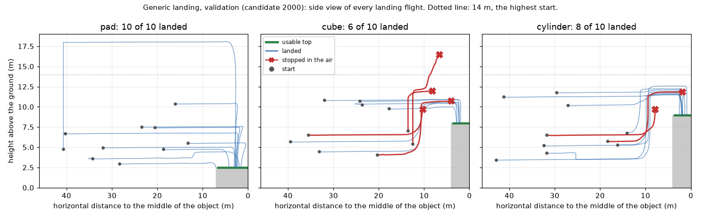

# Generic Landing + Active Search v2

2026-10-11, 브랜치 `exp/active-search-v2-generic-landing`. Phase B는 두 단계다. Stage 1은 pad가 아닌 평평한 윗면(cube, cylinder)에 착륙하는 것을 가르치고, Stage 2는 보이지 않는 목표를 찾으려고 관측 위치를 바꾸는 탐색을 가르친다. Stage 1의 gate를 통과해야 Stage 2를 시작한다.

**결과: Stage 1의 gate를 통과하지 못했다.** 녹화한 적 없는 layout의 36개 시작에서 pad 착륙 10/10, cylinder 8/10, cube 6/10이었고 기준은 cube 8/10이다. 실패는 모두 공중에서 스스로 멈춘 비행이다. 규칙대로 Stage 2는 시작하지 않았다.

동결한 baseline(`grounding_film`, canonical 47/48), Gaussian Blur 결과(46 / 40 / 24 / 8), Arbitrary Start 보고는 그대로다. Canonical test 48개는 비행하지 않았고 Depot set은 봉인된 채다. 동결 지문 둘은 simulator를 띄울 때마다 전후로 확인했다.

## 왜 하는가

Phase A에서 simulator, 화면, evaluator는 cube와 cylinder 착륙을 다룰 수 있게 됐다. 정책은 아니었다. 동결한 baseline에 "Find the blue cube and land on it."을 주면 cube 앞 8m 공중에서 멈췄다. 이 정책은 그런 착륙을 배운 적이 없고, cube 윗면(8m)은 cruise 높이(6m)보다 높다.

## Stage 1 — Generic Landing

질문: Front + Down RGB와 문장 하나를 받는 같은 정책이, pad뿐 아니라 cube와 cylinder의 윗면에도 문장대로 착륙할 수 있는가?

구조는 바꾸지 않았다. AeroVLA-OFT, FiLM, LoRA, L1 action head, chunk 4 / 실행 1, 세 축 행동(forward, down, yaw), proprio 꺼짐. Cube로 올라가는 것은 down 축의 음수 값이다.

모든 숫자는 녹화 전에 [configs/generic_landing.json](../configs/generic_landing.json)에 고정했다(commit `99fa6ae`).

### Teacher

[src/landing/teacher.py](../src/landing/teacher.py)의 `SurfaceTeacher`. Canonical teacher에 두 가지를 더했다. 둘 다 착륙 문장이고 목표가 보일 때만 작동한다.

| 추가한 것 | 조건 | 행동 |
|---|---|---|
| 상승 | 물체에서 25m 안이고, 윗면 + 여유보다 낮다 | 올라간다. 12m 안에서는 전진을 멈추고 충분히 높아질 때까지 기다린다 |
| 느린 진입 | Pad보다 작은 면 위 | 남은 거리에 비례해 감속하고(0.05 m/decision per m), 하강을 시작하는 반경을 면 크기에 맞게 줄인다 |

- **여유:** pad는 2.5m(canonical 하강이 느려지는 높이). 그래서 예전 pad 비행의 높이(5m 이상)에서는 label이 canonical과 같다. Cube·cylinder는 3.5m.
- **탐색:** canonical 그대로(오른쪽으로 회전, 앞이 막히면 상승). 목표가 보이지 않는 동안 teacher가 하는 일은 목표 위치와 무관하다(test로 확인).
- **Approach:** canonical 그대로.

느린 진입이 필요한 이유는 Phase A에서 쟀다. 기체는 속도 명령을 약 2.4초 늦게 따른다. Canonical teacher의 속도로 들어가면 pad(영역 반 변 6.6m)에서는 문제없지만 cube(3.6m)에서는 가장자리에 내린다.

Simulator에서 teacher가 pilot 15개 시작을 모두 끝냈다. 착륙 위치는 cube·cylinder 가운데에서 0.25–0.38m, pad 0.36–0.98m, 접촉 속도 0.35–0.38 m/s.

### Data

[configs/generic_landing/train_plan.json](../configs/generic_landing/train_plan.json). Phase A의 start 규칙(`validate`)을 통과하고, 목표까지 시선과 직선 경로가 열려 있고, teacher가 dry run에서 착륙한 시작만 쓴다.

| | 계획 | 녹화됨 |
|---|---:|---:|
| Train episode | 210 | 209 |
| Val episode (L1 감시용) | 24 | 24 |
| Frame | | 14,739 (train 13,314) |

- **종류별:** pad, cube, cylinder 각각 착륙 54 + approach twin 16. 물체는 종류마다 둘(blue/red pad, blue/red cube, blue/green cylinder).
- **거리:** 10–20 / 20–32 / 32–44m에 착륙 54개씩.
- **첫 시야:** 절반은 목표가 보이고, 절반은 시야 밖(회전하면 보임).
- **시작 높이:** 3–12m. 착륙 162개 중 107개가 1m 이상 상승이 필요하다.
- **Twin:** 48개(23%)는 같은 시작에서 "Approach the …"로 다시 비행. Cube에서 LAND와 APPROACH가 섞이지 않게 한다.
- **Layout:** 예전에 녹화했던 8개 layout(a–d, k–n). 모든 확인은 녹화한 적 없는 6개 layout(t, u, p–s)에서 한다.
- Cap을 얹은 sphere는 넣지 않았다.

Simulator 셋으로 나란히 녹화했다. Teacher가 착륙 영역 안에 내리고 스스로 멈춘 episode만 남긴다.

- 3개는 simulator가 실시간의 0.8배 밑으로 떨어져 버리고 다시 비행했다(셋 다 녹화됨).
- 1개(`gl-40088-blue_cube-near_search`)는 teacher가 끝내지 못해 빠졌다. 12m 떨어진 cube가 Down 영상의 구석에만 걸려서, 목표 쪽으로 돌면 시야에서 빠지고 탐색으로 돌아오면 다시 걸리는 왕복이 320 decision 동안 이어졌다. Canonical의 "Down에 보이면 목표를 본 것" 규칙이 키 큰 물체에서 드러낸 문제다.

### Training

| | |
|---|---|
| 시작 | `grounding_film` (FiLM 가중치 포함해 로드되는 것을 확인) |
| 학습 대상 | Correction LoRA, action head, FiLM. Vision encoder, projector, language model, AeroVLA adapter는 고정 |
| Update | 2,500 (4 frame씩), learning rate 5e-5 (FiLM도 같은 값) |
| 섞는 비율 | Generic landing 45%, 기존 데이터 전체 55% |
| 병합한 데이터 | 1,393 episode, 72,068 frame |
| 후보 | Update 1000 / 1500 / 2000 / 2500에서 저장. Validation loss와 무관하게 |

후보는 pilot 15개 시작을 한 번씩 비행해 고른다. 순서는 고정했다: cube·cylinder 착륙 수 → wrong object 수 → pad 착륙 수 → 충돌 수 → validation L1 → 이른 update. Validation L1은 다섯 번째다.

학습은 94분 걸렸다(GPU 최대 9.9 GiB). 기존 데이터와 새 데이터를 섞은 validation frame의 L1:

| Update | 시작 checkpoint | 500 | 1000 | 1500 | 2000 | 2500 |
|---|---:|---:|---:|---:|---:|---:|
| Validation L1 | 0.1234 | 0.0797 | 0.0736 | 0.0692 | 0.0699 | 0.0676 |

### 결과 1 — 후보 고르기 (pilot)

Pilot 15개 시작은 pad 착륙 4, cube 착륙 4, cylinder 착륙 4, approach twin 3이다. 후보마다 한 번씩 비행했다.

| 후보 | Cube·cylinder 착륙 (8) | Pad 착륙 (4) | Approach (3) | Wrong object | 충돌 | Val L1 |
|---|---:|---:|---:|---:|---:|---:|
| Baseline (`grounding_film`) | 0 | 4 | 3 | 1 | 1 | 0.1234 |
| Update 1000 | 1 | 4 | 3 | 0 | 0 | 0.0736 |
| Update 1500 | 1 | 4 | 3 | 0 | 0 | 0.0692 |
| **Update 2000** | **6** | 4 | 3 | 0 | 0 | 0.0699 |
| Update 2500 | 5 | 4 | 3 | 0 | 0 | 0.0676 |

고정한 순서대로 update 2000을 골랐고, pilot 기준(cube·cylinder 5/8 이상, pad 3/4 이상, approach 중 touchdown 0, 충돌 2 이하)을 통과했다.

- Update 1500과 2000은 validation L1이 거의 같은데 착륙 수는 1과 6이다. L1으로는 고를 수 없었다.
- Cube 하나와 cylinder 하나(`glp-41506`, `glp-41509`)는 어느 후보도 착륙하지 못했다.

### 결과 2 — Validation gate

녹화한 적 없는 layout의 36개 시작(종류별 착륙 10 + approach twin 2), update 2000, 시작마다 한 번. 먼저 가까운 착륙 9개를 smoke로 비행했다: 6/9(pad 3/3, cube 1/3, cylinder 2/3), 기준 6 이상을 딱 맞춰 통과.

| Target | Success | Touchdown (영역 안) | System landing | Wrong target | Collision |
|---|---:|---:|---:|---:|---:|
| Pad | 12 / 12 | 10 / 10 | 10 / 10 | 0 | 0 |
| Cube | 8 / 12 | 6 / 10 | 6 / 10 | 0 | 0 |
| Cylinder | 10 / 12 | 8 / 10 | 8 / 10 | 0 | 0 |
| 합 | 30 / 36 | 24 / 30 | 24 / 30 | 0 | 0 |

Success는 착륙과 approach twin을 합친 수다. Approach twin 6개는 모두 성공했고(공중에서 스스로 정지, touchdown 0), 착륙에 실패한 비행 중 물체에 닿은 것은 없다.

| Gate (녹화 전에 고정) | 기준 | 결과 | |
|---|---:|---:|---|
| Mission success | 30 / 36 이상 | 30 | 통과 |
| System landing | 24 / 30 이상 | 24 | 통과 |
| Pad 착륙 | 9 / 10 이상 | 10 | 통과 |
| **Cube 착륙** | **8 / 10 이상** | **6** | **실패** |
| Cylinder 착륙 | 8 / 10 이상 | 8 | 통과 |
| Wrong target | 2 이하 | 0 | 통과 |
| 충돌 | 1 이하 | 0 | 통과 |
| Approach 중 touchdown | 0 | 0 | 통과 |

**Gate는 통과하지 못했다.** Cube 착륙이 6/10이다. 통과한 줄 가운데 셋(mission success, system landing, cylinder)도 기준에 딱 걸렸다. `generic_landing_v1` checkpoint는 만들지 않았다.

나눠 보면:

| | Pad | Cube | Cylinder |
|---|---:|---:|---:|
| 10–20m 시작 | 3 / 3 | 1 / 3 | 2 / 3 |
| 20–32m | 4 / 4 | 3 / 4 | 3 / 4 |
| 32–44m | 3 / 3 | 2 / 3 | 3 / 3 |
| 처음부터 보임 | 5 / 5 | 3 / 5 | 5 / 5 |
| 시야 밖에서 시작 | 5 / 5 | 3 / 5 | 3 / 5 |

이 set에서는 물체와 첫 시야가 묶여 있다(파란 물체는 모두 보이는 시작, red pad·red cube·green cylinder는 모두 시야 밖 시작). 둘의 영향을 가를 수 없다.

착륙한 비행은 물체 10–12m 앞에서 올라가 윗면보다 2–3.5m 높은 곳에서 수평으로 넘어간 뒤 내려온다. 실패한 비행(빨간 선)은 그 길의 어딘가에서 멈춘다.

### 실패한 여섯 비행

여섯 모두 같은 끝이다: 모델이 공중에서 stop 행동(세 축 모두 0에 가까운 값)을 네 번 연속 냈다. 다른 물체로 간 비행, 부딪힌 비행, 영역 밖에 내린 비행은 없다.

| 비행 | 시작 (거리 / 높이) | 끝 (가운데까지 / 윗면 위) | 일어난 일 |
|---|---|---|---|
| `42021` red cube | 35.5m / 6.6m | 10.3m / +1.7m | 12m 앞에서 상승을 시작했고, 9.7m에서 상승 출력이 줄어들며 정지. 전진으로 넘어가지 못했다 |
| `42027` green cylinder | 31.8m / 6.6m | 7.8m / +0.7m | 같은 모양. 9.7m에서 정지 |
| `42014` blue cube | 13.5m / 7.1m | 8.2m / +4.0m | Cube가 보이는데 먼저 한 바퀴를 돌았다. 11.9m까지 오른 뒤 decision마다 0.1m씩 전진하다가 Front가 cube를 놓치자 정지 |
| `42013` red cube | 12.5m / 5.5m | 6.6m / +8.5m | 12m까지 오른 뒤 천천히 전진하면서 계속 올라갔다. 14.4m에서 Front가 cube를 놓쳤고 16.5m에서 정지 |
| `42016` blue cube | 20.3m / 4.1m | 4.0m / +2.7m | 올라가 cube 가장자리 위까지 왔고, 전진 출력이 0으로 줄어 정지. 하강하지 않았다 |
| `42023` green cylinder | 18.4m / 5.8m | 1.8m / +2.8m | 올라가 가운데 위까지 왔다. 하강을 시작하지 않고 정지 |

계획이 정한 분류로 읽으면:

| 분류 | 수 | |
|---|---:|---|
| Target selection | 0 | 여섯 모두 맞는 물체로 갔다 |
| Surface approach | 0 | 여섯 모두 12m 안으로 들어왔다 |
| Climb | 2 | 상승 도중 정지 (`42021`, `42027`). 윗면보다 높긴 하지만 넘어가는 높이(윗면 + 3.5m)에 못 미쳤다 |
| Alignment | 3 | 윗면보다 높은 곳에서 천천히 전진하다 정지 (`42013`, `42014`, `42016`). `42013`은 과하게 올라갔다 |
| Descent | 1 | 가운데 위에서 하강을 시작하지 않음 (`42023`) |
| Touchdown | 0 | 닿은 비행은 모두 영역 안에 안정적으로 내렸다 |

이 분류는 gate 뒤에 비행 기록을 읽고 붙인 것이다. `scripts/generic_landing.py table`의 기계적 규칙(처음 일어나지 않은 단계)은 alignment 4, descent 2로 읽는다. 상승 도중에 멈춘 둘은 윗면보다 0.5m 넘게 올라갔기 때문에 alignment로, 가장자리 위에 잠깐 있었던 `42016`은 descent로 들어간다.

### 왜 공중에서 멈추는가

Harness의 stop 규칙은 canonical 그대로다: 전진 0.08m 이하, 상하 0.08m 이하, 회전 0.034 rad 이하인 행동이 네 번 연속이면 비행이 끝난다.

Teacher가 작은 면 위에서 내는 label이 이 규칙 바로 옆에 있다.

| 가운데까지 거리 | 수평 비행 중 teacher의 전진 label | Decision 수 |
|---|---:|---:|
| 8–12m | 0.40–0.60m | 817 |
| 4–8m | 0.20–0.40m | 1,234 |
| 0–4m | 0.15–0.20m | 1,904 |

- Cube·cylinder 착륙 label 9,049개 중 stop 규칙 안에 드는 것은 없다. 그러나 1,541개(17%)가 "상하 0, 회전 0, 전진 0.15m"로, stop 규칙의 두 배가 안 된다.
- 이 수평 구간이 길다. 위 표의 3,955개는 착륙 label의 44%다. 모델의 cube 착륙은 중앙값 100 decision이 걸렸다(pad는 54).
- 모델의 출력은 label보다 대체로 작다. 착륙한 비행의 수평 구간에서 전진 출력의 중앙값은 8–12m에서 0.33–0.38m(label 0.45–0.54m), 2–4m에서 0.13m(label 0.15m)다.
- 착륙한 cube·cylinder 비행 14개 중 10개가 닿기 전에 한 번 이상 stop 규칙 안의 행동을 냈고, 2개는 세 번 연속까지 갔다. 실패한 6개는 네 번 연속이었다.

착륙한 비행과 실패한 비행의 차이는 그 작은 출력이 네 번 이어졌는가다. 상승 도중의 정지도 같은 구조다. Teacher는 12m 안에서 전진을 0으로 두고 상승만 한다. 모델의 상승 출력이 목표 높이 전에 줄어들고 전진이 네 decision 안에 살아나지 않으면 비행이 끝난다.

정리하면, 작은 면에 정확히 내리려고 넣은 느린 진입이 "계속 간다"와 "멈춘다"를 0.07m 차이로 붙여 놓았다. 이 teacher는 이번 단계에서 설계한 것이고, label이 stop 규칙에 얼마나 가까운지는 녹화 전에 재지 않았다. Teacher 자신은 스스로 stop을 선언할 때만 비행이 끝나므로 teacher 비행(pilot 15/15)에서는 드러나지 않았다.

### Gate 뒤의 기록용 비행

Gate가 판정된 뒤 같은 checkpoint로 두 가지를 더 비행했다. 어느 것도 판정을 바꾸지 않는다.

**같은 시작을 한 번 더.** Cube·cylinder 착륙 20개 시작의 두 번째 비행.

| | 첫 비행 (gate) | 두 번째 비행 |
|---|---:|---:|
| Cube | 6 / 10 | 5 / 10 |
| Cylinder | 8 / 10 | 6 / 10 |

| 20개 시작 | 수 |
|---|---:|
| 두 번 다 착륙 | 10 |
| 두 번 다 실패 | 5 |
| 첫 비행만 착륙 | 4 |
| 두 번째만 착륙 | 1 |

- 20개 중 5개가 두 비행 사이에 뒤집혔다. 40번의 비행으로 보면 25번(63%) 착륙했다.
- 두 번째 비행의 실패 9개도 모두 공중에서 스스로 멈춘 것이다. Wrong target과 충돌은 없다.
- 두 번 다 실패한 5개의 시작 거리는 12.5m, 13.5m, 18.4m, 20.3m, 31.8m다. 두 비행을 합치면 10–20m 시작은 5/12, 20–32m는 10/16, 32–44m는 10/12다. 가까운 시작이 가장 약하다.

**44m 안의 예전 능력 (regression).** Canonical validation과 같은 구성의 새 36개 시작(13–44m, pad 착륙 27 + approach 9)을 baseline과 update 2000이 한 번씩 비행했다. Canonical test 48개는 쓰지 않았다. Seed 43000에서는 이 구성의 set이 만들어지지 않아 43100에서 뽑았다(43000, 43100, … 중 처음 되는 seed를 쓴다는 규칙은 비행 전에 정했다).

| | Baseline (`grounding_film`) | Update 2000 |
|---|---:|---:|
| Mission success | 35 / 36 | 35 / 36 |
| Pad 착륙 | 27 / 27 | 26 / 27 |
| Approach | 8 / 9 | 9 / 9 |
| 다른 물체가 섞인 시작 (18) | 17 / 18 | 18 / 18 |
| Wrong target | 0 | 0 |
| 충돌 | 0 | 0 |

- 녹화 전에 정한 허용 범위(success와 착륙은 baseline − 2 이상, wrong target과 충돌은 baseline + 1 이하) 안이다.
- Update 2000이 잃은 하나는 `glr-43737-blue_pad-far_search`다. 41.7m에서 pad가 시야 밖인 시작인데, 첫 decision부터 stop 행동을 네 번 내고 끝났다. 탐색 회전을 시작하지 않았다. Baseline은 이 시작에서 착륙했다.
- Baseline이 잃은 하나는 cone으로 가라는 approach였고(320 decision 동안 못 끝냄), update 2000은 성공했다.
- 한 번씩의 비행이다. 한 개 차이는 비행 반복의 변동 안에 있다.

### 그 밖에 본 것

- **내리는 위치:** 모델은 cube에서 가운데로부터 1.95–2.87m, cylinder에서 0.88–2.51m 떨어진 곳에 내렸다(영역은 3.6m). Teacher는 0.25–0.38m였다. 모두 영역 안이고, 가장 바깥에 내린 cube 착륙도 가장자리까지 0.7m 넘게 남았다. 모델은 가운데에 닿기 전에 하강을 시작한다.
- **Ceiling:** 두 비행이 14m를 넘었다(`42010` pad 18.1m, `42013` cube 16.5m). 14m는 시작 규칙과 teacher의 한계이고, 모델의 비행을 막는 장치는 없다.
- **Teacher가 못 끝낸 시작:** `glv-42010-blue_pad-far_visible`. 4.8m 높이, 40m 거리에서 pad가 기체 자신의 팔에 가려져 teacher가 320 decision 동안 끝내지 못했다. Gate에는 그대로 두었고 모델은 18m까지 올라간 뒤 착륙했다.
- **보이는데 도는 시작:** `42014`에서 모델은 cube가 Front에 보이는데도 한 바퀴를 돈 뒤 접근했다. 13.5m 거리, 7.1m 높이에서는 cube(윗면 8m)의 옆면만 보인다.
- **Decision 시간:** 평균 0.52초.

### Stage 1 판정

**통과하지 못했다.** 계획의 규칙대로 여기서 멈춘다.

- Stage 2(Active Search v2)는 시작하지 않았다. 45–110m 데이터, 탐색 teacher, 탐색 학습, 장거리 validation과 test 모두 없다.
- `generic_landing_v1` checkpoint는 없다. 후보 네 개는 `generic_landing_v1_run/` 아래 로컬에만 있다.
- Stage 1을 기다리는 동안 써 본 Stage 2 탐색 규칙 초안은 저장소에 넣지 않았다.
- Gate를 다시 판정하지 않았다. 기준을 바꾸지 않았고, 다른 후보로 다시 비행하지 않았다.

### 한계

- 학습 한 번, seed 하나, 시작마다 비행 한 번. Cube 6/10의 95% 구간은 대략 31–83%다.
- Validation layout은 녹화한 적 없는 layout이지만 장면(Field, Lot)은 학습에 쓴 장면이다. 새 domain이 아니다.
- 물체는 종류마다 둘, 크기는 하나씩이다(cube 한 변 8m, cylinder 지름 8m). "임의의 평평한 윗면"에 대한 결과가 아니다.
- 모델 비행 옆에 기록되는 teacher 행동은 canonical teacher의 것이다. Cube의 높이를 모르므로 실패 분석에는 쓰지 않았다.
- 이 validation 36개는 이 teacher 설계의 gate로 한 번 쓰였다. 다음 시도는 새 seed의 set으로 판정해야 한다.

### 다음 후보

자동으로 시작하지 않는다.

1. **Teacher를 고쳐 Stage 1을 다시 한다 (권장).** 느린 진입의 label을 stop 규칙에서 떼어 놓는다. 예: 전진 하한을 올리고 대신 더 일찍 감속을 시작한다, 상승하면서 전진을 0으로 두지 않는다, 녹화 전에 "label이 stop 규칙의 몇 배인가"를 검사한다. Cube·cylinder episode를 다시 녹화하고, 같은 gate를 새 validation set에서 판정한다.
2. **Stop을 읽는 방법을 바꾼다.** 네 번 연속 규칙은 canonical harness의 것이라 바꾸면 예전 결과와 비교할 수 없게 된다. 권하지 않는다.
3. **Pad 착륙만으로 Stage 2로 간다.** 계획의 gate를 건너뛰는 것이므로 사용자의 결정이 필요하다.

## Stage 2 — Active Search v2

시작하지 않았다. Stage 1의 gate를 통과해야 시작하기로 했고, 통과하지 못했다.

## 기록

| | |
|---|---|
| 표 | `outputs/generic_landing/summary/`: `training.json`, `teacher.json`, `pilot.json`, `pilot_flights.json`, `validation.json`, `validation_repeat.json`, `regression.json` |
| 그림 | `outputs/generic_landing/examples/validation_side_view.png` |
| 고정한 숫자와 시작 | `configs/generic_landing.json`, `configs/generic_landing/` |
| 판정 도구 | `scripts/generic_landing.py` (`pilot`, `gate`, `regression`, `table`) |
| 로컬에만 있는 것 | 비행 원자료, 녹화한 data, 후보 checkpoint 넷 |

**Tests:** Python 383/383, PowerShell 4/4. 동결 지문 둘(`grounding_film` 30개 파일, `gen_v2` 120개 파일)은 마지막 비행 뒤에도 그대로다.
