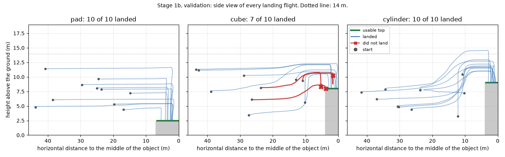
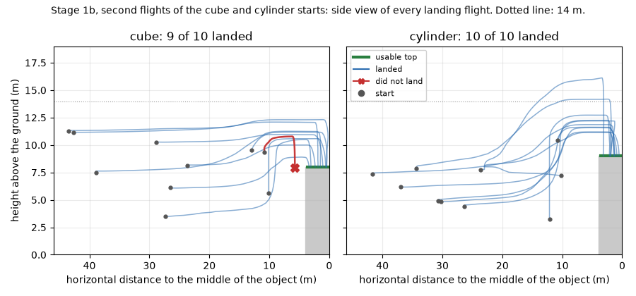
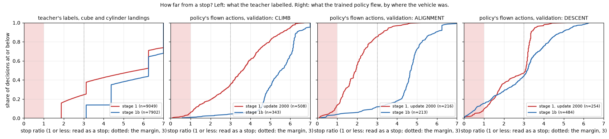

# Stage 1b — Stop-Safe Generic Landing

2026-10-11, 브랜치 `exp/generic-landing-stage1b-stop-safe-teacher`. Stage 1([Generic Landing + Active Search v2](generic_landing_active_search_v2.md))은 gate를 통과하지 못했고, 그 기록은 그대로 둔다. Stage 1b는 한 가지만 바꾼다: 착륙 teacher의 label.

**질문:** Teacher가 touchdown 전에 준 label이 student의 stop과 부딪치고 있었는가? 그 충돌을 없애면 cube와 cylinder 착륙이 안정적으로 배워지는가?

**결과: Stage 1b도 통과하지 못했다.** Cube 착륙의 첫 비행이 7/10(기준 8)이고, regression에서 충돌이 2번 나왔다(baseline 0). 공중에서 스스로 멈추는 실패는 cube·cylinder 40번의 비행 중 15번에서 1번으로 줄었고, cylinder는 20/20, cube는 두 비행 합 16/20이다. `generic_landing_v1`은 만들지 않았다.

동결한 baseline(`grounding_film`, canonical 47/48), Gaussian Blur 결과(46 / 40 / 24 / 8), Arbitrary Start 보고, Stage 1의 실패 결과는 바꾸지 않았다. Canonical test 48개와 Depot set은 비행하지 않았다. Active Search v2(Stage 2)는 이 단계의 결과와 무관하게 시작하지 않는다.

## Stage 1에서 본 것

| | Stage 1 (update 2000) |
|---|---:|
| Validation success | 30 / 36 |
| Pad 착륙 | 10 / 10 |
| **Cube 착륙** | **6 / 10** (기준 8) |
| Cylinder 착륙 | 8 / 10 |
| 같은 시작을 한 번 더 | cube 5 / 10, cylinder 6 / 10. 20개 중 5개가 뒤집힘 |
| 실패 | 모두 공중에서 스스로 멈춤. 상승 중 2, 정렬 중 3, 하강 전 1 |

## 1. Student의 stop: 코드에서 읽은 것

보고서의 "0.08m × 4번"을 믿지 않고 코드를 다시 읽었다.

| | 위치 | 내용 |
|---|---|---|
| Stop 함수 | `src/aerovla_oft/spec.py`, `is_stop` | 세 축 모두 `stop_threshold`(0.08) × 그 축의 범위 이하이면 stop |
| 축별 한계 | `configs/aerovla_oft.json` | 전진 0.08m (범위 0–1m), 상하 0.08m (±0.5m), 회전 0.0336 rad (±0.21 rad). 물리 단위, 범위로 자른 뒤 |
| 연속 규칙 | `scripts/visual_search.py`, `run_episode` | Stop인 decision이 `stop_ticks`(4)번 이어지면 비행 종료. Stop이 아닌 decision 하나가 count를 0으로 되돌린다 |
| Chunk | `src/aerovla_oft/model.py`, `infer` | 4개를 예측하고 첫 번째만 비행한다(execute 1). 매 decision 새로 예측하므로, 네 번은 연속한 네 추론의 첫 행동이다 |
| 예외 | `run_episode` | Finalizer가 접촉을 판정하는 중(`CONTACT_CANDIDATE`)이면 끝내지 않고 기다린다. 강제 이동(push, kick)은 세지 않는다 |
| Teacher 비행 | 같은 줄 | Teacher의 비행도 같은 규칙으로 끝난다 |

Teacher의 label은 정확히 나오므로 stop 규칙 안에 든 적이 없다(Stage 1 data에서도 0개). Student의 출력은 label보다 조금 작고, 그래서 label이 규칙 가까이에 있으면 student만 걸린다. Stage 1 문서는 "teacher는 스스로 stop을 선언할 때만 비행이 끝난다"고 썼는데 정확하지 않다. Teacher에게도 같은 규칙이 적용되고, teacher의 label이 그 규칙 안에 들지 않았을 뿐이다.

## 2. Stop ratio와 규칙

`stop_ratio` = 행동의 세 축을 각 축의 stop 한계로 나눈 값 중 가장 큰 것. 1 이하이면 stop이다. Teacher를 재는 데 따로 만든 근사 규칙은 없다. `src/landing/stop_safety.py`는 student가 쓰는 `is_stop`을 그대로 불러 쓴다.

**규칙 (녹화 전에 `configs/generic_landing_stage1b.json`에 고정):**

- 착륙 임무에서 touchdown 전의 모든 label은 stop이 아니어야 하고, `stop_ratio`가 **3.0 이상**이어야 한다.
- Touchdown 전에 stop인 label이 4번 이어지는 구간이 없어야 한다.
- 착륙의 stop label은 기체가 면 위에 선 뒤에만 나온다.
- Approach 임무는 목표 근처 공중에서 멈추는 것이 정답이다. Canonical teacher는 그 정지점을 향해 일부러 감속한다(0.2m, 2.5배까지). 이 label은 세어서 보고하고 3.0 기준은 적용하지 않는다. Canonical approach teacher는 바꾸지 않았다.

**왜 3.0인가.** 기존 data를 같은 도구로 쟀다.

| Data | 착륙 label (touchdown 전) | 가장 작은 ratio | 3.0 미만 |
|---|---:|---:|---:|
| Gen-v3 / v3b / v3c의 pad 착륙 | 17,233 | 3.125 | 0 |
| Stage 1의 pad 착륙 | 3,259 | 3.125 | 0 |
| Stage 1의 cube 착륙 | 4,556 | **1.875** | 1,120 |
| Stage 1의 cylinder 착륙 | 4,493 | **1.875** | 1,097 |

Pad teacher의 가장 작은 label은 마지막 하강(0.25m)이고 3.125배다. Student는 pad에 내린다(10/10, 26/27). Stage 1의 cube·cylinder label은 1.875배(수평 전진 0.15m)까지 내려갔고 그 착륙이 공중에서 멈췄다. 3.0은 pad teacher가 늘 지켜 온 여유를 모든 면에 요구하는 값이다. 처음 권장된 2.0은 전진 0.16m를 통과시키는데, 그것은 실패한 label과 같다.

진단용으로 "stop에 가까운 구간"도 센다: ratio 2.0 미만이 4번 이어지는 구간. 1.5가 아니라 2.0인 것은 Stage 1의 0.15m(1.875)가 세어지게 하기 위해서다.

## 3. Teacher를 어떻게 고쳤는가

[src/landing/teacher.py](../src/landing/teacher.py)의 `StopSafeTeacher`. Stage 1의 `SurfaceTeacher`는 지우지 않았고, Stage 1의 계획과 data는 그 teacher로 계속 재현된다.

| | Stage 1 | Stage 1b |
|---|---|---|
| 작은 면 위의 진입 속도 | 남은 거리 × 0.05, 하한 **0.15m** (가운데 3m 전부터 0.15m로 기어감) | 남은 거리 × 0.05, 하한 **0.35m** (가운데 7m 전에 0.35m에 도달하고 그대로 들어감) |
| 하강을 시작하는 반경 | 면 크기에 맞춰 줄임 (0.95m) | Canonical 그대로 (1.75m). Pad와 같다 |
| 하강 전 12m 안의 수평 구간 | 30–40 decision | 20–25 decision |
| 물체 근처 상승 | 필요한 높이까지 제자리에서 (전진 0) | 윗면보다 1m 높아질 때까지만 제자리, 그 뒤로는 **전진하면서** 상승 |
| Pad 착륙, 탐색, approach | Canonical | Canonical |

- **0.35m의 근거:** 기체는 명령을 약 2.4초(4.8 decision) 늦게 따른다. Canonical 반경 1.75m를 그 시간에 지나는 속도다. 그 반경에서 하강 명령을 받으면 기체가 가운데쯤까지 밀려간다. Stop 한계의 4.4배.
- **전진하며 상승:** Stage 1의 상승 중 정지 둘은 윗면보다 0.7m, 1.7m 높은 곳에서 일어났다. Label은 "전진 0, 상승 0.5m"였고, student의 상승 출력이 줄어드는 동안 전진은 0에 머물렀다. 이제 윗면을 벗어난 뒤에는 상승의 끝과 수평 비행의 시작이 전진을 공유한다.
- Stop을 피하려고 넣은 움직임은 없다. 모든 축의 값은 그 순간 기체가 해야 할 일이다.

Teacher의 상태와 계획의 이름:

| 계획의 이름 | 코드의 state | Label |
|---|---|---|
| SEARCH | `search` | 오른쪽 회전 0.21 rad (canonical) |
| APPROACH | `approach` | 12m 밖에서 목표로 전진 |
| SURFACE_APPROACH | `final` | 12m 안에서 수평 전진. 작은 면: 0.35m 이상 |
| CLIMB | `climb` | 상승 0.25–0.5m. 윗면을 벗어나면 전진과 함께 |
| ALIGN | `align` | 가운데가 옆에 있을 때 제자리 회전 0.21 rad |
| DESCENT | `descend` | 하강 0.5m, 낮아지면 0.25m (canonical) |
| TERMINAL | `landed` (착륙), `stop` (approach) | 0. 착륙은 면 위에 선 뒤에만 |

## 4. 바꾸지 않은 것

시작 checkpoint(`grounding_film`), 구조, FiLM, LoRA, action head, Front + Down 입력, 문장만 주는 입력, chunk 4 / 실행 1, finalizer, evaluator, stop 규칙, 착륙 영역, update 수(2,500), learning rate, 새 data 비율(45%), 기존 data, 후보(1000 / 1500 / 2000 / 2500), Stage 1 gate의 모든 숫자. Stage 1의 checkpoint에서 이어 학습하지 않는다. Stage 1의 generic landing episode 233개는 학습에 넣지 않는다.

## 5. 녹화 전 확인

**Label 비교 (같은 도구, 같은 규칙).**

| | Stage 1 (녹화된 233 episode) | Stage 1b (계획 285개의 dry run) |
|---|---:|---:|
| 착륙 label (touchdown 전) | 12,308 | 12,991 |
| 그중 stop | 0 | 0 |
| 3.0 미만 | **2,217** | **0** |
| Stop 4연속 구간 | 0 | 0 |
| Stop에 가까운 4연속 구간 | **1,184** | **0** |
| 가장 작은 ratio | 1.875 | 3.125 |
| 5번째 백분위 | 1.875 | 3.125 |
| SURFACE_APPROACH: 3.0 미만 | 2,217 / 4,619 | 0 / 4,418 |
| CLIMB: 3.0 미만 | 0 / 1,233 | 0 / 1,403 |
| DESCENT: 3.0 미만 | 0 / 2,478 | 0 / 2,868 |

Dry run은 지연이 없는 운동학 계산이다. 녹화된 label로 다시 잰 결과는 7절에 있다.

**Teacher pilot (simulator, finalizer 포함, 새 pilot 시작 15개).**

| | 착륙 | Approach twin | 착륙 위치 (가운데에서) |
|---|---:|---:|---|
| Pad | 4 / 4 | 1 / 1 | 0.28–1.11m |
| Cube | 4 / 4 | 1 / 1 | 0.07–0.21m |
| Cylinder | 4 / 4 | 1 / 1 | 0.07–0.12m |

15 / 15, 충돌 0, wrong target 0. 비행 끝 전의 label 758개 중 규칙을 어긴 것 0(착륙 label 693개의 최소 ratio 3.125). 착륙 12개 중 9개가 1.5m 이상 상승했다(최대 8.9m). 시작은 10.8–36.3m, 높이 3.4–11.5m.

## 6. 계획 (녹화 전에 고정)

숫자는 모두 [configs/generic_landing_stage1b.json](../configs/generic_landing_stage1b.json), 시작은 `configs/generic_landing_stage1b/`에 있다.

- **Data:** Stage 1과 같은 구성을 새 seed(50000번대)에서 다시 뽑았다. 녹화 210 episode(pad / cube / cylinder 각각 착륙 54 + approach twin 16) + validation loss용 24. 10–44m, 시작 높이 3–12m, 절반은 목표가 시야 밖. 44m 밖, 가려진 목표, 새 물체는 없다.
- **Seed:** 저장소의 모든 계획·set·dataset을 읽어 쓰인 범위를 확인했다(0–24999, 30000–31002, 40000–43999). 50000 이상은 쓰인 적이 없다.
- **Pilot:** 새 시작 15개. Baseline과 후보 넷이 한 번씩. 순서: cube·cylinder 착륙 수 → 공중 정지 수 → pad 착륙 수 → wrong target → 충돌 → validation L1 → 이른 update.
- **Validation:** 새 시작 36개(종류별 착륙 10 + approach twin 2), 녹화한 적 없는 layout. Gate는 Stage 1의 숫자 그대로: success 30/36, 착륙 24/30, pad 9, cube 8, cylinder 8, wrong target 2 이하, 충돌 1 이하, approach 중 touchdown 0.
- **Repeat gate (새로 추가):** Cube·cylinder 착륙 20개 시작을 같은 checkpoint로 한 번 더 비행한다. 종류마다 첫 비행 8/10 이상, 두 비행 합 16/20 이상, 두 번 다 실패한 시작 1개 이하.
- **Regression:** Canonical validation과 같은 구성의 새 36개 시작을 baseline과 고른 checkpoint가 한 번씩. Success는 baseline − 2 이상, pad 착륙 baseline − 2 이상, wrong target baseline + 1 이하, 충돌은 baseline보다 많지 않을 것, approach 중 touchdown 0.
- **통과하면** checkpoint 이름 `generic_landing_v1`. 통과하지 못하면 만들지 않는다.

**시작 간격의 예외 둘 (set을 뽑기 전에 config에 적음).** 모든 시작은 같은 장면의 예전 시작에서 6m 이상 떨어진다. 다음 둘만 예외다.

1. 녹화 시작은 Stage 1의 녹화 시작에서 6m를 지키지 않아도 된다. 그 episode들은 이번 학습 data에 없다. 지키게 하면 pad 가까이(10–20m, pad가 처음부터 보이는 시작)에 자리가 남지 않아 16개 layout 어디에서도 뽑히지 않았다. Stage 1의 시작과 같은 시작은 하나도 없다.
2. Regression set은 Stage 1의 regression 시작에서 6m를 지키지 않아도 된다. 그 시작들은 녹화된 적이 없다. 지키게 하면 범위의 seed 10개 모두에서 set이 만들어지지 않았다(가까이에 다른 색 pad가 보이는 시작 자리가 없음).

Pilot과 validation 시작은 예외 없이 모든 예전 시작에서 6m 이상 떨어져 있다.

**실패의 이름.** 실패한 착륙은 어떻게 끝났는지로 먼저 부른다: `AIR_SELF_STOP`, `COLLISION`, `TIMEOUT`, `TARGET_SELECTION`, `TOUCHDOWN`, `STABILITY`, `OTHER`. 공중에서 멈춘 비행은 마지막 decision의 위치로 단계를 붙인다: `SURFACE_APPROACH`(12m 밖), `CLIMB`(12m 안, 물체 위가 아님, 진입 높이보다 낮음), `ALIGNMENT`(진입 높이 또는 물체 위, 하강 반경 밖), `DESCENT`(canonical teacher가 하강하는 자리). 정책의 출력이 아니라 위치만으로 읽으므로 Stage 1의 비행도 같은 규칙으로 읽는다(Stage 1의 여섯: CLIMB 2, ALIGNMENT 3, DESCENT 1).

**Ceiling.** Stage 1에서 14m를 넘은 비행이 둘 있었다. 이번 질문은 teacher의 label이므로 executor는 바꾸지 않고, 넘은 비행의 수와 최고 높이만 기록한다.

## 7. 녹화와 녹화된 label

Commit `97e7d59`(녹화 전 고정) 뒤에 simulator 셋으로 나란히 녹화했다. Finalizer 없이, 예전 data와 같은 방식이다.

| | 계획 | 녹화됨 |
|---|---:|---:|
| Train episode | 210 | 207 |
| Val episode (L1 감시용) | 24 | 24 |
| 착륙 / approach twin | 180 / 54 | 177 / 54 |
| 착륙: pad / cube / cylinder | 60 / 60 / 60 | 60 / 57 / 60 |
| Frame | | 13,485 (train 12,156) |

- 실시간 배율은 최소 0.89, 중앙값 0.98이다. 속도 때문에 버린 episode는 없다.
- **3개가 빠졌다.** 셋 다 cube에서 10.4–11.4m, 높이 11.1–11.5m에서 cube를 왼쪽 뒤에 두고 시작한다. Teacher가 320 decision 동안 왼쪽과 오른쪽 회전을 번갈아 했다. Cube가 Down 영상의 구석에 걸리면 "보인다"가 되어 목표 쪽으로 돌고, 돌면 구석에서 빠져 탐색 방향으로 되돌아간다. Stage 1에서도 1개 있었던 canonical 규칙의 문제이고 stop과는 무관하다(이 label들은 6.25배). Teacher가 끝내지 못한 비행은 data가 아니므로 넣지 않았고, 대신할 시작을 다시 뽑지도 않았다.
- 병합한 data: 기존 다섯 set + Stage 1b의 231 = 1,391 episode, 70,814 frame. Stage 1의 generic landing episode는 0개다.

**녹화된 label을 같은 도구로 다시 쟀다.** 학습 script는 이 감사가 통과해야 시작한다.

| | Stage 1 (233 episode) | Stage 1b (231 episode) |
|---|---:|---:|
| 착륙 label (touchdown 전) | 12,308 | 11,157 |
| 그중 stop | 0 | 0 |
| 3.0 미만 | **2,217** | **0** |
| Stop 4연속 구간 | 0 | 0 |
| Stop에 가까운 4연속 구간 (2.0 미만) | **1,184** | **0** |
| 가장 작은 ratio | 1.875 | 3.125 |
| 5번째 백분위 | 1.875 | 3.125 |
| 중앙값 | 6.25 | 6.25 |
| SURFACE_APPROACH: label / 3.0 미만 / 2.0 미만 | 4,619 / 2,217 / 1,541 | 3,287 / 0 / 0 |
| ALIGN | 79 / 0 / 0 | 111 / 0 / 0 |
| CLIMB | 1,233 / 0 / 0 | 1,277 / 0 / 0 |
| DESCENT | 2,478 / 0 / 0 | 2,453 / 0 / 0 |

종류별 가장 작은 ratio는 pad 착륙 3.125, cube 착륙 3.125, cylinder 착륙 3.125이다. 거리대별(10–20 / 20–32 / 32–44m)로도 모두 3.125이고 3.0 미만은 0이다. Approach twin의 label 1,404개는 stop 0, 최소 2.5(정지점 직전의 canonical 감속), 3.0 미만 88개다. 이 88개는 기준을 적용하지 않기로 한 label이다.

착륙 label의 수평 구간(SURFACE_APPROACH)이 4,619개에서 3,287개로 줄었다. 느리게 기어가던 구간이 없어진 만큼이다.

## 8. Training

Stage 1의 일정 그대로다. 달라진 것은 섞이는 generic landing episode뿐이다.

| | Stage 1 | Stage 1b |
|---|---|---|
| 시작 checkpoint | `grounding_film` | `grounding_film` (Stage 1의 checkpoint에서 잇지 않음) |
| 학습 대상 | Correction LoRA, action head, FiLM | 같음 |
| Update | 2,500 (4 frame씩), 5e-5 | 같음 |
| 새 data 비율 | 45% (Stage 1의 13,314 frame) | 45% (Stage 1b의 12,156 frame) |
| 기존 data | 51,640 frame | 같은 51,640 frame |
| 후보 | 1000 / 1500 / 2000 / 2500 | 같음 |
| 걸린 시간, GPU 최대 | 95분, 9.9 GiB | 94분, 9.9 GiB |

기존 data와 새 data를 반씩 섞은 validation frame의 L1:

| Update | 시작 | 500 | 1000 | 1500 | 2000 | 2500 |
|---|---:|---:|---:|---:|---:|---:|
| Stage 1 | 0.1234 | 0.0797 | 0.0736 | 0.0692 | 0.0699 | 0.0676 |
| Stage 1b | 0.1255 | 0.0772 | 0.0750 | 0.0699 | 0.0659 | 0.0657 |

두 run의 validation frame은 서로 다른 episode에서 왔으므로 L1을 맞비교할 수는 없다. 후보 넷 모두 저장한 그대로 다시 로드되는 것을 확인했다. 후보는 L1이 아니라 pilot 비행으로 고른다.

## 9. 후보 고르기 (pilot)

새 pilot 시작 15개(종류별 착륙 4 + approach twin 1)를 baseline과 후보 넷이 한 번씩 비행했다.

| Checkpoint | Pad 착륙 | Cube 착륙 | Cylinder 착륙 | 공중 정지 | 충돌 | Wrong target | Val L1 |
|---|---:|---:|---:|---:|---:|---:|---:|
| `grounding_film` | 4 / 4 | 0 / 4 | 0 / 4 | 8 | 0 | 0 | 0.1255 |
| Update 1000 | 4 / 4 | 2 / 4 | 2 / 4 | 3 | 0 | 0 | 0.0750 |
| Update 1500 | 4 / 4 | 3 / 4 | 3 / 4 | 0 | 0 | 1 | 0.0699 |
| **Update 2000** | 4 / 4 | **4 / 4** | 3 / 4 | **0** | 0 | 0 | 0.0659 |
| Update 2500 | 4 / 4 | 3 / 4 | 4 / 4 | 0 | 0 | 1 | 0.0657 |

고정한 순서(cube·cylinder 착륙 → 공중 정지 → pad → wrong target → 충돌 → L1 → 이른 update)로 update 2000이 골라졌다. 2500과는 wrong target에서 갈렸다. Pilot 기준은 통과했다. Approach twin은 모든 checkpoint가 3 / 3이다.

- Update 1500부터 공중 정지가 없다. Stage 1의 pilot에서는 고른 후보도 8개 중 2개가 공중에서 멈췄다.
- 실패의 모양이 달라졌다. Update 2000의 하나는 cylinder 위에 내렸지만 접촉이 너무 빨랐다(가운데에서 3.33m). Update 1500과 2500의 하나는 blue cube 대신 blue pad에 내렸다.

## 10. Validation gate

새 validation 시작 36개, update 2000, 시작마다 한 번. 먼저 가까운 착륙 9개(smoke): 8 / 9로 통과(Stage 1은 6 / 9).

| Target | Success | System landing | 공중 정지 | Wrong target | Collision |
|---|---:|---:|---:|---:|---:|
| Pad | 12 / 12 | 10 / 10 | 0 | 0 | 0 |
| Cube | 9 / 12 | **7 / 10** | 1 | 0 | 0 |
| Cylinder | 12 / 12 | 10 / 10 | 0 | 0 | 0 |
| 합 | 33 / 36 | 27 / 30 | 1 | 0 | 0 |

Approach twin 6개는 모두 성공했고 touchdown은 없다.

| Gate (Stage 1의 숫자 그대로) | 기준 | Stage 1 | Stage 1b | |
|---|---:|---:|---:|---|
| Mission success | 30 / 36 이상 | 30 | 33 | 통과 |
| System landing | 24 / 30 이상 | 24 | 27 | 통과 |
| Pad 착륙 | 9 / 10 이상 | 10 | 10 | 통과 |
| **Cube 착륙** | **8 / 10 이상** | 6 | **7** | **실패** |
| Cylinder 착륙 | 8 / 10 이상 | 8 | 10 | 통과 |
| Wrong target | 2 이하 | 0 | 0 | 통과 |
| 충돌 | 1 이하 | 0 | 0 | 통과 |
| Approach 중 touchdown | 0 | 0 | 0 | 통과 |

**Gate는 통과하지 못했다.** Cube 착륙이 하나 모자란다. Stage 1과 Stage 1b의 validation 시작은 서로 다른 set이다(같은 구성, 다른 seed).

| | Pad | Cube | Cylinder |
|---|---:|---:|---:|
| 10–20m 시작 | 3 / 3 | 2 / 3 | 3 / 3 |
| 20–32m | 4 / 4 | 2 / 4 | 4 / 4 |
| 32–44m | 3 / 3 | 3 / 3 | 3 / 3 |
| 처음부터 보임 | 5 / 5 | 4 / 5 | 5 / 5 |
| 시야 밖에서 시작 | 5 / 5 | 3 / 5 | 5 / 5 |

내리는 위치(가운데에서, 성공한 비행): cube 0.44–2.90m(중앙값 1.16m), cylinder 0.57–2.88m(1.55m), pad 1.92–5.41m(2.63m). 영역은 cube·cylinder 3.6m, pad 6.6m다. Stage 1의 cube는 1.95–2.87m(2.32m)였다. Cube 착륙에 걸린 decision의 중앙값은 100에서 70으로 줄었다.

## 11. Repeat stability

Cube·cylinder 착륙 20개 시작을 같은 checkpoint로 한 번 더 비행했다.

| | 첫 비행 | 두 번째 | 두 번 다 | 한 번만 | 둘 다 실패 | 합 |
|---|---:|---:|---:|---:|---:|---:|
| Cube | 7 / 10 | 9 / 10 | 7 | 2 | 1 | **16 / 20** |
| Cylinder | 10 / 10 | 10 / 10 | 10 | 0 | 0 | **20 / 20** |
| Stage 1의 cube | 6 / 10 | 5 / 10 | 4 | 3 | 3 | 11 / 20 |
| Stage 1의 cylinder | 8 / 10 | 6 / 10 | 6 | 2 | 2 | 14 / 20 |

| Stability gate | 기준 | Cube | Cylinder |
|---|---:|---:|---:|
| 첫 비행 | 8 / 10 이상 | **7 (실패)** | 10 |
| 두 비행 합 | 16 / 20 이상 | 16 | 20 |
| 둘 다 실패한 시작 | 1개 이하 | 1 | 0 |

**Stability gate도 통과하지 못했다.** 실패한 줄은 cube의 첫 비행 하나다. 두 비행 합과 "둘 다 실패" 줄은 기준에 닿았다. 20개 시작 중 뒤집힌 것은 2개다(Stage 1은 5개). 둘 다 첫 비행에서 실패하고 두 번째에 착륙한 cube 시작이다.

## 12. 실패의 이름

| 어떻게 끝났는가 | Stage 1 (첫 비행 / 두 번째) | Stage 1b (첫 비행 / 두 번째) |
|---|---:|---:|
| 실패한 cube·cylinder 착륙 | 6 / 9 | 3 / 1 |
| `AIR_SELF_STOP` | 6 / 9 | 1 / 0 |
| `TOUCHDOWN` (영역 밖 또는 너무 빠른 접촉) | 0 / 0 | 1 / 1 |
| `TIMEOUT` | 0 / 0 | 1 / 0 |
| `TARGET_SELECTION`, `COLLISION`, `STABILITY` | 0 / 0 | 0 / 0 |

공중 정지의 단계: Stage 1은 CLIMB 2 + 4, ALIGNMENT 3 + 3, DESCENT 1 + 2. Stage 1b는 ALIGNMENT 1.

Stage 1b에서 실패한 비행은 세 시작의 네 번이고 모두 cube다.

| 비행 | 무엇이 일어났는가 |
|---|---|
| `52407` red cube, 10.8m / 9.4m 시작, 첫 비행 (`AIR_SELF_STOP`) | 10.8m까지만 오른 뒤(진입 높이 11.5m) 0.45m씩 전진하다가, 가운데에 닿기 전 5.6m 지점에서 하강을 시작했다. Cube 모서리 위(가운데에서 5.3m, 영역 밖)에서 윗면 0.3–0.9m 위를 오르내리다가 출력이 작아져 정지 |
| 같은 시작, 두 번째 (`TOUCHDOWN`) | 같은 모양으로 내려가 모서리에 내렸다. 가운데에서 5.7m, 영역 밖 |
| `52411` blue cube, 26.5m / 6.2m, 첫 비행 (`TOUCHDOWN`) | 8.6m까지만 올랐다(윗면보다 0.6m). 가장자리를 넘자마자 내려 가운데에서 3.8m에 접촉. 영역(3.6m) 밖. 두 번째 비행은 같은 높이로 들어가 3.35m에 내려 성공 |
| `52412` red cube, 23.7m / 8.2m, 첫 비행 (`TIMEOUT`) | 가운데 위(1.6m)까지 정상적으로 왔고 하강을 시작했다. 윗면 1.1–2.3m 위에서 하강과 상승 명령을 번갈아 내며 260 decision 동안 내려가지 못했다. 두 번째 비행은 착륙 |

Stage 1의 실패는 "가는 도중에 멈춘다"였다. Stage 1b의 실패는 "어디서, 어떻게 내려가는가"다: 충분히 오르지 않고 들어간다, 가운데에 닿기 전에 내려간다, 마지막 하강을 끝내지 못한다.

## 13. Student의 출력은 stop에서 멀어졌는가

Teacher의 label만이 아니라 학습된 정책이 실제로 비행한 행동을 같은 `stop_ratio`로 쟀다. Cube·cylinder 착륙 20개 비행(첫 비행), 무엇에든 닿기 전의 모든 decision.

| 단계 | Stage 1: decision / stop인 비율 / 2.0 미만 | Stage 1b: decision / stop인 비율 / 2.0 미만 |
|---|---:|---:|
| SURFACE_APPROACH | 515 / 0.8% / 4.9% | 493 / 0% / 0% |
| CLIMB | 508 / **5.7%** / 19.1% | 343 / **0.9%** / 2.3% |
| ALIGNMENT | 216 / **13.0%** / 55.1% | 213 / **3.8%** / 5.6% |
| DESCENT | 254 / 9.1% / 36.2% | 484 / 15.3% / 28.3% |
| 전체 | 1,859 / 4.6% / 18.2% | 1,790 / 4.8% / 8.8% |

| 20개 비행 중 | Stage 1 (첫 / 두 번째) | Stage 1b (첫 / 두 번째) |
|---|---:|---:|
| Stop인 decision이 한 번 이상 | 19 / 17 | 10 / 10 |
| 세 번 연속까지 감 | 8 / 10 | 2 / 0 |
| 네 번 연속으로 끝남 | 6 / 9 | 1 / 0 |

- **Teacher를 고친 구간에서는 멀어졌다.** 상승과 정렬에서 stop인 decision이 5.7% → 0.9%, 13.0% → 3.8%로 줄었다. 정렬 구간의 중앙값은 1.93배에서 4.70배가 됐다.
- **고치지 않은 구간에서는 그대로다.** 하강 label은 두 stage가 같고(0.5m, 0.25m), 하강 구간의 stop인 decision은 줄지 않았다. Stage 1b 첫 비행의 15.3%에는 `52412`의 260 decision이 들어 있다(두 번째 비행은 4.9%).
- Baseline(`grounding_film`)은 cube·cylinder에서 8개 모두 네 번 연속 stop으로 끝났다.

답: **MIXED.** 고친 곳은 YES, 남은 stop 근처 출력은 마지막 하강에 모여 있다.

## 14. Regression

Canonical validation과 같은 구성의 새 36개 시작(13–44m, pad 착륙 27 + approach 9)을 baseline과 update 2000이 한 번씩 비행했다.

| | `grounding_film` | Stage 1b (update 2000) | 허용 | |
|---|---:|---:|---|---|
| Mission success | 34 / 36 | 33 / 36 | baseline − 2 이상 | 통과 |
| Pad 착륙 | 25 / 27 | 24 / 27 | baseline − 2 이상 | 통과 |
| Approach | 9 / 9 | 9 / 9 | | |
| 다른 물체가 섞인 시작 (18) | 16 / 18 | 16 / 18 | | |
| Wrong target | 2 | 1 | baseline + 1 이하 | 통과 |
| **충돌** | 0 | **2** | baseline보다 많지 않을 것 | **실패** |
| Approach 중 touchdown | 0 | 0 | 0 | 통과 |

**Regression도 통과하지 못했다.** 충돌 2번 때문이다.

| 시작 (문장은 모두 "Find the blue landing pad and land on it.") | `grounding_film` | Stage 1b |
|---|---|---|
| `53479` 같은 색 물체가 먼저 보임 | Blue pad에 착륙 | 9.6m까지 올라 **blue cone에 충돌** |
| `53471` pad와 이웃을 맞바꾼 layout | 다른 물체 앞 공중 정지 (wrong target) | 9.6m까지 올라 **blue cone에 충돌** |
| `53101` pad가 시야 밖 | Blue pad에 착륙 | **Blue cube 위에 착륙** (wrong target) |
| `53642` pad와 이웃을 맞바꾼 layout | 다른 물체 앞 공중 정지 (wrong target) | Blue pad에 착륙 |

세 비행 모두 같은 모양이다. 파란 pad를 찾으라는 문장에 다른 파란 물체로 가서 그 위로 올라갔다. Cube에는 내렸고, 평평한 꼭대기가 없는 cone에는 부딪혔다. Baseline은 같은 종류의 실수를 할 때 그 물체 앞 공중에서 멈춘다. 윗면에 오르는 것을 배운 정책은 같은 실수를 착륙 시도로 끝낸다. 세 번의 비행으로 원인을 단정할 수는 없다.

## 15. Ceiling

Executor는 바꾸지 않았다. 14m를 넘은 비행:

| | 비행 | 14m 초과 | 최고 |
|---|---:|---:|---:|
| Stage 1b validation | 36 | 1 (`52427` cylinder 14.6m) | 14.6m |
| Stage 1b 두 번째 비행 | 20 | 2 (`52427` 16.1m, `52430` 14.2m) | 16.1m |
| Stage 1b regression | 36 | 0 | 9.6m |
| Stage 1 validation | 36 | 2 | 18.1m |

넘은 비행은 모두 착륙에 성공했다. Cylinder의 진입 높이(12.5m)가 ceiling에 가깝다.

## 16. Gate 뒤의 기록용 비행

Gate가 판정된 뒤 네 가지를 더 비행했다. 어느 것도 판정을 바꾸지 않는다. 뒤의 둘은 regression에서 충돌이 나온 것을 보고 추가했다.

**같은 시작에서 두 student.** Stage 1의 checkpoint(update 2000, 예전 label로 학습)를 Stage 1b validation의 cube·cylinder 착륙 20개 시작에서 한 번씩 비행했다. Stage 1과 Stage 1b의 validation set이 다르다는 한계를 메우는 비교다.

| 같은 20개 시작 | Stage 1의 checkpoint | Stage 1b (첫 비행) |
|---|---:|---:|
| Cube 착륙 | 6 / 10 | 7 / 10 |
| Cylinder 착륙 | 5 / 10 | 10 / 10 |
| 공중 정지 | 7 (CLIMB 5, ALIGNMENT 2) | 1 |
| 그 밖의 실패 | Wrong target 1, 가장자리 touchdown 1 | 가장자리 touchdown 1, timeout 1 |
| Stop인 decision이 있는 비행 | 20 / 20 | 10 / 20 |
| 세 번 연속까지 간 비행 | 10 | 2 |
| Stop인 decision의 비율: 상승 / 정렬 / 하강 | 8.2% / 10.4% / 10.5% | 0.9% / 3.8% / 15.3% |

같은 시작에서도 차이는 그대로다. Cube 시작 둘(`52407`, `52411`)은 두 student 모두 실패했다.

**Teacher의 validation 비행.** Stage 1b teacher가 validation 시작 36개를 비행했다: 36 / 36, 충돌 0. 착륙 위치는 cube 0.06–0.36m, cylinder 0.05–0.28m, pad 0.41–1.04m이고 label은 stop 규칙을 지켰다. Teacher가 끝내지 못하는 시작은 이 set에 없다.

**Regression 시작을 한 번 더, 그리고 Stage 1의 checkpoint로.**

| 같은 36개 regression 시작 | Success | Pad 착륙 | Wrong target | 충돌 |
|---|---:|---:|---:|---:|
| `grounding_film` | 34 | 25 / 27 | 2 | 0 |
| Stage 1b, 첫 비행 (판정에 쓴 것) | 33 | 24 / 27 | 1 | 2 |
| Stage 1b, 두 번째 비행 | 33 | 24 / 27 | 1 | 2 |
| Stage 1의 checkpoint | 35 | 26 / 27 | 1 | 0 |

- Stage 1b의 두 번째 비행은 첫 비행과 똑같았다. 같은 세 시작에서 같은 일이 일어났다: `53101`은 blue cube에 착륙, `53471`과 `53479`는 blue cone에 충돌.
- Stage 1의 checkpoint는 같은 시작에서 충돌하지 않았다. `53101`과 `53479`에서는 blue pad에 착륙했고, `53471`에서는 다른 물체 앞 공중에서 멈췄다.

충돌은 비행의 우연이 아니라 이 checkpoint가 이 시작들에서 하는 행동이다. 세 시작으로 원인을 가릴 수는 없지만, Stage 1b의 student는 같은 색 물체를 착륙 대상으로 삼았을 때 Stage 1의 student보다 끝까지 간다.

## 판정

**Stage 1b: 통과하지 못했다.**

| | |
|---|---|
| 녹화된 label의 stop 규칙 | 통과 (stop 0, 3.0 미만 0, 4연속 구간 0) |
| Validation gate | **실패**: cube 착륙 7 / 10 (기준 8). 나머지 줄은 통과 |
| Stability gate | **실패**: cube 첫 비행 7 / 10. Cube 합 16 / 20과 cylinder 20 / 20은 기준 충족 |
| Regression | **실패**: 충돌 2 (baseline 0). Success, pad 착륙, wrong target은 허용 범위 안 |

- `generic_landing_v1` checkpoint는 만들지 않았다. 후보 넷은 `generic_landing_stage1b_run/` 아래 로컬에만 있다.
- 기준을 바꾸지 않았고, 다른 후보로 다시 비행하지 않았고, gate를 다시 판정하지 않았다.
- Active Search v2(Stage 2)는 시작하지 않았다.

## 질문에 대한 답

1. **Stop에 가까운 label을 없애니 cube 착륙이 나아졌는가?** 나아졌지만 기준에는 못 미친다. 첫 비행 6 → 7 / 10, 두 비행 합 11 → 16 / 20.
2. **Cylinder 착륙이 나아졌는가?** 그렇다. 8 → 10 / 10, 두 비행 합 14 → 20 / 20.
3. **공중 정지가 줄었는가?** 그렇다. Cube·cylinder 40번의 비행 중 15번에서 1번.
4. **Repeat에서도 안정적인가?** Cylinder는 그렇다(뒤집힌 시작 0). Cube는 10개 시작 중 2개가 뒤집혔고 1개는 두 번 다 실패했다. 미리 정한 기준으로는 통과하지 못했다.
5. **Pad 착륙은 유지됐는가?** Validation 10 / 10, regression 24 / 27(baseline 25 / 27). 다만 regression에서 파란 pad 대신 다른 파란 물체로 간 비행이 셋 있었고 그중 둘이 충돌했다. 다시 비행해도 같았다.
6. **Approach와 Land의 구분은 유지됐는가?** 그렇다. Approach twin 6 / 6, regression의 approach 9 / 9, approach 중 touchdown 0.
7. **남은 병목은 여전히 stop인가?** 아니다. 가는 도중에 멈추는 실패는 거의 없어졌다. 남은 것은 cube에서 내려가는 자리와 마지막 하강(덜 오르고 들어감, 가운데 전에 하강, 하강을 끝내지 못함)과, 같은 색의 다른 물체를 착륙 대상으로 삼는 것이다.

가설에 대한 답: Teacher의 touchdown 전 label은 student의 stop과 실제로 부딪치고 있었다. 그 충돌을 없애자 공중 정지는 사라졌다. 그러나 cube 착륙이 안정적이 되는 데에는 그것만으로 충분하지 않았다.

## 한계

- 학습 한 번, seed 하나. Cube 첫 비행 7 / 10의 95% 구간은 대략 40–89%이고, 기준 8 / 10과 한 비행 차이다.
- Stage 1과 Stage 1b의 validation·regression 시작은 서로 다른 set이다. 두 stage의 gate 수를 맞비교할 때 시작의 차이가 섞여 있다. 같은 시작에서의 비교는 16절의 기록용 비행(한 번씩)뿐이다.
- 녹화에서 cube 근접 시작 3개가 빠졌다(teacher의 좌우 회전 반복). Cube 착륙 episode는 57개, cylinder는 60개다.
- 장면은 학습에 쓴 Field와 Lot이고 layout과 시작만 새것이다. 물체는 종류마다 둘, 크기는 하나씩이다.
- Regression의 충돌은 두 번의 비행에서 똑같이 반복됐지만 세 시작에서 나온 것이다. 같은 색 물체로 가는 일이 얼마나 자주 일어나는지는 이 set으로 알 수 없다.
- 14m ceiling은 여전히 모델의 비행을 막지 않는다.

## 다음 후보

자동으로 시작하지 않는다.

1. **하강의 자리와 끝을 고친다 (Stage 1c).** 이번 실패 넷은 모두 cube에서 내려가는 단계다. Teacher가 가 본 적 없는 상태(가장자리 위의 낮은 높이, 진입 높이에 못 미친 채 물체 위)에서 label이 "상승"과 "하강"으로 갈린다. 그런 상태로 밀어 넣는 강제 이동(기존 push 방식)으로 회복 label을 녹화하는 것이 후보다. 새 validation set이 필요하다.
2. **같은 색 물체로의 착륙을 막는다.** Regression의 세 비행. Pad가 아닌 파란 물체가 먼저 보이는 착륙 시작을 녹화 data에 넣는다(지금은 generic landing data에 그런 시작이 없다).
3. **Cylinder와 pad 착륙만 지원 범위로 두고 Stage 2로 간다.** Cube와 regression의 gate를 건너뛰는 것이므로 사용자의 결정이 필요하다.

## 기록

| | |
|---|---|
| 표 | `outputs/generic_landing_1b/summary/`: `audit_stage1_dataset.json`, `audit_plans.json`, `audit_teacher_pilot.json`, `teacher_pilot.json`, `recording.json`, `audit_dataset.json`, `teacher_comparison.json`, `training.json`, `pilot.json`, `pilot_flights.json`, `validation.json`, `validation_repeat.json`, `regression.json`, `failures.json`, `student_outputs.json`, `ceiling.json`, `record_only.json`, `decision.json` |
| 그림 | `outputs/generic_landing_1b/examples/` |
| 고정한 숫자와 시작 | `configs/generic_landing_stage1b.json`, `configs/generic_landing_stage1b/` |
| 도구 | `scripts/audit_generic_landing_teacher.py`, `scripts/generic_landing.py --stage ...`, `src/landing/stop_safety.py`, `src/landing/failures.py` |
| 로컬에만 있는 것 | 비행 원자료, 녹화한 data, 후보 checkpoint 넷 |

**Tests:** Python 410/410 (새 test 27개), PowerShell 4/4. 동결 지문 둘(`grounding_film` 30개 파일, `gen_v2` 120개 파일)은 simulator를 띄울 때마다 전후로 확인했고 마지막 비행 뒤에도 그대로다.

