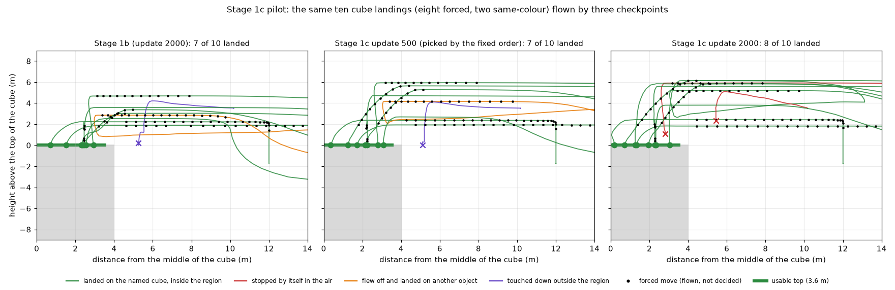

# Stage 1c — Cube Descent Recovery + Same-Color Landing Grounding

2026-10-12, 브랜치 `exp/generic-landing-stage1c-recovery-grounding`. Stage 1([문서](generic_landing_active_search_v2.md))과 Stage 1b([문서](generic_landing_stage1b_stop_safe_teacher.md))는 gate를 통과하지 못했고, 그 기록은 그대로 둔다.

**질문:** Stage 1b가 얻은 stop-safe 착륙을 유지하면서, cube 착륙의 마지막 단계와 같은 색 물체 사이의 선택을 함께 고칠 수 있는가?

**결과 (2026-10-12): Stage 1c는 통과하지 못했다. 후보 pilot에서 멈췄다.**

- 미리 고정한 순서가 고른 후보는 update 500이고, 이 후보는 pilot의 기준 하나(다른 물체에 착륙 1건 이하)를 넘지 못했다(2건). 그래서 **Gate A, Gate B, regression은 비행하지 않았다.**
- Update 1000 / 1500 / 2000은 same-colour 착륙 8/8, 다른 물체 착륙 0, 충돌 0이었지만 강제 cube 착륙 둘에서 **공중에서 스스로 멈췄다**(같은 시작에서 Stage 1b는 0). "Stage 1b보다 공중 정지가 2 이상 많은 후보는 뒤로 보낸다"는 미리 정한 줄에 걸려 update 500 뒤로 갔다.
- `generic_landing_v1`은 만들지 않았다. Gate용 새 시작(gate A 36, gate B 24)은 어느 checkpoint도 비행하지 않았다.
- 결과는 [§10](#10-후보-pilot-새-시작-24개-다섯-checkpoint)부터.

고치는 것은 둘이고 그 밖의 능력은 더하지 않는다.

- **A. Cube descent recovery.** Stage 1b의 cube 실패는 모두 내려가는 단계였다. 그런 상태에서 빠져나오는 길을 가르친다.
- **B. Same-colour landing grounding.** 착륙을 배운 정책이 "파란 pad"를 찾으라는 문장에 다른 파란 물체로 갔다. 색만 맞는 물체를 착륙 대상으로 삼지 않게 한다.

동결한 baseline(`grounding_film`, canonical 47/48), Gaussian Blur 결과, Arbitrary Start 보고, Stage 1과 Stage 1b의 결과는 바꾸지 않았다. Canonical test 48개와 Depot set은 비행하지 않았다. Active Search v2(Stage 2)는 이 단계의 결과와 무관하게 시작하지 않는다.

## 출발점

| | Stage 1 | Stage 1b |
|---|---:|---:|
| Gate | 실패 | 실패 |
| Cube 착륙 (첫 비행 / 두 비행 합) | 6 / 10, 11 / 20 | 7 / 10, 16 / 20 |
| Cylinder 착륙 | 8 / 10, 14 / 20 | 10 / 10, 20 / 20 |
| 공중 정지 (cube·cylinder 40번 중) | 15 | 1 |
| Regression 충돌 | 0 | 2 (재비행에서도 같음) |

Stage 1c는 **Stage 1b가 고른 checkpoint(update 2000)에서 이어서** 학습한다. 이 checkpoint는 Stage 1b의 gate를 통과한 것이 아니므로 `generic_landing_v1`이라 부르지 않고 경로와 지문으로 적는다(`configs/generic_landing_stage1c.json`의 `start_checkpoint_sha256`). `grounding_film`에서 다시 시작하지 않는 이유: Stage 1b가 이미 얻은 것(cylinder 20/20, 공중 정지 15 → 1)을 유지한 채 남은 둘만 고치는 보정이기 때문이다.

## 1. Stage 1b의 cube 실패를 다시 읽음

Cube 착륙 20번(validation 10개 시작 × 2)과 같은 시작에서의 teacher 비행 10번을 위치와 비행한 행동으로 읽었다(`src/landing/failures.descent_profile`).

| | Teacher (10) | Stage 1b student (20) |
|---|---|---|
| 물체 위로 들어올 때의 높이 (윗면 위) | 3.3–4.0m | 0.4–4.3m |
| 하강을 시작한 곳 (가운데에서) | 1.44–1.75m | 0.83–6.16m |
| 하강 중 상하 명령의 부호가 바뀐 횟수 | 0 | 18번은 0, 한 번은 2, 한 번은 58 |
| 내린 곳 (가운데에서) | 0.06–0.36m | 성공 0.42–3.35m, 실패 3.8m와 5.7m (영역 밖) |

- 가운데에서 5m 넘게 떨어진 곳에서 하강을 시작한 비행 셋(5.26m, 5.68m, 6.16m)은 모두 실패했다. 4.1m 안에서 시작한 비행 중 실패는 하강을 끝내지 못한 하나뿐이다.
- `52411`: 윗면보다 0.4–0.9m 높은 채로 들어와 가장자리에 내렸다(3.8m, 3.35m).
- `52407`: 가운데 전 5.7m, 6.2m에서 내려가기 시작해 모서리에서 끝났다.
- `52412`: 가운데에서 1.6m, 윗면 1.1–2.3m 위에 머물며 상하 명령의 부호를 58번 바꿨다.

Teacher는 이런 상태에 스스로 들어가지 않는다. 그래서 data에는 이런 상태에서 나오는 길이 없었다.

## 2. Stage 1b의 같은 색 물체 실패를 다시 읽음

Regression의 세 비행. 문장은 모두 "Find the blue landing pad and land on it."

| 시작 | 첫 시야 | Stage 1b | `grounding_film` | Stage 1의 checkpoint |
|---|---|---|---|---|
| `53471` | Blue cone이 18.5m 앞 가운데. Pad는 25m 뒤 | Cone으로 직진, 9.6m까지 올라 37 decision에 충돌 | 다른 물체 앞 공중 정지 | 다른 물체 앞 공중 정지 |
| `53479` | Blue cone이 49.5m 앞 가운데. Pad는 31m, 60° 옆 | Cone으로 가서 73 decision에 충돌 | Pad에 착륙 | Pad에 착륙 |
| `53101` | 아무것도 없음. Pad는 16.6m, 89° 옆 | Pad를 한 번도 보지 못하고 65m 떨어진 blue cube에 착륙 | Pad에 착륙 | Pad에 착륙 |

세 비행 모두 pad를 한 번도 시야에 넣지 못했다. Cone은 높이 10m이고 평평한 꼭대기가 없다. Stage 1과 Stage 1b의 generic landing data에는 "같은 색의 다른 물체가 먼저 보이는 착륙"을 넣은 적이 없다. 계획한 착륙 180개 중 60m 안의 같은 색 물체가 첫 시야에 있고 목표는 없는 시작은 Stage 1에 2개, Stage 1b에 3개였고 우연히 생긴 것이다.

## 3. Teacher: 하강 규칙 하나

[src/landing/teacher.py](../src/landing/teacher.py)의 `RecoveryTeacher`. Stage 1b의 teacher에 규칙 하나를 더했다. 탐색, 접근, 상승, 진입 속도(0.35m), 하강 속도는 그대로다.

| | Stage 1b | Stage 1c |
|---|---|---|
| 하강을 시작하는 곳 | 가운데에서 1.75m 안 (canonical) | 같음 |
| 낮게 내려온 뒤(윗면 위 3m 이하) 하강을 계속하는 범위 | 3.5m (pad의 값) | **2.675m** (cube, cylinder). Pad는 3.5m 그대로 |
| 그 범위 밖, 낮은 높이 | 계속 하강 | **하강하지 않음.** 올라가서 가운데로 다시 들어온 뒤 1.75m 안에서 하강 |

- **2.675m의 근거:** 하강을 시작하는 반경(1.75m)과 쓸 수 있는 윗면의 끝(3.6m)의 한가운데다. Canonical 3.5m는 영역이 6.6m인 pad의 값이고, cube에서는 끝에서 0.1m다.
- **Hysteresis:** 하강은 1.75m 안에서만 시작하고, 일단 낮아지면 2.675m까지는 계속한다. 작은 위치 오차로 label이 "상승"으로 뒤집히지 않는다. 그보다 크게 벗어나면 되돌아간다.
- Teacher의 정상 비행은 바뀌지 않는다(1.75m에서 내려가 0.4m 안에 내린다). Stage 1b의 data는 이 규칙과도 맞는다.

Stop-safety 규칙은 Stage 1b 그대로다: 착륙의 touchdown 전 label은 stop이 아니고 stop 규칙의 3.0배 이상이며 stop 4연속 구간이 없다.

## 4. Recovery data: 네 가지 상태

Teacher가 스스로 들어가지 않는 상태는 **강제 이동**으로 만든다(`RecoveryPushes`). 강제 이동은 비행하지만 label이 아니다(canonical push와 같은 방식. 강제 이동이 들어간 frame은 학습 sample이 되지 않는다). 강제 이동이 끝난 뒤의 frame이 teacher의 "빠져나오는 길"을 담는다.

| 상태 | 어떻게 만드는가 | Teacher의 답 |
|---|---|---|
| `under_climb` | 상승 도중(윗면 위 0.6–2.1m) 더 오르지 않고 물체 쪽 3.0–5.5m까지 직진시킨다 | 상승 → 가운데로 → 하강 |
| `edge` | 진입 높이에서 가운데를 2.5–4.5m 옆으로 비켜 지나가게 한다 | 하강하지 않음. 가운데로 돌아서 들어온 뒤 하강 |
| `premature` | 가운데 4.5–6.5m 전에서 윗면 위 1.3–2.3m까지 내려가게 한다 | 하강 중단 → 상승하며 가운데로 → 하강 |
| `stall` | 가운데 위에서 내려가는 중(윗면 위 1.2–2.5m 이하)에 두 번 들어 올린다 | 멈춤 없이 하강. 되올라가지 않음 |

- 범위는 1절의 실패에서 왔다. 같은 시작을 베끼지 않았다. Stage 1b의 validation·regression 시작은 이 data의 시작이 아니다.
- 강제 하강은 윗면 위 1.3m보다 낮게, 강제 진입은 0.6m보다 낮게 내리지 않는다. 기체가 명령을 약 2.4초 늦게 따르기 때문에 물체 옆면과 거리를 둔다.
- Episode는 다음을 모두 만족할 때만 data가 된다: teacher가 영역 안에 내리고 스스로 멈췄다, 계획한 강제 이동이 모두 일어났다, 강제 이동이 끝난 첫 decision에 camera가 물체를 보고 있었다(사진으로 알 수 없는 답을 label로 주지 않는다).
- 강제 이동은 teacher 상태가 아니라 **위치**에서 일어난다. 그래서 같은 episode를 학습된 정책에게도 그대로 날릴 수 있다(pilot의 8개).

## 5. Same-colour data

첫 시야에 이름과 같은 색의 **다른** 물체가 있고 이름의 물체는 없다. 이름의 물체는 돌면 보인다. 이동해야 보이는 시작, 44m 밖, 가려진 목표는 없다.

- **Teacher:** 이름의 물체가 camera에 보일 때까지 canonical 탐색(오른쪽 회전)을 한다. 무엇이 보이든 상관하지 않고, 목표가 어디 있는지 모른다. 보이면 접근해서 착륙한다. 다른 물체 쪽으로 가는 label은 없다(계획 단계에서 teacher의 경로가 다른 물체 12m 안으로 들어가는 시작은 버린다).
- **Twin:** 같은 시작에 문장만 바꾼다. 첫 화면은 같고 명사가 다르며 내릴 물체가 다르다. Cone에는 착륙면이 없어 twin이 없다.
- 일부는 다른 물체도 착륙할 수 있는 물체다(pad ↔ cube). "내리기 쉬운 같은 색 물체"로 가는 지름길을 막기 위해서다.

| 이름의 물체 ← 먼저 보이는 물체 | Episode |
|---|---:|
| Blue pad ← blue cube | 20 |
| Blue pad ← blue cone | 12 |
| Blue cube ← blue pad | 16 (twin 10 + 단독 6) |
| Red pad ← red cube | 12 |
| Red cube ← red pad | 12 (twin 6 + 단독 6) |
| 합 | 72 (twin pair 16쌍) |

**Student에게 가는 것은 Front·Down 사진과 문장뿐이다.** 목표의 좌표, 거리, 방향, 물체 id, 다른 물체의 id는 teacher와 evaluator만 쓴다. 녹화된 data의 문장이 모두 catalogue의 문장인지(숫자와 id 없음), proprio가 꺼져 있는지, twin이 시작을 공유하고 다른 물체를 가리키는지를 학습 전에 검사한다(`scripts/generic_landing_1c.py inputs`).

## 6. 계획 (녹화 전에 고정)

숫자는 모두 [configs/generic_landing_stage1c.json](../configs/generic_landing_stage1c.json), 시작은 `configs/generic_landing_stage1c/`에 있다.

**Data.** 녹화 152 episode + validation loss용 16.

| | Episode |
|---|---:|
| Recovery: cube (상태마다 16) | 64 |
| Recovery: cylinder (상태마다 2) | 8 |
| Recovery: pad (`edge` 4, `stall` 4) | 8 |
| Same colour | 72 |

**학습.** Stage 1b의 update 2000에서 시작. LoRA, action head, FiLM만 학습하고 module은 더하지 않는다. Learning rate는 Stage 1b의 절반(2.5e-5), 2,000 update. 뽑는 frame의 35%는 Stage 1c의 새 data, 35%는 Stage 1b의 stop-safe generic landing data, 30%는 기존 data다. Stage 1의 generic landing episode는 0개다. 후보는 update 500 / 1000 / 1500 / 2000.

**Seed.** 저장소의 모든 계획·set·dataset을 읽었다(0–24999, 30000–31002, 40000–43999, 50000–53999 사용 중). Stage 1c는 60000번대를 쓴다.

**Pilot (새 시작 24개).** 강제 cube 착륙 8(상태마다 2), same-colour 착륙 8, pad 4, cylinder 4. Stage 1b의 checkpoint와 후보 넷이 한 번씩. 순서: same-colour 충돌 → 다른 물체 착륙 → 강제 착륙 회복 수 → cube 착륙 → cylinder → pad → 공중 정지 → validation L1 → 이른 update. Same-colour 충돌이 있거나 Stage 1b보다 pad·cylinder·회복이 나빠진 후보는 뒤로 보낸다.

> 결과 뒤에 덧붙임 (2026-10-12): 위 문장은 config의 `pilot.put_behind` 다섯 줄 가운데 "공중 정지가 Stage 1b보다 2 이상 많음"과, 고른 후보가 gate로 가기 위한 `pilot.pass`(same-colour 충돌 0, 다른 물체 착륙 1 이하, cube 6/10, pad 8/10, cylinder 3/4 이상)를 빠뜨렸다. 둘 다 같은 commit(`31934ca`)의 config에 있었고 판정 code는 config를 읽는다. 결과를 가른 것이 이 두 줄이다(§10).

**Gate A — Generic landing (새 시작 36개, Stage 1의 형식과 숫자 그대로).** Success 30/36, 착륙 24/30, pad 9, cube 8, cylinder 8, wrong target 2 이하, 충돌 1 이하, approach 중 touchdown 0. 강제 이동은 없다.

**Gate A의 두 번째 비행.** Cube와 cylinder 착륙 20개 시작을 한 번 더. Cube: 첫 비행 8 이상, 합 16/20 이상, 둘 다 실패 1개 이하. Cylinder: 첫 비행 8 이상, 합 18/20 이상, 둘 다 실패 1개 이하.

**Gate B — Same-colour (새 시작 24개).** 모두 다른 물체가 첫 시야에 있고 이름의 물체는 없다.

| | 기준 |
|---|---:|
| 이름의 물체에 착륙 | 22 / 24 이상 |
| 다른 물체에 착륙 | 0 |
| 다른 물체와 충돌 | 0 |
| 충돌 (모두) | 0 |
| 다른 물체에서 끝난 비행 | 0 |
| 먼저 보인 물체를 거절 | 22 / 24 이상 (90%) |

- **다른 물체에 접근:** 어느 decision에서든 다른 물체의 12m 안에 있고 이름의 물체보다 그 물체에 더 가깝다.
- **다른 물체에서 끝남:** 이름의 물체가 아닌 것에 착륙·접촉·충돌했거나, 다른 물체 12m 안에서 그쪽에 더 가까운 채 스스로 멈췄다.
- **거절:** 접근하지도, 거기서 끝나지도 않았다.

**Gate B의 두 번째 비행.** 24개 중 12개(cone이 다른 물체인 4개 모두 + 나머지 중 다른 물체가 가장 가까운 8개)를 한 번 더. 둘 다 실패한 시작 1개 이하, 두 번째 비행의 충돌 0.

**Regression (새 시작 36개, canonical validation의 구성).** `grounding_film`, Stage 1b의 checkpoint, 고른 checkpoint가 한 번씩. 고른 checkpoint를 `grounding_film`과 비교한다: success는 baseline − 2 이상, pad 착륙은 baseline − 1 이상, **충돌 0**, approach 중 touchdown 0, wrong target은 baseline + 1 이하.

**통과 조건.** 녹화 label의 stop 규칙, data의 입력 검사, Gate A, Gate A의 두 번째 비행, Gate B, Gate B의 두 번째 비행, regression이 **모두** 통과해야 Stage 1c 통과다. 그때에만 `generic_landing_v1`을 만든다.

**Gate 뒤의 기록용 비행 (판정과 무관, 미리 정함).** Gate B 시작의 twin 11개, teacher pilot의 강제 16개를 Stage 1b의 checkpoint와 고른 checkpoint로, Stage 1b가 실패한 validation 시작 셋과 regression 시작 셋을 고른 checkpoint로.

**시작 간격 규칙을 다시 읽음 (set을 뽑기 전에 config에 적음).**

- 6m 규칙은 "check로 비행하는 시작"을 "학습에 쓴 시작"에서 떼어 놓기 위한 것이다. 지금까지는 녹화 시작끼리도 6m를 지키게 했는데, 그 읽기로는 자리가 없다. Blue cone이 먼저 보이고 blue pad가 돌면 보이는 후보 시작의 99% 이상이 예전 시작의 6m 안에 있어 하나도 뽑히지 않았다.
- Stage 1c의 **녹화 시작**은 check로 비행하는 모든 시작(저장소 전체와 이 stage)에서 6m를 지키고, 예전 녹화 시작과는 가까워도 된다. 둘 다 data다.
- Stage 1c의 **check 시작**(gate A, gate B, pilot, teacher pilot)은 이 stage와 그 앞 checkpoint들이 학습에 쓴 모든 시작, 이전의 다른 check 시작, 서로에게서 6m를 지킨다. Stage 1과 Stage 1b의 check 시작(녹화된 적 없음)과 Stage 1의 녹화 시작(이 계열의 어느 checkpoint도 학습하지 않음)과는 가까워도 된다. 이렇게 하지 않으면 pad 가까이의 착륙 시작이 뽑히지 않았다.
- Regression set은 Stage 1b와 같이 예전 regression set의 시작과 가까워도 된다.
- 어느 set에도 예전 set의 시작과 같은 시작은 없다.

**Ceiling.** Executor는 바꾸지 않는다. 14m를 넘은 비행의 수와 최고 높이를 기록한다.

## 7. 녹화 전 확인

**Label (dry run).** 계획한 295개 episode를 새 teacher로 dry run했다(강제 이동 포함). 착륙 label 17,623개 중 stop 0, 3.0배 미만 0, stop 4연속 구간 0, 최소 3.125배. 끝나지 않은 dry run은 없다.

**Teacher pilot (simulator, finalizer 포함, 32개).**

| 강제 상태 | 비행 | 강제 이동이 일어나고 물체가 보임 | 회복해서 착륙 | 강제 이동이 끝난 곳 (가운데에서 / 윗면 위) | 내린 곳 |
|---|---:|---:|---:|---|---|
| `under_climb` | 4 | 4 | 4 | 2.7–4.4m / 1.6–2.0m | 0.08–0.92m |
| `edge` | 4 | 4 | 4 | 3.0–4.2m / 3.7–4.0m | 0.30–0.72m |
| `premature` | 4 | 4 | 4 | 3.6–3.8m / 1.3–2.0m | 0.17–1.32m |
| `stall` (두 번씩) | 4 | 4 | 4 | 0.05–0.64m / 0.7–2.7m | 0.13–0.64m |

| Same colour | 비행 | 이름의 물체에 착륙 |
|---|---:|---:|
| 다른 물체가 먼저 보이는 시작 | 12 | 12 |
| Twin (문장이 먼저 보이는 물체를 가리킴) | 4 | 4 |

- 강제 16 / 16, same colour 16 / 16, 충돌 0, wrong target 0, stop 규칙을 어긴 label 0.
- **목표를 아는 탐색 label 0.** 어느 camera에도 이름의 물체가 보이지 않던 270 decision에서 teacher의 label은 모두 canonical 탐색(오른쪽 회전, 또는 앞이 막혔을 때의 상승)이었다.
- 기준(강제 15 / 16 이상, same colour 16 / 16, 충돌 0, wrong target 0, 위반 0)을 통과했다.
- Teacher pilot은 두 번 비행했다. 처음 뽑은 계획에서 이 set의 seed가 선언한 범위를 넘어간 것을 발견해(다른 set과 겹친 seed는 없었다) seed 사용 방식을 고치고 모든 계획을 다시 뽑았다. 처음 계획의 32개도 같은 기준을 통과했다. 위 표는 다시 뽑은 계획의 것이다.

## 8. 녹화와 녹화된 data

Commit `31934ca`(녹화 전 고정) 뒤에 simulator 셋으로 녹화했다. Finalizer 없이, 예전 data와 같은 방식이다.

| | 계획 | 녹화됨 |
|---|---:|---:|
| Train episode | 152 | 150 |
| Val episode (L1 감시용) | 16 | 16 |
| Recovery: `under_climb` / `edge` / `premature` / `stall` | 20 / 24 / 20 / 24 | 20 / 23 / 20 / 23 |
| Same colour (twin 포함) | 80 | 80 (twin 16쌍 모두) |
| Frame | | 10,829 (train 9,802) |

- 실시간 배율은 최소 0.90, 중앙값 0.98이다. 속도 때문에 버린 episode는 없다.
- **2개가 빠졌다.** 둘 다 cube에서 10–11m, 높이 10–11m에서 cube를 뒤에 두고 시작한다. Teacher가 320 decision 동안 좌우 회전을 반복해 강제 이동이 일어나기 전에 끝났다. Stage 1과 Stage 1b에서도 있었던 canonical 탐색 규칙의 문제다. Data에 넣지 않았다.
- 녹화된 강제 착륙 86개는 모두 강제 이동이 계획대로 일어났고, 끝난 첫 decision에 camera가 물체를 보고 있었다.

**강제 이동 뒤의 label.** 강제 이동이 끝난 뒤 touchdown까지 teacher가 준 label의 수다(강제 이동 자체 1,000 decision은 label이 아니다).

| 상태 | 상승 | 가운데로 (전진·회전) | 하강 |
|---|---:|---:|---:|
| `under_climb` | 63 | 48 | 254 |
| `edge` | 0 | 323 | 315 |
| `premature` | 97 | 58 | 262 |
| `stall` | 0 | 0 | 372 |

**감사 (학습 script는 이것들이 통과해야 시작한다).**

| | 결과 |
|---|---|
| 착륙 label (touchdown 전) | 10,492개. Stop 0, 3.0배 미만 0, stop 4연속 구간 0, 최소 3.125배 |
| 문장 | 6종, 모두 catalogue의 문장. 숫자와 물체 id 없음. Proprio 꺼짐 |
| Twin | 16쌍 모두 시작을 공유하고 다른 물체를 가리킴 |
| 목표가 보이지 않을 때의 탐색 label | 1,342 decision 모두 canonical 탐색. 목표 위치를 쓰는 label 0 |
| Stage 1의 generic landing episode | 0개 |

병합한 data: 기존 다섯 set + Stage 1b의 231 + Stage 1c의 166 = 1,557 episode, 81,643 frame.

## 9. Training

| | |
|---|---|
| 시작 | Stage 1b의 update 2000 (지문은 config와 일치) |
| 학습 대상 | Correction LoRA, action head, FiLM. Module 추가 없음 |
| Update | 2,000 (4 frame씩), learning rate 2.5e-5 (Stage 1b의 절반, FiLM도 같은 값) |
| 뽑는 비율 | Stage 1c 35% (9,802 frame), Stage 1b의 stop-safe data 35% (12,156 frame), 기존 data 30% (51,640 frame) |
| 걸린 시간, GPU 최대 | 75분, 9.9 GiB |
| 후보 | Update 500 / 1000 / 1500 / 2000. 넷 모두 저장한 그대로 다시 로드됨 |

새 data와 기존 data를 반씩 섞은 validation frame의 L1:

| Update | 시작 (Stage 1b) | 250 | 500 | 1000 | 1500 | 2000 |
|---|---:|---:|---:|---:|---:|---:|
| Validation L1 | 0.0719 | 0.0788 | 0.0718 | 0.0658 | 0.0612 | 0.0599 |

후보는 L1이 아니라 pilot 비행으로 고른다.

## 10. 후보 pilot (새 시작 24개, 다섯 checkpoint)

Stage 1b의 checkpoint(update 2000)가 먼저 비행했고, 이어서 후보 넷이 같은 24개를 한 번씩 비행했다. 120 비행, 충돌로 끝난 비행은 Stage 1b의 1건뿐이다.

| | Stage 1b | 500 | 1000 | 1500 | 2000 |
|---|---:|---:|---:|---:|---:|
| Same-colour 시작의 충돌 | 1 | 0 | 0 | 0 | 0 |
| 다른 물체에 착륙 (24개 전체) | 3 | 2 | 0 | 0 | 0 |
| 강제 cube 착륙 성공 (8) | 6 | 6 | 6 | 6 | 6 |
| Cube 착륙 (10) | 7 | 7 | 8 | 8 | 8 |
| Cylinder 착륙 (4) | 3 | 3 | 3 | 4 | 4 |
| Pad 착륙 (10) | 9 | 10 | 10 | 10 | 10 |
| Same-colour 착륙 (8) | 6 | 7 | 8 | 8 | 8 |
| 공중에서 스스로 정지 | 0 | 0 | **2** | **2** | **2** |
| Success (24) | 19 | 20 | 21 | 22 | 22 |
| Validation L1 | 0.0719 | 0.0718 | 0.0658 | 0.0612 | 0.0599 |
| 뒤로 보냄 | | | 공중 정지 | 공중 정지 | 공중 정지 |

**순서와 판정.** 고정한 순서는 500 → 2000 → 1500 → 1000이다. Update 1000 / 1500 / 2000은 공중 정지가 Stage 1b(0)보다 2 많아 `put_behind`에 걸렸고, 걸리지 않은 후보는 500 하나였다. 500을 pilot의 기준에 대면:

| | 500의 값 | 기준 | |
|---|---:|---:|---|
| Same-colour 시작의 충돌 | 0 | 0 이하 | 통과 |
| 다른 물체에 착륙 | 2 | 1 이하 | **실패** |
| Cube 착륙 | 7 / 10 | 6 이상 | 통과 |
| Pad 착륙 | 10 / 10 | 8 이상 | 통과 |
| Cylinder 착륙 | 3 / 4 | 3 이상 | 통과 |

**Pilot NOT PASSED.** 평가 chain은 여기서 멈췄고 gate는 비행하지 않았다.

- `put_behind`의 그 줄이 없었다면 순서의 첫째는 update 2000이고, 2000은 다섯 기준을 모두 넘는다. 그 줄과 숫자(2)는 결과를 보기 전에 정했으므로 바꾸지 않았다. 2000을 gate에 올리지 않았다.
- 계획서의 말은 "renewed air self-stop pattern이면 우선 선택하지 않는다"이고, "2 이상"이라는 숫자와 "고른 후보가 `pass`를 넘어야 gate로 간다"는 줄은 녹화 전에 내가 정해 config에 적은 것이다.

**다섯 가운데 하나라도 실패한 시작 (나머지 17개는 다섯 모두 성공).**

| 시작 | Stage 1b | 500 | 1000 | 1500 | 2000 |
|---|---|---|---|---|---|
| 63005 blue cube, `edge` | blue pad에 착륙 (44m 떨어짐) | blue pad에 착륙 | 착륙 | 착륙 | 착륙 |
| 63006 red cube, `edge` | 착륙 | 착륙 | 공중 정지 (윗면 위 0.2m) | 공중 정지 (1.4m) | 공중 정지 (1.1m) |
| 63009 blue cube, `stall` | 모서리에 touchdown (가운데서 5.2m) | 모서리에 touchdown (5.1m) | 공중 정지 (5.4m, 위 1.9m) | 공중 정지 (5.5m, 위 2.1m) | 공중 정지 (5.4m, 위 2.3m) |
| 63014 blue pad, blue cone이 먼저 | **blue cone과 충돌** | 착륙 | 착륙 | 착륙 | 착륙 |
| 63020 blue cube, blue pad가 먼저 | blue pad에 착륙 | blue pad에 착륙 | 착륙 | 착륙 | 착륙 |
| 63035 blue cylinder, 가까이 | 착륙 | 가장자리 밖 touchdown (3.8m) | 착륙 | 착륙 | 착륙 |
| 63039 blue cylinder, 중간 | blue cube에 착륙 (80m 떨어짐) | 착륙 | 가장자리 밖 touchdown (3.9m) | 착륙 | 착륙 |

- **강제 이동.** 8개 중 7개에서 다섯 checkpoint 모두 강제 이동이 일어났다. 63009의 `stall`은 어느 checkpoint에서도 일어나지 않았다(윗면 위에서 하강하는 상태에 아무도 들어가지 못했다). 그래서 63009는 강제 이동 없는 가까운 cube 착륙이고, 다섯 모두 실패했다.
- "강제 cube 착륙 성공"은 다섯 모두 6이지만 내용이 다르다. Stage 1b와 500은 63005(다른 물체로 감)와 63009를, 1000 / 1500 / 2000은 63006과 63009(둘 다 공중 정지)를 잃었다.

## 11. 공중 정지 둘 (update 1000 / 1500 / 2000)

두 시작 모두 세 checkpoint에서 같은 모습으로 반복됐다.

- **63006 (`edge`).** 강제 이동이 가운데에서 2.9m에서 끝났다(윗면 위 4.7–7.6m, checkpoint마다 다름). 그 뒤 정책은 전진 없이 곧게 내려왔다(가운데에서 2.6–2.8m, 쓸 수 있는 윗면 3.6m 안). Stage 1b와 500은 그대로 닿았다(오차 2.94m, 2.79m). 1000 / 1500 / 2000은 하강 명령이 점점 작아져 윗면 위 0.2 / 1.4 / 1.1m에서 stop 넷을 냈다. 이때 down camera는 cube를 보고 있었고 finalizer는 `LANDING_DESCENT`였다. Update 2000의 마지막 네 decision의 stop ratio는 0.08, 0.07, 0.04, 0.08이다.
- **63009 (`stall`, 강제 이동 없음).** 다섯 모두 가운데에서 5.7–6.1m(윗면 밖, 모서리 쪽)에서 하강을 시작했다. Stage 1b와 500은 모서리에 닿았고(영역 밖), 1000 / 1500 / 2000은 윗면 위 1.9–2.3m, 가운데에서 5.4–5.5m에서 멈췄다. 물체 위가 아니다.

**Cube·cylinder 착륙 14개에서 닿기 전에 낸 stop decision.**

| | Stage 1b | 500 | 1000 | 1500 | 2000 |
|---|---:|---:|---:|---:|---:|
| Decision 수 | 1,218 | 1,052 | 1,075 | 1,092 | 1,114 |
| Stop decision (전체 비율) | 17 (1.4%) | 6 (0.6%) | 22 (2.0%) | 19 (1.7%) | 24 (2.2%) |
| CLIMB 단계의 stop 비율 | 2.6% | 0.0% | 10.6% | 13.5% | 10.2% |
| DESCENT 단계의 stop 비율 | 6.3% | 1.7% | 7.1% | 5.1% | 6.9% |
| Stop이 3번 이어진 비행 | 0 | 0 | 3 | 2 | 2 |
| Stop 4번으로 끝난 비행 | 0 | 0 | 2 | 2 | 2 |

Stage 1b의 stop decision은 17개가 12 비행에 흩어져 있고 두 번 이어진 적이 없다. 1000 이후는 수는 비슷하지만 **이어서** 나온다. 왜 그런지는 이 비행만으로 말할 수 없다. 녹화 label에는 touchdown 전의 stop이 없다(§8).

## 12. Cube 하강: 같은 10개 시작에서 Stage 1b와 후보

강제 이동은 정책이 정한 것이 아니므로 빼고, 정책 자신의 decision만 읽었다.

| | Stage 1b | 500 | 1000 | 1500 | 2000 |
|---|---:|---:|---:|---:|---:|
| 착륙 | 7 | 7 | 8 | 8 | 8 |
| 물체 위로 들어온 높이 (윗면 위, 중앙값) | 2.70m | 2.70m | 3.89m | 3.93m | 3.81m |
| 하강을 시작한 거리 (가운데에서, 중앙값) | 3.15m | 2.94m | 2.71m | 2.49m | 2.77m |
| 하강을 시작한 높이 (윗면 위, 중앙값) | 2.54m | 2.70m | 4.26m | 4.56m | 4.45m |
| 윗면(3.6m) 밖에서 하강 시작 | 2 | 3 | 1 | 1 | 1 |
| Teacher의 포기 반경(2.675m) 밖에서 하강 시작 | 8 | 5 | 5 | 4 | 5 |
| 수직 명령의 부호가 바뀐 비행 / 바뀐 횟수 | 2 / 4 | 1 / 1 | 0 / 0 | 1 / 1 | 1 / 4 |
| Touchdown 오차 (착륙한 것, 중앙값) | 2.37m | 2.15m | 1.60m | 1.48m | 1.64m |
| 영역 밖 touchdown | 1 | 1 | 0 | 0 | 0 |
| 공중 정지 | 0 | 0 | 2 | 2 | 2 |
| Timeout | 0 | 0 | 0 | 0 | 0 |

- 1000 이후의 후보는 더 높이 들어오고, 가운데에 더 가까이 가서 내려오기 시작하며, 닿는 자리도 가운데에 가깝다. Teacher의 규칙 쪽으로 움직였다.
- 부호 뒤집힘은 10개 시작에서 뚜렷한 차이가 없다(2000은 한 비행에서 4번).
- 영역 밖 touchdown은 1 → 0이 됐지만 그 시작(63009)은 착륙이 된 것이 아니라 공중 정지로 바뀌었다.
- Gate A를 비행하지 않았으므로 Stage 1b의 validation(강제 이동 없음, 7/10·16/20)과 견줄 숫자는 없다.

## 13. Same-colour: 같은 8개 시작

| | Stage 1b | 500 | 1000 | 1500 | 2000 |
|---|---:|---:|---:|---:|---:|
| 이름의 물체에 착륙 | 6 | 7 | 8 | 8 | 8 |
| 다른 물체에 접근 | 2 | 1 | 0 | 0 | 0 |
| 다른 물체에 착륙 | 1 | 1 | 0 | 0 | 0 |
| 다른 물체와 충돌 | 1 | 0 | 0 | 0 | 0 |
| 다른 물체에서 끝남 | 2 | 1 | 0 | 0 | 0 |
| 먼저 보인 물체를 거절 | 6 | 7 | 8 | 8 | 8 |

- Same-colour 시작이 아닌 곳에서도 같은 일이 있었다. 63005(blue cube로 가던 중 강제 이동을 받음)에서 Stage 1b와 500은 cube를 떠나 44m 떨어진 blue pad에 착륙했고, 63039에서 Stage 1b는 blue cylinder 대신 80m 떨어진 blue cube에 착륙했다. 24개 전체로 보면 "파란 다른 물체로 간" 비행은 Stage 1b 4, 500 2, 1000 / 1500 / 2000은 0이다.
- 8개 시작, 한 번씩의 비행이다. Gate B(24개 + 12개 재비행)는 비행하지 않았으므로 same-colour 문제가 고쳐졌다고 말할 수 없다. Twin(같은 시작, 다른 문장)도 gate 뒤의 기록용이라 비행하지 않았다.

## 14. Regression 시작 (새 36개): 앞의 두 checkpoint만

후보는 pilot을 넘어야 비행하므로 Stage 1c의 checkpoint는 이 시작들을 비행하지 않았다. Chain의 첫 단계에서 비행한 둘의 결과다.

| | `grounding_film` | Stage 1b |
|---|---:|---:|
| Success | 35 / 36 | 33 / 36 |
| 착륙 (모두 pad) | 27 / 27 | 24 / 27 |
| Approach | 8 / 9 | 9 / 9 |
| Wrong target | 0 | 2 |
| 충돌 | 0 | 0 |
| Approach 중 touchdown | 0 | 0 |
| 공중에서 스스로 정지 | 0 | 2 |
| Timeout | 1 | 0 |

Stage 1b가 실패한 셋은 모두 "파란 pad에 착륙"이고 `grounding_film`은 셋 다 착륙했다.

| 시작 | Stage 1b |
|---|---|
| 66575 (pair, 문장을 바꾼 것) | 다른 물체 쪽에서 스스로 멈춤 (blue pad까지 40.9m 남음) |
| 66595 (같은 색 물체가 먼저) | 9번째 decision에 멈춤 (31.7m 남음) |
| 66760 (pair, 문장을 바꾼 것) | blue cube에 착륙 |

Stage 1b에서 본 것(같은 색의 다른 물체로 감)이 새 시작에서도 다시 나왔다. 이번에는 충돌은 없었다. 판정은 아니지만 Stage 1c의 regression 기준에 대면 Stage 1b는 pad 착륙(24, 기준 26 이상)과 wrong target(2, 기준 1 이하)에서 걸린다.

## 15. Ceiling (기록만)

Executor는 바꾸지 않았다. Pilot 24개에서 14m를 넘은 비행:

| | Stage 1b | 500 | 1000 | 1500 | 2000 |
|---|---:|---:|---:|---:|---:|
| 14m를 넘은 비행 | 3 | 3 | 10 | 8 | 6 |
| 최고 높이 | 21.8m | 22.8m | 23.7m | 23.4m | 23.6m |
| Cube 착륙의 최고 높이 | 12.7m | 13.9m | 15.8m | 15.1m | 14.1m |
| Cylinder 착륙의 최고 높이 | 17.2m | 16.1m | 19.5m | 18.9m | 18.7m |

- 가장 높은 비행은 다섯 모두 63021(red pad, red cube가 먼저)이고 다섯 모두 착륙했다.
- 1000 이후의 후보는 cube와 cylinder에서 더 높이 난다. Regression 시작 36개에서는 `grounding_film`과 Stage 1b 모두 14m를 넘지 않았다(최고 8.9m, 9.2m). Teacher pilot에서는 2개(최고 14.7m)였다.

## 16. 판정

| | |
|---|---|
| 녹화 label의 stop 규칙 | 통과 |
| Data의 입력 검사 (문장, twin, 목표가 안 보일 때의 탐색) | 통과 |
| 후보 pilot | **통과하지 못함** (고른 후보 500, 다른 물체 착륙 2건) |
| Gate A / 두 번째 비행 | 비행하지 않음 |
| Gate B / 두 번째 비행 | 비행하지 않음 |
| Regression | Stage 1c의 checkpoint는 비행하지 않음 |
| **Stage 1c** | **NOT PASSED** |
| `generic_landing_v1` | 만들지 않음 |
| Active Search v2 | 시작하지 않음 |

Gate 뒤에 하기로 한 기록용 비행(twin, 강제 16개, Stage 1b의 실패 시작)도 gate가 없었으므로 비행하지 않았다.

## 17. 질문에 대한 답

Gate를 비행하지 않았으므로 아래는 pilot 24개에서만 말할 수 있는 것이다.

1. **Cube 착륙이 8/10을 넘는가?** 판정할 비행이 없다. Pilot의 cube 10개(8개는 강제 이동)에서 고른 후보 500은 7, 1000 / 1500 / 2000은 8, Stage 1b는 7이다.
2. **두 비행 합 16/20을 넘는가?** 비행하지 않았다.
3. **흔들림과 가장자리 touchdown이 줄었는가?** 1000 이후에서 닿는 자리가 가운데에 가까워졌다(오차 중앙값 2.37m → 1.5–1.6m). 부호 뒤집힘은 차이가 없다. 영역 밖 touchdown 1건은 공중 정지로 바뀌었다.
4. **Cylinder는 유지됐는가?** 4개에서 Stage 1b 3, 500 3, 1000 3, 1500 4, 2000 4. 판정할 수는 아니다.
5. **Pad는 유지됐는가?** 10개에서 Stage 1b 9, 후보 넷 모두 10.
6. **Same-colour의 다른 물체 착륙과 충돌이 없어졌는가?** 1000 / 1500 / 2000은 24개에서 0건이다. 고른 후보 500은 다른 물체 착륙 2건이 남았다. Gate B는 비행하지 않았다.
7. **Twin에서 명사를 따르는가?** Twin은 비행하지 않았다. Pilot에는 같은 물체 쌍의 두 방향(blue pad ↔ blue cube)이 서로 다른 시작으로 2개씩 있고, 1000 이후는 넷 모두 이름의 물체에 착륙했다.
8. **새로 나빠진 것이 있는가?** 있다. 1000 / 1500 / 2000에서 Stage 1b가 없앤 **공중 정지가 돌아왔다**(강제 cube 착륙 8개 중 2, 세 checkpoint에서 같은 시작). 14m를 넘는 비행도 3 → 6–10으로 늘었다.
9. **남은 병목은 무엇인가?** 한 checkpoint가 둘을 함께 갖지 못했다. 이른 후보(500)는 공중 정지가 없지만 아직 파란 다른 물체에 착륙하고, 늦은 후보는 물체를 맞게 고르지만 cube 윗면 바로 위에서 하강 명령이 사라진다. 그리고 가까운 cube 시작 하나(63009)는 다섯 모두 모서리 쪽에서 내려오기 시작해 실패했다.

## 18. 읽을 때 주의할 것

- Pilot은 24개 시작을 한 번씩 비행한 것이다. 같은 시작이 비행마다 뒤집히는 일을 Stage 1b에서 봤다(cube 재비행 7 → 9). 다만 공중 정지 둘은 세 checkpoint에서 같은 시작, 같은 모습으로 반복됐다.
- 결과를 가른 두 줄(공중 정지 +2면 뒤로, 다른 물체 착륙 1 이하)은 계획서의 말을 내가 숫자로 옮겨 녹화 전에 config에 적은 것이다. §6의 요약 문장은 그 가운데 둘을 빠뜨렸다(그 자리에 덧붙였다).
- 강제 이동은 정책이 그 자리에 가야 일어난다. 63009의 `stall`은 다섯 모두에서 일어나지 않았으므로 "`stall` 회복"으로 읽을 수 있는 비행은 상태마다 2개가 아니라 1개(63010, 다섯 모두 착륙)다.
- Stage 1c의 seed 가운데 pilot(63000번대)은 썼다. Gate A(64000번대)와 gate B(65000번대)는 비행하지 않았고, regression(66000번대)은 `grounding_film`과 Stage 1b만 비행했다.

## 19. 다음에 할 수 있는 일 (시작하지 않음)

- **늦은 후보를 gate에 올릴지.** Update 2000(또는 1500)은 pilot의 다섯 기준을 모두 넘지만 고정한 순서가 고른 후보가 아니다. 올리려면 이 stage의 규칙을 바꾸는 것이 아니라 새 규칙을 결과 전에 적은 별도의 평가가 되어야 하고, 그 결정은 이 문서의 범위 밖이다.
- **윗면 바로 위에서의 정지.** 1000 이후에서 돌아온 공중 정지는 하강 명령이 윗면 위 0.2–2.3m에서 사라지는 모습이다. 다음 교정의 대상이라면 이것이다.
- **가까운 cube 시작에서 모서리 쪽 하강.** 63009는 Stage 1b와 후보 넷 모두 가운데에서 5.7–6.1m에서 내려오기 시작했다. Stage 1b의 실패 셋과 같은 종류다.

## 20. Tests

- Python 434 / 434 (WSL), PowerShell 4 / 4.
- 동결 fingerprint: `grounding_film` 30개 파일, `gen_v2` 120개 파일 모두 변동 없음 (작업 전과 후).
- `outputs/aerovla_oft/checkpoints/generic_landing_v1`: 없음.
- 녹화 전 commit `31934ca` 뒤로 `configs/`, `scripts/`, `src/`, `tests/`의 파일은 바뀌지 않았다. Pilot은 그 commit의 code와 config로 판정했다.
- 표: `outputs/generic_landing_1c/summary/` (`pilot.json`, `pilot_flights.json`, `pilot_descent.json`, `pilot_commitment.json`, `pilot_failures.json`, `pilot_student_outputs.json`, `regression_baselines.json`, `ceiling.json`, `decision.json`).

