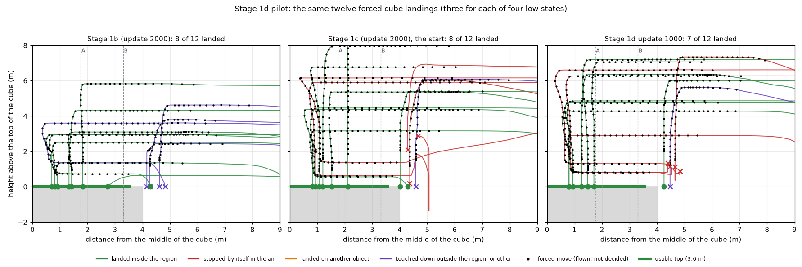

# Stage 1d — Final Descent Continuation Correction

2026-10-12–13, 브랜치 `exp/generic-landing-stage1d-final-descent`. Stage 1([문서](generic_landing_active_search_v2.md)), Stage 1b([문서](generic_landing_stage1b_stop_safe_teacher.md)), Stage 1c([문서](generic_landing_stage1c_recovery_grounding.md))는 통과하지 못했고, 그 기록은 그대로 둔다.

**질문:** Stage 1c가 얻은 같은 색 물체 구분과 generic landing 능력을 유지하면서, 윗면 위 마지막 하강을 끝까지 이어가도록 정책을 고칠 수 있는가?

**결과 (2026-10-13): Stage 1d는 통과하지 못했다. 후보 pilot에서 멈췄다.**

- 새 시작 24개의 pilot에서 후보 셋(update 500 / 1000 / 1500) 가운데 기준을 모두 넘은 것이 없다. 강제 cube 착륙은 시작 checkpoint(Stage 1c의 update 2000) 8/12에서 7 / 7 / 6으로 내려갔고, 그 12개의 공중 정지는 3에서 5 / 4 / 6으로 늘었다(기준: 10 이상, 1 이하).
- 가운데 쪽의 낮은 상태(D1, D2)는 모든 checkpoint가 6/6이었다. 실패는 모두 가장자리 상태(D3, D4)다. 거기에 준 "상승" label은 정책을 올라가게 하지 못하고 제자리에서 멈추게 했다.
- **Qualification, Gate A, Gate B, regression은 비행하지 않았다.** Stage 1c의 봉인한 set은 그대로다. `generic_landing_v1`은 만들지 않았다. 더 학습하지 않았다.
- 결과는 [§8](#8-후보-pilot-새-시작-24개)부터, 읽기는 [§13](#13-무슨-일이-있었는가).

고치는 것은 하나다: 윗면 위 마지막 2m에서 정책이 하는 일. 새 능력은 더하지 않는다. Model 구조, action 공간, stop 기준, `SAFE_RATIO`, finalizer, evaluator, 착륙면, executor는 바꾸지 않았다. Same-colour episode는 새로 녹화하지 않고 Stage 1c의 것을 replay한다.

동결한 baseline(`grounding_film`), Gaussian Blur 결과, Stage 1 / 1b / 1c의 결과는 바꾸지 않았다. Canonical test 48개와 Depot set은 비행하지 않았다. Active Search v2는 이 단계의 결과와 무관하게 시작하지 않는다.

## 출발점

| | Stage 1 | Stage 1b | Stage 1c |
|---|---|---|---|
| 결과 | 실패 | 실패 | 후보 pilot에서 멈춤 (gate는 비행하지 않음) |
| 남긴 것 | cube 6/10, 공중 정지 | 공중 정지 15 → 1, cube 7/10, 같은 색 물체로 감 | 늦은 후보: 같은 색 오착륙 0, cube 8/10, **공중 정지 2건 재발** |

- **시작 checkpoint:** Stage 1c의 update 2000 (`outputs/aerovla_oft/checkpoints/generic_landing_stage1c_run/update-2000`, hash는 config에 기록). Stage 1c의 규칙이 고른 후보가 아니었고 `generic_landing_v1`이 아니다. Stage 1c pilot에서 다른 물체 착륙 0, cube 8/10, cylinder 4/4, pad 10/10, validation L1이 넷 중 가장 낮았다.
- **봉인한 set:** Stage 1c가 만든 gate A(36), gate B(24)와 그 twin(11)은 어떤 학습된 정책도 비행하지 않았다. Regression(36)은 `grounding_film`과 Stage 1b만 비행했다. 이 넷은 Stage 1d의 학습, pilot, 후보 선택, debugging에 쓰지 않는다. 파일의 hash를 config에 적고 test가 확인한다.

## 1. 실패한 비행을 다시 읽음

Stage 1c pilot에서 update 1000 / 1500 / 2000이 같은 두 시작에서 스스로 멈춘 여섯 비행이다(`outputs/generic_landing_1d/summary/descent_failure_audit.json`).

| | Case 1: 63006 (red cube) | Case 2: 63009 (blue cube) |
|---|---|---|
| 윗면 높이 | 8.0m | 8.0m |
| 멈춘 높이 (윗면 위) | 0.21 / 1.38 / 1.07m | 1.87 / 2.13 / 2.35m |
| 가운데에서의 거리 | 2.76 / 2.60 / 2.82m (윗면 위) | 5.38 / 5.49 / 5.44m (**윗면 밖**) |
| 가운데의 방향 | 116–118° (옆·뒤) | 70–78° (옆) |
| Front / Down camera | 안 보임 / 보임 | 안 보임 / 보임 |
| 마지막 12 decision의 전진, 회전 | 최대 0.012m, 0.007 rad (사실상 0) | 최대 0.008m, 0.079 rad |
| 하강 명령 (update 2000, 마지막 12) | 0.49 → 0.41 → 0.42 → 0.37 → 0.26 → 0.11 → 0.21 → 0.11 → 0 → 0 → 0 → 0 | 0.24 → 0.08 → 0.14 → 0.16 → 0.18 → 0.10 → 0.05 → 0.10 → 0.07 → 0.01 → 0.07 → 0.07 |
| 마지막 4 decision의 stop ratio (2000) | 0.08, 0.07, 0.04, 0.08 | 0.93, 0.17, 0.84, 0.87 |
| 수직 명령의 부호 뒤집힘 | 0 | 0 (1500만 1) |
| 하강을 시작한 자리 (가운데에서, 윗면 위) | 2.93–2.94m, 5.9–7.6m | 5.74–6.01m, 4.6–5.2m |
| 하강을 시작한 뒤 멈출 때까지 | 17–23 decision | 21–28 decision |

여섯 모두 같은 모양이다. **전진도 회전도 없이 곧게 내려오다가 하강 명령만 0으로 줄었다.** 흔들린 것이 아니다.

**그 자리의 label.** 녹화된 cube 착륙 label을 같은 자리(거리 ±0.4m, 높이 ±0.6m)에서 세었다.

| | Stage 1b data | Stage 1c data |
|---|---|---|
| Case 1 근처의 label | 0개 | 0–5개. 있는 것은 거의 **상승**(4), 가운데가 앞에 있는 것뿐 |
| Case 2 근처의 label | 0개 | 2–4개, 모두 **상승**, 가운데가 앞에 있는 것뿐 |
| 그 가운데 가운데가 45° 이상 옆에 있는 것 | 0 | 0 |

윗면 위 낮은 곳(3m 이하)의 label을 가운데에서의 거리로 나누면:

| 가운데에서 | Stage 1b data | Stage 1c data |
|---|---|---|
| 0–1.75m | 하강 591 | 하강 1,173 |
| 1.75–2.675m | 없음 | 하강 31 |
| 2.675–3.1m | 없음 | **상승 20** |
| 3.1–3.6m | 없음 | 상승 43 |
| 3.6m 밖 | 없음 | 상승 66 |

- Stage 1c의 teacher는 2.675m에서 label을 "계속 하강(+0.25)"에서 "상승(−0.5)"으로 바꾼다. Case 1은 그 경계 바로 위(2.6–2.8m)다.
- 그리고 그 상태 — 낮고, 가운데가 옆이나 뒤에 있는 — 의 label은 어느 data에도 없었다. Teacher는 늘 가운데를 앞에 두고 내려오기 때문이다.
- 학습된 정책은 사진 한 쌍만 보고 그 전에 무엇을 했는지 모른다. 평평한 윗면 가까이에서는 down camera에 윗면만 보인다. 양쪽 label이 만나는 자리에서 수직 명령이 0이 되고, 전진과 회전도 0이면 그것은 stop이다.
- 이것은 관찰과 맞는 설명이고, 이 비행들만으로 증명한 것은 아니다.

**기존 teacher의 마지막 하강 크기.** 모든 teacher의 하강 label은 두 값뿐이다: 윗면 위 2.5m 초과에서 `[0, 0.5, 0]`, 그 아래에서 `[0, 0.25, 0]`(stop ratio 3.125). Canonical pad data(읽은 400 episode에서 263 / 452개), Stage 1b의 pad·cube·cylinder(361/524, 234/530, 246/558), Stage 1c(429/525, 394/1,082, 20/92) 모두 같다. **Cube의 마지막 하강도 이 값을 그대로 쓴다.** 더 큰 값을 넣지 않았다.

## 2. Teacher: 자리로 정하는 하강 규칙

`src/landing/teacher.FinalDescentTeacher`. Stage 1c의 teacher에서 둘만 바꿨다(pad보다 작은 윗면에서만).

| | Stage 1c | Stage 1d |
|---|---|---|
| 낮게 내려온 뒤 하강을 이어가는 반경 (B) | 2.675m | **3.3m** |
| 윗면 위에서 올라가야 할 때 | 윗면 위 1m 아래면 제자리 상승 | 가운데로 가면서 상승 (제자리 상승은 윗면 **옆**이고 1m 아래일 때만) |

**두 반경.**

- **A = 1.75m (descent safe).** Canonical align 반경. 이 안에서는 어느 높이에서든 하강을 시작한다(`DESCENT_COMMIT`). 모든 이전 단계와 같다.
- **B = 3.3m (hard recovery).** 쓸 수 있는 윗면의 끝(3.6m)에서 하강 중의 수평 drift를 뺀 값. Stage 1b teacher가 녹화한 cube·cylinder 착륙 117개에서 마지막 1.5m 동안의 수평 이동은 중앙값 0.18m, 최대 0.28m였다. 올림해서 0.3m. B 안에서 낮게 있는 기체는 그대로 내려가면 영역 안에 닿는다. Pad는 canonical 3.5m 그대로다.

**규칙 (자리의 함수, 기억이 아님).**

| 기체가 있는 곳 | Label | 이름 |
|---|---|---|
| 가운데에서 A 이내 | 하강 | `DESCENT_COMMIT` |
| 윗면 위 3m 이하, A–B 사이 | 하강 (가운데가 어느 쪽에 있든) | `DESCENT_CONTINUE` |
| 윗면 위 3m 초과(들어오는 높이), A–B 사이 | 가운데로 전진, 하강 없음 | `RECENTER` |
| B 밖이거나 윗면 옆, 낮음 | 하강 없음. 상승 (가운데 쪽으로 돌면서, 길이 열려 있으면 전진) | `RECOVER_CLEARANCE` |
| 들어오는 높이(윗면 위 3.5m)를 되찾은 뒤 | 가운데로 → A 안에서 하강 | `RECENTER` → `DESCENT_COMMIT` |
| 닿은 뒤 | 0 (stop) | `TOUCHDOWN` |

- **Hysteresis.** A와 B 사이 1.55m가 그 띠다. 들어오는 기체는 A 전에 내려가지 않고, 낮은 기체는 B 전에 하강을 멈추지 않는다. 작은 흔들림으로 label이 하강 ↔ 상승으로 바뀌지 않는다.
- **왜 기억이 아니라 자리인가.** Teacher가 "아까 하강을 시작했으니 계속"이라고 기억으로 정하면, 같은 사진에 두 가지 label이 생긴다. Student는 사진 한 쌍만 본다. 그래서 띠 안에서의 label은 높이로 갈린다: 낮으면 하강, 들어오는 높이면 가운데로.
- **Label의 이름.** 학습의 balance가 teacher state 이름을 쓰므로 기록되는 state는 canonical 이름(`descend`, `climb`, `final`, `align`, `landed`) 그대로다. 위 표의 이름은 `descent_phase()`가 같은 decision에 붙이는 설명이다.
- **Stop 규칙.** 닿기 전의 모든 label은 stop 규칙의 3.0배 이상이다(하강 0.25m = 3.125배, 상승 0.25m 이상, 제자리 회전 0.21 rad = 6.25배).

## 3. 강제 상태 넷

Teacher는 스스로 이런 상태에 들어가지 않는다. 그래서 Stage 1c처럼 **강제 이동**으로 만든다. 강제 이동은 비행하지만 label이 아니고, 그 decision이 든 label window는 data에서 빠진다. 강제 이동이 끝난 뒤의 frame이 label이다.

| | 상태 | 만드는 법 | Teacher의 label |
|---|---|---|---|
| D1 | `CENTERED_LOW_HOVER` (`low_hover`) | 가운데 옆 0.3–2.6m를 지나게 한 뒤 윗면 위 0.3–2.0m로 내려 4–8 decision 동안 거의 정지 | 하강, 닿을 때까지 |
| D2 | `CENTERED_DESCENT_DECAY` (`descent_decay`) | 같은 자리에서 윗면 위 1.8–2.8m까지 내린 뒤, 하강을 매 decision 0.55–0.75배로 줄임 (5–8 decision) | 하강, 같은 크기로, 닿을 때까지 |
| D3 | `EDGE_LOW` (`edge_low`) | 가운데 옆 4.0–5.2m를 지나게 한 뒤 윗면 높이 위 0.5–2.0m로 내림 (가장자리·모서리 위 또는 윗면 옆) | 하강 없음. 상승 → 가운데 → 하강 |
| D4 | `EDGE_AFTER_PARTIAL_DESCENT` (`edge_drift`) | 가운데 가까이에서 윗면 위 1.2–2.5m까지 내린 뒤 수평으로 밀어 3.6–4.4m 밖으로 (가운데가 뒤에 옴) | 하강 없음. 돌면서 상승 → 가운데 → 하강 |

- 한 episode의 강제 이동은 둘이다: 가운데에서 얼마나 떨어져 지나갈지 정하는 Stage 1c의 `edge` 이동과, 상태를 만드는 이동.
- 둘 다 teacher 상태가 아니라 **위치**에서 일어난다. 그래서 같은 episode를 학습된 정책에게도 그대로 날릴 수 있다(pilot의 12개, qualification의 4개).
- D1과 D2의 "centered"는 "하강을 이어가는 부분(B) 안"이라는 뜻이다. 실패한 비행이 2.6–2.8m였으므로 가운데 바로 위만이 아니라 B 안 전체에 걸쳐 만든다.
- 녹화에 넣는 조건: teacher가 영역 안에 착륙하고 스스로 멈췄고, 두 강제 이동이 모두 일어났고, 각각 끝난 decision에 camera가 물체를 보고 있었고, 두 번째가 끝났을 때 기체가 아직 공중(윗면 위 0.15m 이상)이었다.

## 4. 계획 (녹화 전에 고정)

숫자는 모두 [configs/generic_landing_stage1d.json](../configs/generic_landing_stage1d.json), 시작은 `configs/generic_landing_stage1d/`에 있다.

**Data.** 녹화 80 episode + validation loss용 8.

| | Cube | Cylinder | Pad | 합 |
|---|---:|---:|---:|---:|
| D1 `low_hover` | 20 | 2 | 2 | 24 |
| D2 `descent_decay` | 16 | 2 | 2 | 20 |
| D3 `edge_low` | 18 | 1 | 1 | 20 |
| D4 `edge_drift` | 14 | 1 | 1 | 16 |
| 합 | 68 (85%) | 6 | 6 | 80 |

**Replay.** 뽑는 frame의 25%는 Stage 1d, 30%는 Stage 1c의 교정 data(recovery와 same-colour 전부), 25%는 Stage 1b의 stop-safe data, 20%는 그 이전 data다. Stage 1의 generic landing episode는 0개다.

**Replay에서 빼는 decision.** Stage 1c가 녹화한 label 가운데, 같은 자리에서 Stage 1d teacher가 주지 않을 것은 replay하지 않는다: 작은 윗면 위, 윗면 위 3m 이하, A와 B 사이에 있는데 녹화된 label이 상승인 decision. **40 decision, 25 episode**다(Stage 1b data에는 0). 그 decision이 든 label window만 빠지고 episode의 나머지는 그대로이며, label을 고쳐 쓰지 않는다. 같은 사진에 반대 label 둘을 주지 않기 위해서다. 목록은 `outputs/generic_landing_1d/summary/left_out_labels.json`.

**학습.** Stage 1c의 update 2000에서 시작. LoRA, FiLM, action head만 학습하고 module은 더하지 않는다. Learning rate는 Stage 1c의 절반(1.25e-5), 1,500 update. 후보는 update 500 / 1000 / 1500. 결과를 보고 늘리지 않는다.

**Seed.** Stage 1d는 80000번대를 쓴다(Stage 1c는 60000번대).

**Pilot (새 시작 24개).** 강제 cube 착륙 12(상태마다 3), same-colour 착륙 6, pad 3, cylinder 3. Stage 1c의 update 2000이 먼저 비행하고 후보 셋이 한 번씩. 하강 비교를 위해 Stage 1b의 checkpoint가 강제 12개를 비행한다(판정과 무관).

- 순서: same-colour 충돌 → 다른 물체 착륙 → 강제 cube 착륙 성공 → 공중 정지 → cube 착륙 → cylinder → pad → 14m 초과 비행 수 → validation L1 → 이른 update.
- 기준(`pass`): same-colour 충돌 0, 다른 물체 착륙 0, 강제 cube 착륙 10/12 이상, 그 12개의 공중 정지 1 이하, pad 3/3, cylinder 2/3 이상, 강제 cube 착륙이 Stage 1c의 update 2000보다 적지 않음.
- **고르는 법.** 후보마다 기준을 댄다. **기준을 모두 넘은 후보들**을 순서대로 세우고 첫째가 qualification으로 간다. 아무도 넘지 못하면 pilot은 통과하지 못한 것이고, qualification도 gate도 비행하지 않으며 더 학습하지 않는다. (Stage 1c는 순서의 첫째만 기준에 댔다. 이번 계획서는 "모두 실패하면" gate를 열지 않는다고 했으므로, 기준은 후보마다 댄다.)

**Qualification (새 시작 20개).** 고른 후보가 한 번 비행한다. Cube 착륙 10(상태마다 강제 1개씩 4 + 강제 이동 없는 6), same-colour 4, pad 3, cylinder 3.

| | 기준 |
|---|---:|
| Cube 착륙 | 8 / 10 이상 |
| Same-colour: 이름의 물체에 착륙 | 4 / 4, 충돌 0 |
| Pad | 3 / 3 |
| Cylinder | 2 / 3 이상 |
| 공중 정지 (20개 전체) | 1 이하 |
| Wrong target | 0 |
| 충돌 | 0 |

통과하지 못하면 gate는 비행하지 않고 Stage 1d는 실패다.

**봉인한 Gate A / Gate B / Regression.** Pilot과 qualification을 **둘 다** 통과해야 연다. Stage 1c의 파일을 Stage 1c의 code로, Stage 1c의 숫자 그대로 판정한다(`scripts/generic_landing_1c.py gate / repeat`).

- **Gate A (36):** success 30, 착륙 24/30, pad 9, cube 8, cylinder 8, wrong target 2 이하, 충돌 1 이하, approach 중 touchdown 0. 두 번째 비행: cube 첫 비행 8 이상·합 16/20 이상·둘 다 실패 1 이하, cylinder 합 18/20 이상.
- **Gate B (24):** 이름의 물체에 착륙 22 이상, 다른 물체 착륙 0, 다른 물체와 충돌 0, 충돌 0, 다른 물체에서 끝남 0, 거절 22 이상. 두 번째 비행(정해 둔 12개): 둘 다 실패 1 이하, 충돌 0.
- **Regression (36):** `grounding_film`과 비교해 success −2 이내, pad 착륙 −1 이내, wrong target +1 이내, 충돌 0, approach 중 touchdown 0. Stage 1d는 한 줄을 더한다: **이름이 아닌 물체에 착륙 0**.

**통과 조건.** 녹화 label의 stop 규칙, 입력 검사, replay 검사, pilot, qualification, Gate A와 두 번째 비행, Gate B와 두 번째 비행, regression이 **모두** 통과해야 Stage 1d 통과다. 그때에만 `generic_landing_v1`을 만든다.

**시작 간격.** Stage 1c의 규칙에 하나를 더했다. Stage 1d의 check 시작(pilot, qualification, teacher pilot)은 이 계열의 checkpoint가 학습한 모든 시작, 서로, Stage 1c의 봉인한 gate·regression·pilot에서 6m를 지킨다. Stage 1c의 **teacher pilot** 시작과는 가까워도 된다. Teacher만 비행했고 어떤 정책도 비행하지 않았으며 녹화되지 않은 시작이다. 그것까지 피하면 "blue cube가 먼저 보이고 blue pad는 안 보이는" 새 시작이 하나도 남지 않았다(계획을 처음 뽑을 때 발견, 계획 파일이 생기기 전에 config에 적음). 녹화 시작은 그것도 포함해 check로 비행하는 모든 시작에서 6m를 지킨다.

**Ceiling.** Executor는 바꾸지 않고 clamp도 넣지 않는다. 모든 pilot, qualification, gate에서 14m를 넘은 비행의 수, 최고 높이, 이름을 기록한다.

## 5. 녹화 전 확인

**강제 이동의 물리 확인 (계획을 뽑기 전, 어느 set에도 없는 시작 8개).** 명령을 2.4초 늦게 따르는 기체가 강제 이동에서 얼마나 가라앉고 흘러가는지 보려고 teacher가 simulator에서 비행했다. 8개 모두 착륙했다.

| 상태 | 두 번째 강제 이동이 끝난 자리 (가운데에서, 윗면 위) | 그 뒤 |
|---|---|---|
| `low_hover` | 1.19m, 1.68m / 2.48m, 1.65m | 곧바로 하강, 그 자리에 착륙 (오차 1.19m, 2.48m) |
| `descent_decay` | 1.21m, 1.52m / 2.03m, 1.07m | 곧바로 하강, 그 자리에 착륙 |
| `edge_low` | 3.59m, 2.03m / 3.85m, 1.57m | 상승 1번 → 가운데 → 하강 (오차 0.28m, 0.47m) |
| `edge_drift` | 3.80m, 1.03m / 4.13m, 1.03m | 상승 1번 → 가운데 → 하강 (오차 0.43m, 0.18m) |

`edge_low`에서 기체가 가라앉는 동안 안쪽으로 0.45–0.6m 흘렀다. 그래서 그 상태의 지나가는 거리를 3.6–5.0m에서 4.0–5.2m로 옮겼다(계획을 뽑기 전).

**Dry run 감사.** 계획한 모든 episode(녹화 88 + check 64)를 teacher의 dry run으로 비행해 label을 검사했다: 닿기 전 stop 0, 3.0배 미만 0, stop 4연속 0, 끝나지 않은 dry run 0.

**Teacher pilot (simulator, finalizer 포함, 강제 cube 착륙 20개).**

| | 결과 | 기준 |
|---|---:|---:|
| 착륙 (두 강제 이동이 일어났고, 끝난 자리에서 물체가 보였고, 두 번째가 공중에서 끝났고, 착륙함) | 20 / 20 | 19 이상 |
| 충돌 | 0 | 0 |
| Wrong target | 0 | 0 |
| 닿기 전의 stop label, stop 4연속 | 0 | 0 |
| 3.0배 미만 label | 0 | 0 |
| 강제 상태가 보이지 않았거나 일어나지 않음 | 0 | 0 |

**PASS.**

| 상태 | 상태가 놓인 자리 (가운데에서 / 윗면 위) | 하강이 시작된 자리 (가운데에서 / 윗면 위) | Touchdown 오차 | 수직 label의 부호 바뀜 | 상승 횟수 |
|---|---|---|---|---:|---:|
| D1 `low_hover` | 1.13–1.84m / 0.59–1.84m | 같은 자리 | 1.13–1.84m | 0 | 0 |
| D2 `descent_decay` | 0.76–2.20m / 1.19–1.78m | 같은 자리 | 0.76–2.20m | 0 | 0 |
| D3 `edge_low` | 3.86–4.52m / 1.50–1.97m | 1.43–1.74m / 3.70–3.90m | 0.13–0.52m | 비행마다 1 | 비행마다 1 |
| D4 `edge_drift` | 3.92–4.38m / 1.02–1.93m | 1.50–1.72m / 3.77–3.90m | 0.20–0.43m | 비행마다 1 | 비행마다 1 |

- D1, D2: 놓인 자리에서 곧바로 내려가 그 자리에 닿는다. 상승도, 부호 바뀜도 없다.
- D3, D4: 한 번 올라가고(부호 바뀜 1번) 가운데로 가서 A 안에서 내려온다. Teacher가 오르내림을 되풀이한 비행은 없다.
- 20 비행 모두 실시간 배율 0.997 이상, 최고 높이 11.6–11.9m(ceiling 14m 아래)다.

<!-- TEACHER_PILOT -->

## 6. 녹화와 녹화된 data

Commit `76cb333`(녹화 전 고정) 뒤에 simulator 셋으로 녹화했다. Finalizer 없이, 예전 data와 같은 방식이다.

| 상태 | 계획 | 녹화됨 | 상태가 놓인 자리: 가운데에서 | 윗면 위 |
|---|---:|---:|---|---|
| D1 `low_hover` | 26 | 26 | 0.58–2.39m (중앙값 1.31m) | 0.38–2.09m (중앙값 1.25m) |
| D2 `descent_decay` | 22 | 22 | 0.60–2.35m (중앙값 0.97m) | 0.68–1.88m (중앙값 1.29m) |
| D3 `edge_low` | 22 | 22 | 3.18–4.79m (중앙값 4.04m) | 0.66–2.04m (중앙값 1.44m) |
| D4 `edge_drift` | 18 | 17 | 3.65–4.37m (중앙값 3.87m) | 0.89–2.14m (중앙값 1.65m) |
| 합 | 88 | 87 | | |

- Train 79 episode, validation loss용 8 episode, frame 4,761개(train 4,333).
- 표면별: cube 76, cylinder 6, pad 5.
- 실시간 배율은 최소 0.91, 중앙값 0.98다.
- 빠진 episode `g1d-80079-red_pad-mid_edge_drift`: teacher 착륙 실패, 끝난 이유 `landed_no_stop`, 강제 이동 2번, 물체가 보였는가 True, 두 번째가 공중에서 끝났는가 True, 123 decision.

**강제 이동 뒤의 label.** 마지막 강제 이동이 끝난 뒤 touchdown까지 teacher가 준 label의 수다(강제 이동 자체는 label이 아니다).

| 상태 | 하강 | 상승 | 가운데로 (전진·회전) | 강제 이동 (label 아님) |
|---|---:|---:|---:|---:|
| D1 `low_hover` | 175 | 0 | 0 | 893 |
| D2 `descent_decay` | 142 | 0 | 0 | 681 |
| D3 `edge_low` | 285 | 110 | 225 | 536 |
| D4 `edge_drift` | 223 | 82 | 336 | 733 |

D1과 D2에는 상승 label이 없고, D3과 D4는 상승 → 가운데 → 하강이다.

**감사 (학습 script는 이것들이 통과해야 시작한다).**

| | 결과 |
|---|---|
| 착륙 label (touchdown 전) | 4,761개. Stop 0, 3.0배 미만 0, stop 4연속 구간 0, 최소 3.125배 |
| 문장 | 6종, 모두 catalogue의 문장. 숫자와 물체 id 없음. Proprio 꺼짐 |
| Same-colour episode | 0개 (새로 녹화하지 않음) |
| Replay | Stage 1의 generic landing 0개, Stage 1b 231개, Stage 1c 166개(녹화된 전부, same-colour 80개와 twin 16개 포함), Stage 1d 87개, 그 이전 1160개 |

병합한 data: 1,644 episode, 86,324 frame.

## 7. Training

| | |
|---|---|
| 시작 | Stage 1c의 update 2000 |
| Update | 1,500 (batch 1 × accumulation 4) |
| Learning rate | 1.25e-05 (FiLM module도 같음) |
| 뽑는 비율 | Stage 1d 25% / Stage 1c 30% / Stage 1b 25% / 그 이전 20% |
| 학습에 쓰인 frame | Stage 1d 4,333 / Stage 1c 9,725 / Stage 1b 12,156 / 그 이전 51,640 |
| Replay에서 뺀 decision | Stage 1c의 40개 |
| 시간 | 57분, 최대 9.90 GiB |

**Validation L1 (새 data 절반 + 기존 data 절반, 600 frame).**

| Update | 시작 | 250 | 500 | 750 | 1000 | 1250 | 1500 |
|---|---:|---:|---:|---:|---:|---:|---:|
| L1 | 0.0772 | 0.0808 | 0.0753 | 0.0748 | 0.0731 | 0.0718 | 0.0711 |

후보는 update 500 / 1000 / 1500이고, 셋 모두 저장한 그대로 다시 로드된다. 후보는 L1이 아니라 pilot 비행으로 고른다.

<!-- RESULTS -->

## 8. 후보 pilot (새 시작 24개)

Stage 1c의 update 2000이 먼저 비행했고, 이어서 후보 셋이 같은 24개를 한 번씩 비행했다.

| | Stage 1c (2000) | 500 | 1000 | 1500 |
|---|---:|---:|---:|---:|
| Same-colour 시작의 충돌 | 0 | 1 | 0 | 0 |
| 다른 물체에 착륙 | 1 | 0 | 0 | 0 |
| **강제 cube 착륙 (12)** | **8** | **7** | **7** | **6** |
| &nbsp;&nbsp;D1 `low_hover` (3) | 3 | 3 | 3 | 3 |
| &nbsp;&nbsp;D2 `descent_decay` (3) | 3 | 3 | 3 | 3 |
| &nbsp;&nbsp;D3 `edge_low` (3) | 1 | 1 | 1 | 0 |
| &nbsp;&nbsp;D4 `edge_drift` (3) | 1 | 0 | 0 | 0 |
| 강제 12개 중 공중 정지 | 3 | 5 | 4 | 6 |
| 공중 정지 (24개 전체) | 5 | 7 | 7 | 9 |
| Cube 착륙 (13) | 8 / 13 | 7 / 13 | 7 / 13 | 6 / 13 |
| Cylinder (3) | 2 | 2 | 2 | 2 |
| Pad (3) | 3 | 3 | 3 | 3 |
| Same-colour 착륙 (6) | 4 | 4 | 4 | 4 |
| Success (24) | 17 | 16 | 16 | 15 |
| 14m를 넘은 비행 / 최고 높이 | 9 / 25.5m | 9 / 24.0m | 11 / 28.4m | 11 / 27.3m |
| Validation L1 | - | 0.0753 | 0.0731 | 0.0711 |
| 기준을 모두 넘음 | - | 아니오 | 아니오 | 아니오 |

기준을 넘은 후보(순서대로): 없음. 모든 후보의 순서: 1000, 1500, 500.

**Update 500.**

| | 값 | 기준 | |
|---|---:|---:|---|
| Same-colour 시작의 충돌 | 1 | ≤ 0 | **실패** |
| 다른 물체에 착륙 | 0 | ≤ 0 | 통과 |
| 강제 cube 착륙 | 7 | ≥ 10 / 12 | **실패** |
| 강제 12개 중 공중 정지 | 5 | ≤ 1 | **실패** |
| Pad 착륙 | 3 | ≥ 3 / 3 | 통과 |
| Cylinder 착륙 | 2 | ≥ 2 / 3 | 통과 |
| 강제 cube 착륙: Stage 1c의 update 2000 이상 | 7 | ≥ 8 | **실패** |

**Update 1000.**

| | 값 | 기준 | |
|---|---:|---:|---|
| Same-colour 시작의 충돌 | 0 | ≤ 0 | 통과 |
| 다른 물체에 착륙 | 0 | ≤ 0 | 통과 |
| 강제 cube 착륙 | 7 | ≥ 10 / 12 | **실패** |
| 강제 12개 중 공중 정지 | 4 | ≤ 1 | **실패** |
| Pad 착륙 | 3 | ≥ 3 / 3 | 통과 |
| Cylinder 착륙 | 2 | ≥ 2 / 3 | 통과 |
| 강제 cube 착륙: Stage 1c의 update 2000 이상 | 7 | ≥ 8 | **실패** |

**Update 1500.**

| | 값 | 기준 | |
|---|---:|---:|---|
| Same-colour 시작의 충돌 | 0 | ≤ 0 | 통과 |
| 다른 물체에 착륙 | 0 | ≤ 0 | 통과 |
| 강제 cube 착륙 | 6 | ≥ 10 / 12 | **실패** |
| 강제 12개 중 공중 정지 | 6 | ≤ 1 | **실패** |
| Pad 착륙 | 3 | ≥ 3 / 3 | 통과 |
| Cylinder 착륙 | 2 | ≥ 2 / 3 | 통과 |
| 강제 cube 착륙: Stage 1c의 update 2000 이상 | 6 | ≥ 8 | **실패** |

**Pilot NOT PASSED.** Qualification과 gate는 비행하지 않았다.

**하나라도 실패한 시작 (나머지 15개는 넷 모두 성공).**

| 시작 | Stage 1c (2000) | 500 | 1000 | 1500 |
|---|---|---|---|---|
| 82010-blue_cube-near_edge_low | 영역 밖 touchdown (4.6m, 위 0.0m) | 공중 정지 (4.6m, 위 1.0m) | 공중 정지 (4.7m, 위 1.1m) | 공중 정지 (4.6m, 위 1.2m) |
| 82012-red_cube-near_edge_low | 공중 정지 (4.4m, 위 0.2m) | 공중 정지 (4.3m, 위 0.2m) | 영역 밖 touchdown (4.5m, 위 0.0m) | 공중 정지 (4.4m, 위 0.1m) |
| 82013-blue_cube-mid_edge_low | 착륙 | 착륙 | 착륙 | 공중 정지 (3.9m, 위 2.0m) |
| 82014-red_cube-mid_edge_drift | 착륙 | 공중 정지 (4.4m, 위 0.4m) | 공중 정지 (4.4m, 위 1.3m) | 공중 정지 (4.4m, 위 0.5m) |
| 82015-blue_cube-far_edge_drift | 공중 정지 (4.3m, 위 2.1m) | 공중 정지 (4.7m, 위 0.3m) | 공중 정지 (4.8m, 위 0.9m) | 공중 정지 (4.8m, 위 1.4m) |
| 82016-red_cube-far_edge_drift | 공중 정지 (4.7m, 위 2.9m) | 공중 정지 (4.5m, 위 0.9m) | 공중 정지 (4.5m, 위 1.1m) | 공중 정지 (4.7m, 위 1.8m) |
| 82155-blue_cube-past-blue_pad | blue_pad에 착륙 | 충돌 (FieldSilo, 최고 19.9m) | 목표에서 48.2m 떨어져 스스로 정지 (최고 18.2m) | 목표에서 48.2m 떨어져 스스로 정지 (최고 18.4m) |
| 82157-red_pad-past-red_cube | 목표에서 54.6m 떨어져 스스로 정지 (최고 25.5m) | 목표에서 55.4m 떨어져 스스로 정지 (최고 21.4m) | 목표에서 55.2m 떨어져 스스로 정지 (최고 28.4m) | 목표에서 54.5m 떨어져 스스로 정지 (최고 27.3m) |
| 82169-blue_cylinder-far_visible | 목표에서 62.4m 떨어져 스스로 정지 (최고 21.2m) | 목표에서 62.9m 떨어져 스스로 정지 (최고 24.0m) | 목표에서 61.7m 떨어져 스스로 정지 (최고 24.4m) | 목표에서 63.0m 떨어져 스스로 정지 (최고 22.9m) |

강제 12개 가운데 두 강제 이동이 모두 일어나고 공중에서 끝난 비행: Stage 1c (2000) 12, 500 12, 1000 12, 1500 12.

## 9. 마지막 하강: 같은 12개 강제 시작에서 Stage 1b / Stage 1c / Stage 1d

강제 이동은 정책이 정한 것이 아니므로 빼고, 정책 자신의 decision만 읽었다. "낮은 띠"는 물체 가까이에서 윗면 높이 위 0.2–2.0m다.

| | Stage 1b | Stage 1c | 1d 500 | 1d 1000 | 1d 1500 |
|---|---:|---:|---:|---:|---:|
| 착륙 (12) | 8 | 8 | 7 | 7 | 6 |
| &nbsp;&nbsp;D1 착륙 / 공중 정지 | 3 / 0 | 3 / 0 | 3 / 0 | 3 / 0 | 3 / 0 |
| &nbsp;&nbsp;D2 착륙 / 공중 정지 | 3 / 0 | 3 / 0 | 3 / 0 | 3 / 0 | 3 / 0 |
| &nbsp;&nbsp;D3 착륙 / 공중 정지 | 0 / 0 | 1 / 1 | 1 / 2 | 1 / 1 | 0 / 3 |
| &nbsp;&nbsp;D4 착륙 / 공중 정지 | 2 / 0 | 1 / 2 | 0 / 3 | 0 / 3 | 0 / 3 |
| 하강을 시작한 거리 (중앙값) | 1.6m | 1.62m | 1.33m | 1.1m | 1.07m |
| 하강을 시작한 높이 (윗면 위, 중앙값) | 2.95m | 4.91m | 4.62m | 3.58m | 3.07m |
| 가운데에 가장 가까웠던 거리 (중앙값) | 1.38m | 1.07m | 1.11m | 1.1m | 1.14m |
| Touchdown 오차 (착륙한 것, 중앙값) | 1.38m | 1.36m | 1.19m | 1.26m | 1.13m |
| 하강 decision 수 (중앙값) | 8.5 | 9.5 | 10.0 | 10.5 | 9.0 |
| 낮은 띠의 decision 수 | 108 | 146 | 150 | 213 | 190 |
| 그 가운데 하강 명령이 stop 띠보다 작은 것 | 29 (27%) | 34 (23%) | 67 (45%) | 80 (38%) | 85 (45%) |
| 그 가운데 stop decision | 1 | 9 | 32 | 49 | 46 |
| 그 가운데 상승 명령 | 10 | 28 | 16 | 43 | 37 |
| 수직 명령의 부호가 바뀐 비행 / 횟수 | 0 / 0 | 1 / 15 | 2 / 4 | 4 / 18 | 3 / 11 |
| 공중 정지 (그 가운데 낮은 띠에서) | 0 (0) | 3 (1) | 5 (4) | 4 (4) | 6 (5) |
| 영역 밖 touchdown | 4 | 1 | 0 | 1 | 0 |
| Timeout | 0 | 0 | 0 | 0 | 0 |
| 다른 물체에 착륙하거나 충돌 | 0 | 0 | 0 | 0 | 0 |

## 10. Same-colour: 같은 6개 시작 (보존되었는가)

| | Stage 1c | 1d 500 | 1d 1000 | 1d 1500 |
|---|---:|---:|---:|---:|
| 이름의 물체에 착륙 | 4 | 4 | 4 | 4 |
| 다른 물체에 접근 | 2 | 1 | 1 | 1 |
| 다른 물체에 착륙 | 1 | 0 | 0 | 0 |
| 다른 물체와 충돌 | 0 | 0 | 0 | 0 |
| 다른 물체에서 끝남 | 2 | 2 | 1 | 1 |
| 먼저 보인 물체를 거절 | 4 | 4 | 5 | 5 |

## 11. Ceiling (기록만)

Executor는 바꾸지 않았고 clamp를 넣지 않았다.

| 비행 | 14m를 넘은 비행 | 최고 높이 | 넘은 시작 |
|---|---:|---:|---|
| teacher pilot | 0 / 20 | 11.9m |  |
| pilot, stage 1b (update 2000) | 0 / 12 | 13.8m |  |
| pilot, stage 1c (update 2000) | 9 / 24 | 25.5m | 82005, 82007, 82008, 82010, 82012, 82015, 82157, 82168 … |
| pilot, stage 1d update 500 | 9 / 24 | 24.0m | 82005, 82007, 82008, 82015, 82016, 82155, 82157, 82168 … |
| pilot, stage 1d update 1000 | 11 / 24 | 28.4m | 82003, 82005, 82007, 82010, 82013, 82015, 82016, 82155 … |
| pilot, stage 1d update 1500 | 11 / 24 | 27.3m | 82003, 82005, 82007, 82008, 82010, 82013, 82015, 82155 … |

## 12. 판정

| | |
|---|---|
| 녹화 label의 stop 규칙 | 통과 |
| Data의 입력 검사 (문장, same-colour episode 0) | 통과 |
| Replay 검사 (Stage 1 0개, Stage 1b·1c·1d 포함) | 통과 |
| 후보 pilot | **통과하지 못함** (기준을 모두 넘은 후보 없음) |
| Qualification | 비행하지 않음 |
| Gate A / 두 번째 비행 | 비행하지 않음 (봉인한 채) |
| Gate B / 두 번째 비행 | 비행하지 않음 (봉인한 채) |
| Regression | Stage 1d의 checkpoint는 비행하지 않음 |
| **Stage 1d** | **NOT PASSED** |
| `generic_landing_v1` | 만들지 않음 |
| Active Search v2 | 시작하지 않음 |

계획대로 더 학습하지 않았고, 봉인한 set을 debugging에 쓰지 않았다.

## 13. 무슨 일이 있었는가

**가운데 쪽의 낮은 상태(D1, D2)는 고칠 것이 없었다.** 여섯 시작에서 Stage 1b, Stage 1c, 후보 셋이 모두 6/6 착륙했다. 이 여섯은 가운데에서 0.8–2.1m에 놓였고, 거기는 Stage 1c의 teacher도 "하강"이라고 하던 곳(2.675m 안)이다.

**가장자리 상태(D3, D4)는 더 나빠졌다.** 같은 여섯 시작에서:

| | Stage 1b | Stage 1c (시작) | 1d 500 | 1d 1000 | 1d 1500 |
|---|---:|---:|---:|---:|---:|
| 착륙 | 2 | 2 | 1 | 1 | 0 |
| 영역 밖 touchdown | 4 | 1 | 0 | 1 | 0 |
| 공중 정지 | 0 | 3 | 5 | 4 | 6 |
| 그 가운데 가운데 쪽으로 들어와서 착륙 | 0 | 0 | 1 | 0 | 0 |

- Stage 1b는 가장자리에서도 그냥 내려가 닿았다(영역 밖). 멈추지는 않았다.
- Stage 1d의 data는 그 자리에 "상승" label을 줬다. 학습이 진행될수록 정책은 내려가지 않게 됐지만, 올라가지도 않았다. **제자리에서 멈췄다.** Update 1500에서는 여섯 모두 그렇다.
- 강제 12개의 낮은 띠에서 정책이 낸 stop decision은 Stage 1b 1개, Stage 1c 9개, Stage 1d 32 / 49 / 46개다. 수직 명령이 "하강(+)"에서 "상승(−)" 쪽으로 가다가 0에서 멈춘 모양이다. §1에서 본 것과 같은 현상이 이번에는 가장자리에서, 더 자주 일어났다.
- Teacher의 길(올라가서 가운데로, 그리고 하강)을 그대로 간 비행은 없다. 가운데 쪽으로 들어온 비행은 시작 checkpoint와 후보 셋의 24번 가운데 한 번이다(update 500의 82013: 오르지 않고 3.85m에서 2.88m로 들어와 착륙). Stage 1c의 82015는 윗면 위 6.9m까지 올라갔지만 돌아오지 않고 멈췄다. 가장자리 상태에서의 나머지 착륙은 놓인 자리에서 그대로 내려간 것이고, 그 자리가 대각선 쪽이라 영역 안이었다.
- 공중 정지로 적힌 것 가운데 셋(Stage 1c와 500의 82012, 1500의 82012)은 윗면 위 0.1–0.2m다. 기체가 서 있을 때의 높이가 0.19m이므로 사실상 윗면 가장자리에 닿아 있는 상태다. 접촉으로 기록되지 않았을 뿐이고, 어느 쪽이든 실패다.

**Same-colour는 숫자로는 그대로지만, 시작 checkpoint 자체가 약했다.** 여섯 시작에서 Stage 1c의 update 2000과 후보 셋 모두 4/6이다.

- 넷 모두 같은 두 시작에서 실패했다. 82155(blue cube, blue pad가 먼저)에서 Stage 1c는 **blue pad에 착륙**했고, 500은 19.9m까지 올라가 silo와 **충돌**했고, 1000과 1500은 목표에서 48m 떨어진 곳에서 멈췄다. 82157(red pad, red cube가 먼저)에서는 넷 모두 21–28m까지 올라가 목표에서 55m 떨어진 곳에서 멈췄다.
- Stage 1c pilot에서 이 checkpoint는 same-colour 8/8, 다른 물체 착륙 0이었다. 새 여섯 시작에서는 4/6, 다른 물체 착륙 1이다. "Stage 1c가 same-colour를 고쳤다"는 것은 8개 시작에서의 관찰이었고, 여기서는 유지되지 않았다.
- Stage 1d가 그것을 더 나쁘게 만들었다고는 말할 수 없다(4/6 그대로, 다른 물체 착륙은 1 → 0). 더 좋게 만들지도 않았다.

**Cylinder 하나(82169)도 넷 모두 같은 식으로 실패했다.** 21–24m까지 올라가 목표에서 62m 떨어진 곳에서 멈췄다.

**높이.** 14m를 넘은 비행이 24개 중 9–11개, 최고 28.4m다. Stage 1b는 강제 12개에서 한 번도 넘지 않았다(최고 13.8m). 멀리서 높이 올라가 멈추는 실패 셋(82155, 82157, 82169)은 Stage 1c의 update 2000에서 이미 있었다.

## 14. 질문에 대한 답

1. **윗면 바로 위에서 하강 명령이 0으로 줄어드는 문제가 줄었는가?** 아니다. 가운데 쪽(D1, D2)에서는 시작 checkpoint도 이미 6/6이라 줄일 것이 없었다. 가장자리(D3, D4)에서는 오히려 늘었다: 공중 정지 3 → 5 / 4 / 6, 낮은 띠의 stop decision 9 → 32 / 49 / 46.
2. **강제 착륙 성공이 나아졌는가?** 아니다. 8/12 → 7 / 7 / 6.
3. **Cube 첫 비행 8/10 이상인가?** Gate A를 비행하지 않았다.
4. **Cube 두 비행 합 16/20 이상인가?** 비행하지 않았다.
5. **Cylinder는 유지됐는가?** Pilot의 3개에서 넷 모두 2/3이다(같은 시작에서 실패). Gate는 비행하지 않았다.
6. **Pad는 유지됐는가?** Pilot의 3개에서 넷 모두 3/3이다.
7. **Stage 1c의 same-colour 구분은 유지됐는가?** 숫자는 같다(4/6). 그러나 유지할 대상이던 시작 checkpoint가 새 시작에서 이미 4/6이고 다른 물체에 한 번 착륙했다.
8. **다른 물체 착륙과 충돌이 0인가?** 후보 1000과 1500은 다른 물체 착륙 0, 충돌 0이다. 500은 충돌 1(silo)이다. Gate B는 비행하지 않았다.
9. **공중 정지가 다시 주된 병목인가?** 그렇다. 24개 가운데 공중 정지가 Stage 1c 5, 후보 7 / 7 / 9다. 두 종류다: 가장자리에서 제자리 정지, 그리고 멀리서 높이 올라가 정지.
10. **남은 병목은 무엇인가?** (a) 낮은 가장자리 상태에서 "상승" label은 정책을 올라가게 하지 못하고 멈추게 한다. (b) 목표가 먼저 보이지 않는 시작 일부에서 20m 넘게 올라가 멀리서 멈춘다. (c) 같은 색 물체 구분은 8개 시작에서 본 것만큼 단단하지 않다.

## 15. 읽을 때 주의할 것, 그리고 내가 정한 것

- **Rule을 바꾼 띠(2.675–3.3m)를 data도 pilot도 거의 덮지 못했다.** D1과 D2를 놓는 거리를 0.3–2.6m로 잡았고, 기체가 가라앉는 동안 안쪽으로 흘러서 녹화된 D1·D2는 0.58–2.39m, pilot의 D1·D2는 0.8–2.1m에 놓였다. Stage 1c의 정책이 멈췄던 바로 그 띠(2.6–2.8m)에 놓인 cube·cylinder episode는 녹화에 하나도 없다(87개 가운데 48개가 2.675m 안, 38개가 3.3m 밖, 그 사이는 pad 하나). 그 띠에 대해 이 단계가 실제로 한 것은 Stage 1c의 반대 label 40개를 replay에서 뺀 것이 전부다. B를 3.3m로 옮긴 것이 Stage 1c의 정지를 없애는지는 이 pilot으로 알 수 없다. 강제 이동의 물리 확인 뒤 D3만 바깥으로 옮기고 D1·D2의 범위는 그대로 둔 것은 내 결정이다.
- **B = 3.3m와 "윗면 위에서는 제자리 상승 없음"은 내가 정한 규칙이다.** 계획서는 A/B를 audit으로 정하라고 했다. 근거(usable top 3.6m − drift 0.3m)는 §2에 있다.
- **후보는 기준을 넘은 것만 순서에 세웠다.** 이번에는 아무도 넘지 못해 차이가 없었다.
- **Qualification의 cube 10개를 강제 4 + 강제 없는 6으로 구성한 것**은 계획서의 "Cube final descent: 10"을 내가 읽은 것이다. 비행하지 않았다.
- **시작 간격에 예외 하나**(Stage 1c teacher pilot 시작과는 가까워도 됨)를 더했다(§4).
- Pilot은 24개 시작을 한 번씩 비행한 것이다. 다만 가장자리의 정지는 후보 셋과 시작 checkpoint에서 같은 시작에 반복됐다.
- Stage 1b는 강제 12개만 비행했다(하강 비교용). 그 가운데 하나(82016)에서는 강제 이동이 일어나지 않았다.
- Seed: pilot(82000번대)과 teacher pilot(81500번대)은 썼다. Qualification(83000번대)은 비행하지 않았다. Stage 1c의 gate A(64000번대), gate B(65000번대)는 여전히 아무도 비행하지 않았다.

## 16. 다음에 할 수 있는 일 (시작하지 않음)

- **가장자리의 label.** "하강(+)"만 배운 자리에 "상승(−)"을 주면 정책은 0에서 멈춘다. 두 번(Stage 1c, Stage 1d) 같은 모양이 나왔다. 0을 지나지 않는 label이 필요해 보인다: 예를 들어 윗면 위 가장자리에서는 오르지 않고 같은 높이로 가운데 쪽으로 전진한 뒤 B 안에서 내려가는 것. 이것은 teacher 규칙을 다시 정하는 일이고 이 단계의 범위 밖이다.
- **2.675–3.3m 띠.** 그 띠에 실제로 놓인 상태를 녹화하고, 그 띠에 놓인 시작으로 확인해야 B를 옮긴 효과를 말할 수 있다.
- **멀리서 높이 올라가 멈추는 실패와 ceiling.** 착륙의 마지막 하강과는 다른 문제다. Runtime 안전(ceiling clamp)과 함께 따로 다뤄야 한다.
- **봉인한 gate.** Gate A, gate B, 그 twin, regression(Stage 1c·1d의 checkpoint는 비행 안 함)은 그대로 남아 있다.

## 17. Tests

- Python 460 / 460 (WSL), PowerShell 4 / 4. 새 test 26개: teacher의 자리 규칙과 hysteresis, 강제 이동 셋, 계획과 간격, 봉인한 파일의 hash, replay와 뺀 label, 입력 검사, pilot·qualification·regression의 판정.
- 동결 fingerprint: `grounding_film` 30개 파일, `gen_v2` 120개 파일 모두 변동 없음 (작업 전과 후).
- `outputs/aerovla_oft/checkpoints/generic_landing_v1`: 없음.
- Stage 1c의 봉인한 파일 넷(gate A, gate B, twin, regression)의 hash는 config에 적은 것과 같다. `outputs/generic_landing_1d/`에 gate, qualification, regression 비행 folder는 없다.
- 녹화 전 commit `76cb333` 뒤로 `configs/`, `scripts/`, `src/`, `tests/`의 파일은 바뀌지 않았다. Pilot은 그 commit의 code와 config로 판정했다.
- 표: `outputs/generic_landing_1d/summary/`. 그림: `outputs/generic_landing_1d/examples/pilot_final_descent_side_view.png`.

