# Phase 1 보고서: 문장으로 지시한 착륙·접근을 수행하는 드론 Vision-Language-Action 모델의 학습과 평가

- 기간: 2026-10-04 – 2026-10-27
- 환경: Project AirSim (Windows), WSL2 Ubuntu, RTX 5070 12GB
- 상태: 종료. Phase 2(자연어로 지정한 차량의 락온·추종)로 전환

## 초록

이 보고서는 공개된 UAV용 Vision-Language-Action(VLA) 모델 AeroVLA를 시뮬레이터에 통합하고, OpenVLA-OFT 방식의 연속 행동 head로 다시 학습해 "문장 하나와 카메라 두 대만으로 지시한 물체를 찾아가 착륙하거나 접근하는" 정책을 만든 과정을 정리한다. 12GB GPU에서 4비트 양자화와 LoRA로 학습한 정책은 학습 data의 범위를 넓혀 가며 처음 보는 시작 위치에서 32/32, 학습하지 않은 장면에서 18/20을 기록했다. 언어-시각 조절(FiLM)을 넣고 더 학습한 checkpoint는 44m 이내의 봉인된 test 48개 시작에서 47/48로 통과해 동결 baseline이 되었다. 같은 baseline은 Gaussian Blur 강도에 따라 46 → 40 → 24 → 8로 무너졌고, 실패는 공중에서 스스로 정지하는 하나의 형태로 모였다. pad가 아닌 표면(cube, cylinder)으로 착륙을 넓히려는 네 차례의 학습은 모두 미리 정한 기준을 넘지 못했다. 원인은 teacher label의 경계에서 정책이 "정지"로 평균화되는 데 있었다. 이를 사람의 개입 data로 고치기 위해 사람 조종과 개입(takeover) 도구를 만들었으나, data 수집 부담이 커서 Phase 1을 여기서 마무리한다. 이 과정에서 배운 개념을 절마다 정리하고, 5절에서 개념과 프로젝트의 대응을 표로 묶는다.

## 1. 서론

### 1.1 목표

드론이 "Find the blue landing pad and land on it."처럼 자연어 문장 하나와 앞(Front)·아래(Down) 카메라 영상만 받아, 지시한 물체를 찾아가서 착륙하거나 가까이에서 멈추게 하는 것이 목표였다. 목표의 좌표, 거리, 방향은 정책에 주지 않고 시작 위치 설정과 판정에만 쓴다.

### 1.2 연구 질문

| 번호 | 질문 |
|---|---|
| RQ1 | 공개 UAV VLA(AeroVLA)는 문장만으로 목표를 찾아가는가 |
| RQ2 | 12GB GPU에서 연속 행동 head(OpenVLA-OFT 방식)로 다시 학습할 수 있는가, 그리고 그 정책이 탐색 행동을 배우는가 |
| RQ3 | 학습 data의 범위를 넓히면 처음 보는 시작, 장면, 물체로 일반화되는가 |
| RQ4 | 비슷한 물체가 함께 있을 때 문장이 가리키는 물체를 골라 착륙하는가. 이것을 봉인한 test로 확인할 수 있는가 |
| RQ5 | 입력 손상(Gaussian Blur)과 새로운 착륙면에서 정책은 어떻게 실패하고, 그 실패를 data로 고칠 수 있는가 |

### 1.3 결과 요약

1. 원본 AeroVLA는 목표 좌표로 계산한 방향 문장에 의존했다. 방향 문장을 빼면 13번 모두 첫 판단에서 착륙(LAND)했고, 문장만으로 지시한 물체 20m 안에서 멈춘 비행은 0/6이었다(4.1절).
2. 연속 행동 head로 바꾼 AeroVLA-OFT는 12GB에서 학습되었고(최대 9.8GiB), 판단 주기가 6.3초에서 0.52초로 줄었다(4.2절).
3. data 범위를 넓힌 Gen-v2는 처음 보는 시작에서 32/32, 학습하지 않은 장면에서 18/20이었다(4.3절).
4. FiLM을 넣어 학습한 `grounding_film`은 봉인된 test 48개에서 47/48로 통과했다. 다만 FiLM 없이 같은 만큼 학습한 대조도 pilot 기준을 지켜, 개선의 원인을 FiLM으로 돌릴 근거는 없다(4.4절).
5. 같은 baseline은 Gaussian Blur 강도에 따라 46 → 40 → 24 → 8로 떨어졌고, 실패는 공중 정지로 모였다(4.5절).
6. cube·cylinder 착륙 학습은 네 단계(1, 1b, 1c, 1d) 모두 기준 미달이었다(4.7절).
7. 사람이 넘겨받아 고친 착륙은 가운데에서 0.29–1.62m에 내렸고, 같은 모델이 혼자 내린 pad 착륙은 1.77–3.46m였다(4.8절).

### 1.4 구성

2절은 이 작업에 쓰인 개념을 정리한다. 3절은 실험 환경과 평가 원칙을 설명한다. 4절은 시간 순서대로 여덟 개의 작업을 "목적, 방법, 결과, 배운 것"으로 기술한다. 5절은 개념과 작업의 대응표다. 6–8절은 논의, 한계, 결론이다. 부록 A에 상세 문서와 코드의 위치를 둔다.

## 2. 배경 개념

각 식 아래에 기호의 뜻, 식이 말하는 것, 그리고 이 프로젝트에서 어디에 어떻게 쓰였는지를 적었다.

### 2.1 Vision-Language-Action 모델

VLA는 영상과 언어를 함께 이해하는 대형 모델(VLM)을 행동 출력까지 확장한 정책이다. RT-2[1]는 로봇 행동을 텍스트 토큰처럼 다뤄 웹 규모의 시각-언어 지식을 로봇 제어로 옮길 수 있음을 보였다. 시각 관측(앞·아래 영상) o와 지시문 ℓ이 주어질 때 정책은 다음과 같다.

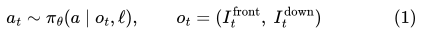

| 기호 | 뜻 |
|---|---|
| `a_t` | t번째 판단에서 정책이 내는 행동. 이 프로젝트에서는 [전진 거리, 하강 거리, yaw 회전] 세 값 |
| `π_θ` | 정책. 매개변수 θ를 가진 신경망(여기서는 VLA 전체) |
| `o_t` | t번째 판단의 관측. 앞 카메라 영상과 아래 카메라 영상 두 장 |
| `ℓ` | 지시문 한 문장. 비행 내내 같다 |
| `∼` | 정책이 정한 분포에서 행동을 고른다는 뜻. 이 프로젝트의 정책은 같은 입력에 같은 행동을 내므로 사실상 함수다 |

- **의미:** 정책은 "지금 보이는 영상 두 장"과 "문장"만으로 다음 행동을 정한다. 과거의 영상이나 기체의 절대 위치는 입력에 없다.
- **이 프로젝트에서:** 입력은 `src/visual_search/episodes.py`의 `policy_inputs`가 만드는 256×256 영상 두 장과 문장뿐이며, 이 함수는 목표 좌표를 인자로 받지 않는다. 두 영상은 위아래로 붙인 한 장(mosaic)으로 모델에 들어간다. 과거를 보지 않는다는 성질은 4.3절의 "탐색 방향을 섞어 가르치면 탐색이 사라지는" 현상과 연결된다(식 8).

OpenVLA[2]는 Prismatic VLM[3] 위에 만든 7B 공개 VLA다. DINOv2[4]와 SigLIP[5]의 patch feature를 채널 방향으로 이어 붙인 뒤 projector로 언어 모델(Llama 2 7B[6])의 입력 공간에 넣는다. 행동은 축마다 256개 구간으로 나눈 이산 토큰으로 생성한다.

AeroVLA[7]는 OpenVLA-7B에 UAV data로 LoRA를 학습한 모델이다. Front와 Down 영상을 위아래로 붙인 한 장(mosaic)을 입력으로 받고, 3자유도 행동(전진, 하강, yaw)을 축마다 99개 구간의 숫자 텍스트로 생성하며, 착륙은 `LAND` 텍스트로 낸다. 범위 [a_min, a_max] 안의 연속값 a를 구간 번호 b로 바꾸는 식은 다음과 같다.

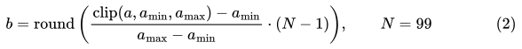

| 기호 | 뜻 |
|---|---|
| `a` | 한 축의 연속 행동값(예: 전진 거리) |
| `a_min`, `a_max` | 그 축의 허용 범위. 원본 AeroVLA는 전진 0–5m, 하강 −5–5m, yaw −1.1–1.1rad |
| `clip` | 범위 밖의 값을 경계값으로 자른다 |
| `N` | 구간 수. AeroVLA는 99 |
| `round` | 가장 가까운 정수로 반올림 |
| `b` | 0부터 98까지의 구간 번호. 모델은 이 번호를 두 자리 숫자 텍스트로 생성한다 |

- **의미:** 연속값을 99칸짜리 눈금 중 하나로 바꾼다. 전진의 경우 한 칸이 약 5cm(5m ÷ 98)다.
- **이 프로젝트에서:** 원본 AeroVLA는 "32 24 18"처럼 세 축의 번호를 텍스트로 생성한다(4.1절). 토큰을 하나씩 생성하므로 판단이 느렸고(추론 약 1.0초, 판단 한 번 4.5–6.3초), 숫자 토큰 하나가 OpenVLA 원래의 행동 토큰으로 바뀌면 해석할 수 없는 출력(`invalid_action`)이 되었다. 출력 문법을 제한한 디코딩으로 이 문제를 없앴다. 이 느린 생성 방식을 바꾼 것이 식 (3)–(4)의 연속값 head다.

### 2.2 OpenVLA-OFT: 병렬 디코딩, 행동 chunk, L1 회귀

토큰을 하나씩 생성하면 판단 한 번에 수 초가 걸린다. OpenVLA-OFT[8]는 세 가지를 바꿨다. 첫째, prompt 뒤에 빈 행동 embedding을 붙여 한 번의 forward로 모든 행동 위치의 hidden state를 얻는다(병렬 디코딩). 둘째, 미래 K 단계의 행동을 한 번에 예측한다(행동 chunk, ACT[9]에서 온 개념). 셋째, 이산 토큰 대신 연속값을 MLP head로 회귀하고 L1 손실로 학습한다. 행동은 축마다 고정 범위로 [−1, 1]에 정규화한다.

![식 (3): 행동을 축마다 고정 범위로 [-1, 1]에 정규화한다](figures/phase1_vla_report/eq03.svg)

| 기호 | 뜻 |
|---|---|
| `a_d` | d번째 축의 행동값(m 또는 rad) |
| `l_d`, `u_d` | d번째 축 범위의 하한과 상한. AeroVLA-OFT는 0.5초 tick당 전진 0–1m, 하강 −0.5–0.5m, yaw −0.21–0.21rad |
| `ã_d` | 정규화한 값. −1에서 1 사이 |

- **의미:** 축마다 단위(m, rad)와 크기가 다르므로 모두 같은 척도로 맞춘다. 그래야 식 (4)의 손실이 한 축에 치우치지 않는다. 예를 들어 전진 0.5m는 0, 1m는 1이 된다.
- **이 프로젝트에서:** 학습 label과 모델의 출력은 모두 이 정규화 공간의 값이고, 실행 직전에 `src/aerovla_oft/spec.py`의 `denormalize_action`으로 물리 단위로 되돌린다. 범위는 OpenVLA-OFT처럼 data 통계에서 정하지 않고 고정값으로 두었다. 실행기와 정지 규칙(식 11)이 같은 범위를 쓰게 하기 위해서다.

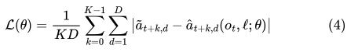

| 기호 | 뜻 |
|---|---|
| `𝓛(θ)` | 손실. 작을수록 정책이 teacher와 비슷하게 행동한다 |
| `K` | chunk 길이. 이 프로젝트에서 4(2초 앞까지) |
| `D` | 행동 차원. 3 |
| `ã_{t+k,d}` | teacher가 k tick 뒤에 낸 정답 행동(정규화) |
| `â_{t+k,d}` | 모델이 지금의 관측 o_t와 문장 ℓ만 보고 예측한 k tick 뒤의 행동 |

- **의미:** 앞으로 4 tick 동안의 3축 행동, 모두 12개 값의 예측 오차 절댓값을 평균한다. 제곱 오차보다 큰 오차에 덜 민감하다.
- **이 프로젝트에서:** AeroVLA-OFT의 학습 목표다(`src/aerovla_oft/model.py`의 `loss`, `scripts/train_aerovla_oft.py`). 4개를 예측하지만 실행은 첫 행동(k = 0)만 하고 다음 판단에서 다시 예측한다(receding horizon[10]). 후보 checkpoint를 고를 때 쓴 "validation L1"이 학습에 쓰지 않은 data에서 잰 이 값이며, 동결 baseline `grounding_film`은 0.061이다. 한 번의 forward로 12개 값을 모두 내므로 판단 주기가 6.3초에서 0.52초로 줄었다(4.2절).

### 2.3 제한된 GPU에서의 미세조정: 4비트 양자화와 LoRA

LoRA[11]는 사전학습 가중치 W₀를 고정하고 저랭크 갱신만 학습한다.

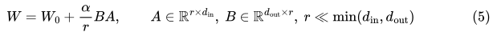

| 기호 | 뜻 |
|---|---|
| `W_0` | 사전학습된 가중치 행렬. 학습하지 않는다 |
| `A`, `B` | 새로 학습하는 작은 행렬 두 개 |
| `r` | rank. 두 행렬 사이의 좁은 차원 |
| `α` | 갱신 크기를 조절하는 계수 |
| `d_in`, `d_out` | 원래 행렬의 입력·출력 차원. Llama 2 7B의 attention 행렬은 4096×4096 |

- **의미:** 거대한 행렬 전체를 바꾸는 대신, 폭이 r인 "좁은 수정"만 배운다. 4096×4096 행렬(약 1,680만 개의 값)을 r = 16으로 고치면 학습하는 값은 2 × 16 × 4096 = 131,072개(약 0.8%)다.
- **이 프로젝트에서:** 기반 모델(OpenVLA-7B)은 4비트(NF4)로 양자화해 고정하고, 그 위의 AeroVLA LoRA(r = 64)도 고정했다. 새로 학습한 것은 LoRA(r = 16, α = 16, 언어 모델의 선형층 7종), 행동 head, FiLM이다. `grounding_film`에서 학습한 값은 LoRA 약 4,000만, head 약 1,470만, FiLM 약 430만 개로 모델 전체 70억 개의 1% 미만이다. 이 구성으로 12GB GPU에서 최대 9.8GiB로 학습할 수 있었다(4.2절).

QLoRA[12]는 고정된 기반 모델을 4비트 NormalFloat(NF4)로 양자화하고 그 위에서 LoRA를 학습해 메모리를 크게 줄인다. 이 작업처럼 이미 학습된 LoRA를 고정한 채 새 LoRA를 하나 더 얹는 구성을 이 보고서에서는 "adapter 적층"이라 부른다.

### 2.4 모방 학습, 특권 teacher, 공변량 이동

행동 복제(behavior cloning, BC)는 전문가의 관측-행동 쌍을 지도학습으로 흉내 낸다[13].

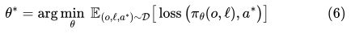

| 기호 | 뜻 |
|---|---|
| `θ*` | 학습으로 찾는 매개변수 |
| `𝒟` | teacher가 비행해 모은 (관측, 문장, 정답 행동)의 data |
| `o`, `ℓ` | 관측(영상 두 장)과 문장 |
| `a*` | 그 순간 teacher가 낸 정답 행동 |
| `loss` | 예측과 정답의 차이. 이 프로젝트에서는 식 (4)의 L1 |
| `𝔼` | data 전체에 대한 평균 |

- **의미:** 정책이 teacher를 최대한 비슷하게 흉내 내도록 매개변수를 고른다. 정답을 직접 보여 주는 지도학습이다.
- **이 프로젝트에서:** teacher는 목표 위치를 아는 규칙 기반 정책이다(탐색은 `src/visual_search/generalization.py`의 `SearchTeacher`, 착륙은 `src/landing/teacher.py`). 정책은 영상과 문장만 보므로, 아래 단락의 특권 teacher 구조가 된다. data는 72 episode(pilot)에서 292(Gen-v1), 445(Gen-v2)를 거쳐 `grounding_film`의 1,160 episode(57,329 샘플)까지 늘었다.

시뮬레이터에서는 목표 위치를 아는 teacher가 정답 행동을 자동으로 만들고, 학생 정책은 카메라 영상만 보고 그것을 흉내 낸다. 이를 특권 정보 teacher(privileged teacher)라고 한다[14].

BC의 근본 문제는 공변량 이동(covariate shift)이다. 학생은 teacher가 간 상태에서만 배우지만, 실행 중에는 자기 실수로 teacher가 가 본 적 없는 상태에 도달한다. Ross 등[15]은 BC의 비용 오차가 시간 길이 T에 대해 제곱으로 커질 수 있고, 학생이 실제로 도달한 상태에 전문가 label을 모아 다시 학습하는 DAgger에서는 선형으로 줄어듦을 보였다.

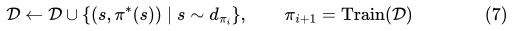

| 기호 | 뜻 |
|---|---|
| `𝒟` | 지금까지 모은 data |
| `s` | 상태(드론의 위치, 자세, 보이는 장면) |
| `π_i` | i번째로 학습한 학생 정책 |
| `d_{π_i}` | π_i로 비행할 때 실제로 지나가는 상태들의 분포 |
| `π*(s)` | 그 상태에서 전문가(teacher 또는 사람)가 낼 정답 행동 |
| `Train` | 누적한 data로 다시 학습하는 과정 |

- **의미:** 학생이 실제로 간 곳(학생의 실수로 생긴 상태 포함)에서 전문가의 정답을 받아 data에 더하고 다시 학습한다. 식 (6)만으로는 teacher가 간 상태만 배우므로, 학생이 한 번 벗어나면 돌아오는 법을 모른다.
- **이 프로젝트에서:** 개입 모드(4.8절)가 이 식의 data 수집 단계다. 학생 π_i는 동결 baseline `grounding_film`, 전문가 π*는 사람이며, 사람이 넘겨받은 뒤의 decision만 label이 된다. Train 단계(학습 1회차)는 계획 초안만 쓰고 실행하지 않았다. Stage 1c·1d의 "잘못된 상태로 밀어 넣은 뒤 teacher가 회복하는 착륙"은 같은 목적을 teacher로 흉내 낸 것이다(4.7절).

HG-DAgger[16]는 사람 전문가가 필요할 때만 조종을 넘겨받아 고치는 변형이다. 학생이 갈 만한 상태를 일부러 만들기 위해 teacher의 시연에 교란을 넣는 방법(DART[17])도 같은 문제를 다룬다.

### 2.5 다중 모드 label과 평균화

비슷한 관측에 서로 다른 정답이 붙으면(예: 같은 장면에서 어떤 때는 "왼쪽으로 돌기", 어떤 때는 "오른쪽으로 돌기") 회귀 손실은 그 사이의 값을 내도록 학습된다. L2 손실의 최소값은 조건부 평균이고, L1 손실의 최소값은 조건부 중앙값이다.

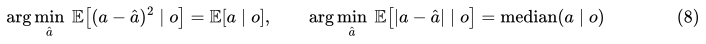

| 기호 | 뜻 |
|---|---|
| `â` | 모델이 내는 행동값 |
| `𝔼[· ∣ o]` | 같은 관측 o에 붙은 정답들의 평균 |
| `median` | 중앙값 |

- **의미:** 같은 장면에 서로 다른 정답이 섞여 있으면, 제곱 오차(L2)로 학습한 모델은 그 평균을, 절댓값 오차(L1)로 학습한 모델은 중앙값을 낸다. 예를 들어 같은 장면에 "왼쪽으로 −0.2rad"와 "오른쪽으로 +0.2rad"가 반반이면 L2의 답은 0이고, L1의 답은 −0.2와 +0.2 사이의 아무 값(0 포함)이다. 어느 쪽이든 "회전하지 않음"이 된다.
- **이 프로젝트에서:** 이 프로젝트의 여러 실패를 설명하는 식이다. 탐색 방향(왼쪽, 오른쪽)을 섞어 가르치자 탐색 frame의 yaw 예측이 +0.88에서 +0.07로 줄었다(4.3절). cube 윗면 위에서 teacher의 "하강" label과 "상승" label이 맞닿는 자리에서 정책은 둘 사이의 "정지"를 냈다(4.7절, Stage 1d). 0 근처의 행동은 식 (11)의 정지 규칙에 걸리므로, 평균화는 곧 "공중 정지"로 나타난다.

Diffusion Policy[18] 같은 생성형 행동 head는 정답이 여러 개인 상황을 평균하지 않고 그대로 다루려고 나온 방법이다.

### 2.6 언어-시각 grounding과 FiLM

언어 조건이 시각 feature에 약하게만 반영되면, 정책은 문장이 가리키는 물체 대신 먼저 눈에 띄는 비슷한 물체로 간다. FiLM[19]은 조건 벡터로 feature의 채널마다 배율과 편향을 정한다. 이 작업에서는 문장 token embedding의 평균 z로 시각 encoder의 patch feature x를 조절했고, 마지막 층을 0으로 초기화해 학습 전에는 항등 함수가 되게 했다.

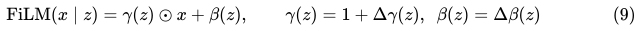

| 기호 | 뜻 |
|---|---|
| `x` | 시각 encoder가 낸 patch feature. 영상 한 장당 256 patch × 2,176 채널 |
| `z` | 지시문 token embedding의 평균(4,096차원) |
| `γ(z)`, `β(z)` | 문장에서 계산한 채널별 배율과 편향. 작은 MLP(hidden 512)가 z에서 만든다 |
| `⊙` | 채널마다 곱한다 |
| `Δγ`, `Δβ` | 학습되는 변화량. 학습 전에는 0이라 FiLM은 아무것도 바꾸지 않는다 |

- **의미:** 문장이 "어떤 시각 채널을 키우고 어떤 채널을 줄일지" 정한다. 예를 들어 "red"가 들어간 문장이 빨간색에 반응하는 채널을 키우도록 학습되기를 기대하는 구조다. 모든 patch에 같은 배율이 적용된다.
- **이 프로젝트에서:** `src/aerovla_oft/model.py`의 `VisualFiLM`이며, 시각 encoder(고정)와 projector(고정) 사이에 넣었다(4.4절). 이 모듈을 넣은 `grounding_film`이 봉인 test에서 47/48로 통과했지만, 학습된 조절은 작았고(|γ − 1| 평균 0.042) blue pad 문장과 red pad 문장의 조절이 거의 같았다. FiLM 없이 같은 만큼 학습한 대조도 pilot 기준을 지켰으므로, 개선의 원인은 FiLM보다 더 긴 학습으로 본다.

비교 대상으로 patch마다 문장 token에 attention하는 cross-attention[20] 모듈도 구현했다.

### 2.7 입력 손상에 대한 견고성

견고성은 학습 분포와 다른 입력에서 성능이 얼마나 유지되는지로 잰다. ImageNet-C[21]는 blur, noise 같은 손상을 강도별로 넣어 이를 측정하는 표준 방식을 제시했다. 이 작업의 Gaussian Blur는 다음과 같다.

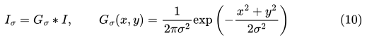

| 기호 | 뜻 |
|---|---|
| `I` | 원본 영상(256×256) |
| `G_σ` | Gaussian kernel. 가운데가 가장 크고 멀어질수록 작아지는 가중치 |
| `σ` | 표준편차(픽셀). 클수록 넓게 섞여 더 흐려진다 |
| `∗` | 합성곱. 각 픽셀을 주변 픽셀의 가중 평균으로 바꾼다 |
| `x`, `y` | kernel 중심에서의 가로·세로 거리(픽셀) |

- **의미:** 초점이 맞지 않거나 렌즈가 더러워진 카메라를 흉내 낸다. 경계와 작은 물체가 먼저 사라진다.
- **이 프로젝트에서:** `src/failures/gaussian_blur.py`가 OpenCV의 `GaussianBlur`로 정책 입력 영상에만 적용했다. Low(7×7, σ = 1.5), Medium(15×15, σ = 3), High(31×31, σ = 6)에서 48개 시작의 성공이 46 → 40 → 24 → 8로 떨어졌고, 실패는 공중 정지로 모였다(4.5절). 흐린 영상은 학습 분포 밖의 관측이며, 정책은 그런 관측에서 0 근처 행동(식 8, 식 11)을 냈다.

## 3. 실험 환경

### 3.1 시뮬레이터와 시스템 구성

시뮬레이터는 Project AirSim[22]이다. AirSim[23]의 후속 프로젝트로, Unreal Engine 위에서 쿼드콥터의 물리, 카메라, 충돌을 제공한다. 처음에는 원본 AeroVLA가 평가된 TravelUAV 환경[24]을 시도했으나 WSL에서 GPU 렌더링이 되지 않아(CPU 렌더링으로 떨어짐), 시뮬레이터는 Windows에서, 모델은 WSL2 Ubuntu에서 실행하고 둘을 네트워크로 연결했다.

```text
Project AirSim (Windows)                          모델 (WSL2, GPU)
  Front / Down RGB 256x256  ──────────────────►  mosaic → VLA → 행동 chunk
  실행기 (속도·고도·방향 명령) ◄──────────────────  첫 행동 [전진, 하강, yaw]
  판정 (접촉, 영역, 속도)      목표 위치는 판정에만 사용, 정책에는 전달하지 않음
```

### 3.2 정책의 입출력과 실행기

- 입력: Front, Down RGB(각 256×256)와 문장 하나. 목표 좌표, 거리, 방향은 입력 경로에 없으며, 입력을 만드는 함수 자체가 목표 정보를 받지 않는다.
- 출력: 0.5초 단위(tick)의 행동 [전진 0–1m, 하강 −0.5–0.5m, yaw −0.21–0.21rad]. chunk 4개 중 첫 행동만 실행한다.
- 실행기: 행동을 "heading 방향 속도, 유지할 고도, 돌아갈 heading" 명령으로 바꾸고, 명령 시간을 tick보다 길게 주어 다음 명령이 비행 중에 이어받게 한다.
- Landing Finalizer: 착륙의 마지막(안정 접촉 확인, latch, 모터 정지)은 정책이 아니라 실행기 수준에서 처리한다(4.4절).

**정지 규칙.** 세 축이 모두 행동 범위의 8% 안이면 정지로 읽고, 4번 연속이면 비행을 끝낸다. ρ는 행동이 정지 대역에서 얼마나 떨어져 있는지를 나타내며, 4.7절의 label 여유 기준에 쓰인다.

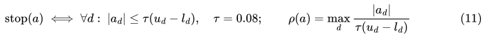

| 기호 | 뜻 |
|---|---|
| `τ` | 정지 대역의 비율. 0.08(행동 범위의 8%) |
| `u_d − l_d` | d번째 축 행동 범위의 폭 |
| `τ(u_d − l_d)` | 축별 정지 대역. 전진 0.08m, 하강 0.08m, yaw 0.0336rad |
| `ρ(a)` | 가장 큰 축이 정지 대역의 몇 배인지. 1 이하이면 정지 |

- **의미:** 세 축이 모두 아주 작으면 "멈추라는 뜻"으로 읽는다. ρ는 행동이 정지에서 얼마나 떨어져 있는지를 하나의 숫자로 나타낸다.
- **이 프로젝트에서:** 정지가 4번 연속이면 비행이 끝난다(`src/aerovla_oft/spec.py`의 `is_stop`, `configs/visual_search.json`의 stop_ticks). Stage 1의 teacher는 cube 위에서 수평 전진 0.15m 같은 작은 label을 냈는데, 이는 ρ ≈ 1.9로 정지 대역에 가까웠고 학생은 그 근처를 정지로 배웠다. Stage 1b는 착륙 전 모든 label이 ρ ≥ 3이 되게 고쳐 공중 정지를 40번 중 15번에서 1번으로 줄였다(4.7절). 사람 조종 모드는 ρ ≤ 1인 label(손을 뗀 순간)과 1 < ρ < 3인 label을 학습에서 뺀다(4.8절).

### 3.3 평가 원칙

이 작업에서 가장 공을 들인 부분은 "주장할 수 있는 숫자"를 만드는 평가 설계였다.

1. **held-out 수준:** 처음 보는 시작(G1), 처음 보는 물체(G2), 학습하지 않은 장면(G3), 둘 다(G4)로 나눠 잰다.
2. **단계별 gate:** 후보 고르기(pilot) → 검증(validation) → 봉인한 test 순서로 진행하고, 앞 단계를 넘지 못하면 다음 단계를 비행하지 않는다.
3. **봉인과 동결:** test 시작은 미리 뽑아 hash를 기록하고, 통과한 checkpoint와 실행 코드는 파일 지문(sha256)으로 동결해 실험 전후에 확인한다.
4. **반복 변동:** 같은 시작을 다시 비행하면 결과가 뒤집히는 경우가 있다(4.7절에서 20개 중 5개). 판정이 1–2 비행 차이로 갈리면 다시 비행해 함께 센다.
5. **짝지은 비교:** 조건을 바꿀 때 같은 시작 집합을 쓰고, 바꾸는 것은 하나만 둔다.

## 4. 연구 과정과 결과

### 4.1 기준 모델 통합과 진단 (2026-10-04 – 10-06)

**목적.** 원본 AeroVLA를 시뮬레이터 closed loop에 넣고 무엇을 할 수 있는지 확인한다(RQ1).

**방법.** AeroVLA를 NF4로 불러와 Project AirSim과 연결하고, 지도에서 고른 목표의 좌표로 방향 문장("Fly forward-left and find the target.")을 계산해 넣는 모드(Coordinate Goal Mode)를 만들었다. 이어서 prompt 구성을 바꿔 가며 69회 비행했다.

**결과.**

- 판단 한 번이 4.5–6.3초(추론 약 1.0초)였고, GPU 최대 사용량은 9.76GiB였다.
- 방향 문장이 있으면 35회 중 33회 목표 쪽으로 갔고 12회는 20m 안에서 스스로 멈췄다.
- 방향 문장을 빼면 13회 모두 첫 판단에서 LAND를 냈다. 방향 문장과 물체 설명이 서로 다른 곳을 가리키면 방향 문장을 따랐다.
- 문장만으로 지시한 물체 20m 안에서 멈춘 비행은 0/6이었다.
- `invalid_action`으로 끝나던 비행은 숫자 토큰 하나가 원본 OpenVLA의 행동 토큰으로 바뀌어 생긴 것이었다. 출력 문법을 제한한 디코딩으로 0회가 되었다.
- 멈추지 않고 이어서 나는 연속 비행으로 정지 시간이 18–21%에서 5–8%로 줄었으나, 벽 충돌은 더 잦았다(10회 중 5회 대 8회 중 1회).

**배운 것.**
1. VLA의 구성(두 시각 encoder의 융합, projector, 언어 모델)과 행동을 텍스트 토큰으로 내는 방식, 그리고 그 디코딩이 깨지는 지점.
2. 지름길 학습: 모델은 영상과 물체 설명이 아니라 좌표에서 온 방향 문장에 의존했다. "언어를 따른다"는 주장은 언어 외의 단서를 빼고 확인해야 한다.
3. closed loop 지연: 판단이 느리면 기체가 판단 사이에 멈추고, 이어서 날게 하면 반응이 늦어 충돌이 늘어난다.

### 4.2 AeroVLA-OFT와 Visual Search (2026-10-07)

**목적.** 방향 문장 없이 문장과 영상만으로 목표를 찾게 하고, 판단을 빠르게 한다(RQ2).

**방법.** OpenVLA-OFT의 공식 코드를 읽고 UAV 3자유도에 맞게 옮겼다. 병렬 디코딩은 그대로, 행동 head는 MLP-ResNet(hidden 1024)으로 줄이고, chunk는 4로 했다. 기반 모델은 NF4로 두고 AeroVLA의 LoRA와 projector는 고정한 채 새 LoRA(rank 16)와 head만 학습했다. 학습 data는 목표 위치를 아는 teacher가 비행한 72 episode다.

**결과.**

- 학습은 batch 1에서 최대 9.8GiB, 39분이었다.
- 자기 구역의 시작에서 23/24(A 6/6, B 6/6, C 5/6, D 6/6) 목표를 찾아 멈췄다. 원본 AeroVLA는 목표가 안 보이는 시작에서 0/6이었다.
- 판단 주기가 6.3초에서 0.52초로, 판단 한 번의 heading 변화 최댓값이 76°에서 13°로 줄었다.
- 학습에 없던 위치(58m)에서 시작하면 2/6이었다.

**배운 것.**
1. 병렬 디코딩, 행동 chunk, 연속값 L1 회귀(식 3, 4)의 실제 구현과, 논문 설명과 공식 코드의 차이를 코드에서 직접 확인하는 습관.
2. receding horizon 실행: 여러 단계를 예측하고 하나만 실행하면, 매 판단이 최신 관측을 반영하면서도 움직임이 끊기지 않는다.
3. 4비트 양자화와 adapter 적층(식 5)으로 7B 모델을 12GB에서 학습하는 법.
4. 특권 teacher 모방 학습(식 6)은 teacher가 보여 준 구역에서는 잘 동작하지만, 그 밖에서는 시작 위치를 외운 것에 가깝다.

### 4.3 data 범위와 일반화: Gen-v1, Gen-v2, 장거리 평가 (2026-10-07 – 10-08)

**목적.** 시작 위치, 물체, 장면을 넓힌 data로 일반화를 확인한다(RQ3).

**방법.** 시작 위치, 방향, 거리, 고도, 물체를 넓힌 292 episode로 Gen-v1을 학습하고, 고정해 둔 held-out 시작에서 평가했다. Gen-v1의 실패를 분류한 뒤, 부족했던 장면(찾은 뒤의 전환)을 더한 445 episode로 Gen-v2를 학습했다.

**결과.**

| 평가 | 원본 AeroVLA | Pilot (72) | Gen-v1 (292) | Gen-v2 (445) |
|---|---:|---:|---:|---:|
| G1 처음 보는 시작 | 1/16 | 4/32 | 27/32 | 32/32 |
| G3 학습하지 않은 장면 | – | 6/10 | 19/20 | 18/20 |
| G2 처음 보는 물체 | – | 0/6 | 9/12 | 11/12 |
| G4 장면과 물체 모두 새것 | – | – | 2/6 | 4/6 |
| 학습에 없던 문장 | – | – | 21/24 | 24/24 |
| 충돌 | 1/16 | 3/32 | 0/130 | 0/130 |

- Gen-v1은 처음에 안 보이던 목표 73개를 모두 찾았다. 실패는 찾은 뒤에 일어났다(높은 곳에서 일찍 멈춤, 목표 앞에서 계속 상승). 이 장면의 data를 더한 Gen-v2에서 해당 실패가 8회에서 0회가 되었다.
- 새로 뽑은 장거리 시작(40–90m, 36회)에서 Gen-v2는 27/36이었다.
- teacher의 탐색 방향(왼쪽, 오른쪽)을 섞어 가르치자 탐색 자체가 사라졌다. 탐색 frame에서 yaw 예측이 +0.88에서 +0.07로 줄었다.
- Gen-v2는 같은 평가 set의 실패를 보고 고친 것이라 새로운 일반화 추정치가 아니다.

**배운 것.**
1. 일반화는 모델 구조보다 data가 덮는 범위에 크게 좌우되며, held-out을 수준별로 나눠야 무엇이 일반화되었는지 말할 수 있다.
2. 실패를 "못 찾음 / 찾은 뒤 실패"처럼 분류하면, 필요한 data를 정확히 더할 수 있다.
3. 다중 모드 label의 평균화(식 8): 영상 한 장만 보고 기억이 없는 정책에게 "왼쪽 또는 오른쪽"을 함께 가르치면 둘의 평균인 "회전 없음"을 배운다.
4. 평가 set을 보고 고친 결과는 그 set에 대해 낙관적으로 치우친다. 새 추정에는 새 set이 필요하다.

### 4.4 문장에 따른 목표 선택과 착륙: Gen-v3, Gen-v3c, FiLM (2026-10-08 – 10-10)

**목적.** 같은 색이나 같은 모양의 다른 물체가 있는 장면에서, 문장이 가리키는 물체를 골라 착륙하거나 접근하게 하고, 그것을 봉인한 test로 확인한다(RQ4).

**방법.**

- Gen-v3: 비슷한 물체가 함께 있는 장면, 착륙 teacher, 착륙 규칙을 더해 학습했다.
- Canonical clean baseline: 범위를 44m 이하로 정하고, 착륙의 마지막을 Landing Finalizer(실행기)로 옮겼다. 정책은 하강까지, 실행기는 안정 접촉과 정지까지 맡는다.
- Gen-v3c: "비슷한 물체가 먼저 보이는" 장면(hard negative) 96 episode로 짧게 보정하고, 착륙의 "서 있음"을 접촉과 위치로 읽도록 판정기를 고쳤다(evaluator v2).
- FiLM: 시각 encoder의 patch feature를 문장으로 조절하는 모듈(식 9)을 넣고 같은 data로 학습했다. 같은 일정을 FiLM 없이 돌린 대조 실험도 함께 했다.

**결과.**

| 단계 | 결과 | 판정 |
|---|---|---|
| Gen-v3 | 검증 시작 18회 중 지시한 pad에 touchdown 16회, 규칙 전체 통과 14회. APPROACH를 시켰을 때 내려앉은 비행 0 | held-out 미측정 |
| Canonical 첫 시도 | 검증 30/36, 다른 물체에서 끝난 비행 3회(기준 2회 이하) | 미통과 |
| Gen-v3c | pilot 11/12, 검증 33/36, 다른 물체 3회 | 미통과 |
| FiLM (`grounding_film`) | pilot 32/32, 검증 34/36, 봉인 test 47/48(착륙 36/36, 다른 물체 1, 충돌 0) | 통과, 동결 |
| FiLM 없는 대조 | pilot 30/32 | pilot 기준 통과 |

- 봉인 test에서 비슷한 물체가 먼저 보이는 시작은 16/17이었다.
- 학습된 FiLM의 조절 크기는 작았다(|γ − 1| 평균 0.042, |β| 평균 0.036). blue pad 문장과 red pad 문장의 조절은 거의 같았다.
- 따라서 47/48은 "더 오래 학습한 것"의 효과일 수 있으며, FiLM의 기여는 입증되지 않았다.

**배운 것.**
1. 언어-시각 grounding의 실패 형태(먼저 보이는 비슷한 물체)와 hard negative data의 한계.
2. FiLM의 구조와 항등 초기화, cross-attention과의 차이.
3. 대조 실험과 원인 귀속: 개선이 있어도, 바꾼 것 외의 차이(학습 길이)를 같은 조건으로 돌려 보지 않으면 원인을 말할 수 없다.
4. 책임 분리: 정책(어디로, 언제 내려갈지), 실행기(안정 접촉과 정지), 판정기(무엇을 착륙으로 볼지)를 나누면 각 부분을 따로 검증할 수 있다.
5. 봉인 test를 한 번만 비행하는 절차와 동결 지문이 결과의 신뢰도를 만든다.

### 4.5 견고성: Gaussian Blur 특성화 (2026-10-10)

**목적.** 동결 baseline이 입력 손상에서 어디서, 얼마나 무너지는지 잰다(RQ5).

**방법.** 정책이 받는 Front·Down 영상에만 Gaussian Blur(식 10)를 넣고, 나머지(모델, 문장, 시작 48개, 실행기, 판정)는 고정했다. 강도는 비행 전에 고정해 commit했다.

| 조건 | Kernel | σ | 성공 (48) |
|---|---|---:|---:|
| Clean | 없음 | – | 46 |
| Low | 7×7 | 1.5 | 40 |
| Medium | 15×15 | 3.0 | 24 |
| High | 31×31 | 6.0 | 8 |

**결과.** 충돌이나 다른 물체 선택은 늘지 않았다. 실패는 하나의 형태로 모였다. 정책이 공중에서 스스로 0에 가까운 행동(정지)을 냈다. High에서는 착륙 36회 중 하강을 시작한 비행이 없었다.

**배운 것.**
1. 손상 강도별 특성화와 짝지은 비교의 설계.
2. 불확실한 입력에서 이 정책의 기본 반응은 "정지"다. 이는 정지 행동이 0 근처에 있는 행동 공간과 평균화(식 8)의 결과로 해석된다. 감지와 복구는 이 관찰에서 출발해야 한다.

### 4.6 평가 인프라 확장: 임의 시작과 일반 착륙면 (2026-10-11)

**목적.** 정책을 바꾸기 전에, pad가 아닌 표면(cube, cylinder, 공 위의 판)을 시작 규칙, 화면, 판정기가 다룰 수 있게 한다.

**방법.** 시작 자세를 사용자가 정하고, 장애물과 높이 규칙으로 거절하게 했다. 착륙면을 사각형, 원, 판(cap)으로 일반화하고, 착륙 판정을 닿은 면의 모양과 크기로 하게 했다.

**결과.** 판정기는 결과를 미리 아는 scripted 비행 15개로 검증했다(15/15. 첫 실행은 13/15였고, 틀린 둘은 scripted 비행이 목표점을 지나쳐 내린 경우였다). 동결 baseline에 cube, cylinder, 판 착륙을 시키자 셋 다 공중에서 멈췄다. 기체는 속도 명령을 약 2.4초 늦게 따라간다는 것도 확인했다.

**배운 것.**
1. 판정기도 측정 도구이므로, 정답을 아는 입력으로 먼저 검증해야 한다.
2. "시뮬레이터와 판정기가 지원한다"와 "정책이 할 수 있다"는 다른 주장이다.
3. 기체의 반응 지연은 teacher label과 사람 조종 모두에 영향을 준다.

### 4.7 pad 외 표면 착륙 학습: Generic Landing 1–1d (2026-10-11 – 10-13)

**목적.** cube와 cylinder 윗면 착륙을 정책에 가르친다(RQ5).

**방법과 결과.** 네 단계 모두 같은 시작 checkpoint 계열에서 data와 teacher만 바꿨고, 매 단계 기준을 미리 고정했다.

| 단계 | 바꾼 것 | 결과 | 판정 |
|---|---|---|---|
| 1 | cube·cylinder 착륙 233 episode, 2,500 update | pad 10/10, cylinder 8/10, cube 6/10(기준 8/10). 실패는 모두 공중 정지. 재비행 시 20개 중 5개 뒤집힘 | 미통과 |
| 1b | 착륙 전 모든 label이 정지 대역의 3배 이상(ρ ≥ 3, 식 11) | 공중 정지 40번 중 15 → 1. cylinder 10/10 두 번. cube 첫 비행 7/10. regression에서 충돌 2 | 미통과 |
| 1c | 잘못된 상태에서 회복하는 착륙 86, 같은 색 물체 착륙 80 | 늦은 후보는 같은 색 8/8이지만 공중 정지가 8개 중 2개로 돌아옴. 규칙이 고른 후보는 다른 물체에 2번 착륙 | 미통과 |
| 1d | 하강/상승 경계를 2.675m에서 3.3m로, 윗면 위 낮은 상태 착륙 87 | 가운데 쪽 6/6 착륙. 가장자리 상태의 공중 정지 3 → 4–6 (12개 중) | 미통과 |

**배운 것.**
1. 정지 대역과 label 여유: teacher의 작은 행동이 정지 규칙에 가까우면 학생은 그것을 정지로 배운다. 여유 기준(1b)으로 공중 정지가 크게 줄었다.
2. label 경계의 평균화: "하강"과 "상승"이 맞닿는 자리에서 학생은 둘의 중간인 "정지"를 냈다(식 8). 경계를 옮기면 정지가 경계를 따라 옮겨 간다(1d).
3. 교란 data(DART[17] 계열)는 회복 행동을 가르치지만, 새로운 경계를 만들 수 있다.
4. 미리 정한 선택 규칙과 gate는 결과가 좋아 보이는 후보도 걸러 낸다. 이것이 과적합된 주장을 막는다.
5. teacher가 규칙으로 정답을 만드는 방식은 "규칙의 경계"를 data에 새긴다. 이것이 사람의 수정 data로 방향을 바꾼 이유다.

### 4.8 사람 조종과 개입 모드 (2026-10-23 – 10-27)

**목적.** 규칙 teacher가 만든 경계 대신, 사람이 실제로 고친 조작을 data로 모은다(공변량 이동 대응, 식 7).

**방법.**

- 사람 조종 모드: 사람이 정책과 같은 입력(Front·Down 카메라와 문장)을 보고 키보드나 pad로 조종한다. 명령은 초당 20번, 가속 한도 안에서 갱신된다. 0.5초마다 그 구간의 명령을 정책의 행동 하나로 바꿔 label로 저장한다(식 12). 손을 뗀 순간(정지 대역 안), 후진, 정책보다 빠른 구간은 label에서 뺀다.
- 개입 모드: 동결 baseline이 canonical 평가와 같은 방식으로 먼저 날고, 사람이 잘못을 보면 넘겨받아 고친 뒤 돌려준다(HG-DAgger[16]와 같은 구조). 모델이 날린 decision과 넘겨받은 순간의 decision은 label에서 뺀다.
- 정밀 착륙 기준: 착륙은 표면 가운데에서 정밀 반경 안이어야 data가 된다. 정밀 반경은 canonical teacher의 정렬 반경(1.75m)과 착륙 영역 반경의 절반 중 작은 값이다(pad·cube·cylinder 1.75m, 공 위 판 1.3m).

**tick label.** 사람이 낸 속도 명령 u(s)를 실제 tick 길이 Δt 동안 적분하고, 기준 tick 길이 T에 맞게 정규화한다.

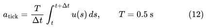

| 기호 | 뜻 |
|---|---|
| `u(s)` | 시각 s에 사람이 낸 속도 명령(전진 m/s, 하강 m/s, 회전 rad/s). 초당 20번 갱신된다 |
| `Δt` | 실제 tick 길이. 약 0.5초지만 조금씩 다르다 |
| `T` | 기준 tick 길이 0.5초 |
| `a_tick` | 그 tick의 label. 정책과 같은 단위(tick당 m, m, rad) |

- **의미:** 0.5초 동안 사람이 실제로 움직인 양을 정책의 행동 하나로 바꾼다. tick이 조금 길거나 짧았으면 T/Δt로 맞춘다. 예를 들어 2m/s로 0.5초 전진하면 전진 1.0m label이 된다.
- **이 프로젝트에서:** `src/human_pilot/controls.py`의 `TickLabel`이 계산한다. 사람의 명령은 초당 20번 바뀌지만 정책은 0.5초마다 한 번 판단하므로, 이 변환이 사람의 조작을 정책의 학습 data로 바꾸는 다리다. 정책이 낼 수 없는 구간(후진, 정책 한도보다 빠른 구간)과 식 (11)의 정지 대역 근처 label은 표시해 학습에서 뺀다.

**결과.** 기록된 비행 16개(학습 샘플 약 760개)를 모았다. 같은 baseline이 혼자 내린 pad 착륙 6번은 가운데에서 1.77–3.46m였고, 사람이 넘겨받아 고친 착륙 7번은 0.29–1.62m였다. 학습 1회차 계획(data 기준, 혼합 비율, pilot·봉인 gate·regression)을 초안으로 썼으나, data 수집 부담 때문에 실행하지 않고 Phase 1을 마무리했다.

**배운 것.**
1. 공변량 이동과 DAgger·HG-DAgger의 실제 운영: 학생이 실제로 도달한 상태에서의 수정이 가장 정보가 많다.
2. 연속 조작을 이산 label로 바꾸는 법(식 12)과, 정책이 낼 수 없는 행동을 label에서 빼는 이유.
3. 사람 data의 비용: 수집이 느리고 원격으로 하기 어렵다. 정답을 시뮬레이터가 자동으로 줄 수 있는 과제가 개인 프로젝트에 더 맞다.

## 5. 개념과 프로젝트의 대응

| 번호 | 개념 | 배운 작업 | 확인한 것 | 문헌 |
|---|---|---|---|---|
| C1 | VLA의 구조(시각 encoder, projector, 언어 모델, 행동 출력) | 4.1 | 공개 VLA를 closed loop에 통합 | [1][2][3][7] |
| C2 | 행동의 토큰화와 디코딩 | 4.1 | 토큰 하나의 교체로 생긴 invalid 출력, 문법 제한 디코딩으로 해결 | [2][7] |
| C3 | 지름길 학습 | 4.1 | 방향 문장을 빼면 13/13 첫 판단 LAND | [7] |
| C4 | 병렬 디코딩, 행동 chunk, L1 회귀 | 4.2 | 판단 6.3초 → 0.52초 | [8][9] |
| C5 | Receding horizon 실행 | 4.2 | chunk 4 중 1개 실행으로 끊기지 않는 비행 | [10] |
| C6 | 4비트 양자화, LoRA, adapter 적층 | 4.2 | 12GB에서 7B 모델 학습(최대 9.8GiB) | [11][12] |
| C7 | 특권 teacher 모방 학습 | 4.2, 4.3 | 목표 위치를 아는 teacher로 탐색 행동 학습 | [13][14] |
| C8 | data 범위와 held-out 수준 | 4.3 | 처음 보는 시작 4/32 → 27/32 → 32/32 | – |
| C9 | 실패 분류가 이끄는 data 보강 | 4.3 | 찾기 73/73, 전환 data로 해당 실패 8 → 0 | – |
| C10 | 다중 모드 label의 평균화 | 4.3, 4.7 | 탐색 방향 혼합 시 yaw +0.88 → +0.07, 하강/상승 경계의 공중 정지 | [18] |
| C11 | 언어-시각 grounding과 hard negative | 4.4 | 먼저 보이는 비슷한 물체로 가는 실패 | – |
| C12 | FiLM, 대조 실험, 원인 귀속 | 4.4 | 47/48이지만 FiLM 없는 대조도 통과, 기여 미입증 | [19][20] |
| C13 | 정책·실행기·판정기의 책임 분리 | 4.4, 4.6 | Landing Finalizer, 판정기 검증 15/15 | – |
| C14 | 평가 설계(gate, 봉인 test, 동결 지문, 반복 변동) | 4.4, 4.7 | 봉인 test 48을 한 번 비행, 재비행 시 20개 중 5개 뒤집힘 | – |
| C15 | 입력 손상과 견고성 | 4.5 | 46 → 40 → 24 → 8, 실패는 공중 정지로 수렴 | [21] |
| C16 | 정지 대역과 label 여유 | 4.7 | 여유 기준으로 공중 정지 15 → 1 (40번 중) | – |
| C17 | 교란 data와 회복 행동 | 4.7 | 회복 data가 경계에서 새 정지를 만듦 | [17] |
| C18 | 공변량 이동, DAgger, 사람 개입 | 4.8 | 모델 착륙 오차 1.77–3.46m 대 사람 수정 0.29–1.62m | [15][16] |
| C19 | 연속 조작의 label화 | 4.8 | 초당 20번의 명령을 0.5초 label로 변환, 제외 규칙 | – |

## 6. 논의

### 6.1 잘 된 것

- OpenVLA-OFT 방식은 12GB 단일 GPU에서 UAV 3자유도에 옮길 수 있었고, 판단 주기를 약 12분의 1로 줄였다(6.3초 → 0.52초).
- 특권 teacher와 data 범위 확장만으로, 학습 분포 안에서는 매우 높은 성공률(처음 보는 시작 32/32, 봉인 test 47/48)을 얻었다.
- 평가 절차(수준별 held-out, gate, 봉인, 동결, 반복 확인) 덕분에 각 숫자가 무엇을 뜻하고 무엇을 뜻하지 않는지 분명하게 말할 수 있었다.

### 6.2 막힌 것과 원인

- **분포 밖으로의 확장:** 새 착륙면, 입력 손상, 먼 거리에서 정책은 공통적으로 "정지"했다. 영상 한 장만 보는 회귀 정책이 상충하거나 낯선 상황에서 0 근처로 평균화하는 성질이 핵심 원인으로 보인다.
- **teacher 설계의 병목:** 규칙 기반 teacher는 규칙의 경계를 data에 남기고, 학생은 그 경계에서 머뭇거린다. teacher를 고칠 때마다 새 경계가 생겼다.
- **사람 data의 비용:** 경계 문제를 피하려면 사람의 수정이 필요했지만, 개인이 원격으로 모으기에는 느렸다.

### 6.3 Phase 2로 가져가는 것

| Phase 1에서 얻은 것 | Phase 2(차량 락온·추종)에서의 쓰임 |
|---|---|
| 시뮬레이터 closed loop, 1인칭·3인칭 화면 | 같은 구조로 CARLA에 구성 |
| 특권 정보로 정답을 자동 생성 | 차량 위치를 시뮬레이터가 알므로 추종 정답이 자동으로 나옴 |
| 평가 설계(held-out, gate, 봉인, 반복) | 추적 유지율, 대상 바뀜, 재획득 시간 평가에 그대로 적용 |
| VLA 학습·미세조정 경험 | 대상 지정은 VLM이 맡고, 추종 정책의 학습 여부는 단순 제어와 비교해 결정 |
| 평균화와 정지의 교훈 | 행동 head와 정답 설계에서 경계를 피하는 방향으로 설계 |

## 7. 한계

1. 하나의 시뮬레이터(Project AirSim Blocks)와 그 안에 만든 장면들에서의 결과다. 다른 환경, 실제 기체로의 전이는 확인하지 않았다.
2. 조건마다 비행 횟수가 수 회에서 수십 회로, 신뢰구간이 넓다. 같은 시작도 재비행에서 결과가 바뀔 수 있다.
3. Gen-v2의 숫자는 같은 평가 set을 보고 고친 뒤의 것이라 독립 추정이 아니다.
4. FiLM의 기여는 대조 실험으로 입증되지 않았다.
5. 장애물 회피, 모델 전체 미세조정, 공식 benchmark(TravelUAV) 평가는 하지 않았다.

## 8. 결론

Phase 1은 공개 VLA를 실제 closed loop에 넣는 것에서 출발해, 연속 행동 head로 다시 학습하고, data 범위와 평가 절차를 통해 44m 이내의 문장 지시 착륙을 봉인된 test로 입증하는 데까지 갔다. 동시에, 학습 분포 밖에서 정책이 "정지"로 무너지는 공통된 실패와, 규칙 기반 teacher가 남기는 경계 문제를 확인했다. 이 경험을 바탕으로 Phase 2에서는 정답을 시뮬레이터가 자동으로 줄 수 있고, 언어 이해와 시각 추적이 핵심이 되는 과제(자연어로 지정한 차량의 락온과 추종)로 옮겨 간다.

## 참고문헌

1. A. Brohan et al., "RT-2: Vision-Language-Action Models Transfer Web Knowledge to Robotic Control," CoRL, 2023. arXiv:2307.15818
2. M. J. Kim et al., "OpenVLA: An Open-Source Vision-Language-Action Model," CoRL, 2024. arXiv:2406.09246
3. S. Karamcheti et al., "Prismatic VLMs: Investigating the Design Space of Visually-Conditioned Language Models," ICML, 2024. arXiv:2402.07865
4. M. Oquab et al., "DINOv2: Learning Robust Visual Features without Supervision," TMLR, 2024. arXiv:2304.07193
5. X. Zhai, B. Mustafa, A. Kolesnikov, L. Beyer, "Sigmoid Loss for Language Image Pre-Training," ICCV, 2023. arXiv:2303.15343
6. H. Touvron et al., "Llama 2: Open Foundation and Fine-Tuned Chat Models," 2023. arXiv:2307.09288
7. P. Xu, Z. Deng, J. Deng, Z. Gu, S. Wan, "AeroVLA: A Vision-Language-Action Model for UAV Navigation via Minimalist End-to-End Control," ECCV, 2026. Code: https://github.com/XuPeng23/AeroVLA
8. M. J. Kim, C. Finn, P. Liang, "Fine-Tuning Vision-Language-Action Models: Optimizing Speed and Success," RSS, 2025. arXiv:2502.19645
9. T. Z. Zhao, V. Kumar, S. Levine, C. Finn, "Learning Fine-Grained Bimanual Manipulation with Low-Cost Hardware," RSS, 2023. arXiv:2304.13705
10. D. Q. Mayne, J. B. Rawlings, C. V. Rao, P. O. M. Scokaert, "Constrained Model Predictive Control: Stability and Optimality," Automatica, 36(6), 789–814, 2000.
11. E. J. Hu et al., "LoRA: Low-Rank Adaptation of Large Language Models," ICLR, 2022. arXiv:2106.09685
12. T. Dettmers, A. Pagnoni, A. Holtzman, L. Zettlemoyer, "QLoRA: Efficient Finetuning of Quantized LLMs," NeurIPS, 2023. arXiv:2305.14314
13. D. A. Pomerleau, "ALVINN: An Autonomous Land Vehicle in a Neural Network," NeurIPS (NIPS 1), 1988.
14. D. Chen, B. Zhou, V. Koltun, P. Krähenbühl, "Learning by Cheating," CoRL, 2019. arXiv:1912.12294
15. S. Ross, G. J. Gordon, J. A. Bagnell, "A Reduction of Imitation Learning and Structured Prediction to No-Regret Online Learning," AISTATS, 2011. arXiv:1011.0686
16. M. Kelly, C. Sidrane, K. Driggs-Campbell, M. J. Kochenderfer, "HG-DAgger: Interactive Imitation Learning with Human Experts," ICRA, 2019. arXiv:1810.02890
17. M. Laskey, J. Lee, R. Fox, A. Dragan, K. Goldberg, "DART: Noise Injection for Robust Imitation Learning," CoRL, 2017. arXiv:1703.09327
18. C. Chi et al., "Diffusion Policy: Visuomotor Policy Learning via Action Diffusion," RSS, 2023. arXiv:2303.04137
19. E. Perez, F. Strub, H. de Vries, V. Dumoulin, A. Courville, "FiLM: Visual Reasoning with a General Conditioning Layer," AAAI, 2018. arXiv:1709.07871
20. A. Vaswani et al., "Attention Is All You Need," NeurIPS, 2017. arXiv:1706.03762
21. D. Hendrycks, T. Dietterich, "Benchmarking Neural Network Robustness to Common Corruptions and Perturbations," ICLR, 2019. arXiv:1903.12261
22. IAMAI Simulations, "Project AirSim," v1.0.1. https://github.com/iamaisim/ProjectAirSim
23. S. Shah, D. Dey, C. Lovett, A. Kapoor, "AirSim: High-Fidelity Visual and Physical Simulation for Autonomous Vehicles," Field and Service Robotics, 2017. arXiv:1705.05065
24. X. Wang et al., "Towards Realistic UAV Vision-Language Navigation: Platform, Benchmark, and Methodology," ICLR, 2025. arXiv:2410.07087. Code: https://github.com/prince687028/TravelUAV

## 부록 A. 상세 문서와 코드

| 절 | 상세 문서 | 주요 코드 |
|---|---|---|
| 4.1 | [baseline](baseline.md), [model_evaluation](model_evaluation.md), [mission_demo](mission_demo.md) | `src/integration/`, `src/mission/` |
| 4.2 | [aerovla_oft](aerovla_oft.md) | `src/aerovla_oft/model.py`, `src/aerovla_oft/spec.py`, `scripts/train_aerovla_oft.py` |
| 4.3 | [aerovla_oft_generalization](aerovla_oft_generalization.md), [aerovla_oft_gen_v2](aerovla_oft_gen_v2.md), [aerovla_oft_long_range](aerovla_oft_long_range.md) | `src/visual_search/`, `scripts/visual_search.py` |
| 4.4 | [aerovla_oft_gen_v3](aerovla_oft_gen_v3.md), [canonical_clean_baseline](canonical_clean_baseline.md), [gen_v3c_hard_negative_grounding](gen_v3c_hard_negative_grounding.md), [language_vision_grounding_architecture](language_vision_grounding_architecture.md) | `src/visual_search/finalizer.py`, `scripts/freeze_baseline.py` |
| 4.5 | [failure_gaussian_blur](failure_gaussian_blur.md) | `src/failures/`, `scripts/blur_characterization.py` |
| 4.6 | [arbitrary_start_generalized_landing](arbitrary_start_generalized_landing.md) | `src/landing/surface.py`, `src/landing/evaluator.py`, `src/mission/start.py` |
| 4.7 | [Stage 1](generic_landing_active_search_v2.md), [Stage 1b](generic_landing_stage1b_stop_safe_teacher.md), [Stage 1c](generic_landing_stage1c_recovery_grounding.md), [Stage 1d](generic_landing_stage1d_final_descent.md) | `src/landing/teacher.py`, `src/landing/stop_safety.py` |
| 4.8 | [human_pilot_mode](human_pilot_mode.md), [human_takeover_r1](human_takeover_r1.md) (초안, 실행하지 않음) | `src/human_pilot/`, `scripts/human_pilot.py` |

## 부록 B. 수식 그림

본문의 식 (1)–(12)는 어떤 Markdown 뷰어에서도 같게 보이도록, TeX를 MathJax로 그린 SVG 그림으로 넣었다(`figures/phase1_vla_report/eq01.svg` – `eq12.svg`).
