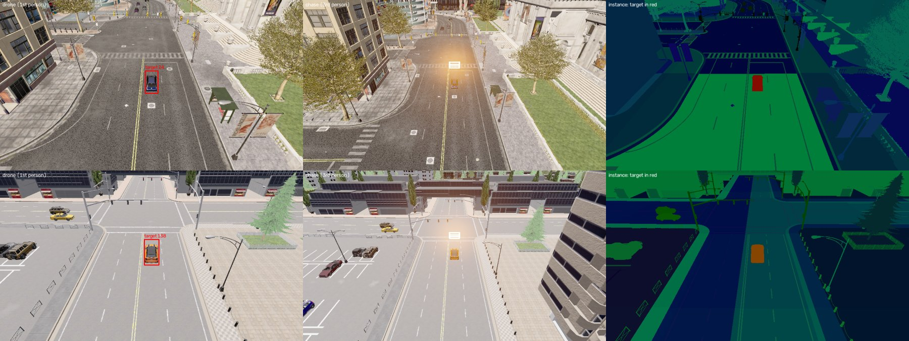

# Phase 2 환경 준비: CARLA 차량 추종

이 문서는 Phase 2(자연어로 지정한 차량을 찾아 락온하고 따라가는 드론)의 실행 환경을 기록한다. 현재 상태는 다음과 같다.

| 항목 | 상태 |
|---|---|
| Python 환경 (uv) | 완료 (2026-11-12) |
| CARLA 버전 선택 | 0.9.16으로 정함 (3절) |
| CARLA simulator 설치와 실행 확인 | 완료 (2026-11-12, 4절) |
| 결론: 12GB GPU에서 simulator와 인식 모델을 함께 돌릴 수 있는가 | 가능. 인식 모델 예산은 약 6GB (5절) |

Phase 1의 환경(WSL의 inference env, `assets/projectairsim-env`)은 바꾸지 않았다. Phase 1 환경은 [setup](setup.md)에 기록되어 있다.

## 1. 구성

Phase 2는 모두 Windows에서 실행한다. CARLA simulator, Python client, 관찰 화면, 이후의 인식 모델이 한 곳에서 돈다.

- CARLA 0.9.16은 Windows 패키지와 Windows용 Python wheel을 함께 제공한다.
- client와 simulator가 같은 PC의 `localhost`로 통신한다. Phase 1처럼 매번 WSL NAT의 host 주소를 확인할 필요가 없다.
- GPU(RTX 5070 12GB)는 하나이므로 simulator와 인식 모델이 같은 메모리를 나눠 쓴다. 그래서 4절에서 simulator가 차지하는 메모리를 먼저 잰다.

WSL은 지금 쓰지 않는다. lock 파일은 Linux x64도 함께 풀어 두었으므로, 나중에 uv 0.13 이상을 WSL에 설치하면 같은 lock으로 환경을 만들 수 있다. 다만 이것은 아직 확인하지 않았다(현재 WSL의 uv는 0.12.23).

## 2. Python 환경 (uv)

### 2.1 버전

| 항목 | 값 |
|---|---|
| uv | 0.13.7 (`%USERPROFILE%\.local\bin\uv.exe`) |
| Python | CPython 3.12.16 (uv가 관리) |
| carla | 0.9.16 |
| numpy | 2.5.4 |
| opencv-python | 5.0.0.93 |

- 의존성은 [`pyproject.toml`](../pyproject.toml)에 적고, 정확한 버전과 hash는 [`uv.lock`](../uv.lock)에 고정했다. Python 버전은 `.python-version`(3.12)에 있다.
- Python을 3.12로 정한 이유: carla 0.9.16의 wheel은 CPython 3.10–3.12만 있다. 그중 가장 최신을 골랐다.
- 대상 플랫폼은 Windows x64와 Linux x64 두 가지로 제한했다(`tool.uv.environments`). carla wheel이 이 두 플랫폼에만 있다.
- `carla` client 버전은 simulator 버전과 같아야 하므로 0.9.16으로 고정했다.

### 2.2 만들기와 확인

저장소 루트에서 실행한다.

```powershell
uv sync
uv run python -c "import carla; print(carla.Client('localhost', 2000).get_client_version())"
```

두 번째 명령은 `0.9.16`을 출력한다. 이 명령은 simulator에 연결하지 않고 client 라이브러리만 확인한다. 환경은 저장소의 `.venv/`에 만들어지며 Git에는 올리지 않는다.

### 2.3 Python 설치 위치

uv가 받은 Python은 `%USERPROFILE%\.local\share\uv\python`에 두었다. uv의 기본 위치(`%APPDATA%\uv\python`)를 쓰지 않은 이유는 다음과 같다.

- Claude 데스크톱 앱 안에서 실행한 명령이 AppData에 쓰면, 그 파일은 실제 AppData가 아니라 앱 전용 폴더에 저장된다.
- 그러면 `.venv`가 가리키는 Python이 앱 밖의 PowerShell에서는 보이지 않고, `.venv`가 깨진다.
- 위 위치는 AppData 밖이므로 앱 안과 밖에서 같은 파일이 보인다.

앱 밖의 PowerShell에서 `.venv`를 새로 만들 때는 그대로 `uv sync`를 실행하면 된다. 앱 안에서 다시 만들 때는 먼저 위치를 지정한다.

```powershell
$env:UV_PYTHON_INSTALL_DIR = "$env:USERPROFILE\.local\share\uv\python"
uv sync
```

## 3. CARLA 버전 선택

2026-11-12 기준으로 공개된 최신 release는 두 가지다.

| 항목 | 0.9.16 | 0.10.0 |
|---|---|---|
| 엔진 | Unreal Engine 4 | Unreal Engine 5 |
| 공개일 | 2025-09-16 | 2024-12-19 |
| Windows 패키지 | `CARLA_0.9.16.zip` 7.81GB, 추가 맵 `AdditionalMaps_0.9.16.zip` 7.25GB | `Carla-0.10.0-Win64-Shipping.zip` 10.20GB |
| PyPI client | `carla` 0.9.16: Windows와 Linux, CPython 3.10–3.12 | `carla-ue5-api` 0.10.0: Linux만, CPython 3.11–3.12 |

0.9.16을 고른 이유는 다음과 같다.

1. **GPU 메모리.** 12GB를 인식 모델과 나눠 써야 한다. UE4 기반이 UE5 기반보다 가볍다.
2. **Windows client.** Windows용 wheel이 PyPI에 있어 uv로 바로 설치된다. 0.10.0은 PyPI에 Linux wheel만 있다.
3. **자동 정답.** 0.9.16 changelog에 bounding box의 `actor_id`와, instance segmentation에서 actor ID를 쓰는 기능이 들어 있다. 화면 속 어느 차가 지정한 차인지 simulator가 직접 알려 주므로, 추적 정답과 채점을 자동으로 만들 수 있다.

## 4. 설치 확인

확인은 [`scripts/carla_check.py`](../scripts/carla_check.py) 하나로 한다. 이 스크립트는 simulator를 켜고, 차량을 자동 주행시키고, 드론 카메라로 한 대를 따라가며 FPS와 GPU 메모리를 잰 뒤 simulator를 끈다.

```powershell
uv run python scripts/carla_check.py --quality Low Epic            # 기본 맵 Town10HD_Opt
uv run python scripts/carla_check.py --quality Low --map Town05_Opt
uv run python scripts/carla_check.py --quality Low --offscreen     # simulator 창 없이
```

결과(요약 JSON과 화면)는 `outputs/phase2/carla_check/<시각>/`에 남는다. 공통 조건은 다음과 같다.

- 동기 모드, 20Hz(tick당 0.05초)
- 차량 40대, Traffic Manager 자동 주행, seed 7
- 카메라 960×540, FOV 90°
- warm-up 40 tick 뒤 400 tick을 잼

### 4.1 설치

| 항목 | 값 |
|---|---|
| 받은 파일 | `CARLA_0.9.16.zip` 7,812,252,810 bytes (서버가 알린 크기와 같음), `assets/downloads/carla-0.9.16/` |
| 푼 위치 | `assets/carla-0.9.16/` (19.4GB, 32,841개 파일) |
| 맵 | Town01, Town02, Town03, Town04, Town05, Town10HD와 각각의 `_Opt`(층으로 나뉜 판) |
| 차량 blueprint | 41개: car 23, van 4, truck 4, motorcycle 4, bicycle 3, bus 1, 분류 없음 2 |
| 드론 blueprint | 없음 (`drone`, `uav`로 찾음) |

패키지 안의 Python wheel(`PythonAPI/carla/dist/`)과 PyPI의 wheel은 hash가 다르다. 풀어서 비교하면 native library(`libcarla.cp312-win_amd64.pyd`)만 다르고 크기는 같다. 같은 source를 따로 build한 것으로 보인다. PyPI wheel로 아래 확인이 모두 통과했으므로 PyPI wheel을 그대로 쓴다.

### 4.2 실행

- **첫 실행 실패.** 첫 실행에서는 simulator가 10분 안에 연결을 받지 않았다. 이때 스크립트는 simulator에 자기 콘솔 출력을 넘겨준 상태였다. 출력을 떼어 낸(`DEVNULL`) 뒤로는 매번 약 3초 안에 연결됐다. 첫 실행 때의 shader 준비가 원인이었을 수도 있어서, 원인을 하나로 확정하지는 않았다.
- **창 없이 실행.** `-RenderOffScreen`으로 창 없이 실행해도 멈추지 않았다.
- **로그 위치.** Claude 앱 안에서 실행하면 simulator의 설정과 로그(`%LOCALAPPDATA%\CarlaUE4`)도 앱 전용 폴더에 저장된다(2.3절과 같은 현상).

### 4.3 차량과 드론 시점

- **드론 카메라.** 드론은 비행 물리가 없는 카메라다. 매 tick 목표 차량의 20m 뒤, 15m 위로 옮기고 차량을 바라보게 한다.
- **3인칭 카메라.** 드론 카메라에서 12m 뒤, 6m 위에 둔다. 드론과 목표 차량이 함께 보인다.
- **드론 몸체.** 드론 blueprint가 없으므로 3인칭 화면에는 debug 상자로 표시했다.
- **debug 상자 주의점.** debug 도형은 모든 RGB 카메라에 찍힌다. 처음에는 상자를 드론 카메라 위치에 그려서, 1인칭 화면이 상자 안쪽에 가려 노랗게 바랬다. 그래서 상자를 카메라 1m 뒤에 그린다. instance segmentation 카메라에는 debug 도형이 찍히지 않았다.



*그림 1. 위: Town10HD_Opt, 아래: Town05_Opt (둘 다 Low).*

- 왼쪽: 드론 1인칭. 빨간 상자는 simulator가 알려 준 목표 차량의 3D 상자를 화면에 투영한 것이다.
- 가운데: 3인칭. 밝은 상자가 드론 위치다.
- 오른쪽: instance segmentation. 목표 차량의 pixel을 빨갛게 칠했다.
- 아래 장면에서는 주황색 목표 차량 근처에 비슷한 노란 택시가 있다.

### 4.4 자동 정답

매 tick 두 가지 정답을 simulator에서 바로 얻는다.

1. **화면 위치.** 목표 차량의 3D bounding box 8개 꼭짓점을 드론 카메라에 투영해 화면 상자를 얻는다.
2. **보이는 pixel.** instance segmentation 영상에서 목표 차량의 pixel을 센다. pixel마다 actor ID가 G + 256·B로 들어 있다(B + 256·G로 읽으면 0개). 목표 차량의 pixel은 Town10HD 1,654개, Town03 1,758개, Town05 2,369개였다.

두 정답의 위치는 그림 1에서 서로 맞는다. 보이는 pixel 수는 가려짐을 직접 잴 수 있게 해 주므로, "가려져도 같은 차를 놓치지 않는가"를 채점하는 데 쓸 수 있다.

### 4.5 속도와 GPU 메모리

GPU 메모리는 `nvidia-smi`의 전체 사용량이다.

- Windows에서는 process별 사용량이 나오지 않는다. 그래서 simulator를 켜기 전 값("시작 전")을 함께 적는다. 이 값은 다른 프로그램이 쓰던 양이다.
- FPS는 동기 모드에서 1초에 진행한 tick 수다. 20Hz이므로 FPS 60은 실제 시간의 3배 속도다.

**표 1. 품질과 창 (Town10HD_Opt)**

| 품질 | 창 | 시작 전 | 대기 중 | 최대 | FPS (카메라 2대) | FPS (+instance) |
|---|---|---|---|---|---|---|
| Low | 있음 | 1,484MiB | 8,152MiB | 8,479MiB | 70.7 | 61.4 |
| Epic | 있음 | 1,475MiB | 8,890MiB | 9,362MiB | 59.3 | 53.3 |
| Low | 없음 | 1,473MiB | 8,365MiB | 8,623MiB | 70.9 | 62.6 |

CARLA는 texture streaming pool을 4,000MB로 고정해 둔다(`CarlaUE4/Config/DefaultEngine.ini`). 이 값을 명령줄(`-ini:Engine:[...]:r.Streaming.PoolSize=1000`)로 바꿔 보았지만 메모리는 달라지지 않았다(Low, 창 없음: 최대 8,623MiB로 같음). 설정이 적용되지 않은 것인지, pool이 원인이 아닌 것인지는 확인하지 않았고, 이 옵션은 스크립트에서 뺐다.

**표 2. 맵 (Low, 창 있음)**

| 맵 | 시작 전 | 대기 중 | 최대 | FPS (카메라 2대) | FPS (+instance) |
|---|---|---|---|---|---|
| Town10HD_Opt | 1,484MiB | 8,152MiB | 8,479MiB | 70.7 | 61.4 |
| Town03_Opt | 1,109MiB | 3,791MiB | 3,839MiB | 67.0 | 62.7 |
| Town05_Opt | 1,104MiB | 3,606MiB | 3,642MiB | 73.6 | 70.1 |

맵에 따라 메모리 차이가 크다. Town03과 Town05에서 simulator가 쓰는 양은 약 2.5–2.7GB, Town10HD는 약 6.7GB다.

**표 3. 다른 GPU 작업과 함께 (Low, 창 있음, Town10HD_Opt)**

인식 모델 대신 WSL의 PyTorch(2.7.1+cu128)로 GPU 메모리를 잡고 fp16 행렬곱(4096×4096)을 쉬지 않고 돌렸다. 그 상태에서 같은 확인을 실행했다.

| 잡아 둔 메모리 | 시작 전 | 대기 중 | 최대 | FPS (카메라 2대) | FPS (+instance) | 행렬곱 (혼자 → 함께) |
|---|---|---|---|---|---|---|
| 3.69GiB | 5,484MiB | 10,870MiB | 11,023MiB | 58.2 | 52.4 | 465/s → 124–307/s |
| 5.69GiB | 7,200MiB | 10,539MiB | 11,100MiB | 58.0 | 53.0 | 465/s → 91–403/s |

- **메모리.** 5.69GiB를 잡아 두면 simulator는 Town10HD에서도 약 3.3GB만 쓰고 정상으로 돈다. 표 1의 약 6.7GB는 꼭 필요한 양이 아니라, 비어 있는 메모리를 쓴 양이다. 오류나 멈춤은 없었다.
- **계산 경쟁.** 둘이 동시에 쉬지 않고 돌면 서로 느려진다. simulator FPS는 71에서 58로 줄었다. 행렬곱은 simulator가 도는 동안 혼자일 때의 20–87%로 떨어졌다가, simulator가 끝나자 원래 속도로 돌아왔다.

## 5. 결론과 3단계에 넘길 것

**질문:** 12GB GPU에서 simulator와 인식 모델을 함께 돌릴 수 있는가. **가능하다.**

1. CARLA 0.9.16과 uv 환경의 client가 이 PC에서 동작한다. 차량 자동 주행, 드론 1인칭과 3인칭 영상, 목표 차량의 자동 정답(화면 상자, 보이는 pixel)을 모두 얻었다.
2. 속도는 충분하다. 960×540 카메라 2–3대로 52–74 FPS이고, 20Hz 기준 실제 시간의 2.6–3.7배다.
3. 메모리는 맵에 달려 있다.
   - Town03과 Town05에서는 simulator가 약 2.6GB만 쓰므로, 인식 모델에 약 8GB가 남는다.
   - Town10HD도 모델이 6GB를 잡은 상태에서 돌았다.
   - 인식 모델의 예산은 약 6GB로 잡는다.
4. 실제 반복에서는 동기 모드로 "simulator 1 tick, 모델 1회 추론"을 번갈아 한다. 그래서 표 3의 계산 경쟁(둘이 동시에 최대로 도는 경우)보다 덜 겹친다. 실제 비용은 3단계에서 고른 모델로 다시 잰다.

3단계(첫 데모 계획)에 넘길 결정은 다음과 같다.

- 개발은 Town03/Town05(Low), 보여 주는 화면은 Town10HD로 할지
- 인식 모델 후보를 메모리 약 6GB 안에서 고르기
- 3인칭 화면의 드론 몸체를 debug 상자로 둘지, mesh를 넣을지
- 추가 맵(`AdditionalMaps_0.9.16.zip`, 7.25GB)이 필요한지

## 참고

- CARLA releases: https://github.com/carla-simulator/carla/releases
- PyPI `carla`: https://pypi.org/project/carla/
- PyPI `carla-ue5-api`: https://pypi.org/project/carla-ue5-api/
- uv: https://docs.astral.sh/uv/
